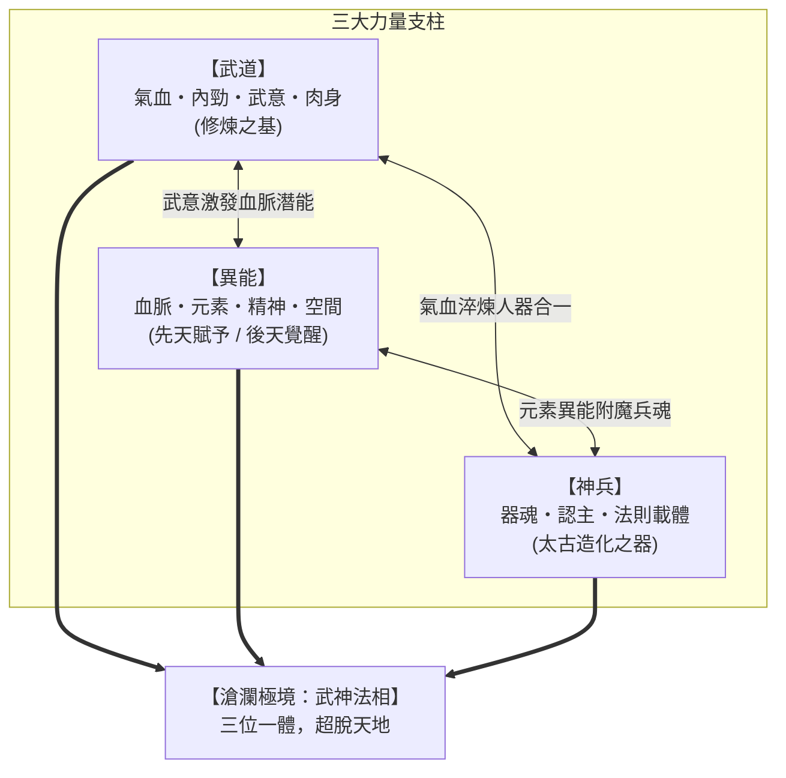
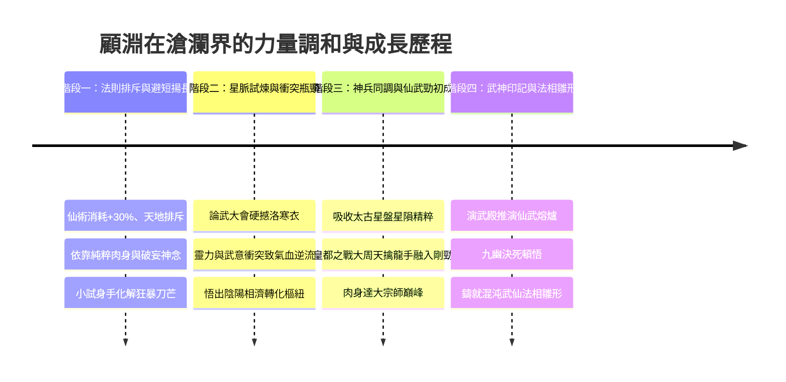
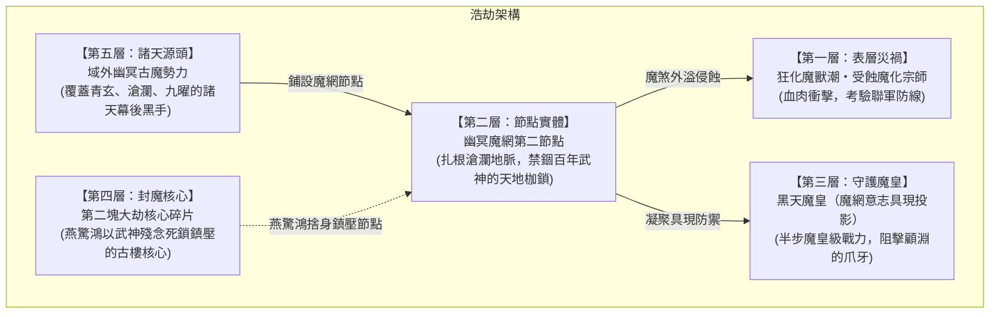

# 《萬界風月樓》第二卷力量體系｜滄瀾武道與仙武融合機制

> **文檔定位**：第二卷《諸天第一步・滄瀾風雲》之修煉體系、境界梯次、顧淵力量適應歷程、九幽魔劫層次及萬界樓【萬法演武殿】核心設施設定。  
> **體系綱領**：武道、異能、神兵三大體系交融；顧淵混沌星脈開闢「仙武同修」之道；拒絕力量突兀暴漲，嚴格遵循實戰試錯與漸進領悟。

---

## 一、滄瀾界三大力量體系剖析

滄瀾界的超凡力量由三大支柱構成，三者非孤立排斥，而是能夠深度融合、相輔相成：

### 1. 武道體系（後天勤修之基）
* **核心修煉**：以人身為天地，運轉呼吸吐納法、熬煉筋骨髓血、貫通全身經脈穴竅。
* **武道真意**：修行者將個人意志、生死經歷與自然天象融為一體，凝聚出專屬的「武道真意」（如洛寒衣的斷星劍意、霸刀門的狂雷刀意）。真意有形無質，能直接壓制對手心魂氣血。

### 2. 異能體系（先天天賦與血脈覺醒）
* **血脈傳承**：太古神魔或天地元氣洗禮遺留的血脈印記，以皇族、古老世家為主。
* **異能類型**：
  * **元素類**：紫霄真龍雷、九幽玄冥冰、焚天烈炎。
  * **肉身強化類**：天生神力、金剛琉璃骨、先天劍骨（洛寒衣所具備）。
  * **感知與精神類**：心靈念動、破虛神瞳、殺意感知。
* **局限**：若無強悍武道體魄承載，高階異能會反噬肉身經脈导致崩潰。

### 3. 神兵體系（天地法則載體）
* **器魂之說**：滄瀾界頂尖神兵皆以萬年玄鐵、地火精金與遠古凶獸神魂熔鑄，誕生了自主的「器魂」。
* **認主機制**：神兵不可強奪，唯有契合神兵性情與武道真意之天驕，方能引發器魂共鳴，實現「人器合一」。
* **法則印記**：遠古神兵往往封存著上古武神或遠古大劫的一絲法則殘片（如洛寒衣的斷星古劍）。

---

## 二、滄瀾界八大武道境界階梯

滄瀾界的實力劃分不與青玄界一一對應，各自遵循本土天地法則運轉：

| 境界名稱 | 修煉核心與威能表現 | 社會地位與人數規模 | 對戰青玄仙道之參照 |
| :--- | :--- | :--- | :--- |
| **一、鍛體境** | 煉皮肉、易筋骨、換骨髓。力達千斤，奔跑如豹，抗擊尋常刀劍。 | 武者基石，軍中步卒與民間護院（百萬級）。 | 相當於練氣初期（一至三層肉身）。 |
| **二、通脈境** | 體內內勁自生，衝開奇經八脈與十二正經。飛簷走壁，拳出破木碎石。 | 鏢局鏢頭、宗門外門弟子（數十萬級）。 | 相當於練氣中後期（四至七層）。 |
| **三、先天境** | 內勁化為真氣，真氣外放達丈外，凝結護體罡氣，凌空踏步三息。 | 名門內門精英、各城偏將（萬人級）。 | 相當於練氣大圓滿～半步築基。 |
| **四、宗師境** | 貫通天地之橋，凝聚專屬**【武道真意】**，百步之內飛花摘葉皆可殺人，開宗立派之資。 | 江湖一流名宿、三品宗門掌門（千人級）。 | 相當於修仙界築基初期～中期。 |
| **五、大宗師境** | 真意凝練為**【武道領域】**（方圓十丈～百丈內掌控元氣），身融天地，凌空踏虛，一人可敵千軍。 | 天驕榜前列、名門巨擘長老、大乾神捕（數百人級）。**洛寒衣（半步武王）處於此境巔峰**。 | 相當於修仙界築基大圓滿～假丹境。 |
| **六、武王境** | 破碎山河，身懷「皇極真罡」，武意化形外顯，調動百里天地元氣，壽元延至三百載。 | 天下頂尖巨擘（如天劍山主、武極殿輪值長老）（全界僅數十人）。 | 相當於修仙界金丹期（初至後期）。 |
| **七、武皇境** | 鑄就「皇極武域」，自身領域內自成小天地法則，觸摸虛空裂縫，壽元五百載。 | 當世傳奇神話，武極殿隱世殿主、皇室太祖級供奉（全界不足五人）。 | 相當於修仙界金丹巔峰～半步元嬰。 |
| **八、武神境** | 武道通神，肉身不死，法相頂天立地，以極致武意撕裂虛空超脫本界（三千年僅燕驚鴻一人，近百年空懸）。 | 傳說存在，神話圖騰（目前無當世活人）。 | 相當於修仙界元嬰尊者～半步化神（戰鬥破壞力更偏向純粹毀滅）。 |

---

## 三、顧淵仙武力量調和的四個漸進階段（成長弧光）

為杜絕「初期受排斥、後期突兀形成千丈法相」的割裂感，顧淵在滄瀾界的力量演化必須經歷明確的**實戰碰撞、力量衝突瓶頸與漸進頓悟**：

1. **第一階段：法則排斥與避短揚長（ch017～ch021）**：
   * **狀態**：青玄仙法受滄瀾稠密氣血排斥，法術消耗增加三成且難以引動天地共鳴。
   * **應對與探索**：顧淵從容隱藏仙術，改以體內混沌星脈運轉肉身純力，輔以宿慧帶來的「破妄真視」洞悉對手真意破綻。此階段顧淵僅以巧破千斤、折扇化罡，初步嘗試以星脈吞吐少量滄瀾武意。
2. **第二階段：星脈試煉與衝突瓶頸（ch022～ch027）**：
   * **實戰碰撞**：在天下論武大會與洛寒衣「斷星劍域」正面硬碰時，顧淵嘗試將狂暴的斷星劍氣大量引入星脈氣海。
   * **瓶頸與微創**：由於仙道靈力的空靈生發與滄瀾武意的剛烈凝滯屬性相悖，顧淵一度遭遇氣血翻湧、右臂經脈刺痛微創的瓶頸。
   * **領悟轉折**：顧淵藉由《太上玄奼真經》水火既濟之理，參悟出以神魂金丹為核心軸心、以混沌星脈為轉化緩衝的「仙武相生周天」，成功消化吸收斷星劍意。
3. **第三階段：神兵同調與仙武勁初成（ch028～ch039）**：
   * **器魂洗禮**：在百兵神宮太古鑄兵祭壇，顧淵汲取遠古星隕天鐵的兵道星火淬煉肉身，肉身防禦與力量直達大宗師巔峰。
   * **皇城實戰驗證**：在承天京紫宸殿大戰中，顧淵施展【大周天擒龍手】，首次將滄瀾剛烈氣血與青玄仙道擒拿術融合為**【混沌仙武勁】**，一擊捏碎三大魔煞長老的萬魂煞陣。
4. **第四階段：武神印記與法相雛形（ch040～ch052）**：
   * **演武殿推演與頓悟**：在九幽地宮中，顧淵融合燕驚鴻三千年殉道武神印記，神魂進入萬界樓【萬法演武殿】推演空間，經歷數萬次虛擬對戰試煉，最終打破滄瀾百年天地枷鎖，在生死決戰中凝結出**【混沌武仙法相（雛形）】**。

---

## 四、九幽魔劫的五大層次結構剖析

為避免將最終決戰簡化為「打死一個大魔王」，必須嚴格釐清九幽魔劫的空間、實體與幕後層次：

1. **第一層（表層災禍）**：被九幽魔煞污染的狂暴獸潮與受蝕狂化的江湖宗師。這是世俗武林聯軍面對的直接軍事威脅。
2. **第二層（大劫實體：魔網第二節點）**：扎根於滄瀾東南萬里地脈之下的巨大黑色神經網絡。它既是抽取滄瀾界氣血本源的毒瘤，也是導致滄瀾界「百年無人成武神」的天地枷鎖！
3. **第三層（節點守護者：黑天魔皇）**：並非獨立有血有肉的生命，而是幽冥魔網自我防衛意志凝聚成的**魔神投影**。擁有三頭六臂與滔天煞氣，代表當前世界所能承載的魔道戰力極限。
4. **第四層（封魔陣眼：第二碎片）**：萬界樓在大劫中遺失的核心碎片。三千年前被燕驚鴻以武神法相強行鎖入胸膛，作為鎮壓魔網節點的核心重錘。
5. **第五層（諸天幕後黑手）**：九幽禁域之變僅是諸天大劫的一處分流。顧淵在第二卷末斬滅的是「黑天魔皇投影」並熔斷「第二魔網節點」，取得碎片，真正驅動魔網的幕後黑手依然沉睡於更高維度的諸天深處（如九曜神域、幽冥界）。

---

## 五、萬界樓核心樞紐解鎖：【萬法演武殿】

取得第二塊大劫核心碎片後，萬界樓修復度達到 **0.25%（25/10000）**，正式解鎖第三核心設施——**【萬法演武殿】**。

### 1. 演武殿四大核心功能
1. **跨世界功法推演與破綻解析**：
   * 顧淵將滄瀾武道輸入演武殿，演武殿利用萬界樓底層法則進行解析，提煉核心發力法門，剔除功法缺陷。
2. **力量體系虛擬模擬對戰**：
   * 殿內可投影歷代強者印記（如燕驚鴻殘影），讓顧淵在神識世界中無限制演練實戰，驗證應敵策略。
3. **仙武融合試煉熔爐**：
   * 解決異界力量衝突的專屬空間。在殿內推演靈力與氣血的最佳融合配比，確保現實運功時不致走火入魔。
4. **戰鬥印記封存與道侶共享**：
   * 將擊敗或共鳴的強者印記烙印於石柱，供未來萬界樓道侶共同參悟。

### 2. 嚴格限制與寫作底線
* **演武殿不是無條件複製機**：只能推演、模擬與驗證，無法直接灌注境界修為，突破仍需自身實戰感悟。
* **推演耗費本源**：演練高階跨界功法需消耗精氣神與萬界樓基礎本源，不可隨心所欲無限運轉。
