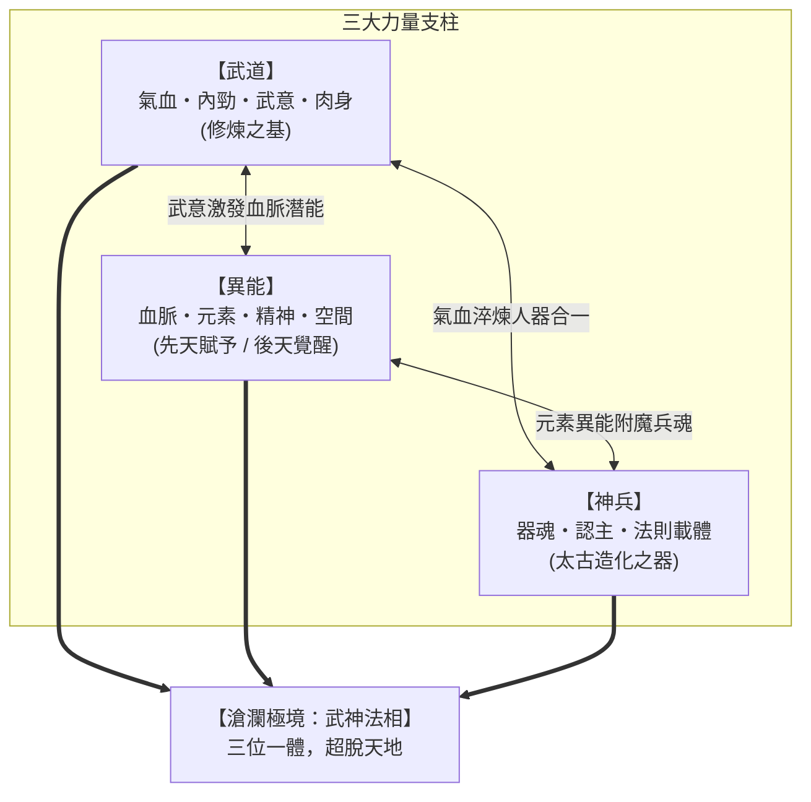
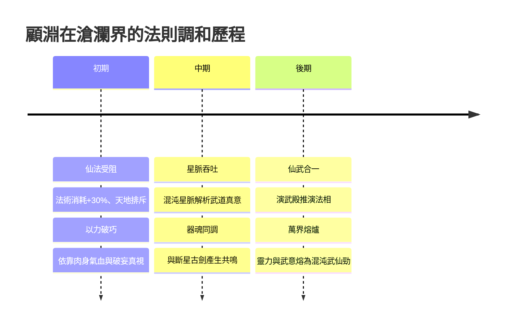
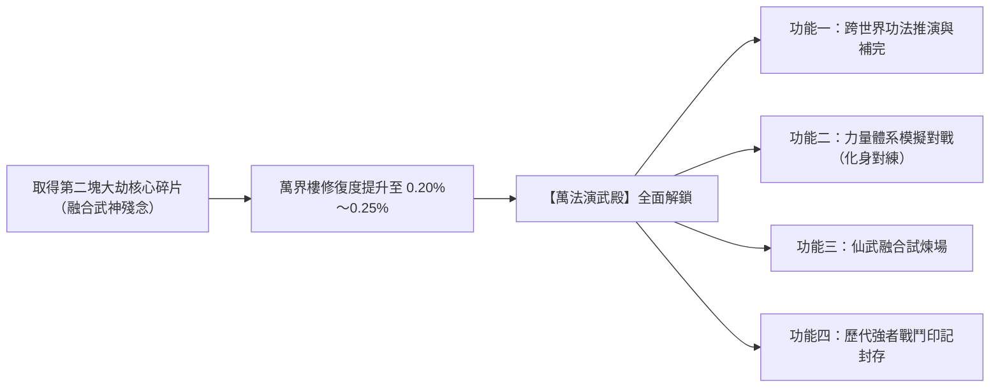

# 《萬界風月樓》第二卷力量體系｜滄瀾武道與仙武融合機制

> **文檔定位**：第二卷《諸天第一步・滄瀾風雲》之修煉體系、境界梯次、顧淵力量適應、仙武融合規則及萬界樓【萬法演武殿】核心設施設定。  
> **體系綱領**：武道、異能、神兵三大體系交融；顧淵混沌星脈開闢「仙武同修」之道。

---

## 一、滄瀾界三大力量體系剖析

滄瀾界的超凡力量由三大支柱構成，三者非孤立排斥，而是能夠深度融合、相輔相成：

### 1. 武道體系（後天勤修之基）
* **核心修煉**：以人身為天地，運轉呼吸吐納法、熬煉筋骨髓血、貫通全身經脈穴竅。
* **武道真意**：修行者將個人意志、生死經歷與自然天象融為一體，凝聚出專屬的「武道真意」（如洛寒衣的斷星劍意、霸刀門的狂雷刀意）。真意有形無質，能直接壓制對手心魂氣血。

### 2. 異能體系（先天天賦與血脈覺醒）
* **血脈傳承**：太古神魔或天地元氣洗禮遺留的血脈印記，以皇族、古老世家為主。
* **異能類型**：
  * **元素類**：紫霄真龍雷、九幽玄冥冰、焚天烈炎。
  * **肉身強化類**：天生神力、金剛琉璃骨、先天劍骨（洛寒衣所具備）。
  * **感知與精神類**：心靈念動、破虛神瞳、殺意感知。
* **局限**：若無強悍武道體魄承載，高階異能會反噬肉身經脈导致崩潰。

### 3. 神兵體系（天地法則載體）
* **器魂之說**：滄瀾界頂尖神兵皆以萬年玄鐵、地火精金與遠古凶獸神魂熔鑄，誕生了自主的「器魂」。
* **認主機制**：神兵不可強奪，唯有契合神兵性情與武道真意之天驕，方能引發器魂共鳴，實現「人器合一」。
* **法則印記**：遠古神兵往往封存著上古武神或遠古大劫的一絲法則殘片（如洛寒衣的斷星古劍）。

---

## 二、滄瀾界八大武道境界階梯

滄瀾界的實力劃分不與青玄界一一對應，各自遵循本土天地法則運轉：

| 境界名稱 | 修煉核心與威能表現 | 社會地位與人數規模 | 對戰青玄仙道之參照 |
| :--- | :--- | :--- | :--- |
| **一、鍛體境** | 煉皮肉、易筋骨、換骨髓。力達千斤，奔跑如豹，抗擊尋常刀劍。 | 武者基石，軍中步卒與民間護院（百萬級）。 | 相當於練氣初期（一至三層肉身）。 |
| **二、通脈境** | 體內內勁自生，衝開奇經八脈與十二正經。飛簷走壁，拳出破木碎石。 | 鏢局鏢頭、宗門外門弟子（數十萬級）。 | 相當於練氣中後期（四至七層）。 |
| **三、先天境** | 內勁化為真氣，真氣外放達丈外，凝結護體罡氣，凌空踏步三息。 | 名門內門精英、各城偏將（萬人級）。 | 相當於練氣大圓滿～半步築基。 |
| **四、宗師境** | 貫通天地之橋，凝聚專屬**【武道真意】**，百步之內飛花摘葉皆可殺人，開宗立派之資。 | 江湖一流名宿、三品宗門掌門（千人級）。 | 相當於修仙界築基初期～中期。 |
| **五、大宗師境** | 真意凝練為**【武道領域】**（方圓十丈～百丈內掌控元氣），身融天地，凌空踏虛，一人可敵千軍。 | 天驕榜前列、名門巨擘長老、大乾神捕（數百人級）。**洛寒衣（半步武王）處於此境巔峰**。 | 相當於修仙界築基大圓滿～假丹境。 |
| **六、武王境** | 破碎山河，身懷「皇極真罡」，武意化形外顯，調動百里天地元氣，壽元延至三百載。 | 天下頂尖巨擘（如天劍山主、武極殿輪值長老）（全界僅數十人）。 | 相當於修仙界金丹期（初至後期）。 |
| **七、武皇境** | 鑄就「皇極武域」，自身領域內自成小天地法則，觸摸虛空裂縫，壽元五百載。 | 當世傳奇神話，武極殿隱世殿主、皇室太祖級供奉（全界不足五人）。 | 相當於修仙界金丹巔峰～半步元嬰。 |
| **八、武神境** | 武道通神，肉身不死，法相頂天立地，以極致武意撕裂虛空超脫本界（三千年僅燕驚鴻一人，近百年空懸）。 | 傳說存在，神話圖騰（目前無當世活人）。 | 相當於修仙界元嬰尊者～半步化神（戰鬥破壞力更偏向純粹毀滅）。 |

---

## 三、顧淵力量適應與仙武融合機制

### 1. 顧淵當前實力基底（金丹初期・底蘊超越尋常元嬰）
* **真靈與神魂**：歷經萬古千劫宿慧，神魂層次已達元嬰巔峰乃至化神門檻，掌握萬界樓主特權（破妄真視、神識威壓）。
* **肉身與法力**：在青玄界經由沈玄清元嬰本源反哺與《太上玄奼真經》同化，體內開闢了獨一無二的**【萬界混沌星脈】**，體魄韌度已不遜於滄瀾界一般大宗師。

### 2. 法則排斥與調和的三個階段

* **第一階段（排斥期・初入天武城）**：
  * 青玄界的靈力運轉受到滄瀾界稠密氣血與地煞磁場的排斥。大範圍法術如引雷術、飛劍術消耗增加三成，威能被壓抑。
  * **顧淵應對對策**：從容隱藏仙法，僅以萬界混沌星脈運轉肉身純力，輔以破妄真視洞悉對手真意破綻，以巧破千斤、談笑退敵。
* **第二階段（同化期・天下論武大會）**：
  * 與洛寒衣、各方天驕擂台交鋒，親身體驗「斷星劍意」、「狂雷刀意」。
  * 混沌星脈主動汲取滄瀾武者激盪的戰鬥意志，將武意轉化為星脈淬煉之火，肉身氣血與體內金丹初步形成雙環共鳴。
* **第三階段（融合期・九幽魔變終局）**：
  * 顧淵成功將青玄仙道之「神魂周天」與滄瀾武道之「氣血領域」融合，創出獨有的**【混沌武仙法相】**。
  * 拳意之中蘊含仙家大道生滅，劍光之中兼具武道極致剛烈與仙家空靈，橫壓當代武王，傲視群雄。

---

## 四、萬界樓核心樞紐解鎖：【萬法演武殿】

第二卷的核心系統獎勵，不再是單純的能量靈石或珍寶調配，而是正式解鎖萬界樓第三項具有戰略意義的核心樞紐——**【萬法演武殿】**。

### 1. 演武殿四大核心功能
1. **跨世界功法推演與破綻解析**：
   * 顧淵將滄瀾界的武技真意（如天劍山劍訣、大乾龍拳）輸入演武殿，演武殿利用萬界樓的底層法則進行解析，提煉出核心發力法門，剔除功法缺陷與隱患。
2. **力量體系虛擬模擬對戰**：
   * 演武殿內部可生成虛擬武神、武王投影，讓顧淵在神識世界中無限制演練實戰，驗證各種應敵策略，累積實戰直覺。
3. **仙武融合試煉熔爐**：
   * 解決異界力量衝突的專屬空間。在殿內推演「青玄靈力＋滄瀾氣血＋神兵器魂」的融合配比，確保顧淵在現實世界運功時萬無一失，不至走火入魔。
4. **戰鬥印記封存與傳承**：
   * 可將擊敗或共鳴的強者戰鬥意志（如燕驚鴻的武神印記）烙印於演武殿石柱之上，供顧淵及未來萬界樓道侶共同參悟。

### 2. 嚴格限制與寫作底線（遵循 writing_guide.md 規則五）
* **演武殿不是無條件複製機**：演武殿只能「推演、模擬、驗證」，無法直接把別人的境界修為灌注給顧淵，顧淵每一次突破仍需自身真刀真槍的實戰感悟。
* **推演需耗費時間與本源**：演練越複雜的跨界功法，需要顧淵消耗自身精氣神與萬界樓基礎本源，不可隨心所欲無限運轉。
* **維持挑戰性**：在演武殿模擬獲勝，不代表在現實中能輕易打敗擁有自主變化的真人強者。
