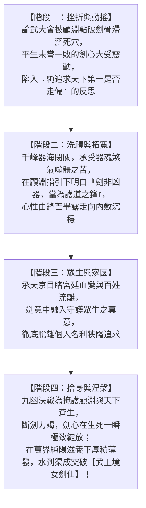

# 《萬界風月樓》第二卷人物設定｜滄瀾群像與雙線自主成長

> **文檔定位**：第二卷《諸天第一步・滄瀾風雲》之核心角色設定、人物弧光、情感心理推進機制與陣營關係圖。  
> **核心設計原則**：遵循 [writing_guide.md](file:///home/wade/src/github/novel/sex/docs/arcs/writing_guide.md)「依女主個性選詞、情感自主性、拒絕英雄救美」原則，貫徹 [world_bible.md](file:///home/wade/src/github/novel/sex/docs/world_bible.md) R24 諸天自主演化原則。

---

## 一、人物關係與陣營總覽圖

```mermaid
flowchart TD
    subgraph 滄瀾界・探索與博弈
        GY["顧淵<br>(萬界樓主・外來探索者・漸進開闢仙武合一)"]
        LHY["洛寒衣<br>(第二卷核心女主・天劍山首徒・斷星古劍<br>經歷劍道挫折與自我突破，終成武王女劍仙)"]
        JMY["姬明月<br>(大乾長公主・監國帝女・紫霄真龍血脈<br>精於帝王權謀，面對朝堂暗潮維持獨立盟友)"]
        JWC["劍無塵<br>(天劍山主・天下第一劍客)"]
        WJD["楚烈天<br>(武極殿大長老・剛正仲裁者)"]
        DBG["段百狂<br>(百兵神宮宮主・鑄兵神匠)"]
        YJH["燕驚鴻<br>(遠古武神殘念・三千年前殉道者)"]
    end

    subgraph 青玄界・自主發展雙線
        LQX["柳清虛<br>(青雲新任掌門・獨立渡九品金丹天劫<br>頒行青雲新令，重組宗門，成為實權宗師)"]
        SXQ["沈玄清<br>(太上仙尊・半步化神<br>探尋青玄古仙遺跡，掌握大劫核心情報)"]
        MRY["慕容玥<br>(東華萬界商盟盟主・築基後期<br>反擊仙商圍剿，建立跨域情報網，追查異界走私)"]
    end

    GY <-->|主動邀戰 ──> 切磋試錯 ──> 理念碰撞 ──> 生死相依| LHY
    GY <-->|平等交易 ──> 破除叛亂 ──> 戰略互惠同盟| JMY
    LHY ---|師徒傳承| JWC
    JWC <-->|雪峰煮酒論道| GY
    DBG <-->|神兵祭壇共鳴| GY
    YJH -.->|英雄相惜・交付第二碎片| GY

    GY -.->|時空錨點微弱感應（非日常通話）| LQX & SXQ & MRY
    SXQ -.->|殘印與魔網同頻極端傳訊| GY
```

---

## 二、第二卷核心女主：洛寒衣（劍道天驕・傲骨自持）

> **「劍道沒有捷徑，這天下第一的位子，我洛寒衣自會用手中長劍親手打下來，何須任何人相讓！」**

### 1. 人物基礎檔案
* **身份**：天劍山首席真傳弟子、下一任天劍山掌教繼承人。
* **外貌特質**：身高挑婀娜，一襲雪白束袖劍袍，墨髮高綰為利落流雲髻，眉若遠山橫黛，眼含冷月秋霜。行走如孤鴻踏雪，拔劍如天雷貫日。
* **初期修為**：大宗師巔峰（半步武王）。
* **血脈與體質**：**先天劍骨**（對天地劍意具超凡親和，經脈天生可承載極限劍罡）。
* **專屬神兵**：**【斷星古劍】**（三千年前星隕天鐵所鑄，劍身銘刻殘缺星紋，劍意深不可測）。
* **核心性格**：高傲、直接、好勝、重承諾、極致純粹。
* **人物缺陷**：初期過度迷信武力、眼中唯有「天下第一」，對劍道以外的大道法則缺乏理解。

### 2. 相遇模式：徹底拒絕英雄救美
洛寒衣與顧淵的相遇，**絕非「女主遇險、男主天降神兵搭救」**。
* **相遇契機**：顧淵初臨天武城時以折扇化解霸刀門狂暴刀芒，氣息出塵。
* **主動邀戰**：路過酒肆的洛寒衣敏銳捕捉到顧淵身上的「異界道韻」，自傲的她認為外來修士憑藉詭異秘法小覷滄瀾武道，當即拔劍攔路，主動向顧淵發起切磋挑戰！

### 3. 獨立成長與道心破境弧光（拒絕突兀突破）
為避免「前一章捨身、後一章直接突破」的突兀感，洛寒衣的成長是一條**充滿挫折、自我懷疑、理念蛻變與頓悟**的完整弧線：



* **寫作禁忌提醒**：突破武王是洛寒衣自身的厚積薄發與道心昇華，顧淵提供的是生機護持與指引，而非「男主直接施捨的修為」。洛寒衣始終保持傲骨自立的女劍仙風骨。

---

## 三、皇朝政治核心女天驕：姬明月（大乾帝女・深謀若海）

> **「江湖兒女只求三尺青鋒快意恩仇，但這大乾萬里江山、億兆生民，終究需要有人在深宮泥沼中執棋撥弄。」**

### 1. 人物基礎檔案
* **身份**：大乾皇朝長公主、兼領天策禁衛大統領，後加冕為監國帝女。
* **外貌特質**：雍容華貴，鳳眼含威，常著一襲暗紅描金玄鳥錦袍，腰佩蟠龍玉璽與紫金短刃。容顏傾國傾城，氣場高貴冰冷。
* **修為境界**：宗師後期・紫霄真龍血脈覺醒六重。
* **核心性格**：冷靜理智、精通帝王權術、深謀遠慮、具家國大義。
* **人物定位**：**政治權謀線的主導者，非即時攻略女主**。

### 2. 朝堂政變後的複雜博弈（拒絕童話式一統）
* 姬明月粉碎三皇子兵變、加冕監國帝女後，並未進入萬事皆吉的童話結局：
  * **老帝尊重傷難愈**：皇室內部各支系藩王蠢蠢欲動，暗中質疑女子監國合法性。
  * **世家與宗門反彈**：落霞商會、地方豪強因三皇子被廢而利益受損，暗中阻撓天策禁軍推行新政。
  * **姬明月的手段**：以鐵腕推行《定武律》，一手以天策府禁衛震懾宵小，一手開放皇家商道拉攏中立勢力，展現出真實而冷靜的政治家魅力。
* **與顧淵的互動**：雙方始終保持平等的「戰略同盟與知己道友」關係，顧淵不干涉皇朝政事，姬明月投桃報李開放古卷秘庫，彼此敬重、互不越界。

---

## 四、青玄界留守三女主自主成長弧線（貫徹 R24 鐵律）

當顧淵在滄瀾界歷經數月歷練時，青玄界三位女主絕未在原地停滯等待，而是各自經歷了驚心動魄的自主成長與地位變革：

### 1. 柳清虛（青雲掌門・九品金丹強者）
* **自主決策與事件**：
  * 面對王氏覆滅後的東華道門質疑，柳清虛拒絕召喚顧淵，一人一劍登通天峰引動天劫，強勢凝成**【九品天道水火金丹】**！
  * 頒布「青雲新令」：重整宗門長老院，提拔二師弟陸遠掌管戒律堂，三師妹林芷萱主理丹草閣，清退依附王家的腐朽宿老。
  * 重塑「青雲護山青蓮劍陣」，親自率隊迎戰東華太華道宮的登門試探，一劍冰封大陣，贏得整個東華靈嶽的敬畏。
* **重逢態勢**：顧淵歸來時，柳清虛已不再是需要保護的小師姐，而是一位威儀赫赫、獨當一面的道門一派之尊。

### 2. 沈玄清（太上仙尊・大劫古探）
* **自主決策與事件**：
  * 退居太上長老閉關後，沈玄清並非單純調息養傷，而是隱匿修為親自踏遍青玄九大古仙遺跡。
  * 查閱《太素天變錄》，破譯出體內殘印與「幽冥魔網」同源的驚天真相。
  * 深入青雲觀後山地底祖靈脈，發現【鎮靈九華鼎】下方赫然是古仙界的一處巨大「封魔樞紐」，揭示青雲觀開派祖師曾是古仙界抗劫神將的隱秘歷史。
* **重逢態勢**：顧淵歸來時，沈玄清掌握的遠古大劫情報已超越顧淵的認知，成為顧淵推演萬界樓身世不可或缺的核心智囊。

### 3. 慕容玥（東華萬界商盟掌舵人）
* **自主決策與事件**：
  * 接管落霞仙城後，遭遇中天仙京頂級仙商與西陵魔煞黑貸的殘酷商業封鎖與價格戰。
  * 慕容玥以《玄金密冊》為武器，精準曝光對手走私暗帳，以商道金融手段反向兼併落霞十二家拍賣行，組建覆蓋整個東華的「東華萬界商盟」。
  * 在清點暗庫時，憑藉【靈鑑瞳術】發現一批來自未知高階文明的神秘晶石與零件，暗中建立起一支跨域商業諜報隊伍。
* **重逢態勢**：顧淵歸來時，慕容玥已建立起龐大的跨界物流初胚，能為主導諸天資源調配提供無窮後盾。

---

## 五、滄瀾界重要男配與名宿群像

* **劍無塵（天劍山主・天下第一劍客）**：武王後期巔峰，胸懷坦蕩，追求純粹劍道，視顧淵為平生知己。
* **楚烈天（武極殿大長老）**：武皇初期，剛正不阿，主持天下論武大會，守護江湖規矩。
* **段百狂（百兵神宮宮主）**：大宗師巔峰，痴迷兵道，守護太古星盤祭壇。
* **燕驚鴻（遠古武神殘念）**：三千年前捨身封魔的偉大英雄，將第二塊大劫核心碎片親手交託給顧淵。
