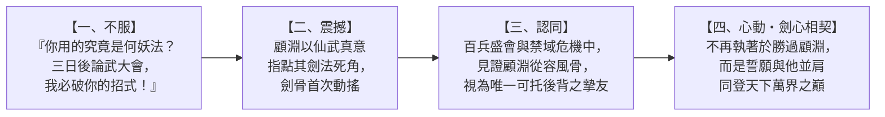

# 《萬界風月樓》第二卷人物設定｜滄瀾群像與情感矩陣

> **文檔定位**：第二卷《諸天第一步・滄瀾風雲》之核心角色設定、人物弧光、情感心理推進機制與陣營關係圖。  
> **核心設計原則**：遵循 [writing_guide.md](file:///home/wade/src/github/novel/sex/docs/arcs/writing_guide.md)「依女主個性選詞、情感自主性、拒絕英雄救美」原則，貫徹 [02-thinking.md](file:///home/wade/src/github/novel/sex/02-thinking.md) 角色構想。

---

## 一、人物關係與陣營總覽圖

```mermaid
flowchart TD
    subgraph 萬界樓與探索者
        GY["顧淵<br>(萬界樓主・金丹初期底蘊超元嬰・外來探索者)"]
    end

    subgraph 滄瀾核心女主與女天驕
        LHY["洛寒衣<br>(第二卷核心女主・天劍山首徒・斷星古劍)"]
        JMY["姬明月<br>(大乾帝女・紫霄真龍血脈・政治權柄掌控者)"]
    end

    subgraph 滄瀾武林與皇室名宿
        JWC["劍無塵<br>(天劍山主・天下第一劍客)"]
        WJD["楚烈天<br>(武極殿大長老・武皇強者)"]
        DBG["段百狂<br>(百兵神宮宮主・鑄兵大宗師)"]
        YJH["燕驚鴻<br>(遠古武神殘念・三千年前殉道者)"]
        Prince["大乾三皇子<br>(野心反派・覬覦魔網力量)"]
    end

    subgraph 青玄界留守道侶（遠程聯動）
        LQX["柳清虛<br>(青雲新任掌門・籌備九品天道金丹)"]
        SXQ["沈玄清<br>(太上仙尊・半步化神・研究古仙卷)"]
        MRY["慕容玥<br>(東華商盟女掌舵・追查未知貨物)"]
    end

    GY <-->|主動邀戰 ──> 平手切磋 ──> 並肩破劫 ──> 劍心相許| LHY
    GY <-->|平等交易 ──> 政治博弈 ──> 戰略盟友（非無腦淪陷）| JMY
    LHY ---|師徒傳承| JWC
    JWC <-->|以劍問道| GY
    WJD <-->|天下論武大會考驗| GY
    DBG <-->|神兵祭壇共鳴| GY
    YJH -.->|英雄相惜・傳承大劫真相| GY
    Prince -->|勾結禁域魔力・暗中作梗| GY & JMY

    GY -.->|時空錨點神魂牽掛| LQX & SXQ & MRY
```

---

## 二、第二卷核心女主：洛寒衣（劍道天驕・傲骨自持）

> **「劍道沒有捷徑，這天下第一的位子，我洛寒衣自會用手中長劍親手打下來，何須任何人相讓！」**

### 1. 人物基礎檔案
* **身份**：天劍山首席真傳弟子、下一任天劍山掌教繼承人。
* **外貌特質**：身形高挑婀娜，一襲雪白束袖劍袍，墨髮高高挽起為利落的流雲髻，眉若遠山橫黛，眼含冷月秋霜。行走如孤鴻踏雪，拔劍如天雷貫日。
* **修為境界**：大宗師巔峰（半步武王）。
* **血脈與體質**：**先天劍骨**（對天地劍意具有超凡親和，肉身經脈天生可承載極限劍罡）。
* **專屬神兵**：**【斷星古劍】**（傳說由三千年前星隕天鐵所鑄，劍身銘刻殘缺星紋，劍意深不可測）。
* **核心性格**：高傲、直接、好勝、重承諾、極致純粹。
* **人物缺陷**：過度崇尚實力至上，對人情世故、政治權謀及武道之外的大道法則缺乏理解，常以「手中劍」解決一切問題。

### 2. 相遇模式：徹底拒絕英雄救美
洛寒衣與顧淵的相遇，**絕非常規套路的「女主遇險、男主天降神兵搭救」**。
* **相遇契機**：顧淵初臨天武城時，為了調解一場武道私鬥，神念微動引發了一絲完全不屬於滄瀾氣血的「仙家道韻」，輕描淡寫化解了狂暴內勁。
* **主動邀戰**：路過酒肆的洛寒衣敏銳捕捉到這股異樣力量，自傲的她認為外來修士憑藉詭異秘法小覷滄瀾武道，當即拔劍攔路，清冷立誓：「閣下方才那招並非滄瀾武學，洛寒衣不才，願以此劍領教閣下高招！」
* **初戰結果**：顧淵從容應對，以巧破千斤、兩相平手收場。這讓生平未嘗一敗的洛寒衣大受震撼，正式激起了她追逐與理解顧淵的決心。

### 3. 感情推進四階段（嚴格遵循 writing_guide.md 傲嬌與女劍修特質）



* **寫作禁忌提醒**：即便在第六篇末兩人情感到達高峰，洛寒衣也絕不轉化為柔弱依附的「嬌妻」，她依然是一位持劍衛道、戰意凜然的絕世女劍仙。

---

## 三、皇朝政治核心女天驕：姬明月（大乾帝女・深謀若海）

> **「江湖兒女只求三尺青鋒快意恩仇，但這大乾萬里江山、億兆生民，終究需要有人在深宮泥沼中執棋撥弄。」**

### 1. 人物基礎檔案
* **身份**：大乾皇朝長公主、兼領天策禁衛大統領。
* **外貌特質**：雍容華貴，鳳眼含威，常著一襲暗紅描金玄鳥錦袍，腰佩蟠龍玉璽與紫金短刃。容顏傾國傾城，氣場高貴冰冷，令人不敢直視。
* **修為境界**：宗師後期・紫霄真龍血脈覺醒六重。
* **核心性格**：冷靜理智、精通帝王權術、深謀遠慮、具家國大義。
* **人物定位**：**政治權謀線的主導者，非即時攻略女主**。

### 2. 與顧淵的互動模式：理智博弈與戰略同盟
* **初遇試探**：姬明月透過皇家巡察司暗報，第一時間鎖定顧淵這個「查無戶籍、來歷成謎」的神祕強者。在皇都盛宴上設局試探顧淵虛實。
* **互利同盟**：
  * 顧淵不介入皇室奪嫡的俗世利益，但他需要進入皇室禁地秘庫查閱「三千年前九幽禁域古圖」。
  * 姬明月面臨奪嫡黨爭與禁域魔變的雙重危局，需要顧淵超然的實力在關鍵時刻震懾宵小。
  * 兩人達成平等交易：姬明月開放古老秘卷，顧淵在神兵祭壇與皇城之變中提供精準情報支援。
* **情感留白**：姬明月對顧淵抱有極高敬意與神祕好奇，但她以皇朝大業為先，雙方保持尊貴有禮的盟友關係，為後續卷次皇朝拓展留下長線伏筆。

---

## 四、滄瀾界重要男配與名宿群像

### 1. 劍無塵（天劍山主・天下第一劍客）
* **境界**：武王後期巔峰。
* **形象與性格**：白髮披肩、布衣芒鞋，看似枯槁老者，雙眸卻宛如星河深邃。豁達大度、毫無門戶之見。
* **劇情作用**：在第二篇末及第六篇登場，與顧淵在雪峰煮酒論道，親口坦言「百年無武神」的悲哀，並對顧淵展示的仙道奧義撫掌大笑，引為平生知己。

### 2. 楚烈天（武極殿大長老・武道仲裁者）
* **境界**：武皇初期。
* **形象與性格**：虎背熊腰，滿面虯髯，手持黑鐵戒尺，言出法隨，剛正不阿。
* **劇情作用**：天下論武大會的主持者，初期對顧淵的「非武體系」持審慎懷疑態度，但在顧淵以純粹武意正面破除邪派詭招後，公開給予其最高規格的宗師禮遇。

### 3. 段百狂（百兵神宮宮主）
* **境界**：大宗師巔峰（神匠之體）。
* **形象與性格**：痴迷兵器至癲狂，赤膊赤足，脾氣暴躁如烈火，唯有見到驚世神兵時方展露笑顏。
* **劇情作用**：在神兵爭鋒篇中，因顧淵能以萬界樓靈素之法喚醒沉睡神兵器魂，將顧淵奉為「太古鑄兵天尊轉世」，全力協助其開啟鑄兵祭壇。

### 4. 燕驚鴻（遠古武神殘念・三千年前殉道者）
* **身份**：三千年前滄瀾界第一位武神。
* **形象**：一尊由熾烈金芒與武道意念凝結的虛影，身披玄黑戰甲，眼眸中倒映著諸天崩壞的慘烈景象。
* **核心台詞**：「後世之人，你身上有萬界古樓的氣息……吾未竟之戰，便託付於你了！」
* **劇情作用**：在九幽禁域深處與顧淵相見，向顧淵揭露域外黑手與幽冥魔網的真相，親手將第二塊大劫核心碎片交給顧淵。

### 5. 大乾三皇子（野心反派）
* **境界**：宗師巔峰，修煉禁忌魔功與陰煞異能。
* **下場**：為奪帝位暗中引動九幽禁域魔煞突襲皇城與神兵大典，最終被洛寒衣與姬明月聯手斬斷經脈，淪為廢人幽禁宗正寺。

---

## 五、男主顧淵在第二卷的行事風格與精神特質

1. **從容求道的「探索者」視角**：
   * 顧淵不急於稱王稱霸，不搞「龍王贅婿降智打臉」。他漫步於滄瀾天武城，品嘗烈酒，觀摩武者熬煉氣血，以超然道心審視不同的文明道路。
2. **以力破巧，言出如金**：
   * 顧淵出手乾淨利落，能不出劍便僅以折扇、拂袖化解攻勢；一旦出招，直擊武意本源，令對手輸得心服口服。
3. **對女性的尊重與平等**：
   * 面對高傲求戰的洛寒衣，他給予充分的戰士尊嚴；面對手握重權的姬明月，他從容談判、不欺不辱。

---

## 六、青玄界留守三大女主遠程動態（雙線共生）

| 女主姓名 | 當前職責與狀態 | 遠程動態與事件 | 與顧淵的心靈紐帶 |
| :--- | :--- | :--- | :--- |
| **柳清虛** | 青雲新掌門・半步金丹 | 正式接掌宗門大印，頂住長老質疑，引動九品天道金丹天劫獨立破境 | 眉心第一枚【紅顏時空錨點】溫熱共鳴，每逢危急時刻默念顧淵之名 |
| **沈玄清** | 太上仙尊・半步化神 | 閉關後山禁地，梳理青雲古仙秘卷，查出古仙界大劫與「幽冥魔網」的圖騰記錄 | 體內共存的大劫殘印與顧淵跨界遙感，成為跨界警訊天線 |
| **慕容玥** | 東華商盟女掌舵・築基後期 | 整合落霞三十六世家暗帳，建立東華商道網絡，追查未知世界流出的神秘貨物 | 透過萬界樓珍寶閣初階權限，遠程為顧淵調集滄瀾所需之仙家靈液物資 |
