# 《萬界風月樓》第二卷雙世界時間線與伏筆追蹤矩陣

> **文檔定位**：第二卷《諸天第一步・滄瀾風雲》雙世界平行推進總綱與伏筆管理系統。  
> **核心原則**：貫徹 R24 諸天自主演化原則；男主穿梭自如，中卷萬界樓重聚；姬明月與洛寒衣雙女主納入後宮；古樓修復度突破 **100/10000（1.00%）**！

---

## 一、雙世界平行推進時間表（Timeline Matrix）

```mermaid
gantt
    title 雙世界平行時間線對照推進圖（含樓中重聚）
    dateFormat  X
    axisFormat  第 %s 階段

    section 滄瀾界（男主探索主線）
    異界初臨・落腳天武城（ch017-021） :active, c1, 0, 5
    天下論武・神兵爭鋒（ch022-033）   :c2, 5, 17
    萬界樓中卷重聚（ch033末）          :milestone, m1, 17, 17
    皇朝風雲・帝女雙修（ch034-039）   :c3, 17, 23
    九幽魔變・仙武合一（ch040-052）   :c4, 23, 36

    section 青玄界（自主發展主線）
    柳清虛渡劫・頒布新令（同期）     :active, q1, 0, 5
    沈玄清探秘・慕容立商盟（同期）   :q2, 5, 17
    萬界樓赴約會面（ch033末）          :milestone, m2, 17, 17
    道盟自保・魔煞老魔甦醒（同期）   :q3, 17, 23
    三女質變・格局重塑迎重逢（同期） :q4, 23, 36
```

### 【階段一：初入異界與宗門自立】（滄瀾 ch017～ch021 ｜ 青玄界同期）
* **滄瀾界（顧淵線）**：
  * 顧淵穿門踏入天武城郊外荒谷，初感天地元氣稠密與仙術排斥（消耗增加三成）。
  * 漫步天武城，品烈酒、觀武風，以折扇化解霸刀門狂狂暴刀芒，以巧破千斤。
  * 混沌星脈首次嘗試吞吐滄瀾武意，推開仙武同修大門；天機星盤鎖定百年前失蹤武神之線索。
* **青玄界（柳清虛主導線）**：
  * 王氏覆滅引發東華修仙界大地震，名門太華道宮與天劍神宗派長老登門拜山，意圖瓜分九華靈脈。
  * 柳清虛拒絕傳訊求助顧淵，毅然獨登通天峰引發**【九品天道水火金丹天劫】**，一劍震退強敵，確立新掌門威權！
  * 頒布「青雲新令」：重整長老院，提拔二師弟陸遠任戒律長老，三師妹林芷萱主理丹草閣，青雲人心徹底歸一。
  * 沈玄清退居太上長老閉關整理青雲秘庫；慕容玥接收落霞商業資產，應對同行商行試探；西陵魔煞宗派密探暗查王氏敗因。

---

### 【階段二：論武神兵與樓中重聚】（滄瀾 ch022～ch033 ｜ 青玄界同期）
* **滄瀾界（顧淵線）**：
  * 聖武廣場天下論武大會，傲骨女劍修洛寒衣登場橫掃群雄，敏銳察覺異界氣息，主動拔劍邀戰顧淵。
  * 兩人激烈切磋打成平手，顧淵指點其劍骨滯澀死穴，洛寒衣劍心動搖，陷入反思。
  * 顧淵赴百兵神宮盛會，引發萬兵朝宗；黑袍魔修突襲千峰器海祭壇，顧淵與洛寒衣背靠背浴血破敵，解開太古星盤萬界銘文（**修復度 +7/10000 達到 0.15%**）。
  * 顧淵混沌星脈汲取星隕天鐵精粹，仙武勁初成；洛寒衣右肩經脈打通，道心由好勝轉向護道。
* **青玄界（沈玄清與慕容玥線）**：
  * 沈玄清隱匿氣息暗查青玄九大古仙遺跡，在藏經閣最底層查得孤本《太素天變錄》，破譯出體內殘印與「幽冥魔網」同源的驚天真相。
  * 沈玄清更進一步查明：青雲觀後山祖靈脈原本是古仙界一處「九天封魔陣」的中央基座，揭露開派祖師背負的歷史宿命。
  * 慕容玥以《玄金密冊》反擊中天仙商圍剿，強勢兼併落霞十二家拍賣行，正式成立「東華萬界商盟」。
  * 慕容玥在清點魔修暗庫時，憑藉【靈鑑瞳術】查獲一批非青玄本土的神秘星紋晶石與零件，確認存在未知跨界走私黑網。
* **【關鍵節點：中卷萬界樓重聚（ch033末）】**：
  * 顧淵動用樓主特權，短暫返回萬界樓，召喚柳清虛、沈玄清、慕容玥齊聚樓主殿。
  * 三女驚喜相逢，各自展示成果：清虛之九品金丹、玄清之抗魔圖騰、慕容玥之走私晶石；顧淵分享滄瀾神兵與仙武勁。
  * 四人深層心魂交泰、溫存共鳴，產生浩瀚陰陽本源反哺（**修復度 +15/10000 達到 0.30%**），加固時空紐帶！

---

### 【階段三：皇朝平叛與帝女雙修】（滄瀾 ch034～ch039 ｜ 青玄界同期）
* **滄瀾界（顧淵與姬明月線）**：
  * 顧淵攜洛寒衣受邀抵達大乾皇都承天京，長公主姬明月設宴試探，展現冷靜帝王心術。
  * 武道盛典之夜三皇子勾結幽冥魔煞發動血腥兵變，欲毒害老帝尊並廢殺姬明月。
  * 洛寒衣與姬明月聯手抗敵，顧淵以【大周天擒龍手】融入剛烈氣血一舉捏碎萬魂煞陣，平定乾坤。
  * 姬明月加冕監國帝女，因真龍血脈暴走走火入魔。在攬月行宮深處，顧淵以純陽本源行《玄奼真經》相救，高冷帝女卸防主動託付，二人雙修合一（**修復度 +25/10000 達到 0.55%**）！姬明月正式納入後宮！
  * 姬明月交付【九幽天圖】古卷，確立大乾與萬界樓的永固道侶同盟。
* **青玄界（外部勢力與魔宗線）**：
  * 柳清虛重組「青雲護山青蓮大陣」，並聯合周邊正道仙門建立「東華道門自保同盟」，青雲觀躍居區域核心領袖。
  * 慕容玥組建跨域商業諜報隊，循著神秘晶石線索追查到東南沿海的一處隱秘虛空走私黑市。
  * 西陵魔煞宗禁地深淵，殘廢的黑煞老怪喚醒了沉睡八千年的「枯骨老魔」；枯骨老魔吞噬萬魂，認出萬界樓重現諸天之氣息，誓言復仇。
  * 青玄地脈濁煞微動，與遙遠滄瀾界的九幽魔變產生微弱共鳴。

---

### 【階段四：仙武問天與破百大躍進】（滄瀾 ch040～ch052 ｜ 青玄界同期）
* **滄瀾界（顧淵與洛寒衣線）**：
  * 九幽禁域魔劫全面爆發，永夜遮天，天下名宿齊聚組建遠征軍；沈玄清殘印與魔網同頻，顧淵跨界獲取魔網死穴關鍵情報。
  * 深入天塹深處，得見燕驚鴻武神殘念，揭露三千年前殉道封魔歷史；黑天魔皇投影與魔網復甦侵蝕群雄。
  * 取得第二塊大劫核心碎片（**修復度 +30/10000 達到 0.85%**）；洛寒衣斷劍捨身力戰，在萬界純陽與生死頓悟中涅槃成就【武王境女劍仙】！
  * 顧淵以混沌星脈融合靈力氣血，於【萬法演武殿】推演創出「混沌武仙法相」，一劍斬滅黑天魔皇投影、熔斷魔網第二節點，平定滄瀾浩劫！
  * 滄瀾天地枷鎖破碎；顧淵與洛寒衣雪峰相許、劍心雙修，立滄瀾紅顏時空錨點（**修復度 +15/10000，正式突破 100/10000，達到 1.00% 破百大關！**）。
  * 萬法演武殿全面啟動，天機閣星盤鎖定 03 號世界【九曜神域】，顧淵功成重返萬界樓！
* **青玄界（重逢格局質變）**：
  * 柳清虛修為穩固九品金丹巔峰，青雲道統大盛，成為名動東華的絕世女掌門。
  * 沈玄清徹底掌握古仙大劫全套古籍地圖，繪製出「古仙抗魔全圖」，正等待顧淵歸來共同研討。
  * 慕容玥將東華商盟打造成鐵板一塊，建立起跨界物流諜報網絡。
  * 顧淵歸來時，青玄三女各以卓越的成就與強者姿態迎接他，雙向奔赴、共探諸天！

---

## 二、第一卷伏筆推進與回收追蹤表

| 編號 | 伏筆項目名稱 | 卷一出處 | 卷二具體推進與回收情節 | 回收狀態 |
| :---: | :--- | :---: | :--- | :--- :---: |
| **FB-01** | 萬界樓崩毀與黑手之謎 | ch001 | 第 028～030 章燕驚鴻殘念親證魔劫同源；碎片讀取諸天強者浴血抗魔記憶 | 階段回收 |
| **FB-02** | 沈玄清大劫殘印與幽冥魔網 | ch008, 009 | 第 026 章沈玄清殘印與滄瀾魔網跨界共振，傳遞魔網死穴破法 | 深化推進 |
| **FB-04** | 西陵魔煞宗太上黑煞之怒 | ch012, 016 | 階段三（ch039）西陵喚醒深淵枯骨老魔，古魔界危機升級 | 危機升級 |
| **FB-06** | 柳清虛衝擊九品天道金丹 | ch002, 010 | 階段一（ch021）清虛獨抗九天雷劫成九品天道金丹，掌門立威 | **完全回收** |
| **FB-07** | 青雲後山古仙秘卷整理 | ch009 | 階段二（ch027）沈玄清破譯《太素天變錄》，查明祖脈九天封魔真相 | 階段回收 |
| **FB-08** | 慕容玥商道與日久生情 | ch015, 016 | 階段二、三（ch033）成立東華商盟，反擊商業圍剿，追查未知走私品 | 深化推進 |
| **FB-09** | 滄瀾界高武大爭之世開啟 | ch016 | 貫穿第二卷全卷，天下論武、神兵爭霸、皇權政變、禁域決戰 | **核心主線** |
| **FB-10** | 顧淵萬界星脈仙武同修 | ch001, 009 | 歷經排斥期、衝突瓶頸期、神兵淬體期，終創混沌武仙法相 | **階段大成** |

---

## 三、第二卷新增伏筆追蹤表（FB2-01 ～ FB2-09）

| 編號 | 伏筆名稱 | 埋設章節 | 核心關鍵字 | 預計回收情節／卷次 | 當前狀態 |
| :---: | :--- | :---: | :--- | :--- | :---: |
| **FB2-01** | 武神燕驚鴻捨身殉道真相 | ch021, 044 | 燕驚鴻、武神殉道、禁域陣眼 | 第五篇九幽地宮揭曉（ch044） | 卷內回收 |
| **FB2-02** | 幽冥魔網第二節點異動 | ch040, 045 | 跨界魔網、魔網節點、黑天魔皇 | 第五、六篇大戰中斬斷熔滅 | 卷內回收 |
| **FB2-03** | 百兵神宮祭壇萬界銘文 | ch031, 032 | 太古鑄兵星盤、萬界分殿投影 | 第 032 章段百狂密室解密 | 卷內回收 |
| **FB2-04** | 大乾皇室真龍異能與雙修 | ch035, 038 | 紫霄真龍、反噬化煞、帝女結契 | 第 038 章行宮雙修納入後宮 | 卷內回收 |
| **FB2-05** | 第二碎片中的【九曜星圖】 | ch051 | 星辰古圖、神話文明、第三世界 | 第 051 章萬界樓演繹／引出第三卷 | **卷末爆發** |
| **FB2-06** | 洛寒衣身世與斷星劍器魂 | ch026, 030 | 先天劍骨、界外星隕、器魂復甦 | 第 047 章斷劍重生、破境武王 | 卷內回收 |
| **FB2-07** | 青玄界未知貨物流入源頭 | ch033 | 異界走私、神秘晶石、虛空裂痕 | 後續跨界商戰與諸天黑市勢力 | 萌芽中 |
| **FB2-08** | 滄瀾百年無武神天地枷鎖 | ch021, 049 | 天地有鎖、魔網抽取本源、枷鎖碎 | 第 049 章一劍開天徹底擊碎枷鎖 | 卷內回收 |
| **FB2-09** | 雙女主皇朝與江湖同盟 | ch038, 050 | 姬明月天策禁軍、洛寒衣天劍山 | 第五、六篇聯軍決戰默契配合 | 卷內回收 |
