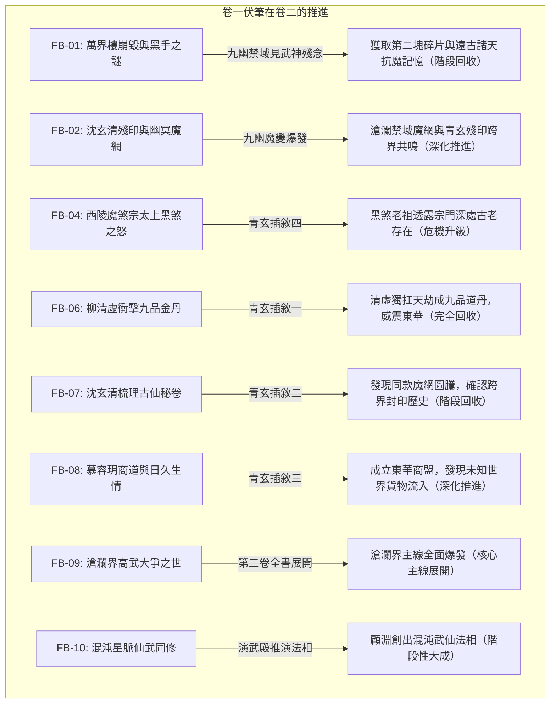
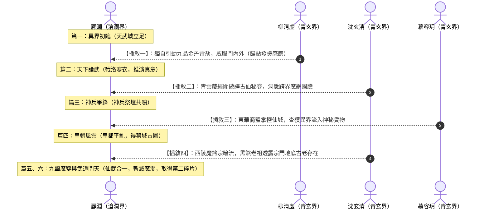

# 《萬界風月樓》第二卷伏筆追蹤與因果鏈矩陣

> **文檔定位**：第二卷《諸天第一步・滄瀾風雲》伏筆管理總綱。負責承接第一卷（青玄篇）FB-01～FB-10 之推進與部分回收，並系統埋設第二卷全新伏筆（FB2-01～FB2-08），確保青玄與滄瀾雙線交織、條理清晰。

---

## 一、第一卷（青玄篇）伏筆在第二卷的推進與回收

在第一卷 [foreshadowing.md](file:///home/wade/src/github/novel/sex/docs/arcs/01/foreshadowing.md) 中確立的 10 大伏筆，在第二卷將獲得實質推進與階段性回收：

### 具體推進細節
1. **FB-01（萬界樓崩毀之謎）**：
   * 在第 028～030 章九幽禁域深處，燕驚鴻的武神殘念親口向顧淵印證：三千年前侵襲滄瀾界的黑手，與摧毀萬界樓的大劫力量同出一源。顧淵在取得第二塊核心碎片時，神魂讀取到一幕「遠古諸天神魔與武神並肩浴血抗敵」的宏大歷史殘象。
2. **FB-02（沈玄清大劫殘印與幽冥魔網）**：
   * 在第 026 章，顧淵抵達九幽禁域邊緣時，眉心道印熾熱發燙，沈玄清在青玄界後山同時心生感應，兩人透過道侶本源遙遙共振，確認青玄界的「九幽濁魔煞」正是這張覆蓋諸天的「幽冥魔網」在不同世界的枝蔓節點。
3. **FB-06（柳清虛九品金丹）**：
   * 在青玄界插敘一（第 005 章末），柳清虛在沒有依賴顧淵親自護法的情況下，以堅定道心與水靈天體獨自迎戰九重天雷，成功凝結「九品天道金丹」，一劍震懾東華各大名門拜山使者，完成從「被保護的小師姐」到「名副其實的青雲掌門」的獨立蛻變。
4. **FB-07（沈玄清古仙界秘卷整理）**：
   * 在青玄界插敘二（第 011 章末），沈玄清在青雲藏經閣萬丈密樓中，翻出泛黃的古仙界殘卷《太素天變錄》，其上記錄的封魔圖騰與九幽禁域地脈紋理完全吻合。
5. **FB-08（慕容玥商道布局與未知貨物）**：
   * 在青玄界插敘三（第 017 章末），慕容玥建立東華商業聯盟，清點各大世家黑市庫房時，意外繳獲了一批「刻有古怪符文的金屬殘片與晶石」，既非仙家靈石，亦非凡鐵，為後續文明提前埋下伏筆。

---

## 二、第二卷全新新增伏筆（FB2-01 ～ FB2-08）

| 伏筆編號 | 伏筆項目名稱 | 埋設章節 | 核心關鍵字 | 預計回收情節／卷次 | 當前狀態 |
| :---: | :--- | :---: | :--- | :--- | :---: |
| **FB2-01** | 武神燕驚鴻捨身封魔真相 | ch005, ch028 | 燕驚鴻、武神殉道、禁域陣眼 | 第五篇九幽魔變終章揭曉 | **核心主線** |
| **FB2-02** | 幽冥魔網第二節點異動 | ch024, ch029 | 跨界魔網、魔煞暴走、節點復甦 | 第五、六篇大戰中正面破解 | 待爆發 |
| **FB2-03** | 百兵神宮鑄兵祭壇萬界銘文 | ch015, ch016 | 太古鑄兵星盤、器魂認主、萬界樓字樣 | 第三篇神兵盛會中段破譯 | 待推進 |
| **FB2-04** | 大乾皇室始祖真龍異能淵源 | ch019, ch023 | 紫霄真龍、神獸精血、太祖密敕 | 第四篇皇朝風雲及後續神話界 | 鋪墊中 |
| **FB2-05** | 第二碎片中的【九曜神域】星圖 | ch035 | 星辰古圖、神話文明、第三世界線索 | 第二卷末天機閣推演／引出卷三 | **卷末大爆發** |
| **FB2-06** | 洛寒衣身世與斷星劍器魂宿命 | ch010, ch014 | 先天劍骨、星隕天鐵、器魂共鳴 | 第三篇神兵異動與第六篇劍心合一 | 貫穿全卷 |
| **FB2-07** | 青玄界未知貨物流入源頭 | ch017（插敘三） | 異界走私、神祕晶石、虛空裂痕 | 第三卷跨界商戰與虛空黑市 | 萌芽中 |
| **FB2-08** | 滄瀾「百年無武神」的天地枷鎖 | ch005, ch031 | 天地有鎖、前路已斷、武神斷代 | 第六篇顧淵破境時揭開天地封印 | 貫穿全卷 |

---

## 三、青玄界四次插敘因果聯動節點

第二卷採取「滄瀾為主，青玄雙線」的立體敘事，在每篇轉折處安排青玄界短篇插敘，使整部小說的諸天世界觀時刻保持鮮活共生：

### 插敘具體規劃
1. **青玄界插敘一：柳清虛的掌門之威（第 005 章末 / 全書 ch021）**
   * **事件**：王家覆滅後，東華天劍神宗與太華道宮派特使拜山，名為恭賀新掌門，實為試探虛實。面對逼迫，柳清虛拒絕傳召顧淵，於青雲通天峰頂毅然引動九天雷劫！
   * **結果**：水火既濟，九品道丹大成！引動青玄天地紫氣三千里，柳清虛一劍冰封挑釁使者佩劍，正式確立青玄一代絕世女掌門之威信。
2. **青玄界插敘二：沈玄清的秘卷驚魂（第 011 章末 / 全書 ch027）**
   * **事件**：沈玄清在青雲後山閉關，查閱歷代掌門秘錄《太素天變錄》。
   * **發現**：古籍中記錄了一萬年前古仙界崩解的舊事，其中出現了一張覆蓋諸天的巨大黑網圖騰。沈玄清驚覺自己體內的魔煞殘印正是魔網的一小簇節點，而圖騰下方標註的第二處節點坐標星象，竟與顧淵跨界前往的星空方位完全一致！
3. **青玄界插敘三：慕容玥的商道暗戰（第 017 章末 / 全書 ch033）**
   * **事件**：慕容玥以雷霆手段肅清仙城三十六世家叛逆，正式組建「東華萬界商盟」。
   * **線索**：在查抄慕容博與魔煞宗暗庫時，慕容玥發現了一批非金非玉的神秘星紋鐵礦與能量晶石。這批貨物來自極度隱秘的走私渠道，證明諸天萬界之間除了萬界樓，似乎還有未知的空間裂痕或走私勢力在暗中活動。
4. **青玄界插敘四：西陵魔煞宗的底牌（第 023 章末 / 全書 ch039）**
   * **事件**：黑煞老祖金丹被廢、長老盡誅的消息傳回西陵本部，魔煞宗舉宗震怒。
   * **反轉**：殘廢的黑煞老祖跪在魔煞宗禁地枯骨深淵前，喚醒了深淵中一尊自遠古大劫沉睡至今的枯骨老魔。枯骨老魔睜開猩紅雙眼，低語：「萬界樓……那座古樓竟然又重現諸天了……」
