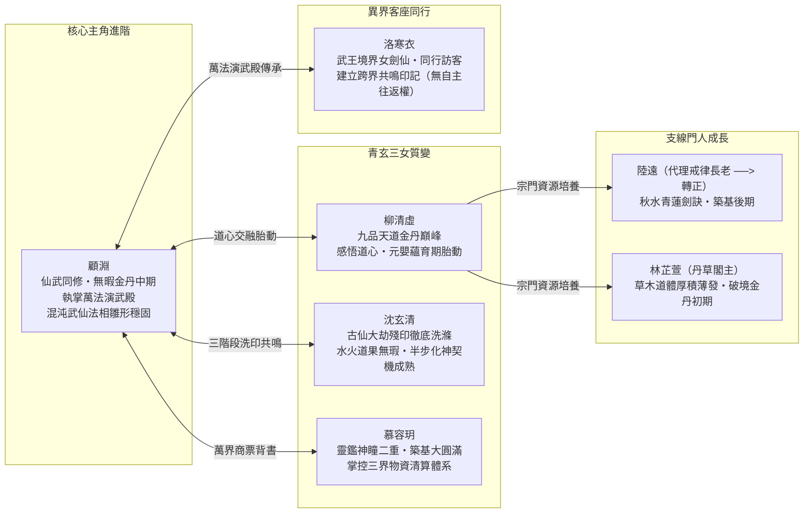

# 《萬界風月樓》第三卷力量體系與跨界商道機制（v2.0）

> **文檔定位**：第三卷《諸天回首・青玄歸途》修煉境界突破、仙武演武殿推演、三界跨界商道金融閉環及萬界樓修復進度躍進（100/10000 至 280/10000）設定。  
> **核心主題**：仙道本源與高武道韻互補；萬界商票清算與資源套利；古仙七界封魔鎖鏈解密；黑市「天行者」虛空力量體系；沈玄清三階段化神契機。  
> **參考母本**：[04-thinking.md](../../../04-thinking.md) 核心審查與架構指引  

---

## 一、人物修為進階矩陣與力量質變

第三卷核心回歸青玄界，主要角色的修為與心性均迎來結構性突破：



### 1. 顧淵：仙武融匯與演武殿掌控
* **修為境界**：青玄仙道金丹中期 ＋ 滄瀾武神殘勁護體。
* **萬法演武殿核心功能**：
  * **道法模擬與推演**：可在演武殿內召喚歷代諸天強者留存的道影進行實戰試錯，將「滄瀾界剛烈武意」與「青玄界天地五行靈力」進行毫無排斥的深度熔煉。
  * **混沌武仙法相（常態化）**：第二卷斬殺黑天魔皇投影時創造的「千丈武仙法相」，在第三卷中壓縮凝練為三丈凝實真身，兼具仙道遁法之飄逸與武道破山之剛猛。

### 2. 青玄三女實力躍升
* **沈玄清（三階段修煉因果・半步化神契機，A級設定銜接）**：
  > 拒絕「一次雙修直接升級」，嚴格劃分三階段因果：
  1. **第一階段：殘印洗滌（排除舊傷）**：五百年前衝擊化神引發的舊傷本就源於太古萬界樓大劫封魔煞氣，古仙遺址的煞氣是舊傷的延伸與觸發。顧淵純陽本源助其徹底驅逐殘印，神魂重歸完整。
  2. **第二階段：本源共鳴（恢復力量）**：沈玄清主動運轉《太素天變錄》，五百年水火道基重新圓融無瑕，元嬰巔峰威能完全恢復。
  3. **第三階段：道心突破（觸及門檻）**：神念感知青玄九處古仙封魔基座，**本卷末達到「元嬰大圓滿巔峰・半步化神契機成熟」**（本卷只出契機，正式破境留待後續），守住五百年仙尊修煉含金量。
* **柳清虛（九品金丹圓滿 ──> 元嬰蘊育期）**：
  * **四階段階梯嚴格定位（A級設定銜接）**：
    1. **卷一**：**半步金丹**（早年強行衝擊金丹受創，道基積傷，由顧淵救治重塑水火道胎）。
    2. **卷二**：**正式凝結金丹，逐步提升品階**（ch021 孤身引天劫凝結上品天道金丹，並於後方閉關溫養，至卷末穩步淬煉至九品天道金丹層次）。
    3. **卷三初～中**：**九品金丹大圓滿，開始孕育元嬰**（周身九品金丹金輝圓融無瑕；ch060 與顧淵深夜本源交泰後，道基內化生一縷紫金胎息，正式步入「元嬰蘊育期／元嬰胎動」）。
    4. **本卷結束**：**元嬰尚未真正凝成，但已經完全具備突破契機**（東華大局平定、道心無垢，化嬰機緣齊備，只待第四卷臨門一腳碎丹成嬰）。
* **慕容玥（築基大圓滿・靈鑑神瞳二重）**：
  * 吞服萬界樓純陽神液與滄瀾界地心淬體精粹，掃除經脈暗疾。
  * 【靈鑑神瞳二重・破虛靈目】：不僅能看穿丹藥法寶品階，更可看透虛空夾縫中的微弱靈力殘渣與黑市走私銘文。

### 3. 門人支線進階（陸遠與林芷萱，落實 A/B 級因果）
* **陸遠（代理戒律長老 ──> 正式任命）**：
  * **職責來源**：原本築基初期，柳清虛頒布「青雲新令」看重其鐵面無私與原則忠誠，先任命為「代理戒律長老」，負責整頓門風、落實新令；
  * **境界突破**：借鑒顧淵武道吐納法並歷經守山實戰，突破至**築基後期**；於卷末抗擊魔潮立下首功，正式轉正為戒律長老。
* **林芷萱（丹草閣主管 ──> 金丹初期因果）**：
  * **非劇情贈品**：天生具備「草木親和道體」，常年管理丹草閣，對靈藥藥性及靈氣運轉有極深個人積累；
  * **突破過程**：柳清虛親授突破丹僅負責輔助破障，林芷萱在後山獨立渡過三九天劫，以自身草木道悟凝成金丹，**正式晉陞金丹初期**。

### 4. 異界道侶跨界權限校準（A級系統規則）
* **洛寒衣**：
  * 本次進入青玄界屬於**「首次隨樓主跨界・同行訪客」**，建立跨界共鳴印記；
  * **尚未取得獨立自主往返權限**，其隨意出入仍嚴格受顧淵樓主特權限制；自主跨界權限留待日後自願深層雙修解鎖。
* **姬明月**：
  * 大乾政務繁重，第三卷全程以天機閣星圖「虛擬神魂投影」遠端參會；
  * 嚴格杜絕未解鎖自主權限前肉身突兀降臨青雲觀；僅於卷末 ch087 局勢穩定後，依託大乾錨點首次短暫親臨萬界樓本體。

---

## 二、跨界商道體系與「萬界商票」金融閉環

慕容玥的商業價值在第三卷迎來跨次元躍遷。過去僅是單界的商樓拍賣，如今建立起「青玄界 ↔ 萬界樓 ↔ 滄瀾界」的三方資源對沖體系：

```mermaid
flowchart TD
    subgraph 青玄界（產能端）
        QX1["高階靈草、培元仙丹<br>延壽古藥、五行陣盤"]
    end

    subgraph 萬界樓（金融與中樞）
        WJL1["【萬界通商行】<br>萬界商票清算系統<br>信用背書・時空倉儲"]
    end

    subgraph 滄瀾界（資源端）
        CL1["星隕天鐵、武道氣血丹<br>神兵粗胚、地心赤金"]
    end

    QX1 ==>|慕容玥三洲商盟調集| WJL1
    CL1 ==>|姬明月天策商行撥付| WJL1

    WJL1 -->|商票換算平準物價| QX1
    WJL1 -->|商票兌付神兵物資| CL1
```

### 1. 資源價差與跨界套利（降維互補）
| 物資類別 | 青玄界現狀 | 滄瀾界現狀 | 萬界商道流通價值 |
| :--- | :--- | :--- | :--- |
| **五行靈草／靈液** | 修仙大宗壟斷，價格穩定。 | 滄瀾無仙道靈脈，靈液可洗滌武者暗傷、延緩神兵器魂磨損，**溢價百倍**。 | 青玄輸出，換取滄瀾極度充裕之礦藏。 |
| **星隕天鐵／地火神金** | 青玄界極為罕見，煉製高階飛劍的稀缺主料。 | 滄瀾千峰器海隨處可採，武者當作尋常兵刃原料。 | 滄瀾輸出，解鎖青玄高階飛劍量產。 |
| **氣血武道密傳** | 青玄修士輕視肉身，近戰極度脆弱。 | 滄瀾武者肉身橫練無敵，近戰搏殺登峰造極。 | 引入青雲觀，開闢外門「仙武體修堂」。 |

### 2. 「萬界商票」四大信用支柱（嚴密商業邏輯，B-01）
* **痛點**：每一次跨界大規模傳送實物，均需耗費萬界樓微量混沌本源，無法承受高頻率日常零售。
* **四大信用支柱機制**：
  1. **本地兌付責任機制**：三洲商盟在落霞等十二城設立實體兌付庫，以八百萬靈石儲備金承擔本地即時兌付；
  2. **資產收益權質押**：青雲觀後山九華祖脈未來三年的靈石開採收益權，作為商票的底層平準基金（收益權質押，非割讓主權）；
  3. **雙向物資對沖結算**：大乾天策商行以滄瀾界罕見之星隕神鐵粗胚提供實物對沖，每季度在萬界樓進行扎差清算，**將時空傳送損耗降低九成以上**；
  4. **萬界樓乾坤道印信用天秤**：商票銘刻不可偽造的乾坤道印法則，作為兩界商人共同認可的最高跨界信用保證。

---

## 三、深淵枯骨老魔本質與群像戰役分工

### 1. 老魔戰力來源（B級戰力合理化）
* **本質**：古代金丹邪修殘魂被太古「幽冥魔網」寄生、改造成的**魔網實體節點**。
* **三大力量來源**：
  1. 原本金丹邪修的殘魂底蘊；
  2. 三千年積累的深淵怨煞；
  3. 幽冥魔網持續輸送的域外魔煞本源。

### 2. ch079～ch084 六方群像剿滅戰役表
| 參戰人物 | 職責與任務 | 戰術價值與定位 |
| :--- | :--- | :--- |
| **柳清虛** | 主持「青蓮開天護山大陣」 | 統御全宗長老弟子，守死青雲防線，阻斷魔煞擴散 |
| **沈玄清** | 引動後山古仙封印鎖鏈 | 以半步化神神念鎖定老魔核心，限制其遁入虛空 |
| **慕容玥** | 商盟後勤供給與情報封鎖 | 提供十萬枚破煞靈丹，並動用黑市情報切斷老魔三處靈脈補給 |
| **陸遠** | 統領戒律堂外圍戰線 | 率弟子截殺被魔煞污染的狂化妖獸，保護山下凡俗城鎮 |
| **林芷萱** | 丹草閣戰地救治體系 | 晝夜不停煉製解煞丹，維持宗門戰力持續運轉 |
| **顧淵** | 致命穿透・毀滅殘絲 | 待三女控死戰局後精準斬入，以混沌純陽將老魔體內的魔網殘絲徹底焚滅 |

---

## 四、親密共鳴與萬界樓功能具體對應表（B-07）

> 男女主角的身心共鳴直接轉化為古樓具體功能模塊的激活與穩定：

| 女主姓名 | 情感共鳴本質 | 萬界樓功能具體表現 | 修復數值增量 |
| :--- | :--- | :--- | :---: |
| **柳清虛** | 長久守望後的深層信任 | 穩定古樓混沌本源，強化青玄界萬界門時空定位；風月苑顯化第二層「凝香道閣」 | +10/10000 |
| **沈玄清** | 放下戒備、平視神魂相契 | 驅散大劫舊傷，解鎖【天機秘庫】古仙遺存線索；靈修殿解鎖元神加護陣眼 | +20/10000 |
| **慕容玥** | 共同承擔商業風險・孤注一擲 | 推進【萬界通商行】解鎖；珍寶閣開放大規模虛空專屬倉儲位 | +20/10000 |
| **洛寒衣** | 生死並肩信任・劍心共鳴 | 建立滄瀾跨界共鳴印記，為後續正式解鎖自主通行奠定道基 | 印記成熟 |

---

## 五、諸天黑市「天行者」灰色商業架構

### 1. 組織定位與三大業務（B-02）
* **定位**：諸天灰色跨界商業與情報中介網絡（非單純反派勢力，顧淵在特定情形下亦可能與之交易）。
* **三大業務板塊**：
  1. **情報交易**：世界坐標、強者弱點、遠古遺址，與慕容玥商盟情報線形成競爭與交織；
  2. **跨界運輸**：珍寶、靈物、異界特產走私；
  3. **禁忌買賣**：收購萬界樓殘片、古仙遺物，暗中與諸天蝕者進行利益交換。
* **白面具寓意**：「交易身份不等於真實身份」，面具素面無相，成員對外僅用代號，互不探詢底細。

---

## 六、第三卷萬界樓數值大躍進（突破 280/10000，嚴格落實 A-02）

| 章節節點 | 核心驅動事件 | 獲得本源增量 | 累計總修復度 | 解鎖功能與古樓外觀變化 |
| :---: | :--- | :---: | :---: | :--- |
| **卷二末** | 滄瀾界平定・大關突破 | — | **100/10000 (1.00%)** | 萬法演武殿解鎖・界門常態流轉 |
| **ch054** | 三界聯動會議・五大命運印記共振 | +10/10000 | 110/10000 | 天機閣星圖解鎖虛擬神魂投影聯動功能 |
| **ch060** | 柳清虛深夜相守・水火既濟本源交泰 | +10/10000 | 120/10000 | 風月苑二層顯化、青雲通道加固 |
| **ch066** | 九霄秘境取得古仙遺志封印片 | **+0/10000** | 120/10000 | 僅獲材料，待融合歸位（落實 A-02） |
| **ch067** | 沈玄清洗印雙修・觸及化神門檻 | +20/10000 | 140/10000 | 靈修殿解鎖元神加護陣眼 |
| **ch068** | **第三碎片正式歸位乾坤道台** | **+60/10000** | **200/10000 (2.00%)** | **解鎖【天機秘庫】（白玉藏書樓顯化）** |
| **ch077** | 跨界商道首航扎差・商票信用成型 | +20/10000 | 220/10000 | 珍寶閣擴建三界虛空專屬倉儲位 |
| **ch083** | 青玄危局平定・三女護道大願力反哺 | +40/10000 | 260/10000 | 萬界樓古陣實體化威能提升五成 |
| **ch085** | **萬界通商行落成・三界同步定標** | **+20/10000** | **280/10000 (2.80%)** | **解鎖【萬界通商行】與【三界時空定標儀】** |
