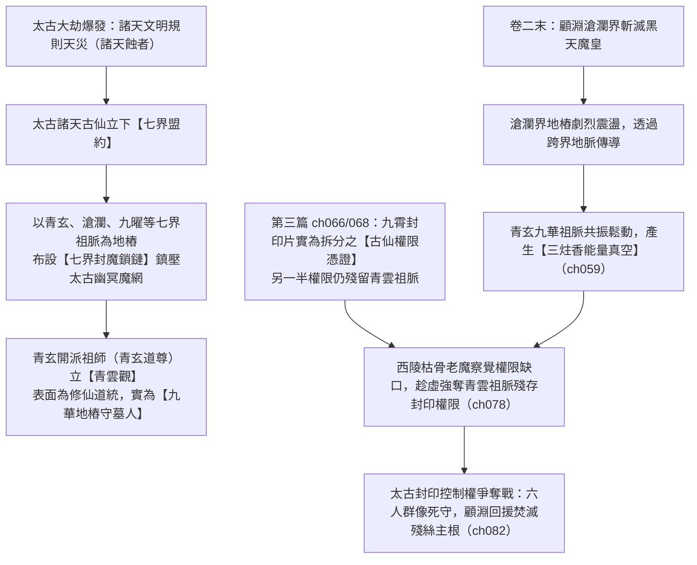

# 《萬界風月樓》第三卷力量體系與跨界商道機制（v3.1）

> **文檔定位**：第三卷《諸天回首・青玄歸途》修煉境界突破、仙武演武殿推演、三界跨界商道金融閉環及萬界樓修復進度躍進（100/10000 至 280/10000）設定。  
> **核心主題**：**陰陽交泰靈肉合一（唯一修復能量引擎）**；仙道本源與高武道韻互補；萬界商票兩級清算閉環；太古七界封魔鎖鏈與祖脈因果；黑市「天行者」虛空體系；沈玄清五百年殘印三階洗印。  
> **參考母本**：核心架構審查與十四項架構補強指引、第三卷人物與主線深度修訂（6.1～6.6、8.1～8.4、11.3）

---

## 一、萬界樓修復能量法則：【風月本源・陰陽造化】（唯一能量來源）

> [!IMPORTANT]
> **萬界風月樓核心底層鐵律**：
> 萬界風月樓之所以名為「風月樓」，其修復度（0/10000 ➔ 10000/10000）的**唯一能量引擎**只有一個：**顧淵與諸天命定天驕之女的「陰陽交泰、靈肉合一」！**
> 任何修復數值（+N/10000）的增長，必須且只能發生在真切的身心交融與本源雙修之中。

### 1. 其他五大元素之正本清源（徹底剝除能量屬性）
| 元素名稱 | 過去混淆定位 | 修正後唯一定位與職能（純粹化） |
| :--- | :--- | :--- |
| **大劫核心碎片** | ❌ 碎片入道台直接狂噴能量 | ✅ **物理骨架與等級上限圖紙**。就像房屋的鋼筋立柱，找回碎片是拓展古樓的物理空間與修復上限（如解鎖 200 以上框架），**本身不含修復能量**。要點亮新框架，必須注入雙修產生的陰陽造化本源。 |
| **跨界商業活動** | ❌ 貨物扎差賺錢獎勵修復度 | ✅ **世俗資源互通與宗門後勤保障**。慕容玥賺取的是靈石、神鐵、仙丹與情報，解決宗門日常用度與主角世俗排面，**不產生一絲古樓修復能量**。商道的成功主要在於贏得商女的傾心崇拜與徹底托付。 |
| **世界氣運／民心願力** | ❌ 戰鬥勝利願力直接反哺修復度 | ✅ **女主的心境蛻變催化劑**。拯救宗門與世界，解決的是外部危機，贏得的是女主角的終極信任與道心契合，讓原本高冷／克制的女仙卸下防備，主動與顧淵深入雙修。 |
| **五女命運印記** | ❌ 開會或共振莫名其妙給點數 | ✅ **跨界定位與虛擬通訊道標**。乃深層雙修後刻下的靈魂道標，只負責引導萬界門時空定位與天機星盤投影通話，**不產生修復能量**。 |
| **建築設施解鎖** | ❌ 蓋好房子自己倒貼修復度 | ✅ **修復度達到門檻後的被動結果**。修復度突破 200 自然顯化【天機秘庫】、突破 280 自然顯化【萬界通商行】，是**獎勵結果**，絕非能量來源。 |

### 2. 第三卷萬界樓數值大躍進表（100 ➔ 280，落實 11.3「看得見、用得上」原則）

> [!IMPORTANT]
> **11.3 數值轉實體功能原則**：修復度可以是數字，但**不能讓讀者只記得數字**——每一次重要修復度突破，都必須讓讀者看到**看得見的外觀變化**與**用得上的實際功能**，並於當章或後續劇情真正派上用場，否則數字會失去意義！

| 章節節點 | 專屬雙修高潮大戲（唯一能量來源） | 女主與情境心境 | 修復增量 | 累計總修復度 | 看得見的變化 ＋ 用得上的實際功能（11.3） |
| :---: | :--- | :--- | :---: | :---: | :--- |
| **卷二末** | 卷二結尾洛寒衣劍心雙修定錨 | 滄瀾界時空定錨達成 | — | **100/10000 (1.00%)** | 萬法演武殿解鎖・二號界門常態流轉（ch053 推演仙武戰身並參悟殘影破陣） |
| **ch060** | **【第一場雙修・清虛水火交泰】** | 柳清虛在顧淵離去期間已憑一己之力證明獨立守宗之能；通天峰古閣夜雨卸下重擔，雙修是久別重逢的情感與本源昇華（非修煉唯一途徑），長期苦修的道基自然共鳴萌發一縷元嬰胎動。 | **+30/10000** | **130/10000 (1.30%)** | **風月苑顯化第二層「凝香道閣」＋ 青玄通道徹底加固**（提供高階靜修溫養空間，並支撐後續兩界高頻往返與大宗跨界商運） |
| **ch066** | 取得大劫碎片（落實 A-02） | 取得【古仙遺志封印片】（**僅開拓物理上限框架至 200，無能量**） | **+0/10000** | 130/10000 (1.30%) | 解鎖 200/10000 大關之物理框架與圖紙（並引出拆分權限線索） |
| **ch067** | **【第二場雙修・玄清仙尊平視相托】** | 沈玄清九霄仙靈泉池，殘印反噬僅為外因；顧淵「沒有憐憫，只有平視」令她於清明尊嚴中第一次承認「自己也需要有人並肩」，主動放下五百年心防，處子玄陰與純陽暴烈交融！ | **+70/10000** *(全卷最爆發一役)* | **200/10000 (2.00%)** **破兩百大關！** | **靈修殿解鎖「元神加護陣眼」＋ 白玉藏書樓【天機秘庫】顯化**（直接用於穩固半步化神元神、收容古仙承道玉簡並大幅提升星圖算力，為後續破譯黑市密盤與三圖推導奠基） |
| **ch077** | **【第三場雙修・玥兒摘星樓算盤獻身】** | 歷經與姬明月共治商道、與柳清虛激辯後，慕容玥意識到自己經營的不再只是家族商業，而是與顧淵共建的未來；摘星樓算盤暗刻「淵」字動情承歡，純陰聚寶之體交感。 | **+30/10000** | **230/10000 (2.30%)** | **珍寶閣開放大規模「三界虛空專屬倉儲位」**（直接解決神鐵與丹藥大宗吞吐，在 ch080 青玄危局中即時調運十萬枚破煞丹馳援前線派上關鍵大用！） |
| **ch083** | **【第四場雙修・清虛石階後生死合體】** | 柳清虛平定宗門大劫，月下石階執手後入掌門寢宮。生死考驗後的極致放縱與依戀，清虛主動引領，元嬰胎息圓熟大成。 | **+30/10000** | **260/10000 (2.60%)** | **守護古陣實體化威能暴漲五成 ＋ 空間承載力正式跨越 2.50% 硬門檻**（直接打通姬明月真龍肉身跨界物理條件，促成 ch087 真身臨樓！） |
| **ch085** | **【第五場雙修・寒衣演武殿仙武契合】** | 洛寒衣歷經「武者獨立性 vs 追隨依附」的內在叩問，於實戰中悟透「各自強大卻願意同行」的道侶真諦；於萬法演武殿仙武肉身共鳴雙修，為次日主動以劍立誓奠定根基。 | **+20/10000** | **280/10000 (2.80%)** | **九層白玉【萬界通商行】＋【三界時空定標儀】實體建成並當場投入運轉**（自動化跨界商票總清算 ＋ 捕捉九曜血黑異動；同時觸發未知古老權限暗線） |

### 3. 萬界樓自身演化：非單純獎勵建築（秩序復甦與未知古老權限・FB3-07）
* **核心定位**：萬界樓不能只是被動提供修煉場所、珍寶、通道、星圖與商行的「獎勵建築」——作為全書核心，古樓本身亦擁有自己的歷史與演化方向。
* **卷末暗線落點（ch085 / ch088）**：當萬界通商行與三界時空定標儀於 ch085 解鎖時，靈素首度在古樓深層脈絡中發現一個**「從未記錄過的古老權限」**自主浮現；身為器靈的她既不知其名目、亦無法解讀。她第一次意識到：**萬界樓的修復並非單純恢復一座建築，而是在逐漸恢復某種原本存在的秩序**。此處點到為止，遙相呼應 ch066「最後一個錨點」，正式作為第四卷以後的獨立暗線展開。

---

## 二、青玄祖脈、七界封魔鎖鏈與大劫因果（P0 深度閉環）

1. **青雲觀的真正使命**：
   * 開派祖師青玄道尊乃太古七界封魔盟約守陣仙尊之一。青雲九峰護山大陣的核心陣眼，正是七界封魔鎖鏈在青玄界的「道樞地樁」。
2. **祖脈異動與古仙拆分權限的雙重因果（8.4 強化連線・保留 R24 自主演化）**：
   * 卷二末尾滄瀾界斬滅黑天魔皇投影導致九華地樁產生共振鬆動與三炷香能量真空；
   * 與此同時，第三篇取得之【古仙遺志封印片】經靈素檢測，證實並非完整封印核心，而是太古大劫時古仙為防核心落入敵手而**戰時人為拆分的「古仙權限憑證」**——其另一部分控制權限至今殘留在青雲祖脈之中；
   * 兩者疊加（皆為各方勢力自主行動演化出的連鎖反應，**絕非古仙早已算定的宿命劇本**，嚴守 R24 原則），直接觸發枯骨老魔進犯青雲、企圖強奪太古封印控制權！

---

## 三、沈玄清五百年殘印、傷勢與突破因果（P0 深度閉環）

1. **舊傷源頭**：
   * 五百年前沈玄清探索太古古仙禁地，元神深處沾染了太古萬界樓崩解時遺落的「太古蝕煞殘印」（大劫遺留，非新病因）。
2. **五百年的壓制代價**：
   * 殘印無時無刻不在侵蝕道基，沈玄清五百年來必須耗費自身七成以上的元神本源，晝夜不停運轉《太素天變錄》死死壓制，這才是她無法衝擊化神、外表極度清冷孤僻的根本原因。
3. **ch059～ch062 的病發因果**：
   * ch059 勘查祖脈時感應同源煞氣，殘印躁動；ch062 廊下觀洛寒衣練劍與師徒茶談後，五百年將情感視為修行負擔、習慣獨自成為別人依靠的孤高道心首次動搖，壓制殘印的心念防線初現裂痕。
4. **ch067 的三階段洗印閉環（傷勢只是外因，心防主動卸下才是核心）**：
   * **第一階段：殘印洗滌（除病因）**：太古古樓遺留蝕煞唯萬界純陽本源能解。顧淵於九霄仙靈泉池以「沒有憐憫，只有平視」守住她的尊嚴，沈玄清在清醒中第一次承認自己也需要有人並肩，由此主動相托，純陽化解蝕煞、徹底拔除宿疾；
   * **第二階段：本源共鳴（復修為）**：沈玄清被壓制五百年的七成本源徹底解放，經脈空虛之際與顧淵靈肉合一，陰陽相濟，瞬間恢復至全盛的**元嬰大圓滿巔峰**；
   * **第三階段：道心突破（悟契機）**：放下五百年將情感視作負擔的心結，學會成為平等並肩之道侶，道心無瑕，正式觸摸到「半步化神」的突破契機（本卷出契機，不直接突破）。

---

## 四、跨界商道體系與「萬界商票」金融閉環（P0/P1 邏輯扎實化）

### 1. 兩界資源互換的經濟剛需基礎（百倍暴利合理化）
* **滄瀾界對青玄靈液的剛需（買命丹）**：
  * 滄瀾武者肉身修煉剛猛暴烈，晚年必然全身經脈碎裂、氣血暗傷積累（如洛寒衣右肩舊疾、老一輩武王經脈石化）。青玄界「三階回春靈木原液」具備仙道生生不息特性，能溫潤化解暗傷、延壽三十年！對武林世家老祖而言是買命丹，百倍溢價完全合乎經濟規律。
* **青玄界對滄瀾神鐵的剛需（量產飛劍）**：
  * 青玄靈氣充沛但礦脈貧瘠，普通飛劍經不起金丹真火催動。滄瀾星隕天鐵與地火神金受狂暴元氣衝刷億萬年，耐熱耐衝擊性是青玄礦石的百倍，能直接讓青玄劍修飛劍品階跨越一個大檔次。
* **定價機制**：慕容玥採取「大宗平價配額（穩固盟友）＋頂級拍賣溢價（掠奪暴利）」的組合拳。

### 2. 「萬界商票」防偽、兩級流通與防擠兌機制
* **實體防偽載體**：以「星隕天鐵微粒揉入五階冰蠶靈絲」製成的**金絲靈券**，券面銘刻顧淵以萬界道印打入的「微型因果防偽陣紋」，無法偽造、滴血綁定。
* **兩級結算流通機制（解決普通修士不能跨界的問題）**：
  * **普通修士持票**：持有商票可在青玄三洲商盟任何門店「隨時平價兌換滄瀾輸入之星隕神鐵、地火精金」，或按官定固定匯率兌取純淨靈石。商票本質上是**「戰略神鐵提貨券＋靈石保值儲蓄券」**，在大宗交易中成為頂級硬通貨；
  * **跨界總清算**：只有三洲商盟與大乾天策商行具備透過萬界樓進行實物大宗差額清算的權限。
* **三大防擠兌安全閥**：
  1. **準備金池動態注資**：三洲商盟每日流水靈石的 30% 自動劃入準備金池；
  2. **祖脈三年收益權質押**：青雲觀後山九華祖脈三年特等靈石開採收益權質押（收益權非主權），由柳清虛背書兜底；
  3. **大乾天策神鐵對沖**：大乾皇朝以國庫神鐵儲備提供實物對沖，雙向抵扣，杜絕單邊通脹。
* **跨界治理共識：「官商分層共治」（姬明月 ⟷ 慕容玥理念衝突之制度結晶，ch071～ch073）**：
  * **皇朝主權底線（姬明月堅持）**：大乾皇朝掌握星隕神鐵等戰略物資之年度出口配額、軍備優先調撥權與皇室防偽稅印，防止跨界紙券衝擊大乾國家財政與國內賦稅物價；
  * **市場信用效率（慕容玥堅持）**：萬界商盟全權執掌市場化定價、民間即時剛兌與獨立準備金池運作，拒絕官府層層審批扼殺流通效率與滋生黑市套利；
  * 兩者結合使「萬界商票」既有皇朝國運與宗門秩序背書，又保有極高市場流動性，同時奠定姬明月與慕容玥彼此認可的合作夥伴關係。

---

## 五、深淵枯骨老魔本質與六人群像防衛戰役（P0 戰力合理化）

### 1. 老魔戰力來源與戰略動機（8.4 升級）
* **本質**：三千年前肉身已死，將殘魂獻祭給地底太古魔網，化為「**幽冥魔網的寄生傀儡肉身**」。
* **真實動機（非單純吞噬靈脈）**：察覺九霄秘境半份封印憑證被取走，加上九華地樁出現三炷香能量真空期，枯骨老魔親自出動**企圖強奪殘留在青雲祖脈中的半份「太古古仙封印權限」**！一旦得手，便能反控九華地樁、撬動七界封魔鎖鏈在青玄界的一環，讓第五篇升級為**爭奪太古封印控制權的生死之戰**。
* **戰力構成**：其戰力非個人修為，而是能調用青玄地底沉澱三千年的太古幽冥煞海本源，破壞力相當於「半步化神級的地脈天災」。
* **危機的致命性**：掀起的九天陰煞濁流具有劇烈神魂污染性，若擴散開來，青雲山下三千萬凡人與低階弟子將在半個時辰內化為血水魔奴！

### 2. 六人群像戰術釘死分工表
| 參戰人物 | 職責與任務 | 戰術價值與定位 |
| :--- | :--- | :--- |
| **柳清虛** | 主持「青蓮開天護山大陣」 | 統御全宗長老弟子，守死青雲防線，阻斷魔煞擴散 |
| **沈玄清** | 引動後山古仙封印鎖鏈 | 以元嬰大圓滿巔峰（蘊含半步化神道韻）之神念鎖定老魔核心，孤身入陣樁牽制老魔真身 |
| **慕容玥** | 商盟後勤供給與情報封鎖 | 提供十萬枚破煞靈丹，並動用黑市情報提前截斷老魔三處靈脈補給 |
| **陸遠** | 統領戒律堂外圍戰線 | 率弟子截殺狂化妖獸，死守山下凡俗城鎮 |
| **林芷萱** | 丹草閣戰地救治體系 | 晝夜不停煉製解煞丹，維持宗門戰力持續運轉 |
| **洛寒衣** | 極限近戰游擊突擊 | 以斷星武王劍罡撕裂老魔護體白骨甲冑，阻止其遁逃 |
| **顧淵** | 致命穿透・毀滅殘絲 | 待眾人控死戰局後精準斬入，以混沌純陽神雷將老魔體內的魔網殘絲徹底焚滅 |

---

## 六、洛寒衣與姬明月跨界規則定位（P0/P1 精準定位）

### 1. 洛寒衣在青玄的戰力定位與適應過程
* **境界對標**：滄瀾女武王 ＝ 相當於青玄界**「金丹大圓滿至半步元嬰」**的破壞力。近戰三丈爆發力堪比元嬰初期，但遠程大範圍法術操控與神魂防禦弱於修仙者。
* **適應歷程**：
  * ch057 剛來時天地無氣血煞氣，調動天地之力範圍被壓縮五成；
  * ch061 憑純粹肉身劍罡近戰一指碎金丹護盾；
  * 在顧淵純陽相輔下，逐步領悟「武體容納靈氣」竅門，戰力穩固；
  * ch081 圍剿老魔時充當撕裂老魔肉身的極限近戰游擊。

### 2. 姬明月真身跨界的硬性物理門檻（提前鋪陳）
* **真身跨界三大硬性條件**：
  1. 與顧淵完成過深層陰陽雙修（卷二已達標）；
  2. 眉心凝聚成熟時空錨點（卷二已達標）；
  3. **萬界樓空間承載力必須達到 2.50%（250/10000）以上，且需顧淵親自在樓內催動界門接引**！
* **情節閉環**：ch054 姬明月神魂投影抱怨肉身厚重跨界受限；ch083 戰後雙修修復度突破 2.60% 後，ch087 姬明月順理成章真身跨界降臨萬界樓！

---

## 七、黑市「天行者」灰色商業架構與三方分層（8.2 嚴格分層）

1. **獨立組織定位（絕非諸天蝕者附庸）**：
   * 天行者本質是**獨立逐利的跨界情報與走私網絡**，並非諸天蝕者的正式組織。他們知曉諸天蝕者的存在與太古遺址的商業價值，卻未必理解背後「規則級天災」的真正危險。
   * **三方目的不必一致**：
     - **天行者組織主體**：追求跨界商業暴利、航線壟斷與情報買賣；
     - **棋算者（至尊無面・最高決策）**：在商網背後另懷獨立的長遠私謀；
     - **諸天蝕者**：遵循自身高維規則清理邏輯，將各界勢力視為可利用媒介或待清理目標。
2. **組織架構與白面具制度**：
   * 「執事（白面）➔ 行走（銀面）➔ 樞密算者（金面）➔ 棋算者（至尊無面）」。互不知曉本名與真實界域，戴上面具即為代號。
3. **跨界技術與走私動機**：
   * 依託「虛空裂隙星梭」與古樓崩解時的亂流節點，跨界死亡率高達五成，極度渴望掠奪萬界商票空間信標；
   * 切割倒賣萬界樓基石碎片牟取暴利，並以商業報價向各方神秘買家（偶有間接流向蝕者關聯勢力者）兜售強者與遺址情報。
4. **對顧淵的動態態度**：
   * 破譯密盤顯示，高層將顧淵標記為「001 號潛在天平執掌者」，下達密令「密切觀察，必要時可與之交易」，正體現其**逐利獨立、不盲從蝕者**的灰色巨頭本色。
