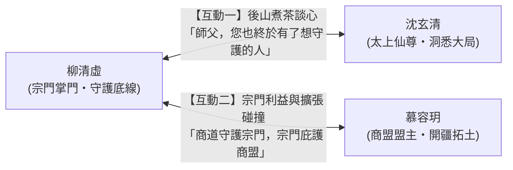
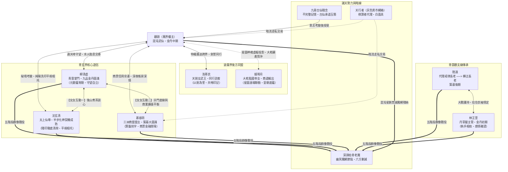

# 《萬界風月樓》第三卷人物補充｜愛情戲設計・新NPC設定（v2.0）

> **文檔定位**：第三卷《諸天回首・青玄歸途》專屬人物設計文件，涵蓋：  
> 1. 青玄三女（柳清虛・沈玄清・慕容玥）愛情節拍深化、親密共鳴因果對應與女女互動戲  
> 2. 支線情侶：陸遠・林芷萱 的感情確認、職責與境界成長因果  
> 3. 本卷主要NPC：天行者（灰色黑市網絡）・深淵枯骨老魔（魔網節點）・九霄古仙殘念（不完整記憶）  
> 4. 滄瀾道侶定位校準：洛寒衣（隨行同行者・共鳴印記）與姬明月（星圖虛擬聯動）  
> **參考母本**：[04-thinking.md](../../../04-thinking.md) 核心審查與架構指引  

---

## 一、青玄三女愛情戲深化與心境昇華

> [!IMPORTANT]
> **本卷愛情戲的核心原則**：
> 1. **愛情戲不必全落在男主身上**：女主們有各自的守望、試探、欣賞、彼此談心與事業決策；男主是引發心境質變的錨，但非時時刻刻居於舞台正中。
> 2. **親密共鳴具備明確的系統反哺因果**：男女主角的身心契合並非單純數值交換，而是特定情感節奏推動萬界樓特定功能的解鎖與穩定。
> 3. **遵從 R16 情感規範**：拒絕以「雙修許久」、「本源流入」等概括性字眼模糊過程，精確展現成熟男女間的心理博弈、主動託付與情感尊嚴。

---

### 1. 柳清虛（ch058・ch060・ch083・ch086）

> [!NOTE] **柳清虛境界進展四階段階梯（A級設定銜接）**
> * **第一卷**：**半步金丹**（早年衝擊受創致道基受損，經顧淵救治重塑無瑕水火道胎）。
> * **第二卷**：**正式凝結金丹，逐步提升品階**（ch021 孤身引動天劫成就上品金丹，在顧淵跨界期間持續閉關、溫養道胎，至第二卷末穩步淬煉至九品天道金丹層次）。
> * **第三卷初～中**：**九品金丹圓滿，開始孕育元嬰**（ch058 重逢時「九品金丹的金光在周身流轉」代表金丹已達巔峰無瑕；ch060 與顧淵深夜本源交泰後，道基內化生一縷紫金胎息，正式步入「元嬰蘊育期／元嬰胎動」）。
> * **第三卷結束**：**元嬰尚未真正凝成，但已經完全具備突破契機**（東華平定、道心無瑕，已備齊化嬰契機，留待後續機緣臨門一腳碎丹成嬰）。

#### 情感弧光：「守望者的驕傲與柔軟」
卷一她是被救的掌門，卷二她是獨立撐起宗門的掌門；到了卷三，她要讓顧淵看見——**她不再等待被看見，她已是那個讓顧淵也想回頭看的人**。

* **親密共鳴與萬界樓反哺**：長久守望後的深層信任 ──> 穩定古樓混沌本源、強化青玄界萬界門時空定位（修復度 +10/10000）。

---

**【Scene A】重逢場（ch058）——「通天峰上的等待」**
*視角：柳清虛第三人稱主觀視角*

通天峰，清晨。
柳清虛站在峰頂，眼前是剛布好的第七重護山陣法，她手持青玉道印，九品天道金丹圓滿的金光在周身流轉，無聲無息，極其圓融——那是一派掌門在天地間最沉穩的威儀，唯有丹田氣海深處，隱隱有一縷紫金色的胎息在隨之呼應。

她沒有感應到什麼預兆。就是突然，眉心那個溫熱的印記，微微一跳。
她的手停了。道印差一點從指尖滑落。
她站在那裡，很長時間沒有轉身。
山道下陸遠在喊：「師姐！師兄回來了！」
她深吸一口氣，收起道印，恢復波瀾不驚的掌門儀態，緩步走下通天峰的石階。
每走一步，心跳快一分。走到第三個彎道，她看見了那道青衫身影——合著折扇，仰頭看她，眉眼含笑，像是從未離開過一樣。
「清虛。」
她停在原地，好半晌才開口，聲音比平日輕了許多：「回來了。」
——只有她自己知道，她在那三個字裡，壓下了多少個日夜的想念。

---

**【Scene B】深夜相守（ch060）——「師姐的眼淚與道心交融」**
*視角：雙視角交替（先柳清虛，後顧淵）*

通天峰古閣，燭火搖曳。
顧淵把滄瀾所歷的一切講完，茶已涼了三杯。柳清虛靜靜聽著，素手端著茶盞，眼睫垂下。
「清虛？」
她抬起頭，眼眶微紅。顧淵放下茶盞，側身將她攬入懷中。她僵了一下，隨後將額頭埋入他的頸間，聲音悶悶地傳出：「顧淵……你每次走，我都裝作不在意……但這次去了那麼久。」
顧淵輕撫她的長髮：「讓你等了。」
柳清虛沉默片刻，輕聲道：「洛姑娘……在滄瀾界，與你並肩作戰，是個極好的劍修吧？」
這不是小女兒態的吃醋，而是身為道侶對同伴的認可與一絲微妙的不安。顧淵坦然道：「她極傲，但也極純粹。但守著青雲、守著這座山門的人，天下只有一個柳清虛。」
柳清虛眼角的淚痕被他輕輕拭去。那一夜，古閣青紗微動，水火既濟真訣與純陽星脈無聲共融，溫潤如春水生波。柳清虛氣海中的九品金丹在極致的心魂契合中輕輕震顫，凝結出一縷紫金元嬰道胎之息，萬界樓時空錨點隨之熠熠生輝。

---

**【Scene C】危局後的石階獨坐（ch083）——「我不依附你，但我選擇你」**
*視角：柳清虛純主觀視角*

大戰過後，月華灑落後山焦黑的靈田。
柳清虛坐在石階上，沒有哭，只是平靜地凝視著滿目瘡痍的山門。這一次，她沒有等顧淵來救；她主持大陣、調兵遣將、護全弟子，撐住了整個東華的防線。
當顧淵踏上石階走至她身旁時，她沒有回頭，只輕聲問道：「這次，我沒讓你失望吧？」
顧淵坐下，低語：「從來沒有。」
柳清虛嘴角微揚，伸手將微涼的指尖輕輕搭在他寬厚的手背上。她比任何時候都篤定：她不需要依賴他才能站立，但她甘願與他並肩承擔諸天的風雨。

---

### 2. 沈玄清（ch062・ch067・ch069・ch079）

> [!IMPORTANT] **沈玄清半步化神三階段因果（A級修煉因果與角色尊嚴）**
> 沈玄清的境界提升絕非「一次雙修直接升級」，而是跨越五百年積累的嚴謹因果鏈：
> 1. **第一階段：殘印洗滌（ch067前半）**：神魂恢復完整、排除舊傷。舊傷本就源於太古萬界樓大劫封魔，古仙遺址的煞氣是舊傷的共鳴觸發，顧淵純陽本源助其徹底驅逐殘煞。
> 2. **第二階段：本源共鳴（ch067後半）**：修為重新圓融、五百年元嬰道果恢復無瑕。
> 3. **第三階段：道心突破（ch067末～ch084）**：觸及化神門檻，引動元神神念出竅，**在本卷末達到「元嬰大圓滿巔峰・半步化神契機成熟」，為後續正式化神預留空間**。

#### 情感弧光：「仙尊學會了牽掛與平視」
沈玄清不是尋常溫柔女修，她是修行五百年的道門仙尊。她的感情絕非少女式爭寵，而是「平視、知己、生命相托」。

* **親密共鳴與萬界樓反哺**：放下戒備、神魂相契 ──> 解鎖【天機秘庫】古仙遺存線索、靈修殿解鎖元神加護陣眼（修復度 +20/10000）。

---

**【Scene A】廊下觀劍的審視與欣賞（ch062）**
*視角：沈玄清第三人稱主觀*

沈玄清站在古閣廊下，看著庭院中洛寒衣練劍。
雪白劍袍、孤傲拔俗，每一劍都凝練著極致的生死殺伐。沈玄清眼神深邃，心中沒有盲目的敵意，反而充滿了仙尊對同道強者的客觀認可：*「劍骨天成，確實是戰場上能為他擋下致命一擊的人。」*
然而，當顧淵走到洛寒衣身側低聲指點、洛寒衣自然仰頭對視時，沈玄清搭在玉欄上的素手微不可察地收緊了一分。她活了五百年，很清楚那一瞬間的心緒動搖意味著什麼。她不承認那是嫉妒，但當她轉身回書案前勾畫陣圖時，筆尖卻破天荒地懸停了良久。
——成熟仙尊的動心，不是失控，而是發現冷寂了五百年的心湖，第一次泛起了無可迴避的漣漪。

---

**【Scene B】秘境深處的神魂洗滌（ch067）——「沒有憐憫，只有平視」**
*視角：雙視角交替*

古仙遺址陣眼深處，沈玄清承受古仙大劫記憶衝擊，體內殘印引動地脈濁煞反噬，神魂如遭萬刃凌遲。
她跪坐於地，月白道袍凌亂，墨髮散落。洛寒衣欲拔劍護持，顧淵按住劍鞘：「讓我來。」
顧淵行至她面前，半跪而下，迎上她清冷倔強的雙眸。
沈玄清牙關咬緊，五百年來她習慣了獨抗天劫、庇護門人，從未向任何人示弱。但在神魂即將被黑暗吞噬的臨界點，看著顧淵沉靜深邃的眼眸，她慢慢鬆開了緊抿的唇：
「……顧淵，不要讓我消散。」
顧淵眼中**沒有憐憫，只有平視。她不要被當成需要憐憫的人，她要的是與他並肩而立。**
「我在。」
雙手十指相扣，《太上玄奼真經》水火既濟本源如汪洋奔湧。顧淵引混沌純陽，沈玄清主動運轉《太素天變錄》逆轉心脈，二人神魂交泰，將那道寄生五百年的大劫黑印徹底煉化抹除！沈玄清元嬰晶瑩無垢，道胎神光大盛，神魂力量重歸巔峰，觸及化神之壁！
事畢，沈玄清緩緩睜開眼，長睫微顫，主動握緊顧淵的手掌，不再避諱這份跨越輩分的生命之契。

---

### 3. 慕容玥（ch071・ch073・ch077）

#### 情感弧光：「算盡天下利弊，唯對他孤注一擲」
慕容玥是商人，在商言商、寸步不讓；但她對顧淵的愛，恰恰讓這個精於計算的人，有了一個甘願承擔全部風險的唯一變數。

* **親密共鳴與萬界樓反哺**：共同承擔跨界風險、建立商道信用 ──> 推進【萬界通商行】解鎖、珍寶閣虛空貨位擴容（修復度 +20/10000）。

---

**【Scene A】商道論證的商業邏輯交鋒（ch071）**
*視角：慕容玥第三人稱主觀*

慕容玥將整理完備的商道策劃案推至顧淵面前。
顧淵翻閱後問道：「萬界商票需要足夠的信任背書，如今萬界樓修復度僅約 1%，如何確保兩界商行願意兌付？」
慕容玥金玉算盤一揚，條理清晰地展現商業手腕（B-01 補充）：
1. **實體儲備與兌付機制**：三洲商盟以十二大拍賣行現存的八百萬靈石儲備金與天階丹藥作為本地即時兌付保證，商戶隨到隨兌；
2. **資產抵押權限**：青雲觀後山九華祖脈未來三年的靈石開採收益權，作為商票的底層穩定基金；
3. **大乾天策商行對沖**：姬明月以大乾皇室名義提供滄瀾界獨有的星隕神鐵實物儲備，兩界物資形成天然對沖；
4. **萬界樓核心信用天秤**：乾坤道印烙印於商票之上，具備不可偽造的空間法則波動。
她微揚下巴，眼波流轉：「顧大樓主，妾身把整個商盟的身家性命都押在你的信譽上了。這筆生意，你簽還是不簽？」
顧淵提筆落印，含笑凝視她：「萬界商女，名不虛傳。」

---

**【Scene B】算盤上的秘密（ch077）——「淵」**
*視角：慕容玥純主觀*

商道通航首日，帳房深處。伙計盡退，萬籟俱寂。
慕容玥獨坐案前，拿出一柄靈刻短刃，在金玉算盤最隱蔽、最貼近掌心的一枚翡翠撥珠背面，極細、極慢地刻下了一個小字：
**「淵」**。
那是她一人的秘密，不為外人道，甚至不打算讓顧淵知曉。
門扉微響，顧淵端著溫茶步入，順手飲盡她案頭已涼的殘茶，溫聲道：「辛苦了。」
慕容玥神色自若地將算盤滑入袖中，順勢倚入顧淵懷抱，纖指點著他的胸膛嬌笑：「今晚這筆帳，大樓主打算怎麼結？」
顧淵低頭吻她發間：「今晚先由你開價。」
——她算計了一世財富，唯獨在算盤底層，給他留下了無價的真心。

---

## 二、三女非男主中心的內部互動戲（兩場重磅交鋒）

> 打破「所有女主僅圍繞男主單線旋轉」的扁平架構，建立真實立體的後方同盟。

### 1. 第一場：柳清虛 ⟷ 沈玄清（ch063前夕・後山茶亭）
* **主題**：師徒名分與心靈共鳴。
* **情節**：
  沈玄清獨坐後山洗劍池旁，柳清虛攜紫砂茶具前來，親手烹煮靈茶。
  柳清虛敏銳察覺師尊看向顧淵時眼神的微妙變化——不再是純粹的高居雲端，而多了一絲身為女子的牽掛。
  柳清虛並未拈酸吃醋，而是將茶盞奉至師尊面前，輕聲道：
  「師父，從小到大，都是您在為青雲扛起風雨。但這次顧郎回來，徒兒看見師父眼中有了光亮……徒兒很高興，這世間終於也有了讓師父想要牽掛、想要守護的人。」
  沈玄清執杯的手微微一顫，眼中波光流轉，終是幽幽一嘆，輕握清虛的手：「清虛，你長大了。」
  兩代道門女魁首達成心靈默契，師徒隔閡消弭於無形。

### 2. 第二場：柳清虛 ⟷ 慕容玥（ch072・千寶商樓密閣）
* **主題**：宗門戒律安全 vs 商業利益擴張。
* **情節**：
  慕容玥欲將落霞仙城的大宗傳送陣直接引向青雲後山，以便貨物快速轉運；柳清虛嚴詞拒絕，認為後山乃宗門祖脈禁地，且連通封魔大陣，商道魚龍混雜恐引發魔修滲透。
  兩人各據一方，寸步不讓：慕容玥強調商業時效與利潤，柳清虛堅守宗門防線與道統根基。
  最終，慕容玥被柳清虛身為掌門的原則與底線折服；柳清虛亦認可商盟能為青雲弟子帶來源源不絕的修行資源。二人商定：在青雲外圍「青溪谷」另闢專屬商貿驛站，由戒律堂統一審查通關。
  臨別時，慕容玥掩唇笑道：「柳掌門這般護短，難怪顧大樓主在外走得再遠，魂也丟在青雲觀。」柳清虛耳根微紅，神態卻從容自若：「彼此彼此。」

---

## 三、支線情侶：陸遠・林芷萱 感情線完備設計

> [!TIP]
> 陸遠與林芷萱是青雲觀日常底色的靈魂支柱，兩人的情感進展代表宗門在劫難中的傳承與溫暖。

### 1. 人物職務與境界因果補強（落實 A/B 級審查）
* **陸遠（代理戒律長老 ──> 正式任命）**：
  * **原狀態**：築基初期。
  * **職責來源**：柳清虛頒布「青雲新令」，看重陸遠性情耿直、鐵面無私且對宗門絕對忠誠，破格任命其為「**代理戒律長老**」，主掌門規整肅；
  * **境界突破**：在顧淵留下的武道吐納法借鑒與守山實戰淬煉下，修為穩步邁入**築基後期**；於卷末抗擊魔潮立下赫赫戰功，正式轉正為戒律長老。
* **林芷萱（丹草閣主管 ──> 金丹初期突破因果）**：
  * **原狀態**：煉氣九層。
  * **修煉積累**：天生具備罕見的「草木親和道體」，常年泡在丹草閣照料師尊、分析萬界靈藥，對藥理與天地靈息的理解早已超越尋常修士；
  * **突破過程**：柳清虛親授水火調和突破丹（非直接灌頂，僅作破障輔助），林芷萱在後山獨立引動三九天劫，以自身多年對丹道草木之悟凝成無瑕木靈金丹，**正式晉陞金丹初期**。

### 2. 情感確認關鍵節拍（ch083）——「拉住衣袖」
大戰落幕，丹草閣內靈藥香氣混雜著淡淡血腥。
林芷萱靠著藥櫃沉沉睡去，睫毛微顫。陸遠卸下滿是煞氣的劍袍，輕手輕腳將自己的厚實外袍披在她肩頭。
林芷萱悠悠轉醒，看著陸遠眼底的血絲與乾裂的嘴唇，輕聲道：「師兄，你又路過丹草閣？」
陸遠別開頭：「……戒律巡山，剛好走到後院。」
這一次，林芷萱沒有像以往那般笑笑放過。她坐起身，纖細的手指探出，輕輕**拉住了陸遠的衣袖**。
衣料緊繃。
「師兄，丹草閣在後山盡頭，巡山走不到這裡。」她仰起頭，眼眸倒映著微弱的燭火，「每一次宗門有難，每一次我最害怕的時候，你都在。不要再說是路過了，好不好？」
陸遠身形凝固，僵立在原地良久。他沒有抽回衣袖，也沒有再找藉口。良久，他緩緩蹲下身，反手握住了那隻沾著藥汁的小手，沉聲道：
「……好，以後不說路過。只要你想，我一直在。」
窗外星河璀璨，兩顆純粹的心終告定情。

---

## 四、三名新 NPC 深度審查與定案

### 1. 天行者（諸天灰色商業網絡組織）
* **定位昇華（B級）**：非單純反派打手，而是遊走於諸天文明裂隙的**灰色商業中介網絡**。
* **組織三大業務功能**：
  1. **情報交易**：掌握諸天世界坐標、強者弱點、遠古遺址，甚至可與慕容玥形成亦敵亦友的情報交易；
  2. **跨界走私**：轉運各界違禁稀有礦產、異界生靈；
  3. **禁忌買賣**：私自收購萬界樓損毀碎片、古仙封印殘核，暗中供奉於諸天蝕者。
* **組織層級與白面具含義**：
  * **諸天蝕者**：太古大劫源頭（終極威脅）；
  * **天行者**：獨立黑市組織（利益驅動，與蝕者合作而非屬下）；
  * **棋算者**：天行者核心最高決策者，隱居高維裂隙；
  * **天行者爪牙（素面白具）**：白面具代表「交易身份不等於真實身份」，面具不刻五官，成員對外只以數字代號相稱，冷酷超然。
* **行事原則**：「沒有什麼不能賣，只看買家出不出得起價。我們不打架，我們只負責提醒。」

---

### 2. 深淵枯骨老魔（西陵危局核心 Boss）
* **本質與力量來源（B級戰力合理化）**：
  * 並非普通金丹怨靈，其本質是古代金丹邪修殘魂被太古「幽冥魔網」寄生、改造成的**魔網實體節點**；
  * **三大力量支柱**：三千年前之金丹殘魂底蘊 ＋ 東華山脈積累數千年的陰煞死氣 ＋ 幽冥魔網源源不絕輸送的魔煞本源。
* **ch079～ch084 青玄群像戰役六方分工鏈**：
  | 參戰人物 | 職責與任務 | 戰術價值與定位 |
  | :--- | :--- | :--- |
  | **柳清虛** | 主持「青蓮開天護山大陣」 | 統御全宗長老弟子，守死青雲防線，阻斷魔煞擴散 |
  | **沈玄清** | 引動後山古仙封印鎖鏈 | 以半步化神神念鎖定老魔核心，限制其遁入虛空 |
  | **慕容玥** | 商盟後勤供給與情報封鎖 | 提供十萬枚破煞靈丹，並動用黑市情報切斷老魔三處靈脈補給 |
  | **陸遠** | 統領戒律堂外圍戰線 | 率弟子截殺被魔煞污染的狂化妖獸，保護山下凡俗城鎮 |
  | **林芷萱** | 丹草閣戰地救治體系 | 晝夜不停煉製解煞丹，維持宗門戰力持續運轉 |
  | **顧淵** | 致命穿透・毀滅殘絲 | 待三女控死戰局後精準斬入，以混沌純陽將老魔體內的魔網殘絲徹底焚滅 |

---

### 3. 九霄古仙殘念（古仙遺志不完整記憶）
* **台詞與真相分層重塑（A級主線懸念）**：
  * 拒絕「資料庫式一次性全盤招供」，調整為沉重的不完整殘缺記憶。
  * **考驗與傳承**：顧淵必須以自身混沌星脈承受古仙三道誅魔意志衝擊，證明自身道心，方能喚醒古仙殘念。
* **定案台詞（ch066）**：
  > 「萬界樓……不是你以為的那樣……」  
  > （殘念神魂劇烈震盪，古老陣紋明滅不定）  
  > 「那一戰……天塌地陷，我們已經沒有選擇……引爆，是最後的辦法……」  
  > 「至於為什麼引爆、敵人在何方……孩子，殘念將散，這條路，你必須親自去走完……因為逝去之人，已沒有資格替諸天作主。」
* **實體遺存**：殘念消散後，並非單純化作虛無星光，而是凝結出一枚刻滿太古封魔陣紋的**【古仙承道玉簡】**，成為顧淵日後推演諸天七界封魔陣的關鍵實物依憑。

---

## 五、滄瀾界道侶定位與跨界機制校準

### 1. 洛寒衣（首次同行者・非自由跨界）
* **系統權限嚴格校準（A級）**：
  * 洛寒衣本次進入青玄界，純粹由顧淵動用樓主特權「接引並陪同視察」，**尚未取得獨立自主跨界之能**；
  * `ch086` 的雪峰劍誓，是傲骨劍仙在道心與立場上對顧淵的徹底選擇（「我的劍，從今往後有你在列」）；後續自主跨界通行權限，需待二人日後行深層身心契合後方可解鎖。

### 2. 姬明月（星圖遠端聯動・大乾商道輸出）
* **空間定位嚴格規範（A級）**：
  * 姬明月身為大乾監國帝女，社稷責任重大，**第三卷絕不突兀以肉身瞬移出現在青雲觀**；
  * 其全程透過萬界樓天機閣星圖以「虛擬神魂投影」參與三界聯動會；
  * `ch087` 的「五女同聚」明確為大乾局勢平定後，姬明月藉由大乾錨點首次短暫親臨萬界樓本體議事，不破壞兩界實體空間屏障。

---

## 六、第三卷人物關係更新圖（v2.0）

