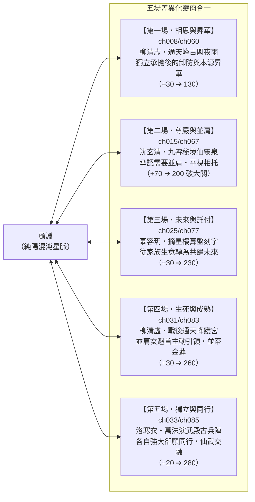

# 《萬界風月樓》第三卷人物補充｜愛情戲設計・群像深化・新NPC設定（v3.1）

> **文檔定位**：第三卷《諸天回首・青玄歸途》專屬人物設計文件，涵蓋：  
> 1. 五位核心女主獨立人格坐標與本卷情感進展總覽（各自有生活、目標、判斷、選擇與成長；相互尊重，不必事事認同）  
> 2. 五場差異化雙修高潮大戲（唯一修復能量來源，強調感情與道心昇華，拒絕工具化突破與單調救傷套路）  
> 3. 女女互動與價值碰撞（清虛與寒衣破冰、明月與玥兒跨界商政交鋒與共識、清虛與玥兒商門激辯、師徒幽篁茶談、夜宴與五女齊聚的和而不同）  
> 4. 支線情侶：陸遠・林芷萱 的扎實能力成長、職責晉升與拉衣袖定情  
> 5. 本卷主要NPC：天行者（蜂巢黑市網絡・白面具制度）・深淵枯骨老魔（地脈天災）・九霄古仙殘念（三大實質情報）  
> 6. 滄瀾道侶弧光校準：洛寒衣（獨立劍道與道侶同行的內在轉變）與姬明月（參與跨界商道、建立女主協同關係與 2.50% 真身跨界硬門檻）  
> **參考母本**：核心架構審查與十四項架構補強指引、第三卷人物與感情線深度修訂指引（6.1～6.6、8.1～8.4）

---

## 一、成熟多女主群像核心原則（獨立人格・和而不同）

> [!IMPORTANT]
> **人物寫作鐵律**：
> 《萬界風月樓》不是單純的升級打怪小說，**女主角絕不能只是男主獲得力量、資源、獎勵的途徑**。她們必須各自擁有獨立的生活、目標、判斷、選擇與成長。
> 五位女主之間**拒絕低俗爭風吃醋，也拒絕缺乏真實感的「完全一團和氣」**——她們對於萬界樓的未來、資源分配與行事節奏，不必事事認同，而是**在保留各自性格差異與價值底線的前提下，彼此尊重、分工協同**。

### 1. 五位核心女主的價值坐標與本卷情感進展總表

| 女主 | 核心價值坐標 | 面對萬界樓與大事的典型立場 | 本卷獨特情感進展與心理轉變 |
| :--- | :--- | :--- | :--- |
| **柳清虛** | **秩序與責任** | 凡事以宗門根基、凡俗蒼生與規則底線為先，反對無底線冒進 | 證明自己在顧淵離去期間已能獨立承擔掌門重任；從思念守望的道侶，徹底成長為獨當一面、與顧淵平等並肩的女魁首（ch008 雙修是情感與本源昇華，而非完成修煉的唯一途徑） |
| **沈玄清** | **尊嚴與平等** | 守護道心獨立與大道本質，警惕被權術或世俗交換裹挾 | 不是不懂情，而是五百年來把情感視為修行負擔、習慣成為別人的依靠卻不知如何成為別人的道侶；ch010 師徒茶談動心，ch015 清醒承認「自己也需要有人並肩」，在完整尊嚴下平視相托 |
| **慕容玥** | **利益與效率** | 講求資源配置最大化、制度信用與風險可控下的主動擴張 | 在 ch019～021 與姬明月交鋒共治、ch020 與柳清虛激辯後迎來關鍵內心轉折——意識到自己經營的不再只是家族商業，而是與顧淵共同建立的未來；ch025 算盤刻「淵」字水到渠成 |
| **洛寒衣** | **承諾與行動** | 厭惡空談與彎繞，信奉說到做到、以劍破局與強者直率 | 經歷「武者獨立性 vs 追隨依附」的內在衝突——見證眾女各自擁有宗門、道統、商盟與皇朝後自我叩問，於戰火中破悟「真正的道侶不是依附，而是各自強大卻願意同行」，ch034 主動以劍立誓 |
| **姬明月** | **權責與大局** | 從皇朝法度、國家財政與諸天勢力版圖權衡利弊，要求權責對等 | 擺脫遠端配角定位：於 ch019～021 從皇權財政角度與慕容玥發生真實理念衝突並達成共識，建立強者合作夥伴關係；以一國秩序先行替顧淵鋪路，待 ch035 真身降臨實現情感與戰略雙爆發 |

---

## 二、純粹雙修引擎：五場差異化親密大戲（唯一能量來源）

> [!IMPORTANT]
> **拒絕單調的「受傷 ➔ 救人 ➔ 雙修」重複模式，也拒絕把雙修寫成女主獲得成長的唯一途徑！**  
> **正文防工具化鐵律**：大綱雖明定雙修為萬界樓唯一修復能量來源，但**實際正文必須寫成「感情昇華、靈肉契合之後，順帶自然反哺古樓」**，絕不可寫成「為了修復古樓而去雙修」，避免任何女主被工具化的觀感。  
> 第三卷修復度自 100/10000 穩步飆升至 280/10000 的全部 180 點能量，全部來自以下五場具備**不同心理主題、不同空間氛圍、不同情感動力與不同道法異象**的極致親密大戲：

---

### 1. 第一場雙修（卷內 ch008｜全書 ch060 柳清虛）：【相思與本源昇華】
* **核心主題**：小別勝新婚、獨撐大局後的柔情釋放，以及平等道侶之間的感情與本源昇華。
* **情境氛圍**：通天峰古閣、夜雨敲窗、青燈黃卷、卸下掌門道袍後的依戀與坦誠。
* **情感動力與成長分寸（6.6 核心要求）**：
  * 柳清虛真正的成長，源於她在顧淵離開期間已經獨自整肅山門、布陣禦敵、淬煉九品天道金丹，證明自己能夠獨立承擔一派之主的責任。
  * 今夜伏在顧淵懷中眼眶泛紅，不是等待拯救的軟弱，而是終於可以短暫卸下強撐已久的盔甲。
  * **切忌過度依賴修為突破**：雙修是兩人久別重逢後的感情與本源昇華，絕非她完成修煉的唯一途徑。氣海深處那一縷微弱的紫金元嬰胎動，是她長期獨立苦修厚積薄發後，於本源交泰間自然湧現的水到渠成共鳴（FB3-06）。
* **反饋與分寸控制（6.3 聯動）**：**萬界樓修復度 +30/10000（達到 130/10000）**，風月苑顯化第二層「凝香道閣」。後山沈玄清僅憑同源道標與天地靈機遠距感知到本源共鳴與柳清虛道基圓融，絕不暗中窺視靜室親密過程，維持高冷仙尊的尊嚴與界線。

---

### 2. 第二場雙修（卷內 ch015｜全書 ch067 沈玄清）：【尊嚴與平視並肩】（全卷最爆發之役）
* **核心主題**：五百年高冷仙尊在清醒與尊嚴完整的前提下，第一次承認自己也需要有人並肩。
* **情境氛圍**：九霄秘境古仙寒泉池、水霧氤氳、冰肌玉骨。從倔強守住仙尊體面的「休要憐憫本座」，到顧淵雙眼緊盯「仙尊，沒有憐憫，只有平視」。
* **情感動力（6.3 核心要求）**：
  * **絕不能只靠傷勢發作推動雙修**：秘境煞氣誘發五百年大劫殘印只是外在引子，而非逼她失控就範的理由。
  * 承接 ch010（全書 ch062）師徒茶談後的長久沉思——沈玄清並不是不懂情，而是五百年來始終把情感視為修行的負擔；她早已習慣成為別人的依靠，卻不知道如何成為別人的道侶。
  * 真正令她放下心防的決定性瞬間，是她在神智清明之際第一次誠實面對內心並承認：**「五百年獨行已久，我也需要有一個人，能站在身側與我並肩。」** 主動褪去素裳，是平等強者之間的尊嚴相托。
* **道法異象與反饋**：太素天變與混沌純陽大碰撞！冰火狂暴交織，五百年處子純陰徹底拔除殘印宿疾（除病因），被壓制五百年的七成元神本源解放重歸圓融至**元嬰大圓滿巔峰**（復修為），道心無瑕觸摸化神門檻（悟契機）！**萬界樓修復度狂飆 +70/10000（達到 200/10000，整整 2.00% 破大關！）**，新骨架注滿本源，**解鎖【天機秘庫】**！

---

### 3. 第三場雙修（卷內 ch025｜全書 ch077 慕容玥）：【共同未來與算盤託付】
* **核心主題**：從精明計算家族版圖的商女，蛻變為將人生與未來都算進顧淵命途的同行合夥人。
* **情境氛圍**：落霞商盟最高層摘星樓、俯瞰三洲人間燈火。滿桌散落著商票帳冊與兩界契約，手邊是一柄微型紫金算盤（核心撥珠背面暗刻「淵」字）。
* **情感動力（6.5 核心要求）**：
  * 承接 ch020（全書 ch072）與柳清虛激辯後的關鍵內心轉折（意識到自己拼命搭建的跨界商道，已不再只是慕容家的家族商業，而是她與顧淵共同建立的未來），以及 ch019～021 與姬明月碰撞並達成共識的歷練。
  * 算盤背後的「淵」字因此不再只是俏皮可愛的小動作，而是這位算盡天下的商海女王，在心底鄭重把自己的未來託付給他的無聲印記。深夜顧淵飲盡殘茶攬腰入懷，精明商女主動卸下算計面具，動情承歡。
* **道法異象與反饋**：聚寶純陰體質交感，靈動熱烈，聲息如珠玉落盤。慕容玥【靈鑑神瞳】二重蛻變（洞破虛妄法寶節點），突破築基大圓滿；**萬界樓修復度 +30/10000（達到 230/10000）**，珍寶閣開放大規模三界虛空專屬倉儲位！

---

### 4. 第四場雙修（卷內 ch031｜全書 ch083 柳清虛）：【生死與成熟並肩】
* **核心主題**：大劫平定、獨立守宗後的並肩生命昇華。
* **情境氛圍**：月光灑落通天峰長階，戰火洗淨。石階獨坐執手、「沒讓你失望吧」「從來沒有」的心靈對白後，二人攜手步入掌門寢宮。
* **情感動力**：柳清虛已憑一己之力統率全宗守住青雲、重整東華秩序。此刻的她展現出成熟女魁首與並肩道侶的自信、主動與極致柔情。
* **道法異象與反饋**：莊嚴宏大，青蓮道火與混沌純陽於虛空化生並蒂金蓮。九品金丹氣海內的紫金元嬰胚胎胎息圓熟大成，具備完備突破契機；**萬界樓修復度 +30/10000（達到 260/10000）**，守護古陣實體化威能暴漲五成！

---

### 5. 第五場雙修（卷內 ch033｜全書 ch085 洛寒衣）：【獨立劍心與仙武同行】
* **核心主題**：武者解開「追隨與獨立」心結後，以平等強者之姿以劍會心、以身相托。
* **情境氛圍**：萬法演武殿、諸天殘破古兵陣列、斷星古劍斜插於地。武癡女子的直率熱烈，汗水與氣血戰罡交織。
* **情感動力（6.4 核心要求）**：
  * 經歷整卷青玄之行與西陵老魔戰場的獨立破局，洛寒衣徹底想通——她不需要為了追隨顧淵而磨鈍獨行天地的劍鋒，真正的道侶不是依附，而是各自強大卻願意同行。
  * 在演武殿萬千古兵見證下，她以武證道、仙武交泰，並在隔日 ch034（全書 ch086）萬界門前主動以劍立誓，完成從「信任同行」到「主動選擇共行大道」的完整心理蛻變。
* **道法異象與反饋**：剛柔並濟、大開大合，仙武戰罡徹底相融，斷星劍器魂昇華，女武王傲骨化作只對一人展露的深沉柔情；**萬界樓修復度 +20/10000（達到 280/10000，整整 2.80%！）**，雙修本源催化，**正式解鎖第四核心設施【萬界通商行】與【時空定標儀】**！

---

## 三、女女互動與群像碰撞（相互尊重，但不必事事認同）

> 絕非模板化的一見如故，也非低俗爭風吃醋，而是五位擁有獨立價值觀的強者女子在現實利益、道統秩序與治理理念上的真實交鋒與彼此認可。

### 1. 柳清虛 ⟷ 洛寒衣（卷內 ch006｜全書 ch058 通天峰石階初見）
* **初見對峙**：柳清虛手按掌門印，展現一派之主的秩序感與主場威嚴；洛寒衣負劍而立，流露武者對強者的審視與求戰倨傲。空氣中靈壓與劍罡微碰，全無諂媚討好。
* **融冰細節**：山道轉角處，洛寒衣看見清虛皓腕上因加固大陣留下的靈火灼傷，默默取出天劍山凌霄雪峰特產「生肌雪玉膏」遞過去：「滄瀾的藥，專克火毒。你是他的掌門，別帶傷迎客。」清虛莞爾接過。兩人以強者互敬破冰，但此幕也悄悄在洛寒衣心底埋下第一顆種子——看著柳清虛坐擁山門重責，她開始思索自己在異界的獨立定位。

### 2. 沈玄清 ⟷ 柳清虛（卷內 ch010｜全書 ch062 幽篁亭師徒茶談）
* **核心金句**：清虛執壺烹茶，並未替顧淵強行開脫，而是平靜道出本心：**「師尊，徒兒知道顧淵的心容得下諸天，但他的眼裡始終有我們。」**
* **深層心理價值（6.3）**：這句話真正的力量，在於促使沈玄清第一次審視自己的情感——她並非不懂情，而是五百年來始終把情感當成修行的負擔與破綻；她習慣了高坐雲端、成為別人的依靠，卻從未學會如何卸下盔甲、成為別人的道侶。這場茶談成為 ch015 心防鬆動的真正起點。

### 3. 姬明月 ⟷ 慕容玥（卷內 ch019～021｜全書 ch071～073 跨界商政理念衝突與共識）
* **核心定位（6.1 重點補強）**：徹底打破姬明月在卷中長期淪為「遠端背景板」的局限，建立兩位女主之間不依附於顧淵的強者合作關係！
* **真實理念衝突（ch019 / ch071）**：
  * **姬明月（皇權與國家財政視角）**：透過星圖投影強硬質疑商票方案——鑄幣定價乃皇朝命脈，星隕神鐵屬軍國戰略重器；若任由私人商行跨界發行自由流通的商票，極易衝擊大乾賦稅秩序、引發國內銀錢物價動盪，她堅持由皇朝掌握配額、稅印與流通邊界。
  * **慕容玥（市場效率與商業信用視角）**：寸步不讓地正面反駁——若商票淪為官府層層審批的行政憑證，市場便失去即時剛兌的公信力與效率，反而逼出黑市套利與暗中走私；跨界硬通貨必須尊重市場供需、維持獨立準備金池與靈活清算。
  * 兩人隔界正面交鋒，立場鮮明、皆有充分道理，當場並未勉強妥協。
* **達成共識與強者互認（ch021 / ch073）**：
  * 經過兩日推演與 ch020 柳清虛青雲端條款落地後，姬明月與慕容玥各自守住底線、讓出非核心邊界，敲定**「官商分層共治」**架構——大乾朝廷握緊戰略物資年度配額、軍備優先調撥權與皇室防偽稅印；慕容玥商盟全權執掌市場定價、即時兌付與兩界差額清算。
  * 商票首航大捷後，姬明月淡然肯定慕容玥的理財手段：「若在大乾朝堂，戶部尚書之位都屈就了你。」慕容玥亦笑敬帝女治國格局：「若無殿下以國運托底，這紙商票也成不了氣候。」兩人不只是都愛顧淵，更成為彼此認可的跨界戰略夥伴！

### 4. 柳清虛 ⟷ 慕容玥（卷內 ch020｜全書 ch072 商門對坐激辯與玥兒心境轉折）
* **激烈衝突**：慕容玥提出質押九華祖脈三年開採收益權作為商票防擠兌安全閥。柳清虛拍案斥責祖脈乃立派根基，絕不容拿宗門命脈冒險；慕容玥紅著眼眶摔出青雲三千弟子每月微薄供奉帳冊：「柳掌門，王家雖滅，東華群狼環伺，光靠清高道骨能換來破境靈丹、養活三千門人嗎？！」
* **結盟與關鍵心理轉折（6.5）**：兩女確認彼此全無私心，清虛終落掌門印、親手斟茶。走出配殿之際，慕容玥望著掌門玉印心頭微震——她驟然意識到，自己方才那份近乎孤注一擲的執著，早已不是為了慕容家一姓之利；**自己如今傾力經營的一切，已不再只是家族商業，而是她與顧淵共同建立的未來**。這道轉折直接為 ch025 算盤刻「淵」字賦予沉甸甸的情感重量。

### 5. 兩個多女主同堂名場面的群像張力（6.2 拒絕過度順利）
* **ch017（全書 ch069）四女實體同席＋姬明月星圖投影**：
  * 絕不流於一團和氣，也不寫低俗吃醋。席間議及「萬界樓今後該如何面對兩界勢力與黑市異動」時，五女立刻顯露鮮明差異：
    * **慕容玥（利益與效率）**主張順勢佈設跨界商網搶佔定價權；
    * **柳清虛（秩序與責任）**提醒青雲祖脈剛現鬆動，須先穩固宗門秩序與凡俗安危；
    * **沈玄清（尊嚴與平等）**直言古樓太古使命在於應對諸天大劫，切忌淪為純粹逐利的交易場；
    * **姬明月（權責與大局）**要求任何跨界動作必須明定界域權責與邊界，不可破壞皇朝法度；
    * **洛寒衣（承諾與行動）**握劍冷聲表態，若有人窺伺古樓便直接持劍斬絕後患，不必空談權衡。
  * 五女彼此並未強求意見一致，而是在尊重對方判斷的前提下各司其職，顧淵折扇周旋其間，展現真實而成熟的群像質感。
* **ch035（全書 ch087）五女真身首次齊聚萬界樓**：
  * 面對九曜神域神權崩潰與真龍神座告急，五女真身同堂定策時依然「和而不同」：姬明月從大局與皇朝存亡出發力主迅速出兵並確立遠征統轄權責；柳清虛強調青玄大戰剛歇、必須先固守兩界退路與秩序；沈玄清以五百年見識冷靜示警諸天蝕者屬規則天災，不可低估神域兇險；慕容玥當場核算遠征補給、商票敞口與黑市情報線的投入回報；洛寒衣不涉冗長爭論，按劍立身，只重申既已立誓同行便直赴前線以行動破局。
  * 沒有虛假的盲目附和，唯有五位成熟強者在不同視角碰撞後形成的堅不可摧的分工同盟。

---

## 四、門人支線進階：陸遠與林芷萱扎實成長（P2 補強）

### 1. 陸遠（代理戒律長老 ──> 正式轉正・築基後期）
* **成長歷程（絕非裙帶恩賜）**：
  * **ch005 / ch057**：任「代理戒律堂主事」（築基中期）。王家殘黨宿老倚老賣老，陸遠頂著被暗算刺傷的威脅，鐵面無私按律重罰，以一身硬骨頭贏得基層弟子擁戴；
  * **ch027 / ch079**：老魔率煞潮突襲，老長老們嚇得龜縮，陸遠挺身而出率領執法隊死守山下凡俗城鎮，在血海搏殺中打破瓶頸，突破**築基後期**；
  * **ch032 / ch084**：柳清虛當眾宣布任命其為青雲觀「戒律長老」，全宗弟子雷鳴歡呼，心服口服。

### 2. 林芷萱（丹草閣弟子 ──> 丹草閣主・築基中期）
* **成長歷程（非劇情贈品・嚴守修仙境界階梯）**：
  * **ch005 / ch057**：長期打理丹草閣（煉氣九層圓滿），身具「草木親和道體」，對靈藥藥性了如指掌，但因早年王家剋扣靈藥壓制了築基契機；
  * **ch021 / ch073**：慕容玥引進滄瀾神鐵與高階靈材後，林芷萱晝夜鑽研，煉製出失傳的「太素融靈丹」，並順勢打破桎梏成功踏入**築基初期**；
  * **ch027 / ch079**：老魔進犯，她以一人之力統御戰地救治點，十二時辰不停輪轉救活數千弟子，草木道體在極限壓力下覺醒昇華；戰後穩步突破**築基中期**，憑卓越戰功與無可替代的丹道造詣正式受封「丹草閣主」。

### 3. 情感確認關鍵節拍（ch031 / ch083）——「拉住衣袖」
* 大戰落幕，丹草閣外。陸遠收起染血法尺假裝「路過」。
* 林芷萱走出閣門，不再聽他藉口，**主動伸手拉住陸遠的衣袖**。
* 「師兄，丹草閣在後山盡頭，巡山走不到這裡。不要再說是路過了，好不好？」
* 陸遠僵住，第一次沒有找藉口離開，反手握住林芷萱沾滿藥汁的溫熱手指：「好，以後不說路過。只要你想，我一直在。」

---

## 五、主要 NPC 深度審查與定案

### 1. 天行者（獨立逐利的跨界情報與走私網絡・8.2 嚴格分層）
* **組織定位（非諸天蝕者附庸）**：天行者並非諸天蝕者的正式下屬，而是逐利的跨界情報與走私網絡。他們知道諸天蝕者的存在與古仙遺址的暴利價值，但未必理解背後真正的滅世危險；**天行者（商利）、棋算者（獨立私謀）、諸天蝕者（自身高維邏輯）三方各自獨立，不必一致**。
* **組織層級**：「執事（白面）➔ 行走（銀面）➔ 樞密算者（金面）➔ 棋算者（至尊無面）」。成員互不知曉真實界域與本名，戴上面具即為代號。
* **行動動機**：依託高風險「虛空裂隙星梭」走私，渴望獲取萬界商票的空間信標；切割倒賣萬界樓基石碎片、對外兜售強者與遺址情報牟利。
* **對顧淵的動態密令**：ch024（全書 ch076）破譯密盤顯示，高層將顧淵標記為「001 號潛在天平執掌者」，下達內部密令「密切觀察，必要時可與之交易」，且密盤中**只暴露了九曜神域存在核心交易站**，並未附帶精確入口坐標。

### 2. 深淵枯骨老魔（西陵危局核心 Boss・8.4 動機升級）
* **本質**：三千年前肉身已死，將殘魂獻祭給太古魔網，化為「**幽冥魔網的寄生實體肉身**」。
* **戰略動機**：並非單純吞噬靈脈，而是察覺九霄封印片被取走及祖脈三炷香真空期後，企圖**強奪殘留在青雲祖脈中的半份「古仙封印權限」**，將第五篇升級為太古封印控制權爭奪戰（屬各方自主判斷演化的連鎖衝突，非古仙宿命安排）。
* **戰力與危機**：調用青玄地底三千年幽冥煞海，破壞力等同於「半步化神級地脈天災」；九天陰煞濁流若擴散，三千萬凡人與弟子將化為血水魔奴，因而形成極度緊繃的六人群像防衛戰。

### 3. 九霄古仙殘念（三大實質線索 ＋ 終極懸念留白・8.1）
* **核心對白（保留懸念，不一次說完）**：
  * *「萬界樓……不是你以為的那樣……引爆……是當年最後的辦法。」*
  * 消散前認出顧淵身上的古老印記，吐出更具衝擊力的終極留白：*「你所見的萬界樓，不過是它留下的最後一個錨點。」*（**嚴格規範：第三卷不提前確定萬界樓究竟是建築、法寶還是更龐大存在的答案**）
* **三大實質情報與憑證**：
  1. **大劫本質**：諸天蝕者並非單純生命，而是文明演化極致時引發的「高維規則天災／格式化清理」；
  2. **萬界樓引爆往事**：上一任樓主與古仙聯盟當年為阻止諸天整體崩滅，萬不得已引爆核心並以七界鎖鏈暫釘虛空；
  3. **拆分憑證與印記感應**：認出顧淵混沌星脈深處之古老印記，留下【古仙承道玉簡】與【古仙遺志封印片】（實為戰時拆分的古仙權限憑證之一半，另一半殘留青雲祖脈）。

---

## 六、滄瀾界道侶弧光與跨界條件校準

### 1. 洛寒衣（女武王戰力定位 ＋ 「選擇性同行」心理變化弧光）
* **境界對標**：滄瀾女武王 ＝ 相當於青玄界**「金丹大圓滿至半步元嬰」**的破壞力。近戰三丈爆發力堪比元嬰初期，但遠程大範圍法術操控與神魂防禦弱於修仙者。
* **正文分寸提醒（關鍵）**：寫作洛寒衣的「獨立」時，**切忌寫成排斥靠近、生硬逞強的「拒絕依賴」**；她的內核是**「選擇性同行」**——有本事獨行天地、不依附他人羽翼，但同時也敢把後背與心意交給顧淵，清醒而主動地選擇與他共行。
* **內在心理轉變弧光（6.4 核心補強）**：
  * **第一階段・異界自省（ch005～006 / ch057～058）**：初臨青玄，靈氣環境壓縮其調動天地之力的範圍；見柳清虛一派掌門威儀，她首次隱約生出武者的警覺——自己願與顧淵同行，卻需確認自己的劍心不會因踏入陌生世界而失去獨立鋒芒。
  * **第二階段・群像對照與劍心叩問（ch010、ch017 / ch062、ch069）**：先後見到柳清虛有自己的宗門、沈玄清有自己的五百年道統、慕容玥有自己的商業帝國、姬明月有自己的皇朝江山，洛寒衣手撫斷星古劍自問：離了滄瀾天劍山，自己在顧淵身側究竟是「並肩的劍」，還是失了稜角的附庸？
  * **第三階段・戰火破悟（ch022～023、ch028～029 / ch074～075、ch080～081）**：截殺白面具、單劍斷黑石峽谷魔脈、近戰撕裂老魔骨甲，她在修仙戰場上憑自己的武道判斷打出無可替代的戰位，也體會到與顧淵互托後背的暢快，終於豁然開朗——**真正的道侶不是依附，也非冷漠排斥依賴，而是各自強大後的主動「選擇性同行」**。
  * **第四階段・主動立誓（ch033～034 / ch085～086）**：演武殿仙武交泰徹底相融後，於萬界門前主動拉顧淵之手按在斷星劍柄立誓。這不再只是單純的愛情宣言，而是一位獨立女武王確認自我劍道後，清醒而主動選擇與顧淵共同前行的莊重承諾。

### 2. 姬明月（深度參與跨界商道 ＋ 2.50% 真身跨界門檻與時機交代）
* **三大硬性門檻**：① 完成過深層雙修；② 凝聚成熟時空錨點；③ **萬界樓修復度達到 2.50%（250/10000）以上，且需顧淵親自在樓內催動界門接引**！
* **ch031（2.60%）至 ch035 真身降臨四章間隔的自然交代（防落差）**：ch031 修復度跨過 2.50% 後刻意未立刻接引真身，正文須於 **ch031 末／ch033** 以一兩句星圖傳訊自然點明——大乾朝堂此刻正值「官商分層共治」首期商票稅印結算與監國暫攝交接關鍵期，且真龍肉身初跨需待萬界通商行與時空定標儀落成校穩二號星門。姬明月身為一國監國，絕不為私情拋下朝政，這番交代反而把她「權責與大局為先」的帝女格局立得更穩。
* **去「遠端配角化」情感與劇情鋪陳（6.1 核心補強）**：
  * **ch002 / ch054**：神魂投影列席，坦率抱怨真龍肉身厚重受限於 2.50% 硬門檻，同時展示治國平藩的鐵腕格局。
  * **ch017 / ch069**：夜宴投影列席，從「權責與大局」立場明確亮出底線，與其他四女形成真實張力。
  * **ch019～021 / ch071～073**：**本卷關鍵戲份增量**——從皇權與國家財政角度與慕容玥爆發跨界商業理念衝突，最終達成「官商分層共治」共識，成為彼此認可的強者合作夥伴；並在首航告捷後與顧淵私下對談，展現帝女「不等門開、先以一國規則為君鋪路」的深沉愛意與強者默契。
  * **ch035～036 / ch087～088**：修復度突破 2.60% 後真身降臨萬界樓，五女首度真身齊聚；她既有與眾女和而不同的統帥定策，又因真龍神座危機推動第四卷征途，實現全卷情感與劇情的雙重收束。
