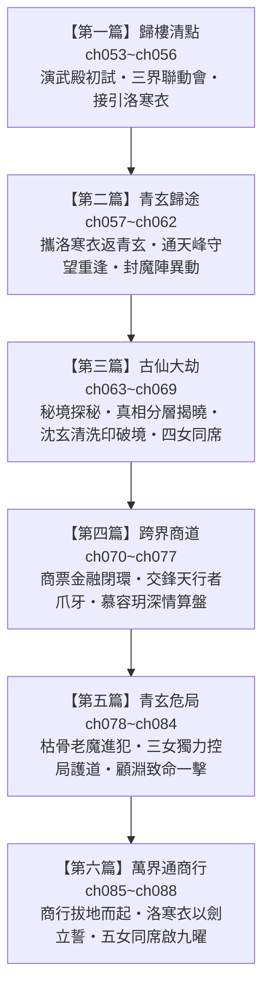

# 《萬界風月樓》第三卷綱要｜《諸天回首・青玄歸途》（v2.0）

> **卷名**：第三卷《諸天回首・青玄歸途》  
> **世界核心**：青玄界（主線）＋ 萬界樓（生活與中樞）＋ 滄瀾界（後方聯動）  
> **全書章節**：ch053 ～ ch088（全卷共 36 章）  
> **核心主題**：**「萬界之主，不忘根源——回頭看看你守護的地方，才知道往後的路有多長。」**  
> **敘事模式**：**青玄歸途主線 ＋ 跨界商道金融閉環 ＋ 古樓共同生活圈成型 ＋ 下一界預熱（九曜神域）**  
> **核心女主**：**柳清虛**（感情升華・守望重逢）、**沈玄清**（古仙秘辛揭曉・仙武雙修破境）、**慕容玥**（跨界商道建立・商業帝國聯通滄瀾）  
> **助演女主**：**洛寒衣**（首次跨界入青玄・與三女相識）、**姬明月**（遠端星圖聯動・大乾商道輸出）  
> **卷末修復指標**：萬界樓總修復度自 **100/10000（1.00%）** 穩步躍升至 **280/10000（2.80%）**，解鎖第四核心設施【萬界通商行】與【時空定標儀（三界同步版）】  
> **參考母本**：[04-thinking.md](../../../04-thinking.md) 核心審查與架構  
> **參考規範**：[world_bible.md](../../world_bible.md)｜[writing_guide.md](../writing_guide.md)｜[MASTER_FORESHADOWING.md](../MASTER_FORESHADOWING.md)

---

## 一、第三卷文檔體系導航

* 📘 [02_power_system.md](./02_power_system.md)：**力量體系與跨界商道機制**
  * 顧淵仙武演武殿進階、沈玄清半步化神突破、柳清虛九品金丹圓滿（元嬰胎動）、陸遠與林芷萱境界提升。
  * 萬界商票信用清算閉環、資源跨界套利體系。
  * 古仙七界封魔鎖鏈原理、天行者虛空力量架構、萬界樓修復進度表（100至280）。
* 👥 [03_romance_and_characters.md](./03_romance_and_characters.md)：**愛情戲深化與人物補充**
  * 青玄三女專屬愛情節拍（通天峰等待、深夜眼眶紅、算盤暗刻「淵」字）。
  * 支線情侶（陸遠・林芷萱）五層宗門溫馨情感線。
  * 新NPC設定：天行者（棋算者・爪牙）、深淵枯骨老魔、九霄古仙殘念。
* 📜 [05_chapter_outlines.md](./05_chapter_outlines.md)：**逐章編劇詳細大綱（全 36 章｜ch053～ch088）**
  * 六大篇章逐章細綱（出場人物、場景、核心情節、爽點情感落點、伏筆埋設與萬界樓修復反哺）。
* 🌐 [MASTER_FORESHADOWING.md](../MASTER_FORESHADOWING.md)：**全書跨卷暗線總攬（頂層中央庫）**
  * S級終極主線（諸天蝕者、古仙大劫、七界封魔陣、顧淵前世因果）。
  * A/B/C級跨卷長線狀態與天行者組織檔案。
  * 卷三新增伏筆矩陣（FB3-01～FB3-06）與全卷歷史原始伏筆總對照表。

---

## 二、第三卷的結構動機與核心設計原則

### 1. 為什麼顧淵要先回青玄界？
卷二末尾，顧淵從滄瀾界帶著破百勝利歸入萬界樓。此刻萬界樓雖剛剛突破 1%，但**根基遠未穩固**：
1. **青玄界的懸而未決**：
   - 沈玄清手持「古仙抗魔全圖」等待顧淵歸來共同研討，圖中記載的古仙大劫源頭仍是未解謎題。
   - 青雲觀後山「九天封魔陣」基座異動（FB-07）：古仙開派祖師背負的歷史宿命即將揭曉。
   - 慕容玥查獲的「神秘星紋晶石」（FB2-07）仍未確認來源——走私黑網背後牽扯諸天暗黑勢力。
2. **萬界樓成長的瓶頸**：
   - 1% 破百僅是結構性質變的開始，萬法演武殿剛剛解鎖，大量設施仍待修復。
   - 若直接奔向神話文明【九曜神域】，萬界樓本源不足，無法在新世界建立穩固基礎，需要青玄界的資源補給、情報整合與深層陰陽共鳴反哺。
3. **慕容玥的商業價值正式兌現**：
   - 東華萬界商盟已成型，那批神秘星紋晶石是打通**青玄界 ↔ 萬界樓 ↔ 滄瀾界跨界商路**的關鍵鑰匙。
   - 慕容玥的「後方大總管」地位從單界商業巨頭升格為**諸天供應鏈樞紐**，兌現她作為「萬界商女」的核心價值。
4. **洛寒衣的首次跨界與交集**：
   - 滄瀾界時空錨點確立後，洛寒衣由顧淵接引陪同進行首次跨界體驗，以傲骨劍仙視角踏入修仙世界，與青玄三女相識，化解隔閡，奠定跨界女主同盟。

### 2. 核心架構審查修正原則（遵循 04-thinking.md）

> [!IMPORTANT]
> **本卷必須嚴格執行的三大系統鐵律**：
> 1. **世界架構不設上限（A-01）**：正文嚴禁出現「已知九界」等封頂描述，統一改為「超出目前認知的諸天萬界體系」；古仙「七界封魔鎖鏈」僅代表太古盟約參戰的七個特定界域，非萬界極限。
> 2. **修復度取得不等於完成修復（A-02）**：材料必須經過「辨識、融合、歸位」三階段方產生數值。ch066 取得碎片 (+0)，ch067 殘印洗滌 (+20)，ch068 碎片歸位 (+60)，杜絕重複計算。
> 3. **跨界通行權限嚴格階梯化（A-03）**：顧淵接引洛寒衣入樓 (1) 與陪同前往青玄 (2) 屬於樓主特權護送；洛寒衣尚未取得「獨立自主跨界權限」(3)。ch086 劍誓為道心與立場抉擇，非直接解鎖自由瞬移。

---

## 三、第三卷六大篇章結構圖

---

## 四、各篇章詳細核心內容

### 【第一篇】歸樓清點（ch053～ch056）

**核心任務**：萬界樓破百後的結構性質變盤點、古樓生活氛圍初成、洛寒衣接引入樓。

#### 關鍵情節：
1. **萬法演武殿啟動與道法殘影（ch053）**：
   - 顧淵攜靈素在演武殿內演練滄瀾武意與仙武合一神通，千丈法相凝練為三丈凝實戰身。
   - 銘文解析伏筆：演武殿穹頂沉澱著太古古仙留存的**武道戰法殘影**（此伏筆將在第三篇秘境試煉中與古仙意志共鳴回收，B-02）。
2. **三界情報彙整與星圖聯動（ch054）**：
   - 顧淵透過天機閣整合雙界動態：青雲觀金丹大盛、古仙抗魔全圖繪成、神秘晶石待解析。
   - **首次跨界聯動會議**：青玄三女與遠在大乾皇宮的姬明月（以星圖虛擬神魂投影）同步感知，五大命運印記共振，萬界樓修復度 +10/10000（達到 110/10000）。
3. **接引洛寒衣入樓（ch055）**：
   - 顧淵依託已建立的滄瀾時空錨點，接引洛寒衣以「同行貴賓」身份踏入萬界樓（落實 A-03）。
   - 傲骨女劍仙的反應：以滄瀾武者視角打量古樓，與樓靈靈素互動展現反差萌；靈素引導參觀演武殿，洛寒衣見諸天兵刃痕跡，武者傲骨與求道心大動。
4. **前往青玄界的決議（ch056）**：
   - 顧淵告知青玄界有傳承萬年的古仙道統與深淵魔煞，邀請洛寒衣陪同視察。洛寒衣撫斷星古劍坦然應允：「我洛寒衣從不避戰，何況是你走過的地方。」

---

### 【第二篇】青玄歸途（ch057～ch062）

**核心任務**：顧淵攜洛寒衣返青玄，青雲觀今非昔比的成長展現，柳清虛守望者的脆弱與自尊。

#### 關鍵情節：
1. **異界來客與青雲新貌（ch057）**：
   - 顧淵攜洛寒衣穿過萬界門降臨東華靈嶽。洛寒衣感受靈氣稠密與武意稀薄的反差。
   - **青雲觀新氣象**：戒律長老陸遠（身板挺拔、嚴肅整頓巡山）與丹草閣主林芷萱（丹氣氤氳、溫柔照料）率眾迎接，展現宗門自立後的繁盛底氣，不再是當年的落魄小觀。
2. **通天峰的等待與重逢（ch058）**：
   - 柳清虛在峰頂布完第七重護山大陣，眉心印記突動，青玉道印險些滑落。
   - 緩緩走下石階，山道轉角見得顧淵，壓下千百夜想念，輕輕吐出三字：「回來了。」
   - **清虛與寒衣初見**：非爭風吃醋，而是強者之間的冷靜審視（「劍骨非凡」vs「掌門威儀難纏」），彼此尊重。
3. **後山地脈與七界封魔殘跡（ch059）**：
   - 沈玄清察覺後山祖脈異動，顧淵以破妄真視配合「古仙抗魔全圖」勘查地脈深處。
   - **大劫真相第一層揭露（B-01）**：確認青雲祖脈為太古古仙聯盟布設之「七界封魔鎖鏈」節點之一（明確七界僅為當年參與參戰之界域，非萬界上限，A-01）。
4. **通天峰古閣深夜相守（ch060）**：
   - 燭火搖曳，柳清虛靜聽顧淵講述滄瀾歷險，眼眶泛紅，埋首顧淵頸間輕吐相思與委屈。
   - 顧淵撫髮溫存，水火本源深層交泰，柳清虛道心圓融，道基內悄然凝結出一縷紫金元嬰胚胎道息（元嬰胎動，非直接突破，FB3-06），萬界樓修復度 +10/10000（達到 120/10000）。
5. **洛寒衣的仙城見聞與芷萱同行（ch061）**：
   - 洛寒衣與林芷萱同遊落霞仙城，一劍碎金丹護盾震懾狂妄修士，武道立威；夜市買雲糕，促成陸遠與林芷萱的溫馨日常。
6. **沈玄清的審視與斷星共振（ch062）**：
   - 沈玄清廊下靜觀洛寒衣練劍，活了五百年道心初泛酸意；以元嬰神識感應斷星古劍，察覺其天鐵材質與青玄古仙遺器波動同頻（埋下 FB3-03）。

---

### 【第三篇】古仙大劫（ch063～ch069）

**核心任務**：深入九霄封魔秘境，真相分層解密，沈玄清主動洗印突破半步化神，四女萬界樓實體同席。

#### 關鍵情節：
1. **九霄封魔古仙遺址開啟（ch063）**：
   - 沈玄清以古圖定位東華深處封禁秘境，顧淵、沈玄清、洛寒衣三人組成探秘小隊，柳清虛坐鎮山門，慕容玥提供補給。
2. **意志試煉與演武殘影回收（ch064～ch065）**：
   - 古仙意志幻境降臨，直面太古大劫心魔：洛寒衣戰勝「斷劍恐懼」、沈玄清破除「萬年孤寂」、顧淵斬破「諸天覆滅幻象」。
   - **演武殿伏筆回收（B-02）**：古仙殺陣爆發之際，顧淵引動 ch053 於萬法演武殿參悟之古仙武道殘影，同頻破開殺陣陣眼！
3. **古仙殘念顯化與大劫不完整記憶傳承（ch066）**：
   - 顧淵以混沌星脈承受古仙三道誅魔意志考驗，證道心後喚醒陣眼深處的古仙殘念（A-05）；
   - 古仙殘念神魂震盪，道出帶有殘缺與震撼的沉重真相：「萬界樓……不是你以為的那樣……引爆……是最後的辦法。至於為什麼……孩子，你必須自己去找答案……我們已無資格替諸天作主」；
   - 留下可辨識的實體遺物【古仙承道玉簡】與【第三卷大劫核心碎片・古仙遺志封印片】（此處僅取得材料，修復度 +0，嚴格落實 A-02）。
4. **沈玄清三階段洗印破境因果（ch067）**：
   - 舊傷本就源於太古大劫，古仙遺址煞氣為誘發因素（非新病因）；沈玄清主動運轉《太素天變錄》，顧淵純陽相輔（A-02/B-03）：
     - ① **殘印洗滌**：徹底排除大劫舊傷，神魂重歸無瑕；
     - ② **本源共鳴**：五百年水火道基完全恢復圓融；
     - ③ **道心突破**：觸及化神門檻，元嬰大圓滿巔峰，具備化神契機（本卷只出契機，正式突破留待後續）；
   - 二人間「沒有憐憫，只有平視」，沈玄清生命相托，修復度 +20/10000（達到 140/10000）。
5. **第三碎片歸位與天機秘庫（ch068）**：
   - 古仙遺志碎片正式融入萬界樓乾坤道台，爆發星光洪流，修復度暴漲 +60/10000（累計達到 **200/10000，整整 2.00% 破兩百大關！**）。
   - 解鎖新設施**【天機秘庫】**：古樓外觀升起白玉閣樓，可系統儲存諸天頂尖孤本與戰略情報。
6. **四女實體同聚萬界樓（ch069）**：
   - 秘境歸來，柳清虛、沈玄清、慕容玥、洛寒衣四人首次於萬界樓主殿實體同席（A-04）；姬明月以星圖虛擬神影列席，笑聲滿樓，古樓生活氛圍徹底成型。

---

### 【第四篇】跨界商道（ch070～ch077）

**核心任務**：慕容玥商業帝國價值全面兌現，萬界商票制度打通，交鋒黑市「天行者」，算盤暗刻深情。

#### 關鍵情節：
1. **萬界樓殘片被盜真相（ch070）**：
   - 顧淵破妄真視剖析走私晶石：殘留道韻並非任何已知界域氣息，而是**萬界樓本體基石殘片**遭人非法拆解牟利（A-01）。
   - 正式鎖定諸天黑市組織「**天行者**」（背後代號「棋算者」），確立長期交鋒暗線（AL-01）。
2. **萬界商票與三界商業閉環（ch071～ch073）**：
   - 慕容玥拒絕空談，攜具體帳冊策劃「青玄靈藥 ↔ 萬界樓 ↔ 滄瀾神鐵」商業閉環（B-04）。
   - 設計「萬界商票」信用兌付制度，確立四大信用支柱（B-01）：
     ① **三洲商盟現貨儲備金兌付**：落霞等十二城設立實體兌付庫，以八百萬靈石儲備金承擔本地即時兌付責任；
     ② **靈脈三年收益權質押**：青雲觀後山九華祖脈未來三年開採收益權質押（收益權質押，非割讓主權）；
     ③ **天策商行神鐵對沖**：滄瀾星隕神鐵雙向扎差對沖，將跨界傳送損耗降低九成以上；
     ④ **乾坤道印法則信用背書**：商票銘刻不可偽造的萬界樓乾坤道印法則，顧淵親筆簽名，確立兩界公認最高信用。
   - 慕容玥撥動算盤，嬌俏索簽，展現頂級商女魄力。
3. **黑市截貨與天行者交鋒（ch074～ch075）**：
   - 首批跨界物資遭截，天行者兩名素面白具、身著虛空罡衣之爪牙前來警告施壓。
   - 顧淵金瞳撕破空間隱匿，洛寒衣武王劍罡封死退路，慕容玥以二重靈鑑神瞳破解對方隨身之「黑市密碼盤」。
4. **黑市情報解密與九曜線索（ch076）**：
   - 破解密碼盤證實：天行者為利益驅使收購古樓殘片，並暗中為諸天蝕者蒐集強者情報（B-05）；確認九曜神域設有黑市核心交易站（FB3-02）。
5. **商道首航慶功與算盤上的深情（ch077）**：
   - 跨界商道首期成功雙向扎差結算，持續商業反哺為萬界樓注入本源，修復度 +20/10000（達到 220/10000）。
   - 深夜商行靜室，慕容玥在算盤最隱蔽撥珠刻下「淵」字；顧淵飲其殘茶、攬入懷中，深情共鳴。

---

### 【第五篇】青玄危局（ch078～ch084）

**核心任務**：西陵枯骨老魔全面進犯，三女獨力控局護道，展現獨立成長；顧淵回援精準滅魔。

#### 關鍵情節：
1. **西陵老魔進犯東華（ch078）**：
   - 西陵魔煞宗太上巨擘「深淵枯骨老魔」（古代邪修結丹後被太古幽冥魔網寄生之實體節點，具備殘魂底蘊、深淵怨煞、魔網本源三大戰力來源）趁虛率眾進犯，全面爆發東華靈嶽爭奪戰（FB-04 終局）。
2. **五階戰役連鎖與六人群像分工（ch079～ch081）**：
   > [!IMPORTANT]
   > 嚴格貫徹 R24 自主演化原則：顧淵未至前，三女及宗門眾人已全盤控制戰局，絕非被動挨打等待救美（B-07）！
   - **五階戰役推進**：
     - ① **危機爆發（ch078）**：老魔率煞潮突襲東華，天地變色；
     - ② **宗門自救（ch079）**：柳清虛啟動「青蓮開天大陣」護山，陸遠率戒律堂截殺狂化妖獸護城，林芷萱丹草閣晝夜煉解煞丹穩軍心；
     - ③ **商道封鎖（ch080）**：慕容玥調動三洲商盟十萬破煞丹與後勤物資，動用黑市情報提前截斷老魔三處靈脈補給；
     - ④ **古仙封印（ch081）**：沈玄清以半步化神神念貫通九華基座，引動古仙封魔印，將老魔死死困鎖地底陣眼；洛寒衣以劍意護持陣眼外圍；
     - ⑤ **核心焚滅（ch082）**：戰局已定，顧淵橫渡切入，以混沌星脈神雷將老魔體內的「幽冥魔網殘絲」徹底焚滅，拔除根源。
3. **青雲祖印警訊與顧淵歸來（ch082）**：
   - 青雲祖印陣眼激盪，沈玄清道印微鳴，天機閣第一時間捕捉訊號（B-06）；顧淵自萬界樓橫渡回援。
   - 戰局已定，顧淵現身直接切入封魔陣眼，以混沌星脈神雷將老魔核心寄生之「幽冥魔網殘絲」徹底焚滅，斬草除根。
4. **戰後石階獨坐與執手定情（ch083）**：
   - **主線情感**：月下石階，柳清虛輕搭顧淵手背：「這次我沒讓你失望吧？」顧淵低語：「從來沒有。」（C-02）。三界時空錨點大共鳴，修復度暴漲 +40/10000（達到 260/10000）。
   - **支線感情確認**：林芷萱在丹草閣外主動伸手拉住陸遠衣袖，打破「路過」藉口；陸遠第一次沒有找理由離開，兩人執手相對，心意徹底確認。
5. **東華修仙盟約重訂與掌門抉擇（ch084）**：
   - 柳清虛確立東華一等宗門地位；晨曦中看見遠處並肩的陸遠與林芷萱，會心一笑；沈玄清公開抗魔全圖節選警示修仙界；慕容玥將商盟升格為「青玄三洲萬界商盟」。

---

### 【第六篇】萬界通商行（ch085～ch088）

**核心任務**：萬界通商行解鎖、洛寒衣以劍立誓、五女真身同聚、九曜神域啟程。

#### 關鍵情節：
1. **萬界通商行與定標儀解鎖（ch085）**：
   - 商道累積反哺與大戰定錨合力，萬界樓再迎結構性突破，修復度 +20/10000（**達到 280/10000，即整整 2.80%！**）。
   - 解鎖第四核心設施**【萬界通商行】**（白玉商閣跨界自動扎差轉運）與**【時空定標儀（三界同步版）】**（隨時感知三界動態）。
2. **洛寒衣以劍為誓與清虛掌門戰略抉擇（ch086）**：
   - **洛寒衣劍誓**：青玄之行結束，洛寒衣返回滄瀾界前夕，於萬界門前拉過顧淵之手按在斷星劍柄：「顧淵，劍之所指，心之所向。我的劍從今往後，有你在列。」確立道侶立場，建立跨界共鳴印記（A-03，尚未取得獨立自主往返權限）。
   - **柳清虛獨立決策**：柳清虛以青雲掌門身份做出宗門獨立戰略規劃，簽署《青玄・滄瀾道法交流盟約》，主導外門仙武堂設立，展現不依賴男主的自立宗主魄力。
3. **五女首次真身同席（ch087）**：
   - 姬明月妥善處置大乾政務後，首次真身短暫穿過萬界門，降臨萬界樓主殿（A-04）。
   - 五大核心女主全員真身齊聚古樓，天機閣星盤前共同研討下一站神話文明【九曜神域】之戰略佈局。
4. **出發序章（ch088）**：
   - 顧淵於萬法演武殿以演武殘影與抗魔圖推演神域坐標；洛寒衣負劍立於身側。
   - 折扇輕展，萬界門深處九曜星光大盛，第三卷圓滿收官，第四卷大幕拉開！

---

## 五、第三卷萬界樓修復進度表（嚴格落實 A-02）

| 章節節點 | 核心驅動事件 | 獲得本源增量 | 累計總修復度 | 解鎖功能與古樓外觀變化（C-04） |
| :---: | :--- | :---: | :---: | :--- |
| **卷二末** | 滄瀾界平定・大關突破 | — | **100/10000 (1.00%)** | 萬法演武殿解鎖・界門常態流轉 |
| **ch054** | 三界聯動會議・五大命運印記共振 | +10/10000 | 110/10000 | 天機閣星圖解鎖虛擬投影聯動功能 |
| **ch060** | 柳清虛深夜相守・水火既濟本源交泰 | +10/10000 | 120/10000 | 風月苑二層顯化、青雲通道加固 |
| **ch066** | 九霄秘境取得古仙遺志封印片 | **+0/10000** | 120/10000 | 僅獲材料，待融合歸位（落實 A-02） |
| **ch067** | 沈玄清洗印雙修・觸及化神門檻 | +20/10000 | 140/10000 | 靈修殿解鎖元神加護陣眼 |
| **ch068** | **第三碎片正式歸位乾坤道台** | **+60/10000** | **200/10000 (2.00%)** | **解鎖【天機秘庫】（白玉藏書樓顯化）** |
| **ch077** | 跨界商道首航扎差・商票信用成型 | +20/10000 | 220/10000 | 珍寶閣擴建三界虛空專屬倉儲位 |
| **ch083** | 青玄危局平定・三女護道大願力反哺 | +40/10000 | 260/10000 | 萬界樓古陣實體化威能提升五成 |
| **ch085** | **萬界通商行落成・三界同步定標** | **+20/10000** | **280/10000 (2.80%)** | **解鎖【萬界通商行】與【三界時空定標儀】** |

---

## 六、第三卷卷末人物成就清單

| 人物 | 入卷初始狀態 | 卷末成就與質變 | 情感與道侶狀態 |
| :--- | :--- | :--- | :--- |
| **顧淵** | 金丹初期・仙武初融・修復度 1.00% | 金丹中期・常態三丈武仙法相・執掌諸天商道・知曉古樓崩毀真相 | 萬界執棋人，五大道侶同心相助 |
| **柳清虛** | 入卷：九品金丹圓滿（自卷一「半步金丹」──> 卷二「結丹並淬至九品」） | 卷末：道基內紫金胎息圓熟（元嬰蘊育期），元嬰尚未真正凝成，但突破契機已完全具備 | 卸下守望防線，確立深層道侶同盟 |
| **沈玄清** | 元嬰初期巔峰・殘印受制 | 大劫殘印徹底驅散・本源重歸圓融・突入**元嬰大圓滿巔峰・半步化神契機成熟**・破譯七界封魔鎖鏈 | 突破師徒禁忌心防，平視相托，生命相守 |
| **慕容玥** | 築基後期・落霞商盟盟主 | 築基大圓滿・破虛靈目二重・主導三界萬界商票金融體系 | 算盤暗刻「淵」字，後方大總管坐實 |
| **洛寒衣** | 滄瀾女武王・未曾跨界 | 首次隨樓主跨界青玄・建立跨界共鳴印記（尚未取得獨立往返權限）・適應靈氣・斷星古劍器魂昇華 | 以劍為誓正式入後宮，同行者身份確立 |
| **姬明月** | 大乾監國帝女・遠端聯動 | 天策礦脈對接萬界商道・大乾國運昇華 | 首次真身親臨萬界樓，共商九曜戰略 |
| **陸遠** | 築基初期・耿直師兄 | 升任代理戒律堂主事──>正式轉正**戒律長老**・突破**築基後期**・獨當一面 | 與林芷萱戰火相依，被拉住衣袖，感情正式確認 |
| **林芷萱** | 煉氣九層・丹草閣弟子 | 丹道深厚積累輔以突破丹・渡劫成就**金丹初期**・正式執掌丹草閣 | 主動拉住陸遠衣袖，執手定情，宗門溫馨守護者 |

---

## 七、第四卷預告

> **卷名（預定）**：第四卷《九曜神域・神座之爭》  
> **主要世界**：05 號世界【九曜神域】（神話信仰文明）  
> **核心女主**：**羲凰神女**（太陰神宮少宮主）、**赫拉迪雅**（熒惑戰伐女武神）  
> **核心動機**：  
> 1. 追蹤「天行者」在九曜神域的黑市核心交易站，直面棋算者中層代理；  
> 2. 探尋大乾姬氏紫霄真龍血脈與九曜神系之隱秘起源；  
> 3. 以萬界純陽解救神明「信仰濁泥」之毒，爭奪至高神位；  
> **萬界樓目標修復度**：280/10000 ──> 500/10000（突破 5% 大關）！
