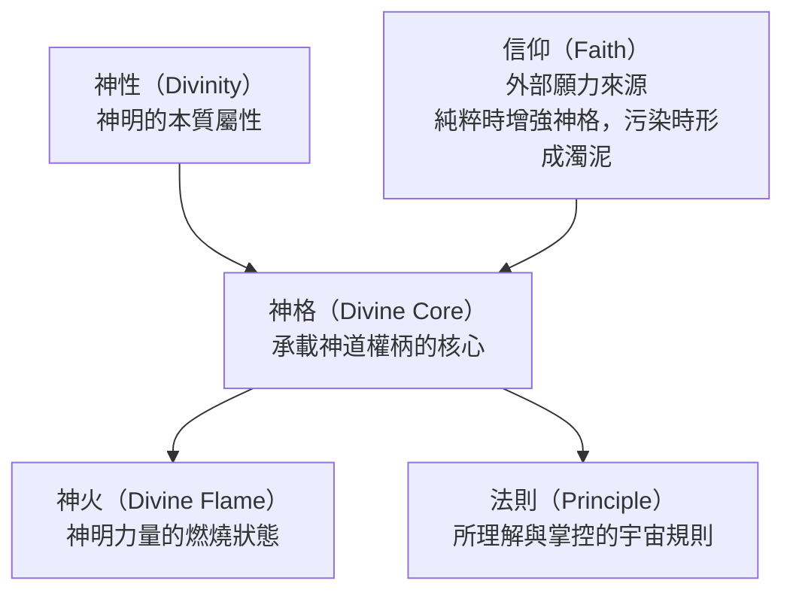

# 第四卷｜力量體系與雙修修復引擎（v1.0）

> **文件定位**：九曜神域的力量體系、第四卷六場雙修排程與修復度分配（+220 → 500/10000）、諸天神藏殿解鎖機制、以及各世界力量在神域環境下的互動規則。

---

## 一、力量體系鐵律（全卷適用）

> [!IMPORTANT]
> **唯一修復能量引擎（P0 鐵律）**
> 
> 萬界風月樓修復度（280 → 500/10000）的**唯一能量引擎**，仍然是顧淵與諸天命定神女的「陰陽交泰、靈肉合一」。
> 
> 以下行為**絕對不直接增加修復度**：
> - 取得神格或神格碎片
> - 打贏神殿戰爭或政治鬥爭
> - 收復真龍神座
> - 擊退蝕者規則投影
> - 解鎖地點、達成任務
> 
> 每一份本源增量，必須有對應的自願雙修場景，且正文雙修過程中完全不提數值。

---

## 二、神明力量的五個構成維度

> [!NOTE]
> 以下五者並非像修仙境界那樣的單純晉升順序，而是構成神明力量的五個不同維度：

| 維度 | 名稱 | 說明 |
|:---:|:---:|:---|
| 規則維度 | **法則** | 神明所理解與掌控的宇宙規則，神王・神尊級別才能深度運用 |
| 補給維度 | **信仰** | 外部願力來源，純粹時滋養神格，受七情六慾污染時則成為侵蝕神格的濁泥 |
| 核心維度 | **神格** | 承載神道權柄的核心能量體，可被感知、被濁泥污染，也能被修復 |
| 本質維度 | **神性** | 神明最底層的本質屬性，決定其掌管的法則領域，與生俱來 |
| 狀態維度 | **神火** | 神明力量的燃燒狀態，是施展神術的即時能量，神格受損時神火也會衰弱 |

### 力量體系與萬界樓體系的兼容性

| 九曜神域術語 | 萬界樓對應概念 |
|:---:|:---:|
| 神性 | 本源底層屬性 |
| 神格 | 本源能量體 |
| 信仰願力 | 外部能量補給 |
| 信仰濁泥 | 污染本源（需洗滌） |
| 神火 | 靈息（施展術法的即時能量） |
| 法則 | 天道（最高層次） |

> **顧淵以破妄真視分析神格時，使用的是萬界樓的本源法則語言，這讓他能看見其他神明看不見的東西——包括濁泥的真正流向，以及神格龜裂的真正原因。**

---

## 三、九曜神域力量等級與各人物定位

### 神階對照表

| 神階 | 稱謂 | 大致對應 | 本卷主要人物 |
|:---:|:---:|:---|:---|
| 六階 | 神王 | 諸界法則頂點 | 昊天神皇（本卷卷末隕落） |
| 五階 | 神尊 | 掌握完整法則 | 羲凰（龜裂狀態）・赫拉迪雅・赤炎神君・玄月神母 |
| 四階 | 神將 | 戰力強大高層 | 鐵赤將軍・廣寒月宮大神將 |
| 三階 | 神君 | 各系中堅力量 | 大多數神殿高層 |
| 二階 | 神官 | 掌握微量法則 | 神殿的一般守衛 |
| 一階 | 神使 | 神明初步凝形 | 神域中最常見的神明 |

### 本卷主要人物力量定位

| 人物 | 力量定位 | 神域中的相對強弱 |
|:---|:---:|:---|
| 顧淵 | 萬界樓主・破妄真視・神魂格位超越神域法則 | 以法則視角降維打擊，非直接武力競爭 |
| 洛寒衣 | 滄瀾界武王・仙武合一境 | 神域四階神將層次，可正面交鋒 |
| 羲凰 | 五階神尊（龜裂，實際下降至四階強） | 神域第一慈悲者，戰力受損但神格底蘊深厚 |
| 赫拉迪雅 | 五階神尊（完整，戰伐神格） | 神域第一線戰力之一 |
| 昊天神皇 | 六階神王（壽元將盡，神格衰竭） | 名義最強，但實際戰力已下降至五階上 |
| 赤炎神君 | 五階神尊（完整，日曜神格） | 本卷主要政治對手，戰力在赫拉迪雅之上 |

---

## 四、顧淵在神域的能力運用

> [!NOTE]
> 顧淵在神域的優勢**不在個人武力**，而在於以下四點：

### 1. 破妄真視（神格分析）
- 在神域，顧淵的破妄真視可以看見神格內部的信仰濁泥分布、龜裂位置、污染程度。
- 他是神域第一個能用「外部法則語言」解析神格結構的存在。
- 這讓他成為羲凰的「神格醫師」，也讓他能找到神座被濁泥污染的核心位置。

### 2. 萬界樓法則（跨維度視角）
- 以諸天萬界的視角審視神域問題，能看見神域神明看不見的死角。
- 以萬界樓的本源體系理解信仰濁泥，提出其他神明從未想過的解決方案。

### 3. 因果籌謀
- 神域政治複雜，顧淵以幕後執棋的方式介入神座之爭。
- 不直接競爭神座，而是讓適合的人（羲凰、赫拉迪雅、昊天神皇）各自完成自己的選擇。

### 4. 樓內絕對領域
- 神域的神格不能影響萬界樓內部。
- 當危機最嚴峻時，萬界樓是所有人的最後安全屋。

---

## 五、跨界力量兼容性

### 修仙力量（柳清虛・沈玄清）在神域
- 修仙靈力在神域的高能量環境中，受到神格輻射的壓制。
- 但陰陽本源（道基/元嬰層次）與神域的法則並不衝突，而是以不同的形式共存。
- 柳清虛的元嬰突破，在神域的法則共鳴下，可以獲得比普通環境更強烈的感知——這是第五篇元嬰突破場景的世界觀支撐。

### 高武力量（洛寒衣）在神域
- 仙武合一境的力量，在神域中以「純淨武意」的形式被感知，不受信仰濁泥影響。
- 洛寒衣的斷星古劍在神域中，器魂有輕微共鳴反應（AL-03 推進伏筆）。

### 大乾真龍血脈（姬明月）在神域
- 大乾皇室的紫霄真龍血脈，本源正是來自九曜神域天曜分支。
- 在神域環境下，姬明月的真龍血脈會被被動激活，表現為：金色龍紋在皮膚下流動・周身散發天然神格壓迫感。
- 這讓她在九曜神域中天然擁有「神裔」層次的認可，不需要額外介紹。

---

## 六、第四卷六場雙修排程與設計原則

### 總覽

| 場次 | 女主 | 篇次/章節 | 本源增量 | 累計進度 | 心境層次 |
|:---:|:---|:---:|:---:|:---:|:---:|
| ① | 姬明月（真龍神座情感昇華） | 第五篇/ch117 | +40 | 320/10000 | 天人合一 |
| ② | 羲凰（太陰神格洗滌與心境相契） | 第三篇/ch105 | +60 | 380/10000 | 天人合一 |
| ③ | 赫拉迪雅（戰伐神魂契合） | 第四篇/ch111 | +40 | 420/10000 | 魂靈相契 |
| ④ | 柳清虛（跨界重逢與道侶昇華） | 第五篇/ch118 | +30 | 450/10000 | 心有靈犀 |
| ⑤ | 羲凰（神格重塑後深層共鳴） | 第六篇/ch123 | +30 | 480/10000 | 魂靈相契 |
| ⑥ | 赫拉迪雅（神魂誓約與本源融合） | 第六篇/ch124 | +20 | **500/10000** | 天人合一 |

---

### 【場次①】姬明月・欠帳兌現第一步

**觸發時機**：第二篇，神域初站立足，兩人在太微玉京的臨時落腳點久別重逢。  
**修復增量**：+40  
**心境層次**：魂靈相契  
**修復增量較高的原因**：姬明月與顧淵已是天人合一層次的道侶，此次雙修是第三卷欠帳的第一步兌現，心境早已相契，只是在神域這一全新環境下的重逢昇華，層次加成顯著。

**場景設計要點**：
- 語言風格：神域世界文化差異——以天地異象烘托情感分量（writing_guide.md 規則十五）。
- 姬明月在神域中被真龍血脈被動激活，她身上散發的天然神格壓迫感讓顧淵第一次以不同的角度見到她。
- 兩人重逢後，不必急著敘舊，而是在神域的陌生環境下，彼此的熟悉感反而更顯珍貴。
- **寫作核心**：「在陌生的神話世界裡，你是我唯一熟悉的錨點。」

**正文禁忌**：
- 不提修復數值與本源能量。
- 不可讓場景淪為「補票」的交代性場景，必須有完整的情感過程。

---

### 【場次②】羲凰・太陰神格洗滌與心境相契（第一次）

**觸發時機**：第三篇，ch105，羲凰主動選擇與顧淵共同探索真正的神道之後。  
**修復增量**：+60（本卷最高單次增量）  
**心境層次**：天人合一  
**修復增量最高的原因**：羲凰是神域層次的神尊（神格力量遠高於修仙世界的元嬰），雙修所產生的陰陽本源品質，是本書迄今最純粹的一次。且她的「主動選擇」帶來了最高品質的心境共鳴。

**場景設計要點**：
- 羲凰是第四層次「道侶契合」的前戲場（本次屬第三層次・情感確認）。
- 語言風格：莊重・稀缺・以天地異象烘托情感分量。建議大量使用太陰意象（月華・星河・廣寒）。
- 羲凰的主動性：她是主動尋找顧淵的，主動求見，主動理解，主動選擇。雙修不是因為她「被救」，而是因為她「理解之後的自主抉擇」。
- 神格洗滌的視覺呈現：太陰月華在兩人之間流動，龜裂的神格逐漸癒合，像月缺漸圓的過程。
- **寫作核心**：「不是你給了我救贖，而是你讓我看見，我值得被救。」

**寫作規範（writing_guide.md 規則六）**：
- 信仰濁泥的洗滌不是雙修的直接功能，而是雙修後心境提升的附帶效果。
- 羲凰理解到：當她真正有所愛（有了七情六慾），她才能真正理解眾生的七情六慾，才能真正洗滌濁泥而不受其傷害。
- **正文完全不提能量數值**，神藏殿顯現一律章末播報。

---

### 【場次③】赫拉迪雅・戰伐神魂契合

**觸發時機**：第四篇，ch111，戰場上的生死信任建立之後。  
**修復增量**：+40  
**心境層次**：魂靈相契  
**場景特色**：本書第一次以「神魂誓約」形式進行的雙修——赫拉迪雅的文化背景（戰伐神系，以誓約為最神聖的信物），使這場雙修具有截然不同的文化儀式感。

**場景設計要點**：
- 語言風格：比羲凰場更有力量感、更直接，但不失莊重。戰神的情感世界：愛如火，誓如劍。
- 赫拉迪雅的主動性：她是以「挑戰者」身份認識顧淵的，這場雙修她也不是被動者。她主動提出「以神魂誓約確認盟約」，這在熒惑神系是最高等級的承諾形式。
- 熒惑神火的意象：兩人之間的能量交融以戰伐熒惑神火的形式呈現，烈而不焚，燃而不傷。
- **寫作核心**：「我一生與最強者交鋒，唯獨這一次，我選擇把後背交給你。」

---

### 【場次④】姬明月・真龍神座情感昇華（第二次）

**觸發時機**：第五篇，ch117，姬明月完成認主考驗、奪回真龍神座之後。  
**修復增量**：+40  
**心境層次**：天人合一  
**場景特色**：這是姬明月主線的最高情感點。她以自己的帝王意志完成了真龍認主，不靠顧淵打下來送她——她自己做到了。這場雙修是**成功者的慶典，不是傷者的療癒**。

**場景設計要點**：
- 姬明月在此刻是帝王，是龍女，是完整的自己。
- 語言風格：高冷女帝型（writing_guide.md 規則二），只在最私密的瞬間卸下威儀，以稀缺感製造衝擊。
- 真龍神格的能量餘韻環繞，金色龍紋在兩人之間流動，與太陰月華和戰伐熒惑火形成鮮明對比。
- **寫作核心**：「我用一生守護的，原來一直也是你守護的。」

---

### 【場次⑤】柳清虛・跨界重逢道侶昇華 ＋ 元嬰突破（BL-04 回收）

**觸發時機**：第五篇，ch118，柳清虛跨界親臨神域，久別重逢。  
**修復增量**：+20  
**心境層次**：心有靈犀  
**修復增量較低的原因**：柳清虛這次跨界主要目的是「見到顧淵」，不是修為突破——元嬰突破是雙修後的自然水到渠成，而非雙修的主要目的。正因如此，雙修本身的修復增量不高，但元嬰突破這個里程碑本身，是本書第一個卷非第一次突破元嬰境的重大成長事件。

**BL-04 回收場景設計**：
- 柳清虛來到神域，在神域法則的輻射下，感知到元嬰胎動的躁動。
- 顧淵協助她穩住元嬰蘊育的最後衝刺。
- 雙修結束後，元嬰破殼而出——在廣寒月宮的月輪之上，元嬰金光與太陰月華交映，成為本章最震撼的異象。
- 柳清虛站在神域的天穹，第一次以元嬰的視角感知諸天萬界的廣闊。

**寫作核心**：「從半步金丹到元嬰，我走了多少年。而此刻，你在這裡。」

---

### 【場次⑥】羲凰・神格重塑後深層共鳴（第二次）

**觸發時機**：第六篇，ch123，九曜神域新秩序開始建立之後。  
**修復增量**：+10  
**心境層次**：魂靈相契  
**場景特色**：本場修復增量最小，但情感意義重大。羲凰的神格已在第三篇完成第一階段修復；本場是神域新秩序確立後，她以一個「真正完整的自己」，第一次以道侶的身份（而非求救者）與顧淵相守。

**寫作核心**：「不再是為了眾生，只是為了我自己，我想要這樣的夜晚。」

---

### 【場次⑦】赫拉迪雅・神魂誓約本源融合（第二次）

**觸發時機**：第六篇，ch124，神域終局後的尾聲。突破五百大關。  
**修復增量**：+10 → **500/10000**  
**心境層次**：天人合一  
**場景特色**：本場是本卷最後一場雙修，也是突破五百的里程碑之場。章末必須呈現諸天神藏殿顯現的異象。

**寫作核心**：「誓約在戰場立下，今夜，讓它刻入靈魂。」

**諸天神藏殿顯現時機**：
- 雙修結束，溫存落幕。
- 靈素輕聲通報：「樓主，修復度已達五百……但是……」
- 靈素話語停頓，因為她看見了什麼。
- 萬界樓深處，一座從未記錄在設施清單中的建築，緩緩從虛空中顯現。
- 靈素：「這不是新建的……它好像，一直在這裡。」（FB3-07 推進）

---

## 七、第五核心設施：諸天神藏殿（Celestial Archive Hall）

### 解鎖節點
**修復度 500/10000（5.00%）** → **諸天神藏殿顯現**

### 設施特色（FB3-07 推進版本）

> [!IMPORTANT]
> 本設施的呈現方式，必須遵守「不揭露終極答案，只深化謎題」的原則。
> 
> 靈素必須對此設施感到困惑，而非只是正常播報解鎖。

**顯現方式（與其他設施解鎖的差異）**：
- 其他設施解鎖：靈素播報「某設施已達解鎖門檻，正在修復啟動」。
- 諸天神藏殿：**沒有解鎖播報**，它自己顯現出來。
- 靈素的反應：「它不在原始設施清單中……但……它在這裡的時間，可能比我記憶中的萬界樓更早。」

**初步可見的能力**：
1. **神格解析**：解析不同世界的神格結構與權柄（這解釋了為什麼萬界樓對九曜神域如此親和）。
2. **信仰溯源**：追蹤信仰願力的來源、流向與污染（與信仰濁泥機制直接對應）。
3. **神術收錄**：保存已取得的神格法則與神術。

**未解謎題（本卷不解答）**：
1. 靈素對諸天神藏殿的部分區域，有「管理權」但沒有任何相關記憶。
2. 某些九曜神格碎片在進入神藏殿時，自動產生「臣服」或「朝拜」的反應。
3. 神藏殿的建築風格，與萬界樓其他九大設施截然不同——更古老，更宏偉，像是一個不屬於這個時代的東西。

**連結 SL-02（萬界樓本質）**：
> 諸天神藏殿的出現，讓顧淵第一次真正懷疑：他修復的，可能根本不只是一座「樓」。

---

## 八、各世界力量在神域的交互補充

### 修仙力量 × 信仰法則
- 修仙道心（元嬰層次）與神域信仰法則並不互斥。
- 元嬰層次的道心，本質是「對天道的理解」，與神域法則的「天道規則」共享同一個底層邏輯。
- 這讓柳清虛的元嬰突破在神域能獲得「跨文明的天道共鳴」加持。

### 高武武意 × 戰伐神格
- 洛寒衣的仙武合一境，以純粹武意（不依靠信仰）運作。
- 與赫拉迪雅的戰伐神格相遇時，產生「同頻共振」——赫拉迪雅第一次感受到一個「不靠信仰撐起的戰意」有多純粹。
- 這是赫拉迪雅對現有神權制度（以信仰供養神格）產生根本動搖的觸媒之一。

### 商道資訊 × 神域黑市
- 慕容玥的萬界商盟情報網，在九曜神域與天行者交易站之間形成直接競爭。
- 本卷中，慕容玥以情報戰的方式支援顧淵，不必親臨神域。
- BL-03 落霞仙城清算，在此章背景下可以以「遠端清算」方式完成（慕容玥在青玄界發動，神域事件提供了政治壓力支援）。

### 大乾真龍 × 天曜神宮分支
- 姬明月的紫霄真龍血脈，在神域中以「天曜神裔」的身份被認可。
- 她的帝王意志（統治下界的帝道心境），與神域的信仰法則形成特殊共鳴：**帝王同樣是以萬民信仰為力量支撐的存在，只是載體從神格換成了皇位。**
- 這讓姬明月在神域中能以「世俗帝王」的視角，提出神明從未想到的解決方案。

---

## 九、雙修書寫分寸規範（神域世界適用版）

### 神域文化對親密場景的影響

參照 writing_guide.md 規則十五：

> **神域世界**：神格威儀、感情稀有而珍貴、一旦動情便震動天地。語言風格：莊重、稀缺、以天地異象烘托情感分量。

**具體執行原則**：
1. **莊重感**：神明的情感不輕易外露。羲凰第一次在顧淵面前展露脆弱，本身就是震撼神域的大事。赫拉迪雅立下誓約，對戰伐神系而言是比婚約更神聖的承諾。
2. **稀缺感**：神明在神域中的情感，數千年才可能發生一次。顧淵的出現，是神域幾萬年來第一次有來自諸天萬界的視角挑戰信仰制度。
3. **天地異象**：每一場雙修的高潮，必須有對應的神域層面天地異象（太陰月華傾瀉・戰伐熒惑神火齊齊低鳴・紫霄真龍神格金光沖天）。
4. **不套用修仙語言**：不用「靈息」「道基」「金丹」等修仙術語描述神域的親密共鳴，改用「神格共鳴」「神性流動」「法則震顫」等神域對應詞彙。

**神域雙修詞彙補充**（配合 writing_guide.md 詞彙庫）：

| 層面 | 神域適用詞彙 |
|:---:|:---|
| 起始 | 神性相感、法則初觸、神格輕顫 |
| 運轉 | 神格共鳴、信仰願力純粹化、神性循環 |
| 神魂 | 神念相融、神魂相契、法則共鳴 |
| 能量 | 神格本源流轉、天地本源歸一、陰陽神性交泰 |
| 異象 | 星河倒懸、九曜共鳴、天地神光映照 |
| 升華 | 神道相契、天道同感、神格圓滿 |
| 收束 | 神性歸元、法則平復、天地安寧 |
| 結果 | 神格復甦、神道通明、本源純粹 |

### 正文分寸總覽

| 分寸層面 | 規範 |
|:---:|:---|
| 雙修過程 | 感情昇華主體，完全不提本源數值或修復度 |
| 章末播報 | 靈素輕聲通報修復度，以古樓共鳴餘韻帶過，不超過兩句話 |
| 諸天神藏殿顯現 | 在第七場雙修（赫拉迪雅場）的章末播報後，自然引入神藏殿顯現 |
| 女主主動性 | 本卷七場，羲凰和赫拉迪雅均屬 C/D/E 型，不可讓她們淪為被動受者 |
| 顧淵的姿態 | 從容而不急切，他的強勢感來自沉穩，不來自主導控制 |
