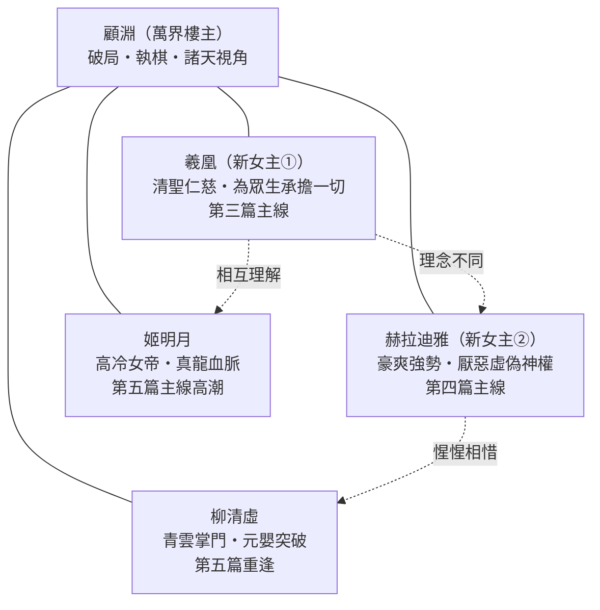

# 第四卷｜人物設計與感情線（v1.0）

> **文件定位**：第四卷所有主要人物的詳細人物設計、感情發展弧光、個性差異化、女主主動性分級，以及主要新 NPC 的功能定位。

---

## 一、第四卷人物系統總覽

---

## 二、羲凰神女——第一位新女主

### 基本設定

| 項目 | 設定 |
|:---|:---|
| 姓名 | **羲凰** |
| 稱謂 | 太陰神宮少宮主・廣寒月華神女 |
| 神系 | 太陰神系（玄月神系） |
| 神階 | 五階神尊（龜裂狀態，實際四階強） |
| 外貌 | 月白長衣，面如滿月，鬢邊有月華流轉的天然紋路，眼中常有淡淡月光 |
| 年齡（神域換算） | 神明紀元三千年（相當於年輕神明） |
| 相遇類型 | **女主主動接近（C型）＋ 共同患難（E型主導）** |
| 感情發展弧線 | 理念探討→信任建立→情感確認→自主選擇 |

### 核心個性
**清聖、仁慈、孤高，卻因承擔眾生而逐漸失去自己。**

羲凰是太陰神域三千年來最慈悲的神女。她相信神明的使命是承擔眾生苦難，因此長年以太陰神火替下界信徒洗滌濁泥，將污染全數轉移到自身神格承擔。

她的神格已龜裂超過一千年，但她從不對外承認，更不停下腳步。

> **「旁人問我：太陰宮主，你的神格何時能痊癒？我說：等眾生的苦難止息之日。旁人說：那要等到何時？我說：我也不知道，所以我無法停。」**

**與其他清冷型女主的差異**：

| 人物 | 清冷來源 | 核心追求 |
|:---:|:---:|:---:|
| **柳清虛** | 修道秩序感・責任使然 | 秩序與責任 |
| **沈玄清** | 師尊尊嚴・自我界定 | 尊嚴與平等 |
| **羲凰** | 神明威儀・超然於凡俗情感 | 眾生與慈悲 |

羲凰的清冷不是冷漠，而是**神格損耗到無暇顧及自身**的疲憊。她面對顧淵時的第一個真實反應，不是疑惑或戒備，而是——「他知道我在痛嗎？」

### 感情發展詳細設計

**第一階段：主動求見（ch101）**  
羲凰聽聞萬界樓主到訪，主動打聽。她的內心動機不是「對顧淵有感情」，而是：「這個人用外界視角看神域，或許能看見我們都看不見的東西。」她主動求見，是因為她的神格再不解決，就真的撐不住了。  
→ 顧淵第一眼見到她時，以破妄真視看見神格龜裂的真實程度，心頭一震。他沒有立刻說出來，只是問：「少宮主，你上一次真正休息，是什麼時候？」  
→ 羲凰愣住了。沒有人問過她這個問題。

**第二階段：理念碰撞（ch102～103）**  
兩人探索信仰機制時，發生第一次正面衝突：

- 顧淵：「神明為什麼不能拒絕？」
- 羲凰：「因為眾生需要我們。」
- 顧淵：「你現在的狀態，真的還能給予嗎？」
- 羲凰沉默。

她從未被人這樣質問過。她的第一反應是憤怒——這個外來者不懂神明的使命。  
但顧淵的下一句話讓她說不出反駁：  
> **「一盞油燈，若強行燃燒到無油，它最後給出的，不是光，而是煙。」**

**第三階段：信任確立（ch104）**  
顧淵以破妄真視為羲凰找到神格自救的可能性，並直接告訴她：「我能幫你，但你需要先願意讓自己被幫助。」  
羲凰第一次在神明威儀之外，露出了脆弱的神情：「我試過很多方法，都沒用。你確定嗎？」  
顧淵：「不確定。但我知道你現在的方法，一定會失敗。」  
→ 羲凰笑了。是疲憊後的苦笑，但也是第一次真正輕鬆的表情。

**第四階段：自主選擇（ch105）**  
羲凰主動提出雙修。  
不是因為走投無路，不是被逼迫，而是在理解顧淵的神道觀點後，她做出的**主動抉擇**：  
> **「若你說的是真的——只有當我真正有所愛，才能真正理解眾生的愛，才能洗滌濁泥而不受其傷——那我願意，以這個方式，讓自己更完整。」**

**第五階段：深化（第六篇）**  
神域新秩序建立後，羲凰第一次說出：「我想要為自己而存在，不只是為眾生。」  
這是她整個人物弧光的核心轉折——從「以自我消耗換眾生救贖」，到「以自我完整成就更大慈悲」。

### 羲凰的女主主動性等級：**E型（女主主導）**

她掌握關係發展的節奏與進程：主動求見、主動質疑、主動選擇雙修。  
顧淵在她面前，偶爾是被引導者。

---

## 三、赫拉迪雅——第二位新女主

### 基本設定

| 項目 | 設定 |
|:---|:---|
| 姓名 | **赫拉迪雅** |
| 稱謂 | 熒惑戰伐女武神・赤煌天將 |
| 神系 | 火曜神系（熒惑神系） |
| 神階 | 五階神尊（完整，戰伐神格） |
| 外貌 | 鎧甲與戰袍並用，赤金色長髮，眼若熒惑火，笑時有熾烈光芒 |
| 年齡（神域換算） | 神明紀元五千年 |
| 相遇類型 | **競爭對手型（D型）＋ 戰場合作（B型）** |
| 感情發展弧線 | 挑戰→較量→惺惺相惜→戰場信任→誓約 |

### 核心個性
**豪爽、強勢、好戰、坦率，厭惡虛偽神權。**

赫拉迪雅是熒惑戰伐軍團最強的女武神，五千年軍旅生涯，從未一敗。她手握熒惑軍團最精銳的部隊，有自己的戰略目標、部屬與信念。

她最初反對以戰爭製造信仰的黑幕，因此被神殿高層邊緣化。但她保有自己的軍團，拒絕妥協。

> **「他們說我不懂神殿規矩。我說：我懂，我只是不屑遵守。」**

**與洛寒衣的差異化**：

| 人物 | 力量本質 | 追求核心 | 情感表達 |
|:---:|:---:|:---:|:---:|
| **洛寒衣** | 純粹劍道・仙武合一 | 自身劍心・選擇性同行 | 克制・選擇時直接 |
| **赫拉迪雅** | 戰爭統帥・熒惑神格 | 戰士・榮耀・誓約 | 豪爽・坦率・從不繞彎子 |

**赫拉迪雅的核心問題**：
> **一名真正的戰神，究竟應該為神王而戰，還是為自己的戰士與信念而戰？**

### 感情發展詳細設計

**第一階段：主動挑戰（ch107）**  
赫拉迪雅第一眼見到顧淵，立刻感受到他身上的「不屬於神域但超越神域」的氣息。  
她的第一反應：「這個人很有意思，試試他的斤兩。」  
→ 她直接發出挑戰：「外來者，你在神域晃蕩，可敢與我走兩招？」  
→ 顧淵以萬界樓的法則視角從容接招，沒有讓她佔到便宜，也沒有碾壓她——只是讓她清楚地感受到「這個人的深度，我看不透」。  
→ 赫拉迪雅大笑：「有意思！你是第一個讓我看不透的外來者。」

**第二階段：理念衝突（ch108～109）**  
兩人調查戰爭黑幕時，產生核心理念碰撞：

- 赫拉迪雅：戰爭本身不是惡，以戰磨礪才是戰神之道。
- 顧淵：但如果戰爭是被人為製造的呢？犧牲的戰士，是為自己的信念而戰，還是被人當作信仰燃料？

赫拉迪雅沉默。她從未從這個角度思考過戰爭。  
她的第一反應是憤怒，然後是恐懼，然後是更深的憤怒——對那些操控戰爭的神明。

**第三階段：戰場信任（ch110～111）**  
面對熒惑神殿的內部叛亂，赫拉迪雅選擇了信任顧淵。  
不是因為她弱，而是因為她看見了：「這個人在戰場上，知道該做什麼，也知道不該做什麼。」  
兩人並肩作戰，赫拉迪雅的戰術加上顧淵的破局視角，配合無間。  
→ 戰後，赫拉迪雅面對顧淵說出她生平第一次說出口的話：「謝謝你。」  
→ 顧淵：「你不必謝，你是你自己的戰神。」

**第四階段：神魂誓約（ch111雙修）**  
赫拉迪雅主動提出以熒惑神系最高規格的「神魂誓約」確認盟約關係。  
這不是一場普通的雙修——在熒惑神系的傳統中，神魂誓約一旦立下，比任何盟約都神聖，永不可撤銷。  
> **「我一生只會立一次誓約，我不輕易承諾任何人，但今夜，你是例外。」**

**第五階段：終局兌現（第六篇）**  
神域終局後，赫拉迪雅的第二場雙修，是誓約的完整兌現。  
她說：「我以為我立誓，是為了戰場盟友。但現在我知道，我立誓，是為了一個讓我相信的人。」

### 赫拉迪雅的女主主動性等級：**D型（女主追求）**

她積極表達態度，從挑戰到誓約，每一步都由她主動推進。  
顧淵在她面前，偶爾需要「跟上她的節奏」。

---

## 四、姬明月——第五篇主線高潮

### 本卷功能定位
姬明月在第四卷的核心功能是：**個人主線的最高潮**（奪回真龍神座）。

她不因兩位新女主登場而降格為配角——第五篇整整六章，是她的個人史詩。

### 本卷關鍵人物成長

**大乾太祖與九曜天曜分支的血脈淵源揭曉**：
- 大乾皇室的紫霄真龍血脈，三千年前，祖先從九曜神域天曜分支流出的神格種子中取得。
- 這個淵源讓姬明月在神域中被認可為「天曜神裔」，這解釋了她的帝王意志為何能與神格法則共鳴。

**姬明月取得真龍神座的方式**：
- 顧淵負責：揭露神座被污染的真相，破除神座外部的七重禁制。
- 姬明月負責：憑紫霄真龍血脈完成認主考驗，以自己的帝王意志重新定義真龍神權。
- **顧淵不替她「打下來」**——她自己完成了最後的認主，不靠任何人的力量。

**寫作核心**：「我的血脈來自諸天，我的意志只屬於我自己。」

### 本卷感情線發展
- 第二篇：久別重逢，神域的陌生環境讓兩人在熟悉中體驗新的感知（場次①預熱雙修）。
- 第五篇：真龍神座認主後的情感最高點（場次④完整雙修）。
- 本卷不新增姬明月的女主線外的情節——她的成長都集中在真龍神座主線。

---

## 五、柳清虛——跨界重逢與元嬰突破

### 本卷功能定位
柳清虛是第四卷**BL-04 完全回收**的主角，也是讓讀者確認「舊女主不因新世界篇章消失」的重要存在。

### 元嬰突破設計（BL-04 回收）

**突破前的鋪陳**（第五篇前）：
- **跨界資格**：萬界樓修復度已達 380+，柳清虛作為首批「深層陰陽共鳴」道侶早已具備自主跨界權限；她將青雲觀日常掌門事務暫交長老團與慕容玥商盟協防後，主動選擇於此時啟程。
- **跨界動機與任務**：她不僅是為了重逢，更因在青玄界感知到元嬰胎動臨界與九曜天道法則的奇異共鳴；抵達九曜後，她亦協助顧淵與羲凰穩定太陰月輪與祭天壇邊緣的修仙陣法支援，在神域劇情中發揮實質作用。

**突破場景（ch118）**：
1. 柳清虛以萬界門跨界親臨神域（修復度已達 480，跨界權限早已具備）。
2. 兩人久別重逢（她最後一次見顧淵是第三卷末）。
3. 在廣寒月宮的月輪之上，神域的天道法則共鳴刺激元嬰胎動達到臨界點。
4. 顧淵協助她穩住最後衝刺，雙修結束後（場次⑤），元嬰正式破殼。
5. 廣寒月宮上方，元嬰金光與太陰月華交映——羲凰親眼見證，這是第一次跨修仙道的道侶在她的神宮留下如此異象。

**元嬰突破後柳清虛的改變**：
- 修為：元嬰初期，但靈脈圓滿，潛力極大。
- 視野：元嬰視角可以感知到比金丹期廣闊百倍的天道信息。
- 她說：「我在神域感受到的，比在青玄界所有歲月加起來還要壯闊。」

**寫作核心**：「我等這一天，等了很多年。而此刻，我選擇在你旁邊，突破這道門。」

---

## 六、沈玄清——後方坐鎮

### 本卷功能定位
沈玄清在第四卷不出現在神域前線，但她的**古仙法則研究**，在第六篇終局破局時提供了關鍵理論支援。

**具體貢獻**：
- 她在青玄界繼續研究古仙大劫殘跡，發現「諸天七界封魔鎖鏈」與九曜神域的關係。
- 她遠端傳訊顧淵：「九曜祭天壇，可能正是七界封魔鎖鏈的一個節點——或者說，它原本的功能是淨化信仰濁泥，是整個鎖鏈系統的一部分。蝕者侵蝕神域，可能正是為了破壞這個節點。」（SL-03 推進）
- 這個情報，在第六篇終局成為顧淵破局的關鍵拼圖之一。

---

## 七、慕容玥——情報戰線

### 本卷功能定位
慕容玥在第四卷是**天行者情報戰的後方指揮官**，以及**落霞仙城清算（BL-03）的執行者**。

**天行者情報戰**：
- 慕容玥的萬界商盟在三洲建立後，情報網已覆蓋多個跨界商業節點。
- 她提前取得天行者九曜交易站的部分情報，在顧淵進入神域前就建立了情報地圖。
- 本卷中，她以遠端傳訊的方式持續支援顧淵，扮演「諸天情報官」的角色。

**落霞仙城清算（BL-03 回收）**：
- 在顧淵進入九曜神域期間，慕容玥趁落霞仙城因神域事件導致對外採購受阻，以商業手段完成清算。
- 具體手段：操控落霞仙城三十六世家的供應鏈，讓城主的隱秘帳目被迫曝光，以商盟替代城主取得仙城實際商道控制權。
- 章節處理：以一段慕容玥的遠端傳訊播報方式在某章末處理，不必單獨開章節。

---

## 八、洛寒衣——劍道碰撞

### 本卷功能定位
洛寒衣是第一篇的主要戰力支撐，以及赫拉迪雅關係的重要「對比參照」。

**與赫拉迪雅的互動**：
- 洛寒衣與赫拉迪雅在第一篇就有短暫相遇。
- 兩人以劍道與戰神之道切磋，互相感知對方的戰意純粹度。
- 赫拉迪雅對洛寒衣的評價：「你的劍意，沒有任何信仰的痕跡。在神域，這是罕見的。」
- 洛寒衣：「我的劍只為我自己的道而存在。」
- 赫拉迪雅若有所思——這次交流，是她後來對現有神權制度（以信仰供養神格）產生根本動搖的觸媒之一。

**斷星古劍的輕微反應（AL-03 推進）**：
- 洛寒衣在諸神黃昏遺墟附近，斷星古劍器魂有輕微的「認知感應」。
- 靈素察覺，遺墟深處的某件古仙遺器與斷星古劍器魂有同頻波動。
- 本卷不深追，留作第五、六卷洛寒衣身世篇的伏筆。

---

## 九、主要新 NPC 設計

### NPC①｜昊天神皇（九曜神王）

**定位**：現任九曜共主，本卷最重要的悲劇性配角。

**核心性格**：並非昏君，而是**被制度困住的疲憊老神**。

他見過五萬年的歷史，見過信仰濁泥的爆發、神座之爭的腥風血雨，他知道問題的根源——但他沒有力量去解決，因為解決需要顛覆整個神域的信仰體系，這是他一個人的力量做不到的。

他對顧淵的態度：最初是試探，後來是寄望，最後是**將最後的選擇交給自己的意志**。

**卷末最後選擇**（非顧淵斬殺）：
- 在第六篇終局，昊天神皇看清一切真相後，做出了最後的抉擇。
- 他以自身最後的神格本源，完成一件其他人做不到的事（具體見 05_chapter_outlines.md）。
- 他的最後選擇，讓九曜神域的秩序更替具有史詩級的歷史重量。

**關鍵台詞**：
> **「我在這個神座上坐了七千年，做了所有能做的事。但沒有一件，是真的改變了什麼。……也許，不是神座的問題，而是坐上神座的人，始終以為自己能代表天道。」**

---

### NPC②｜赤炎神君（日曜神系首領）

**定位**：本卷主要政治對手，神座爭奪的主導者。

**核心性格**：野心勃勃，強勢，但並非單純的惡棍。他相信日曜神系的光明法則才是九曜神域最適合的統治法則——他的動機是信念，不只是個人野心。

**行為模式**：
- 以政治手腕拉攏各神系，製造神王繼承危機。
- 對顧淵始終保持表面禮貌，內心視其為必須清除的變數。
- 本卷卷末，在昊天神皇做出最後選擇後，赤炎神君的野心落空——但他保留了繼續在神域政治中活躍的可能，不死（留作後續世界返場的可能）。

---

### NPC③｜玄月神母（太陰宮主）

**定位**：羲凰的師尊，掌握太陰神系最深層的秘密。

**核心性格**：看似溫和，實則深謀遠慮。她比羲凰更早知道信仰濁泥問題的根源，但她選擇沉默，因為她以為沉默才是保護羲凰的方式。

**態度曖昧的真相**（本卷揭露）：
- 玄月神母知道，「神明應有七情六慾才能真正洗滌濁泥」這個道理。
- 但她無法說出口，因為如果說出口，九曜神域的整個信仰制度就會崩潰。
- 她以沉默保護了制度，卻讓羲凰一個人承擔了代價。

**卷末和解**：羲凰在理解一切後，主動找師尊說：「我懂你為什麼沉默了。但我不會再替你沉默。」玄月神母流下了三千年來的第一滴眼淚。

---

### NPC④｜鐵赤將軍（赫拉迪雅的政敵）

**定位**：熒惑軍團統帥，與神殿勾結的共謀，以戰爭製造信仰的執行者。

**核心性格**：純粹的功利主義者。他不在乎神道信念，只在乎熒惑神格的力量能延長多少壽元。

**卷內命運**：在第四篇終局被赫拉迪雅親手斬殺（赫拉迪雅親自動手，不靠顧淵——這是她的高光戲）。

---

### NPC⑤｜棋算者中層代理（無名者）

**定位**：獨立勢力派駐於天行者交易站的觀察者，與天行者合作、交易或互相利用，但不受天行者指揮；本卷主要智慧型對手。

**核心性格**：
- 外表謙遜，實際上是本卷最危險的人物。
- 他代表棋算者，但他自己也有私謀——他不完全服從棋算者的指令。
- 他以旁觀者的姿態看著神座之爭，計算哪一個結果對「棋算者的真正目的」最有利。

**外貌設定**：著素色長袍，面戴白玉面具（與卷三白面執事的白面具呼應，但等級更高）。

**本卷展示的能力**：
- 掌握九曜神域所有神系的情報（包括天行者交易站的完整帳目）。
- 能在各神系之間穿梭，各方都以為他是自己人。
- 在第六篇終局，他展示了一個讓顧淵也警覺的長期布局——那個布局不是針對神座，而是針對「萬界樓的修復進度」（棋算者的真正目的）。

**卷末狀態**：趁混亂撤離，真正目的部分揭露，但棋算者真身仍未現。

---

### NPC⑥｜神域古神殘念（混沌始神）

**定位**：九曜神域最古老的神明殘魂，存在於諸神黃昏遺墟深處。

**核心功能**：提供遠古大劫情報，以及「認出顧淵印記」（SL-04 推進）。

**出場方式**：當顧淵進入諸神黃昏遺墟時，混沌始神的殘念主動顯現，以低沉的古老語言說：「你身上的印記……是那個時代的東西。你從哪裡來的？」顧淵：「我也不確定。」混沌始神沉默片刻：「那個時代的東西，不該再出現了。但你在這裡，說明什麼都還沒有結束。」

**提供的情報**：
- 諸天七界封魔鎖鏈在神域的節點位置（SL-03 推進）。
- 信仰濁泥問題的遠古起源（比現在所有神明知道的都更古老）。
- 顧淵身上的印記，讓混沌始神在態度上有輕微的「臣服感」（呼應 FB3-07 諸天神藏殿顯現時某些神格的臣服反應）。

---

## 十、女主群像互動設計

### 羲凰 × 赫拉迪雅
兩人在神域的立場截然不同，但都在對抗現有神權制度的不同面向：

| 對比維度 | 羲凰 | 赫拉迪雅 |
|:---:|:---:|:---:|
| 問題 | 以自我消耗換眾生救贖（太積極地承擔） | 被神殿利用以戰爭製造信仰（被動成為工具） |
| 解決方式 | 以自我完整取代自我消耗 | 以自我信念取代神殿規則 |
| 對顧淵 | 理念對話→主動依靠 | 實力較量→戰場信任→誓約 |
| 彼此評價 | 「赫拉迪雅的直接，讓我羨慕。」 | 「羲凰的慈悲，讓我敬佩，但也讓我心疼。」 |

**兩人對話場景（第四篇末，可選設計）**：
- 赫拉迪雅找到羲凰：「我聽說你長年洗滌濁泥，把污染都轉到自己的神格上。」羲凰：「是。」赫拉迪雅：「那不是慈悲，那是自我毀滅。」羲凰輕輕說：「我知道了。那個外來者，也是這樣告訴我的。」

### 羲凰 × 姬明月
兩人有一種跨文明的相通感——都是以自己的方式承擔眾生/子民。

- 羲凰：「你是皇帝，我是神女，我們都是眾生的托付者。」
- 姬明月：「但你們神明的托付，是自願的嗎？我的子民選擇我，是因為他們信任我。你的信徒，知道你在承受什麼嗎？」
- 羲凰沉默，然後說：「這正是問題所在。」

### 赫拉迪雅 × 洛寒衣
兩人是本卷最快建立惺惺相惜的女女組合——都是強者，都不靠神權（或門派權威），都以自身戰力立身。

- 兩人的切磋（第一篇），赫拉迪雅輸了半招，沒有生氣，反而大笑：「好！你這個凡人，讓我大開眼界！」
- 洛寒衣也難得一笑：「你是第一個神明，讓我覺得可以對等而論的。」

---

## 十一、第四卷人物成長總覽

| 人物 | 卷初狀態 | 本卷成長 | 卷末狀態 |
|:---|:---:|:---:|:---|
| 羲凰 | 神格龜裂，以自我消耗換慈悲 | 理解神道真義，神格第一階段修復 | 以完整的自己給予眾生更多 |
| 赫拉迪雅 | 被神殿邊緣化，掌自己軍團 | 揭露戰爭黑幕，取得熒惑軍團實際掌控 | 熒惑神系新秩序的奠基者 |
| 姬明月 | 在神域初次立足，尋找血脈源頭 | 揭露大乾太祖血脈淵源，完成神座認主 | 紫霄真龍神脈重塑，大乾皇朝底蘊深化 |
| 柳清虛 | 九品金丹圓滿，元嬰胎動 | 跨界親臨神域，完成元嬰突破 | **元嬰初期**，諸天視野大幅拓展 |
| 沈玄清 | 元嬰大圓滿，研究古仙法則 | 發現九曜是封魔鎖鏈節點，支援終局破局 | 後方最強智庫，SL-03 情報推進 |
| 慕容玥 | 萬界商盟三洲覆蓋 | 完成落霞仙城清算，主導天行者情報戰 | BL-03 完全或階段回收，情報網更完善 |
| 洛寒衣 | 仙武合一境 | 神域強者交鋒，斷星劍器魂輕微反應 | AL-03 萌芽推進，對神域有全新體認 |
| 顧淵 | 2.80% 修復度，五場雙修記錄 | 神域七場雙修，神藏殿顯現，諸天視角再深化 | 5.00% 修復度，諸天神藏殿謎題開啟 |
