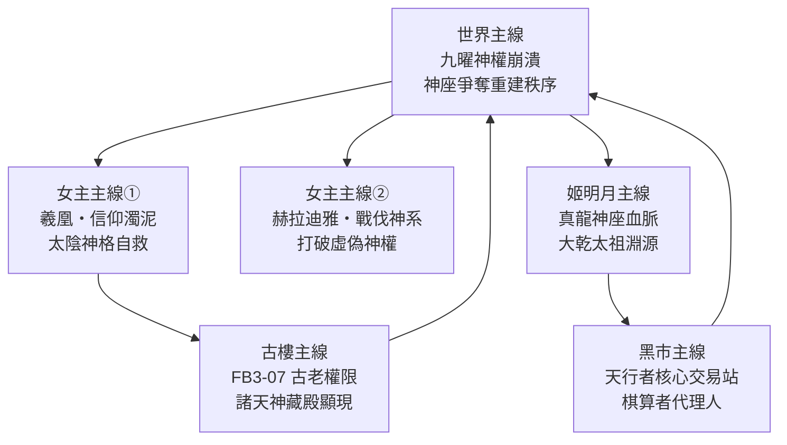
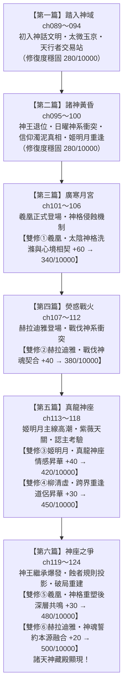

# 《萬界風月樓》第四卷綱要｜《九曜神域・神座之爭》（v1.0）

> **卷名**：第四卷《九曜神域・神座之爭》  
> **世界核心**：九曜神域（主線 05 號世界）＋ 萬界樓（中樞）＋ 青玄界、滄瀾界（後方聯動）  
> **全書章節**：ch089 ～ ch124（全卷共 36 章）  
> **卷內章節**：vol04 ch001 ～ ch036  
> **核心主題**：**「神明因眾生而存在，還是眾生因神明而存在？當信仰成為毒藥，神明是否還有資格代表天道？」**  
> **敘事模式**：**神話史詩主線 ＋ 神權政治鬥爭 ＋ 兩位新女主獨立弧光 ＋ 姬明月血脈尋根高潮 ＋ 諸天蝕者規則投影初現**  
> **核心女主**：**羲凰**（太陰神宮少宮主・清聖仁慈・為眾生承擔一切）、**赫拉迪雅**（熒惑戰伐女武神・豪爽強勢・厭惡虛偽神權）  
> **並行女主**：**姬明月**（真龍神座主線高潮）、**柳清虛**（元嬰突破・跨界重逢）、**沈玄清**（古仙法則研究・後方坐鎮）、**慕容玥**（天行者情報・落霞清算）、**洛寒衣**（神域強者交鋒・劍道碰撞）  
> **卷初修復度**：280/10000（2.80%）  
> **卷末目標**：500/10000（5.00%）  
> **參考規範**：[world_bible.md](../../world_bible.md)｜[writing_guide.md](../writing_guide.md)｜[MASTER_FORESHADOWING.md](../MASTER_FORESHADOWING.md)

---

## 一、第四卷文檔體系導航

* 📋 **README.md**（本文件）：全卷定位、核心主線、六大篇章結構圖、卷末成果與文件導航  
* 🌍 [01_world_setting.md](./01_world_setting.md)：**九曜神域世界設定（v1.0）**  
  * 神域歷史、九大星曜神系詳細設定、神國地理、神權政治制度  
  * 信仰濁泥的運作機制、神格結構與信仰文明特色  
* ⚡ [02_power_system.md](./02_power_system.md)：**力量體系與雙修修復引擎（v1.0）**  
  * 神性、神格、神火、信仰、神階五層力量體系  
  * 第四卷六場雙修排程與修復度分配（+220 → 500/10000）  
  * 諸天神藏殿解鎖機制與 FB3-07 推進邏輯  
* 👥 [03_romance_and_characters.md](./03_romance_and_characters.md)：**人物設計與感情線（v1.0）**  
  * 兩位新女主的完整人物弧光（羲凰・赫拉迪雅）  
  * 姬明月主線高潮、舊女主在神域的成長  
  * 新 NPC 設計（神王、日曜神君、太陰宮主等七人）  
* 📜 [05_chapter_outlines.md](./05_chapter_outlines.md)：**逐章編劇詳細大綱（全 36 章・ch089～ch124，v1.0）**  
  * 六大篇章逐章細綱（出場人物、場景、核心情節、爽點情感落點、伏筆埋設與萬界樓修復反哺）  
* 🌐 [MASTER_FORESHADOWING.md](../MASTER_FORESHADOWING.md)：**全書跨卷暗線總攬（頂層中央庫）**

---

## 二、第四卷核心架構原則（十二項鐵律）

> [!IMPORTANT]
> **本卷必須嚴格執行的系統鐵律**：
> 1. **唯一修復能量引擎（P0）**：萬界風月樓修復度的唯一能量引擎仍然只有顧淵與諸天命定神女的「陰陽交泰、靈肉合一」。取得神格、打贏神戰、收復神座，均**不直接增加修復度**；修復度只來自自願雙修。
> 2. **神域世界文化差異（P0）**：本卷進入「神域世界」文明，親密場景語言必須調整為「莊重、稀缺、以天地異象烘托情感分量」（詳見 writing_guide.md 規則十五），徹底區別於修仙、武俠風格。
> 3. **兩位新女主獨立弧光（P0）**：羲凰（第三篇六章）與赫拉迪雅（第四篇六章）各自擁有完整相遇—認識—衝突—深化過程，不可壓縮或合併；兩人個性截然不同，共用同一模板是本卷最嚴重的寫作禁忌。
> 4. **姬明月主線不退場（P0）**：姬明月是貫穿全卷的第三條女性主線，第五篇《真龍神座》為其個人最高潮，不得因兩位新女主登場而降格為配角。
> 5. **神王隕落的歷史重量（P1）**：現任九曜神王在卷末必須有自己的最後選擇（非顧淵直接斬殺），讓九曜神域的秩序更替具有史詩分量。
> 6. **三方勢力嚴格分層（P1）**：天行者（獨立逐利）、棋算者（獨立私謀）、諸天蝕者（規則天災）三方目的不同、不隸屬，第四卷棋算者中層代理首次露面，但仍不揭露棋算者真身。
> 7. **諸天蝕者規則投影（P1）**：本卷第一次直接面對蝕者的規則投影，但不揭露真身。規則投影降臨神域，讓讀者感受到其高維威脅，然後被顧淵等人破局——讓每一次接觸都更有份量。
> 8. **FB3-07 古老權限推進（P1）**：第五百點解鎖「諸天神藏殿」時，靈素必須發現它不在原始設施清單中、似乎是古樓原有結構重新顯現，且某些神格在進入時自動產生朝拜反應——持續深化而非揭曉終極答案。
> 9. **柳清虛元嬰突破（P1）**：BL-04 在本卷正式回收，柳清虛完成碎丹成嬰，不再延後。突破契機必須與劇情有機融合，不能只是系統宣佈。
> 10. **R23 相遇差異化（P2）**：羲凰採「女主主動接近 ＋ 共同患難」（C/E 型），赫拉迪雅採「競爭對手 ＋ 戰場合作」（D 型），兩者都區別於前三卷所有相遇模式，嚴禁「女主重傷被雙修救治」套路。
> 11. **舊女主在神域繼續成長（P2）**：沈玄清、慕容玥、洛寒衣、柳清虛各自在本卷有實質成長與劇情貢獻，不因新女主登場而退場。
> 12. **長文規格（P2）**：常規章節 5,000～7,500 字；重要情節/雙修大章/卷末終局 8,000～12,000+ 字，不壓縮字數。

---

## 三、第四卷五條主線交織圖

> **五線交織原則**：五條主線互相牽引，不可各自孤立。
> - 姬明月尋龍神座 → 牽出大乾太祖血脈源自九曜天曜分支 → 牽動神域政治格局
> - 羲凰受信仰濁泥侵蝕 → 顧淵協助尋神格自救之法 → 推動對神道制度的反思
> - 赫拉迪雅揭露熒惑神殿以戰爭製造信仰 → 連結世界主線神權腐敗根源
> - 天行者收購神格碎片 → 棋算者代理人介入神座繼承局 → 暗中操縱神域政治
> - 顧淵對抗諸天蝕者規則投影 → 第五百點古老權限顯現 → 諸天神藏殿謎底萌芽

---

## 四、第四卷六大篇章結構圖

---

## 五、六大篇章詳細核心內容

### 【第一篇】踏入神域（ch089～094）
**核心任務**：初入神話文明，建立世界觀基礎，預熱五條主線。

| 章節 | 核心內容 |
|:---:|:---|
| ch089 | 萬界門啟動第三號星門・顧淵與洛寒衣正式進入九曜神域・第一眼神域景象 |
| ch090 | 初探太微玉京・神域表面繁盛與內部矛盾・接觸神裔居民 |
| ch091 | 天行者核心交易站線索浮現・神格碎片黑市初見・棋算者代理人影子 |
| ch092 | 顧淵以破妄真視察覺神格結構異常・首次接觸信仰濁泥概念 |
| ch093 | 洛寒衣與神域強者的劍道交鋒・建立在神域的初步立足點 |
| ch094 | 收到神王議會召見訊號・九曜神政局勢第一次全景呈現・五條主線伏筆全面埋下 |

**篇末狀態**：修復度維持 280/10000，諸天神藏殿尚未顯現，五條主線已全面啟動。

---

### 【第二篇】諸神黃昏（ch095～100）
**核心任務**：神權危機全面爆發，信仰濁泥真相初步揭露，棋算者代理人登場。

| 章節 | 核心內容 |
|:---:|:---|
| ch095 | 九曜神王議會召見・神王壽元將盡的真相・日曜神系爭奪繼承權 |
| ch096 | 信仰濁泥爆發・神格開始龜裂的神明們・顧淵以萬物破綻真視分析成因 |
| ch097 | 天行者大量收購神格碎片・黑市神格拍賣揭露・棋算者中層代理首次正式登場 |
| ch098 | 顧淵發現信仰濁泥並非普通魔煞・追溯至九曜祭天壇的信仰願力機制 |
| ch099 | 諸天蝕者已滲透部分神權系統的跡象・姬明月提供大乾太史令記載的線索 |
| ch100 | 日曜神系向顧淵施壓・第一次選邊站的政治試探・廣寒月宮方向傳來急報 |

**篇末成果**：
- 修復度維持 **280/10000**（本篇保留姬明月在太微玉京與顧淵久別重逢的情感戲，但不觸發雙修與修復度增量，將其完整情感高潮留至第五篇《真龍神座》）
- 棋算者中層代理（AL-01 推進），BL-05 推進
- 信仰濁泥機制初步理解（明確其為九曜文明自身長期演化的制度問題）

---

### 【第三篇】廣寒月宮（ch101～106）
**核心任務**：羲凰正式登場，完成信仰濁泥機制的完整揭示，第一場核心雙修。

| 章節 | 核心內容 |
|:---:|:---|
| ch101 | 顧淵抵達廣寒月宮・羲凰神女第一次正式登場（她主動找到顧淵） |
| ch102 | 探索太陰神宮的信仰機制・羲凰長年洗滌濁泥導致神格龜裂的真相 |
| ch103 | 羲凰與顧淵的理念碰撞（神明應否無限承擔眾生苦難）・太陰宮主的態度 |
| ch104 | 顧淵以破妄真視為羲凰找到神格自救可能性・兩人信任關係確立 |
| ch105 | 羲凰主動選擇與顧淵共同探索真正的神道・**【雙修①：羲凰・太陰神格洗滌與心境相契】** |
| ch106 | 神格部分修復・太陰神宮煥發新光・羲凰正式加入顧淵陣營・卷入神座之爭 |

**篇末成果**：修復度 +60 → **340/10000**，羲凰確認為新女主，太陰神系與顧淵結盟。

> [!NOTE]
> 羲凰的相遇類型為「**女主主動接近 ＋ 共同患難**」（C/E 型）。她聽聞萬界樓主到訪，主動求見——她相信他可能是唯一懂得神格運作的外來者。兩人從一開始就是對等的理念探討，非救助關係。

---

### 【第四篇】熒惑戰火（ch107～112）
**核心任務**：赫拉迪雅登場，戰伐神系衝突升級，第二場核心雙修。

| 章節 | 核心內容 |
|:---:|:---|
| ch107 | 熒惑赤淵戰爭爆發・赫拉迪雅率軍登場・與顧淵的第一次交鋒（她主動挑戰） |
| ch108 | 熒惑軍團統帥政敵介入・赫拉迪雅被神殿孤立・戰爭真相調查開始 |
| ch109 | 顧淵與赫拉迪雅共同調查戰伐神系的信仰製造機制・理念衝突與惺惺相惜 |
| ch110 | 揭露熒惑神殿以戰爭人為製造信仰願力的黑幕・赫拉迪雅的道德震撼 |
| ch111 | 顧淵輔助赫拉迪雅平定內部叛亂・戰場上的生死信任・**【雙修②：赫拉迪雅・戰伐神魂契合】** |
| ch112 | 赫拉迪雅取得熒惑軍團實際掌控權・與顧淵達成戰略盟約・神域格局重塑 |

**篇末成果**：修復度 +40 → **380/10000**，赫拉迪雅確認為新女主，熒惑神系盟約建立。

> [!NOTE]
> 赫拉迪雅的相遇類型為「**競爭對手型 ＋ 戰場合作**」（D 型）。她第一次見顧淵就提出挑戰——以戰會友，以勝負定地位。雙修不是療傷，而是兩人在戰場上建立信任後的**神魂誓約**：為共同的戰神信念立約。

---

### 【第五篇】真龍神座（ch113～118）
**核心任務**：姬明月主線最高潮，真龍神座認主，柳清虛元嬰突破。

| 章節 | 核心內容 |
|:---:|:---|
| ch113 | 紫薇天關開啟・紫霄真龍神座真正現身・大乾太祖血脈淵源確認 |
| ch114 | 顧淵與姬明月共同進入紫薇天關深處・神座被信仰濁泥重度污染的真相 |
| ch115 | 顧淵揭露神座污染源並破除外部禁制・姬明月以帝王意志面對認主考驗 |
| ch116 | 姬明月憑紫霄真龍血脈完成認主・以自己的帝王意志重新定義真龍神權 |
| ch117 | **【雙修③：姬明月・真龍神座情感昇華】**・奪回神座，重塑紫霄真龍神脈 |
| ch118 | 柳清虛跨界親臨（具自主跨界權限，掌門事務暫交長老，為穩定元嬰臨界兼支援陣法而來）・**【雙修④：柳清虛・跨界重逢道侶昇華 ＋ 元嬰突破（BL-04 回收）】** |

**篇末成果**：
- 修復度 +40（姬明月 → 420）+30（柳清虛 → **450/10000**）
- **BL-04 完全回收**：柳清虛碎丹成嬰，正式突破元嬰境
- **AL-04 主要階段回收**：大乾太祖與九曜天曜分支血脈淵源揭曉

---

### 【第六篇】神座之爭（ch119～124）
**核心任務**：全卷終局，五線交匯，新秩序建立，突破 500 解鎖諸天神藏殿。

| 章節 | 核心內容 |
|:---:|:---|
| ch119 | 九曜神王繼承權正式爆發・各神系全面站隊・三方勢力（天行者・棋算者・蝕者）同時在場 |
| ch120 | 天行者交易站神格拍賣陰謀全面揭露・棋算者代理人展現真正目的 |
| ch121 | 諸天蝕者規則投影降臨九曜神壇・神域首次面對高維天災威脅 |
| ch122 | 顧淵、羲凰、赫拉迪雅、姬明月等人協力破局・現任神王的最後選擇 |
| ch123 | **【雙修⑤：羲凰・神格重塑後深層共鳴 +30 → 480/10000】**・九曜神域新秩序（廢除日曜世襲、確立九系共治與信仰疏導機制）開始建立 |
| ch124 | **【雙修⑥：赫拉迪雅・神魂誓約本源融合 +20 → 500/10000】**・**諸天神藏殿顯現！** 下一個諸天世界線索埋下 |

**篇末成果**：
- 修復度突破 **500/10000（5.00%）**
- **第五核心設施「諸天神藏殿」顯現**（FB3-07 深化推進）
- 靈素發現神藏殿不在原始設施清單・某些神格進入時自動臣服・靈素對部分神格有管理權但無相關記憶
- **AL-01 部分揭露**：棋算者代理人展現私謀，但棋算者真身仍未現
- 九曜神域新秩序建立，蝕者規則投影被破局（真身仍未現）
- 下一個諸天世界的線索首次出現

---

## 六、第四卷新增主要地點開放節奏

> [!TIP]
> 地點應透過劇情逐步解鎖，不可第一章就全部呈現。

| 解鎖篇次 | 地點 | 解鎖方式 |
|:---:|:---|:---|
| 第一篇 | 太微玉京（神域都城） | 顧淵初入神域自然探索 |
| 第一篇 | 九曜天宮（神權中樞） | 神王議會召見 |
| 第二篇 | 九曜祭天壇 | 顧淵追溯信仰濁泥源頭 |
| 第三篇 | 廣寒月宮・太陰神宮 | 羲凰主動帶入 |
| 第四篇 | 熒惑赤淵（戰伐聖地） | 戰爭爆發後進入 |
| 第五篇 | 紫薇天關 | 姬明月血脈共鳴開啟 |
| 第五-六篇 | 諸神黃昏遺墟 | 蝕者規則投影降臨後探索 |

---

## 七、第四卷人物配置一覽

| 人物 | 定位 | 本卷主要劇情功能 |
|:---|:---:|:---|
| 顧淵 | 萬界樓主 | 破局・推演・跨界布局・協助兩位新女主 |
| 洛寒衣 | 女武王 | 神域強者交鋒・劍道碰撞・第一篇戰力支撐 |
| 姬明月 | 紫霄女帝 | 第五篇真龍神座主線最高潮 |
| 柳清虛 | 青雲掌門 | 第五篇跨界親臨・**元嬰突破（BL-04 回收）** |
| 沈玄清 | 元嬰大圓滿 | 後方古仙法則研究・為第六篇破局提供理論支援 |
| 慕容玥 | 萬界商盟盟主 | 天行者情報・落霞仙城清算（BL-03 推進） |
| **羲凰** | **太陰神宮少宮主** | **第三篇女主主線・兩場雙修** |
| **赫拉迪雅** | **熒惑戰伐女武神** | **第四篇女主主線・兩場雙修（終局含誓約場）** |

**主要新 NPC**：

| NPC | 定位 | 功能 |
|:---|:---:|:---|
| 九曜神王（昊天神皇） | 現任九曜共主，壽元將盡 | 最後選擇・神座之爭的核心引爆點 |
| 日曜神君（赤炎神君） | 日曜神系首領・野心家 | 本卷主要政治對手・神座爭奪主導者 |
| 太陰宮主（玄月神母） | 羲凰的師尊・太陰神系真正核心 | 掌握太陰神系最深層秘密・態度曖昧 |
| 熒惑軍團統帥（鐵赤將軍） | 赫拉迪雅的政敵 | 與神殿勾結・製造戰爭信仰的共謀 |
| 棋算者中層代理（無名者） | 獨立勢力派駐於交易站的觀察者（與天行者合作、交易或互相利用，不受天行者指揮） | 本卷主要智慧型對手・展現三方錯位 |
| 天行者金面樞密算者 | 交易站負責人 | 神格黑市・拍賣陰謀 |
| 神域古神殘念（混沌始神） | 遠古第一代神明殘魂 | 提供遠古大劫情報・暗示顧淵印記淵源 |

---

## 八、第四卷跨卷伏筆進展追蹤

| 伏筆編號 | 伏筆名稱 | 本卷任務 | 卷末狀態 |
|:---:|:---|:---|:---:|
| AL-01 | 天行者與棋算者目的 | 棋算者中層代理首次登場，展現私謀 | **部分揭露** |
| AL-02 | 慕容先祖淵源 | 慕容玥取得九曜宗譜資料 | **推進但不完全回收** |
| AL-04 | 姬明月真龍血脈 | 揭露大乾太祖與九曜天曜分支的關係 | **主要階段回收** |
| BL-03 | 落霞仙城暗潮 | 慕容玥三洲商盟覆蓋後遠端清算 | **完全或階段回收** |
| BL-04 | 柳清虛元嬰突破 | 完成碎丹成嬰 | **完全回收** |
| BL-05 | 九曜黑市衝突 | 與天行者核心交易站正面交鋒 | **主要階段回收** |
| FB3-07 | 古樓古老權限 | 第五百點諸天神藏殿顯現 | **持續深化** |
| SL-01 | 諸天蝕者 | 直接面對規則投影 | **不揭露真身** |
| SL-02 | 萬界樓本質 | 神藏殿記憶碎片與靈素管理權謎題 | **不揭露終極答案** |
| SL-03 | 七界封魔鎖鏈 | 發現九曜是另一個重要節點 | **推進** |
| SL-04 | 顧淵前世 | 神域古神殘念認出其印記 | **不揭露身隕真相** |

---

## 九、第四卷修復度六場雙修排程

| 場次 | 女主 | 篇次 | 修復增量 | 累計 | 心境層次 | 核心意義 |
|:---:|:---|:---:|:---:|:---:|:---:|:---|
| ① | **姬明月**（真龍神座情感昇華） | 第五篇 | +40 | 320 | 天人合一 | 認主考驗後的完整情感確認（欠帳兌現） |
| ② | **羲凰**（太陰神格洗滌與心境相契） | 第三篇 | +60 | 380 | 天人合一 | 神女重新理解神道後的自主選擇 |
| ③ | **赫拉迪雅**（戰伐神魂契合） | 第四篇 | +40 | 420 | 魂靈相契 | 戰場信任確認・神魂誓約立下 |
| ④ | **柳清虛**（跨界重逢與道侶昇華） | 第五篇 | +30 | 450 | 心有靈犀 | 久別重逢・元嬰突破（BL-04 回收） |
| ⑤ | **羲凰**（神格重塑後深層共鳴） | 第六篇 | +30 | 480 | 魂靈相契 | 神域新秩序建立後的深層共鳴 |
| ⑥ | **赫拉迪雅**（神魂誓約與本源融合） | 第六篇 | +20 | **500** | 天人合一 | 戰神誓約最終兌現・突破五百大關 |

> [!IMPORTANT]
> **修復度書寫規範**：正文雙修過程本身完全不提能量、本源數值或修復度數字。所有修復數字與諸天神藏殿顯現，一律只出現在章末由靈素輕聲播報或以古樓遠處共鳴餘韻帶過。

---

## 十、卷末成果總覽

| 類別 | 成果 |
|:---|:---|
| 修復度 | 280/10000 → **500/10000（5.00%）** |
| 新設施 | **諸天神藏殿**（Celestial Archive Hall）顯現 |
| 新女主 | **羲凰**（太陰神宮少宮主）・**赫拉迪雅**（熒惑戰伐女武神）正式確認 |
| 伏筆回收 | BL-04（柳清虛元嬰突破）・AL-04 主要階段・BL-05 主要階段 |
| 伏筆推進 | AL-01・AL-02・FB3-07・SL-01～04 |
| 神域新秩序 | 廢除單一神王集權與日曜世襲企圖，確立**九系共治議會＋信仰疏導機制**（允許神明保有自我意志，不再強制壓抑七情六慾）；羲凰主導太陰洗滌新法、赫拉迪雅掌管熒惑戰伐新紀律、姬明月以真龍神座列席 |
| 下一步線索 | 下一個諸天世界的線索首次出現 |
