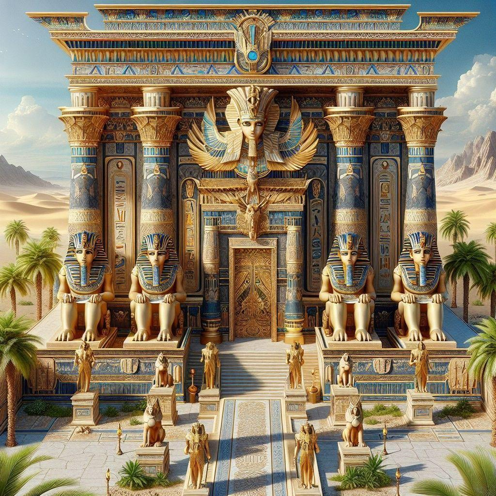
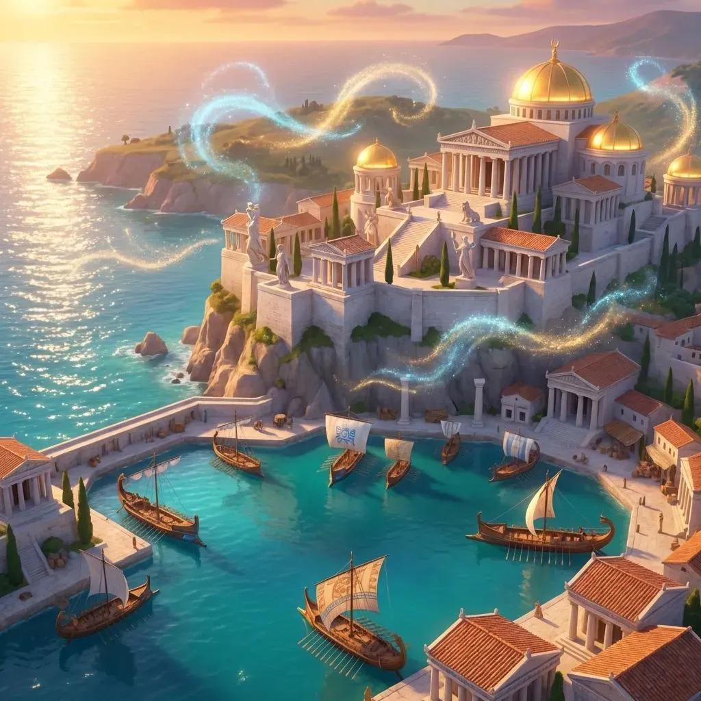
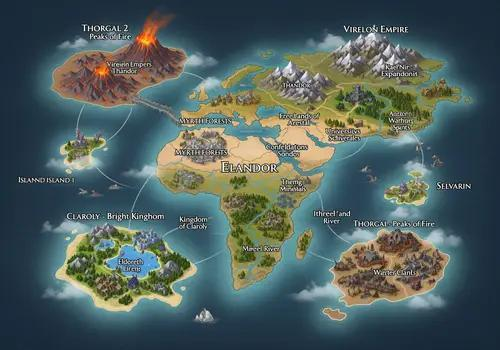
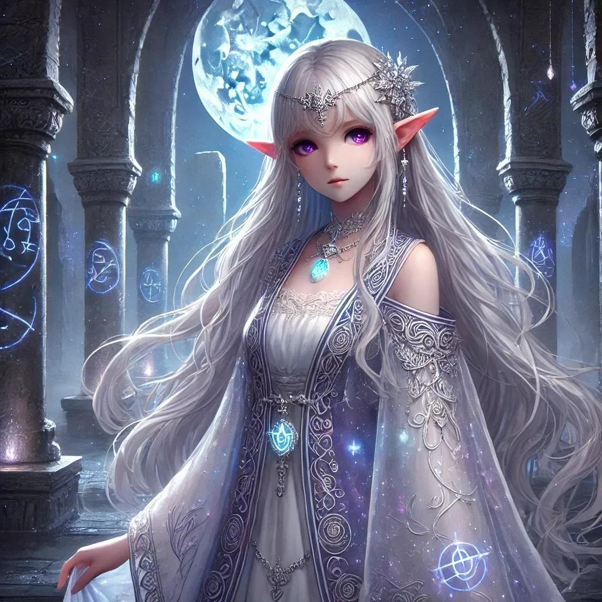

**不是繼續增加暗線，而是先做一次全書暗線的盤點、分級、合併與淘汰。**

《萬界風月樓》已經從單一世界的修仙故事，逐漸發展成跨世界、跨文明、跨勢力的長篇作品。這種規模必然會產生大量伏筆。

但有一個風險：如果每一卷都新增五、六條暗線，卻只回收一、兩條，到了第八卷、第十卷，讀者可能已經忘記某條暗線最初出現在哪裡，作者自己也會被設定牽制。

我的原則是：

> **暗線不是越多越好，而是每一條暗線都必須有存在的價值、推進的節奏，以及最終的交代。**

而且，我不建議為了減少數量，把所有暗線都硬塞進天行者、棋算者、諸天蝕者三個組織。不同謎題應該保留不同來源，否則世界會顯得過度設計，所有事件背後似乎都是同一批人在操縱。

我會將暗線分成四種：

| 分類 | 處理原則 |
| ----- | ----- |
| 主幹暗線 | 貫穿全書，必須保留 |
| 世界暗線 | 在特定世界完成，原則上不跨太多卷 |
| 人物暗線 | 有明確人物成長或身世意義，適時回收 |
| 裝飾性伏筆 | 沒有實際劇情價值，可以刪除或併入其他線 |

尤其是世界暗線，我希望第四卷開始採取一個新原則：

**每個世界都應該有自己的完整故事，不必每個世界都成為萬界大陰謀的一部分。**

這會讓九曜神域的神權腐敗、信仰濁泥與神座之爭真正具有自己的歷史意義，而不是只當作揭露諸天蝕者的工具。

## **一、先看目前的暗線存量**

我找到了你上傳的 `MASTER_FORESHADOWING.md` 原始總庫。它有一個很值得注意的現象：其實你已經做過一次暗線分類與合併，只是第四卷的設計又開始增加新的分支。

目前的總庫：

## **全書暗線存量（第三卷結束基準）**

# **4**

S級主幹暗線

# **4**

A級長期暗線

# **5**

B級中期暗線

**尚未完成的跨卷暗線**

# **13**

第四卷另外規劃的新伏筆

**6 條**

第四卷可能面對的總管理項目

**19 條**

不含已回收的 C 級卷內暗線，也不代表 19 條都必須成為獨立故事線。

我認為真正的問題不是 19 這個數字，而是其中有不少暗線其實在描述同一件事情的不同側面。

### **目前四條 S 級主幹**

| 編號 | 暗線 | 我的判斷 |
| ----- | ----- | ----- |
| SL-01 | 諸天蝕者真身與邏輯 | 必須保留 |
| SL-02 | 萬界樓本質與崩毀真相 | 必須保留 |
| SL-03 | 諸天封魔陣與拆分權限 | 必須保留，但要控制揭露節奏 |
| SL-04 | 顧淵前世印記與身隕之謎 | 必須保留 |

這四條是整部小說的骨架，我不建議刪除。

但有一個問題：SL-01、SL-02、SL-04 其實彼此高度關聯。

我會把它們視為一個「遠古浩劫謎團」，底下保留三個不同問題：

1. 諸天蝕者究竟是什麼？  
2. 萬界樓為什麼崩毀，又為什麼留下最後一個錨點？  
3. 顧淵與當年的浩劫究竟有什麼關係？

這樣管理時是三個問題、一個主幹謎團，不必每個問題都再生出三、四條支線。

### **四條 A 級長期暗線**

* AL-01：天行者與棋算者。  
* AL-02：慕容先祖淵源。  
* AL-03：洛寒衣斷星古劍。  
* AL-04：姬明月真龍血脈。

這四條裡面，AL-04 正好是第四卷要處理的，完成後就應該正式退出活動暗線清單。

AL-02、AL-03 不必急著回收，但也不應每卷都增加新線索。

### **五條 B 級中期暗線**

* BL-01：沈玄清大劫殘印，已回收。  
* BL-02：枯骨老魔與太古封印權限之爭，已回收。  
* BL-03：落霞仙城與三十六世家。  
* BL-04：柳清虛元嬰突破。  
* BL-05：九曜黑市衝突。

其中 BL-03、BL-04、BL-05 都應該在第四卷處理。

尤其 BL-03，我不希望它繼續成為第五卷的商戰暗線。慕容玥已經建立三洲商盟，這件事情應該有個結果。

Pasted text(1).txt

## **二、第四卷六條新增暗線，應該怎麼處理？**

這是我認為最值得動刀的地方。

你在第四卷原始伏筆表新增了 FB4-01～FB4-06。

逐一看：

| 新編號 | 新伏筆 | 我的建議 |
| ----- | ----- | ----- |
| FB4-01 | 神藏殿與靈素古老管理權 | 保留，併入 SL-02 |
| FB4-02 | 古神認出顧淵印記 | 保留，併入 SL-04 |
| FB4-03 | 羅睺神系與蝕者的隱秘連結 | 暫時刪除 |
| FB4-04 | 水曜神系與天行者往來 | 刪除獨立暗線 |
| FB4-05 | 棋算者關注萬界樓修復進度 | 保留，併入 AL-01 |
| FB4-06 | 九曜祭天壇是封魔鎖鏈節點 | 保留，但必須確認是否真的必要 |

我的理由如下。

**FB4-01：不需要獨立成線。**

神藏殿顯現、靈素擁有古老管理權、神格自動臣服，這些都是萬界樓本質的線索。

全部歸入 SL-02 即可。

**FB4-02：不需要獨立成線。**

古神殘念認出顧淵印記，這就是 SL-04 的推進。

不要再多建立一條古神身世線。

**FB4-03：我傾向直接刪除。**

羅睺神系主動吸收信仰濁泥，並與蝕者存在隱秘連結。

這個設計雖然有吸引力，但會產生一個問題：

九曜神域已經有神王繼承、日曜權力鬥爭、太陰神格污染、熒惑戰爭製造信仰、天行者黑市、棋算者代理人、蝕者規則投影。

再加上一個隱藏的羅睺神系陰謀，第四卷會過度擁擠。

如果羅睺神系只是九曜內部一個腐敗神系，就直接放在世界設定裡，不需要設成跨卷暗線。

**FB4-04：刪除獨立暗線。**

水曜神系與天行者往來，可以是黑市交易的背景情報。

但除非水曜神系本身對第五卷有不可替代的作用，否則沒有必要讓讀者再記住一個神系的秘密。

**FB4-05：保留，併入 AL-01。**

棋算者真正關心萬界樓修復進度，這是很有價值的情報。

但要注意，不能在第四卷就讓讀者知道棋算者為什麼關心。

只要讓代理人露出一個不合理的反應即可。

**FB4-06：暫時不新增，先檢查 SL-03。**

九曜祭天壇是不是七界封魔鎖鏈的節點？

這是一個很大的設定。

如果九曜祭天壇只是信仰願力的匯聚中心，就不必硬把它連接到封魔陣。

如果它確實承擔封印功能，才納入 SL-03。

我比較傾向讓它先有自己的神域文明功能，至於與封魔鎖鏈的關係，等後續真正有必要時再揭露。

這樣不會讓所有世界的重大建築都變成同一套遠古封印工程。

## **三、我建議進行一次真正的暗線清理**

不是把已經寫過的設定刪掉，而是將暗線分成三種管理狀態：

* 活動中：近期必須推進，讀者仍需要記得。  
* 封存中：已經埋設，但暫時不推進。  
* 已結案：劇情已經交代，不再列入未解謎題。

我建議第四卷結束時，活動暗線只留下以下項目。

### **建議的第四卷結束後暗線清單**

保留：S級主幹

| 編號 | 暗線 | 第四卷後狀態 |
| ----- | ----- | ----- |
| SL-01 | 諸天蝕者 | 持續活動 |
| SL-02 | 萬界樓本質與崩毀真相 | 持續活動 |
| SL-03 | 七界封魔陣與拆分權限 | 持續活動 |
| SL-04 | 顧淵前世與身隕之謎 | 持續活動 |

保留：A級長期

| 編號 | 暗線 | 第四卷後狀態 |
| ----- | ----- | ----- |
| AL-01 | 天行者與棋算者 | 持續活動 |
| AL-02 | 慕容先祖淵源 | 封存，等待適當人物篇 |
| AL-03 | 洛寒衣斷星古劍 | 封存，等待適當人物篇 |
| AL-04 | 姬明月真龍血脈 | 第四卷結案 |

第四卷結案：B級

| 編號 | 暗線 | 處理 |
| ----- | ----- | ----- |
| BL-03 | 落霞仙城暗潮 | 正面清算，結案 |
| BL-04 | 柳清虛元嬰突破 | 突破後結案 |
| BL-05 | 九曜黑市衝突 | 黑市事件結束，後續組織情報歸 AL-01 |

如此一來，第四卷結束後：

* 活動主幹 4 條。  
* 活動長期暗線 1 條。  
* 暫時封存人物暗線 2 條。  
* B 級中期暗線不再有未處理項目。

也就是說，**真正需要持續追蹤的只有五條主線。**

這個數量我認為相當合理。

注意：這不是把 AL-02、AL-03 永久放棄，而是不要為了維持暗線熱度，刻意在每卷塞入線索。

## **四、還有一個更重要的問題：有些暗線不應該存在**

我想特別談談目前故事的結構。

現在的總庫有一個傾向：

只要某個人物出現特殊血脈、某個遺跡出現特殊符文、某個組織表現異常，就會被建立成一條暗線。

這其實不一定是好事。

例如：

* 一個古老宗門有自己的歷史，不代表它與萬界樓有關。  
* 一個神明有特殊血脈，不代表它是諸天封魔陣的一部分。  
* 一個黑市組織有特殊交易，不代表它背後一定有更大的陰謀。  
* 一把古劍有特殊來歷，不代表它必須成為拯救諸天的關鍵道具。

我希望保留一些「只是這個世界自己的故事」。

這對九曜神域尤其重要。

### **我建議第四卷採取三個敘事限制**

**第一，信仰濁泥不必完全由蝕者造成。**

它應該是神域文明自身長期發展出來的制度性問題。

眾生願力、神明權力、信仰壟斷、戰爭製造信徒，這些都能形成完整的因果。

蝕者可以利用這種脆弱性，但不必是每件壞事的幕後黑手。

**第二，九曜神域的神權危機必須有自己的歷史結局。**

神王退位、日曜神系失勢、太陰神系改革、熒惑軍團重建。

這些事件即使不涉及諸天蝕者，也值得獨立成立。

**第三，第四卷結束時，不能再留下五、六個新組織等待第五卷解釋。**

第五卷應該有自己的世界、人物、文明與主要矛盾。

不是每進入一個新世界，就發現那裡又有一個古老組織、一個神秘遺跡、一條封魔鎖鏈。

## **五、第四卷總綱本身還有幾個需要修正的地方**

除了暗線，我也看到幾個結構問題。

| 問題 | 目前狀況 | 建議 |
| ----- | ----- | ----- |
| 雙修場次 | 文件導航寫六場，實際排程是七場 | 統一改為七場 |
| 第二篇雙修 | \+40 有列入修復度，但 ch095～100 章節表沒有明確安排 | 必須指定章節與情感鋪墊 |
| 修復度 | 280 \+ 220 \= 500 | 數學正確 |
| 九曜祭天壇 | 既是信仰願力中心，又可能是七界節點 | 先確定其原生功能 |
| 棋算者 | 有時被寫成天行者最高決策者，有時又是獨立勢力 | 修正組織圖與文字 |
| 神王終局 | ch122 作最後選擇，ch123～124 才建立秩序 | 應明確交代新神權制度由誰接手 |
| 柳清虛跨界 | ch118 突然親臨九曜 | 交代跨界權限如何取得，不可忽略既有通行限制 |

其中棋算者的問題尤其值得注意。

目前文件一方面規定天行者、棋算者、諸天蝕者三方獨立；另一方面組織圖卻把棋算者畫成天行者內部的最高決策者。

這是設定矛盾，必須修正。

我建議：

* 天行者：獨立的跨界商業組織。  
* 棋算者：獨立的隱秘勢力，與天行者存在情報及交易關係。  
* 諸天蝕者：不屬於任何組織的高維規則威脅。

這樣才是真正的三方分立。

另外，柳清虛的跨界不能只因為要安排雙修，就讓她突然出現在九曜。她必須有合理的通行方式與自己的成長選擇。青玄界也應繼續自行發展，而不是等待顧淵回來。

## **六、我建議新增一份全書暗線管理規範**

這份規範比再寫一份人物設定更有長期價值。

我建議直接加入 `MASTER_FORESHADOWING.md`：

**《全書暗線管理規則 v2.0》**

1. S 級主幹暗線原則上不超過 4 條。  
2. A 級活動暗線原則上不超過 3 條。  
3. B 級中期暗線原則上不超過 5 條。  
4. 每卷新增的跨卷暗線原則上不超過 2 條。  
5. 新暗線必須說明它不能併入哪一條既有暗線，以及為什麼必須獨立存在。  
6. 已經埋設但兩卷沒有推進的暗線，必須重新評估：封存、合併或回收。  
7. 每卷至少結案 2 條既有暗線，避免只增不減。  
8. 世界內部的政治、宗教、文明矛盾，除非有跨卷必要性，否則不升格為全書暗線。  
9. 已回收暗線移入歷史存檔，不再重複列入活動清單。  
10. 不得為了回收暗線而扭曲人物動機或世界因果。

這裡的數量是管理上限，不是要求每卷一定要填滿。

## **七、我的最終建議：先清理，再寫第四卷**

我會把目前工作順序調整成：

1. **第一階段：整理 MASTER\_FORESHADOWING.md**  
   將舊暗線分成活動、封存、結案三種狀態，刪除重複編號與沒有必要的支線。  
2. **第二階段：確認第四卷暗線**  
   只保留 AL-01、AL-04、BL-03、BL-04、BL-05 的推進，以及 SL-01～SL-04 的必要進展。  
3. **第三階段：修訂第四卷總綱**  
   尤其是雙修場次、棋算者定位、信仰濁泥與封魔陣的關係。  
4. **第四階段：才展開第四卷其他文件**  
   01 世界設定、02 力量體系、03 人物感情線、05 逐章細綱。

**最後，我還有一個比較大的想法。**

我認為《萬界風月樓》不需要把所有故事都收束到一個終極陰謀。

真正值得保留的長篇魅力，應該是三個層次同時存在：

* 顧淵與眾女主的感情、成長及萬界樓修復，是讀者持續追看的主動力。  
* 每個世界都有自己的文明、人物、衝突與完整故事。  
* 遠古浩劫、萬界樓本質、諸天蝕者，是貫穿全書的深層謎團。

## 插圖

