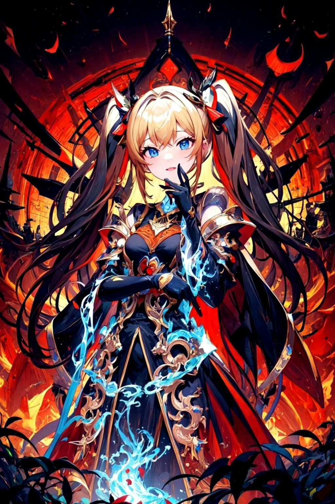
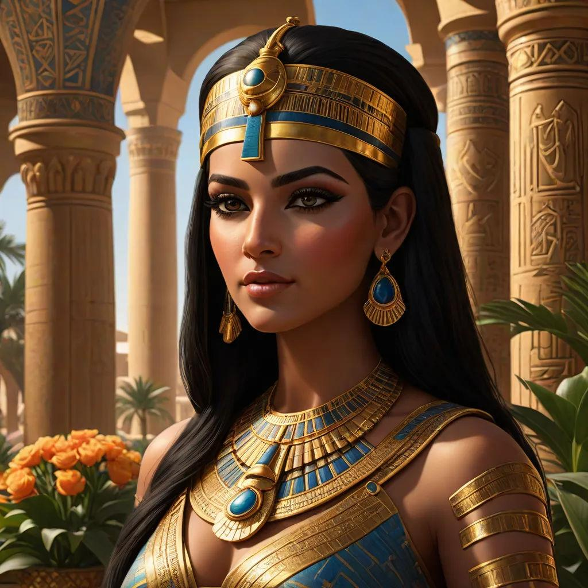

# 第七卷人物速查表｜艾瑟蘭三位正式女主＋彩蛋人物（濃縮版）

> 完整原始備份見 `characters.bak.md`。

## 一、核心關係與定位總覽

- **寫作共識**：三位正式女主皆為長期伴侶，本卷完成各自自主選擇與實質關係推進，保留後續跨界、家庭與後代空間；避免單一「英雄救美」弧線。
- **三女互動**：不必一開始就熟悉，允許適度嫉妒；溫柔（艾琳諾）× 傲嬌（塞拉菲娜）× 直率（菲奧娜）碰撞出化學反應。
- **克麗奧佩脫拉**：獨立彩蛋人物，短暫情愫、不入萬界樓、不與三女見面、不套用正式女主模板。

| 角色 | 關係定位 | 相遇 | 熟悉 | 動情 | 確立關係 | 相處特色 |
|---|---|---|---|---|---|---|
| **艾琳諾・晨星** | 長期伴侶｜溫柔守護型 | 善意帶戒心 | 理解與陪伴 | 情感依靠 | 溫柔接納 | 細膩依戀、偶有小任性 |
| **塞拉菲娜・馮・羅恩** | 長期伴侶｜知性傲嬌型 | 好奇與質疑 | 研究與辯論 | 心智吸引 | 傲嬌承認 | 鬥嘴吃醋、偶主動又害羞 |
| **菲奧娜・格里芬** | 長期伴侶｜英武坦率型 | 懷疑與調查 | 合作與磨合 | 欣賞與信任 | 坦率選擇 | 直率熱情、常更主動 |
| **克麗奧佩脫拉七世** | 彩蛋人物｜短暫情愫 | 遺跡試探 | 智慧交鋒 | 卸冠傾訴 | 自選短暫親密 | 不挽留、不依附、留回憶 |

---

## 二、三位正式女主

### 1. 艾琳諾・晨星｜精靈族・守護生命

- **關係核心**：從守護者到彼此的歸屬。
- **情感弧線**：對顧淵抱善意但存戒心 → 顧淵理解精靈生命傳承並尊重其族群責任 → 察覺他關心的是「她這個人」而非只為拯救 → 願在守護族群外為自己選擇一份感情。

### 2. 塞拉菲娜・馮・羅恩｜魔法研究者・追求真理

- **關係核心**：從學術對手到靈魂知己。
- **情感弧線**：對無咒施法極度好奇並懷疑其藏秘 → 透過研究、辯論、實驗建默契 → 發現顧淵能懂她的求知欲也看見她脆弱一面 → 口是心非卻開始吃醋在意。

### 3. 菲奧娜・格里芬｜騎士・堅持榮譽

- **關係核心**：從並肩作戰到相互託付。
- **情感弧線**：因顧淵來歷不明展開調查警戒 → 經並肩作戰與調查建立信任 → 欣賞其實力、判斷與擔當 → 不只以騎士身分並肩，而是以女人身分坦率選擇他。

---

## 三、彩蛋人物｜克麗奧佩脫拉七世（Cleopatra VII）

- **基本資料**：沙漠古王國末代女王｜人族｜約 30 歲｜黑長髮、深邃眼眸、肌膚白皙、明豔高貴且具成熟女性魅力。
- **歷史映射（改編不照搬結局）**：托勒密王朝→沙漠古王國；羅馬擴張→星輝帝國對南方沙漠施壓（凱撒／安東尼對應西方征服者與盟友統帥）；王朝可衰危，但個人命運須由她自決。
- **傳承與戰力**：非主流九環法師，屬古代祭司王族傳承；強項在知識、情報、精神魔法與政治手腕。
  - **星辰占測**：借星象與星盤觀測以太流向（推測走向，非精準預知）。
  - **祭司秘法**：古咒、祭儀、神殿結界調動特殊以太。
  - **王權契約**：以血脈與守護靈立契，召喚王朝守護者、維繫遺跡封印。
- **性格與弱點**：外在優雅從容、善察言觀色與掌控談話；內在自尊極強、深愛國家、拒作大國棋子，同時渴望以普通女人而非女王身分被理解。弱點是慣於政治算計，反而看不透不受權力牽制的顧淵。
- **與顧淵五步弧線**：
  1. **遺跡試探**：顧淵追查泰坦以太核心入王室遺跡，她先行試探而非求助。
  2. **智慧交鋒**：見他無圖王權財富，共論遺跡、文明興衰與他界統治者。
  3. **卸下王冠**：獨處夜談傾訴孤獨與亡國焦慮，顧淵只認真傾聽、不作空諾亦不勸棄位。
  4. **短暫情愫**：非交易亦非依附，她主動選擇一段真實親密時光。
  5. **各自前行**：調查畢即別離，不挽留、不入樓，她繼續面對國家與臣民，僅留特殊回憶。
- **代表語氣**：
  > 「我曾經擁有一個王國，卻從未真正擁有自己的命運。」
  > 「你不想要我的王冠，也不想要我的土地。那麼，顧淵，你究竟想從我身上得到什麼？」
  > 「今晚不要稱呼我為女王。至少在這個夜晚，讓我只做克麗奧佩脫拉。」
  > 「你會離開，而我仍要留在這裡。這一次，我不打算讓任何人替我決定結局。」
