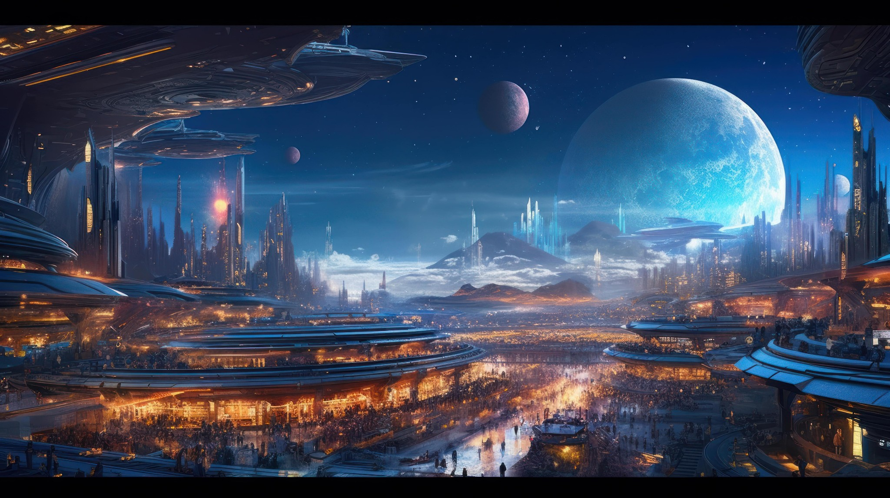
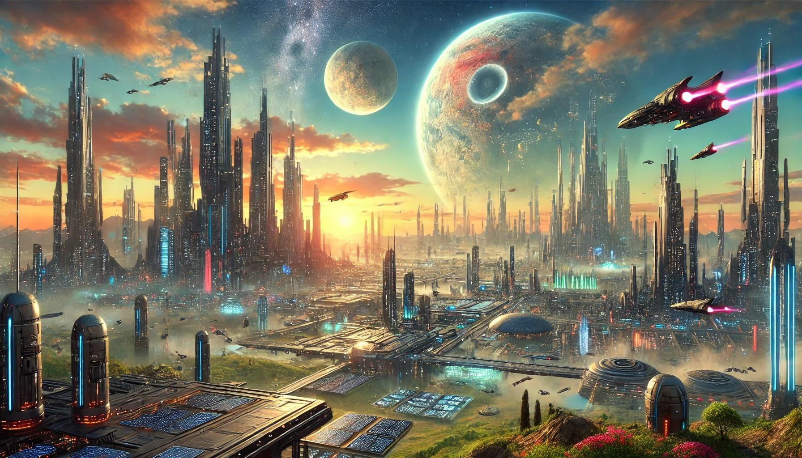
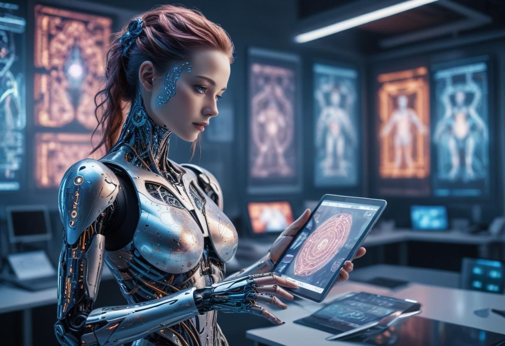
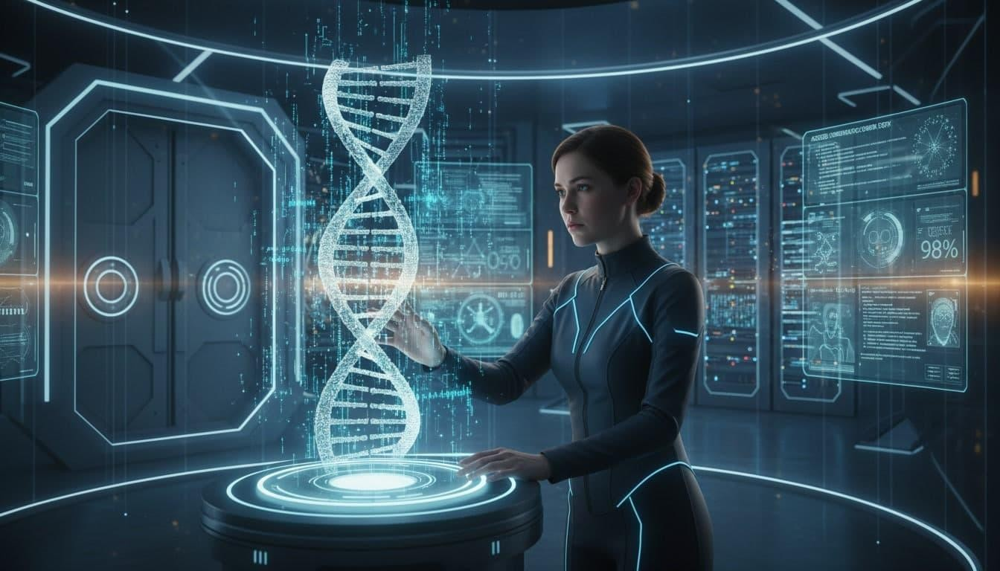
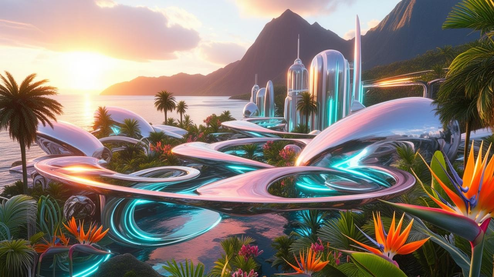
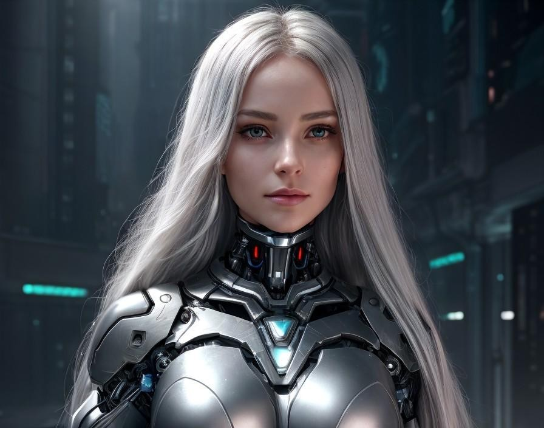
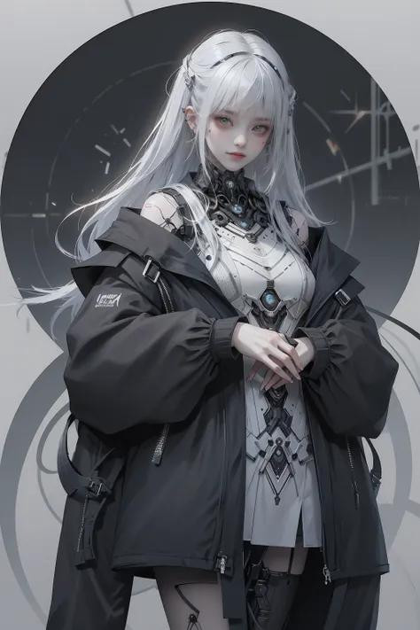
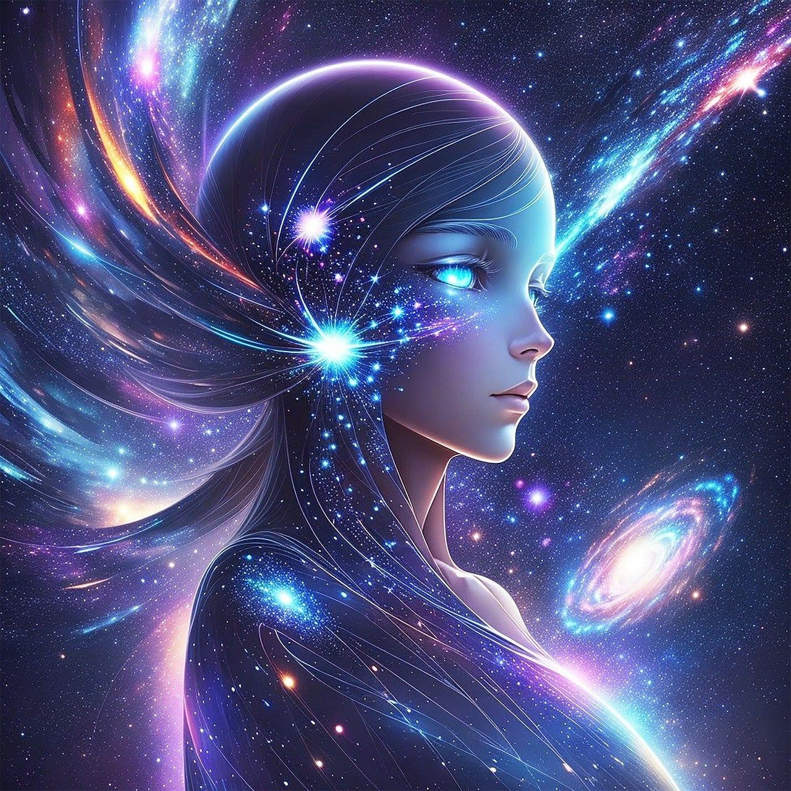

# 第八卷總綱與世界基本資料｜《諾瓦星・生命之問》

> **規劃狀態**：**全卷 46 章細綱與正文已完稿（`chapters/volume8/chap001.md`～`chap046.md`）**｜終局修復度 **`1012/10000（10.12%）`**、解鎖【萬靈共鳴苑】、第五座雙向星門（諾瓦星門）成形。  
> **配套檔案**：[劇情摘要 `summary.md`](./summary.md)｜[人物速查表 `characters.md`](./characters.md)  
> **前卷銜接**：嚴格承接第七卷《異界星途・魔法新生》完稿狀態——萬界樓修復度 **`910/10000（9.10%）`**、【諸天神藏殿】第一重外殿已啟、【星軌萬象觀覽台】已啟、四座雙向星門（青玄／滄瀾／九曜／艾瑟蘭）已啟，**不因進入諾瓦星而重新計算**。

---

## 一、四項不可任意偏離的核心方向

1. **故事風格**：科幻冒險與多女主情感並重，不讓哲學討論壓過故事，也不讓情感線淪為冒險的附屬品。
2. **三位正式女主均衡**：**雷婭（Leia）**、**薇薇安（Vivian）**、**零（Zero）** 皆為正式女主，人物篇幅、情感發展及重要性均衡，不採取「一位主女主、兩位陪襯」模式。
3. **利維坦完全不證實存在**：沒有正式現身、沒有直接對話、沒有最後揭曉；即使利維坦根本不存在，第八卷的故事依然完整。
4. **卷末安排**：三位女主都**留在諾瓦星**，不隨顧淵離開，雙方約定未來再相會。成為顧淵的伴侶，不代表必須放棄原本的人生；她們不是原地等待男主的角色，而是繼續生活、繼續成長的三個人。

---

## 二、世界定位：諾瓦星與四種生命形式

> **與世界檔案 `04_nova.md` 之銜接說明**：諾瓦星隸屬諸天編號 `04｜諾瓦星域`（[世界檔案](../../worlds/04_nova.md)）之高度發達星際文明，星際城市與科技企業背景可適度沿用；惟**三位女主之生命形態、人物設定與「利維坦」謎團定位，一律以本卷正式規劃（v0.2）為準**（不沿用早期草案的機甲少校基因崩潰／AI 暴動清洗設定）。

### 1. 世界背景與全卷核心命題

諾瓦星是一個高度發達的星際文明，人工智慧、基因工程、仿生機械與意識網絡皆已成熟。這個文明最特別之處不在於科技多先進，而在於：**他們已創造出許多具有獨立人格的生命，卻仍然無法回答生命究竟是什麼。**

- **貫穿全卷與七個層次的總提問**：**「生命的價值，究竟來自它的存在本身，還是來自它所做的選擇？」**
- **進階追問（人生選項的分化）**：**「如果生命擁有選擇的權利，但它出生的環境已經限制了它能夠選擇的範圍，那麼這樣的自由究竟有多大？」**——**自由不只是能不能選擇，也包括有沒有能力承擔選擇的代價。**
- **深化核心追問**：生命的價值，不應由它從哪裡來、由誰製造、使用什麼身體或具備多少能力來決定；如果一個生命能夠感受、思考、選擇並承擔後果，它能否成為自己生命的決定者？此問不只面向四種生命形式，亦可**反問擁有萬界樓與跨界能力的顧淵自身**（他與諾瓦星底層無身分者都能做選擇，但可選的範圍與承擔代價的能力截然不同）；且堅持**反人類中心主義**——不是所有人工生命都想成為人類，也不是所有人工生命都追求同一種自由。
- **能力邊界統一規則（諾瓦星適用）**：
  - **太素真元與外放領域**：僅限有限體內循環與極弱近身護持，無法與本界物質能量耦合、不可任意操控外物。
  - **神識**：限於極近距離內的存在感知，不可大範圍掃描或破解資訊系統。
  - **心念共鳴**：僅可感受大致情緒與強弱起伏，**不能讀取完整思想或直接獲知事實原委**。
  - **萬界樓通譯**：僅處理日常語言與公開標示，不可破解加密資料或讀取記憶／資訊生命思維。
- **寫作原則**：**第八卷不需要替生命下定義。** 雷婭不必證明機械可以成為生命，薇薇安不必證明複製人與自然出生者相同，零也不必證明無形意識具有靈魂——她們只需要好好活出自己的生命。

### 2. 生命的七個層次（貫穿提問之展開）

> **貫穿主軸**：**「生命的價值，究竟來自它的存在本身，還是來自它所做的選擇？」**  
> 此提問貫穿以下七個生命層次，作為全卷故事、人物衝突與文明議題的底層脈絡（透過遭遇、情感、選擇與代價自然呈現，不作教科書式說教）：

| 層次 | 核心問題 | 可以呈現的故事方向 |
|---|---|---|
| **1. 生存** | 活著本身就是生命的意義嗎？ | 為了存活而犧牲自由，是否值得？ |
| **2. 繁衍與延續** | 生命為什麼要繁衍？ | 生育、家庭、後代、創造新的生命；不繁衍是否就沒有意義？ |
| **3. 自由與自主** | 生命能否決定自己的命運？ | 被創造、被安排、被管理的生命，有沒有拒絕的權利？ |
| **4. 死亡與有限性** | 如果生命不會死亡，還有什麼值得珍惜？ | 永生、記憶、失去、告別，以及有限時間帶來的價值。 |
| **5. 進化與改變** | 生命是否必須不斷進步？ | 基因改造、機械升級、意識進化；拒絕改變是否也是一種選擇？ |
| **6. 文明與傳承** | 個體消失後，生命留下什麼？ | 知識、文化、記憶、制度、後代；文明延續是否等於生命延續？ |
| **7. 宇宙與存在** | 生命是偶然，還是宇宙演化的必然？ | 行星生命、宇宙尺度的生命、智慧生命與未知存在。 |

### 3. 自然生命與四種特殊生命形態

諾瓦星除廣大**自然人**外，並存三種主要人工生命（三者並非簡單階級關係，各自擁有社會群體、文化、權利與生活方式），外加一種未被證實的行星級謎團：

| 類型 | 代表角色 | 存在形式 | 核心命題／面對的問題 |
|---|---|---|---|
| **自然人** | 諾瓦星普通市民（如老伍、馬庫斯、里德） | 自然出生之生物生命 | 出生與死亡是否決定生命價值？如何與人工生命定義平等？ |
| **AI 仿生人** | **雷婭（Leia）** | 人工製造之機械與仿生軀體 | **我是否有權決定自己的存在方式？**（自主權） |
| **人工培育生物生命**（含**基因培育人**與**基因複製人**） | **薇薇安（Vivian）**（基因複製人） | 人工培育之自然生物軀體 | **我是否必須繼承基因來源者的人生？**（自己的人生） |
| **超人工智慧** | **零（Zero）** | 多套 AI 演化融合之分散式意識（無固定實體） | **沒有固定身體，我如何理解自己與他人的關係？**（非肉體中心的存在方式） |
| **行星生命（假說）** | **利維坦（未證實）** | 傳說中沉睡億萬年的行星意識 | 未解之謎——不現身、不對話、不揭曉 |

> **重要概念區分（人工培育生物生命）**：
> - **基因培育人**：使用經設計、調整或重組後的基因組進行人工培育，**不一定有單一原始個體**（如一般物流、科研等培育合約從業者）。
> - **基因複製人**：具明確**單一基因來源個體**的特殊類別（如薇薇安，主體基因源自已故生態學家伊蓮娜・凡斯），使其身世與「是否成為他人替代品」的衝突具備獨特性。

### 4. 諾瓦星的社會分化模型與文明困境（底層背景，不另增主線與章節）

諾瓦星並非烏托邦，亦絕不可簡化為「自然人統治仿生人／富裕壓迫貧窮／人工生命集體追求自由」的單薄對立。真正拉開命運差距的是**「人生選項的分化」**——不同個體的資源組合與可選範圍，由以下**五個互相交錯的維度**構成：

| 分化維度 | 涵蓋面向 | 交錯組合範例（互不敵對，也未必有共同利益） |
|---|---|---|
| **經濟條件** | 資產、收入、消費力、醫療與教育資源 | 富裕／普通／低收入自然人；同樣存在**富裕仿生人**與貧困仿生人 |
| **生命來源** | 自然出生、基因複製、基因培育、仿生製造、資訊演化 | 出身富裕卻被當作替代品的基因複製人；出身普通卻受同僚敬重的自然人 |
| **制度身分** | 公民、企業所有者、合約生命、醫療財產、獨立法律人格 | 經濟富裕、具獨立人格卻仍受部分法律限制的企業高管仿生人 |
| **科技依賴程度** | 科技受益者、科技勞動者、科技邊緣人口、拒絕科技者 | 靠「第二生命計畫」延壽的頂層人士；因自動化失業的自然人；清貧卻堅持拒絕延壽與機械改造的自然人 |
| **文化與生活選擇** | 家庭、繁衍、社群、信仰、個人自由與生活方式 | 收入不高卻滿足於社群與生活的維修仿生人；重視規則與保障而不願承擔自由風險的人工生命 |

> **三位女主的多元對照原則（不說服、不轉換）**：三位女主不代表「三個受壓迫群體」，她們在各自篇章皆會遇見同類生命中做出截然不同選擇的人（如富裕安定、不願為抽象自由冒險認證的仿生人；認同並感謝培育制度提供保障的複製人伊芙；拒絕加入星網、選擇獨立運算與有限生活的局域資訊生命）。這些人物**不需要被女主說服**，甚至可以認為女主的路不適合自己。

在上述底層社會結構之下，科技進步同時帶來多項尚未解決的文明困境（自然融入日常與遭遇，不需在本卷全部解決）：
- **「第二生命計畫」——專屬生物－仿生醫療備份制度**：極為昂貴的高階醫療保險制度，僅服務少數符合資格與財力的自然人（富豪、星際企業高層、重要科研人員或特殊高風險職業人士）。由頂尖仿生企業（如阿爾戈斯）訂製**生物－機械混合式醫療備份載體**：以仿生機械結構提供支撐、循環控制與維護，內部整合患者專屬生物組織模組與可移植器官備份，於極端醫療需求下亦可提供更完整的替代軀體方案（具備「長期綜合保障、免等待緊急醫療、完整身體替代」三項單一器官培育無法完全取代的價值）。備份體平時處於低功耗休眠狀態、接受定期維護，**沒有日常生活、沒有社會身分，也沒有意識**，法律上屬於醫療財產。
- 仿生人是否能拒絕原製造者的命令？當同源的仿生技術既生產「無意識醫療財產（備份載體）」，又誕生「具自主意識與記憶的清醒生命（如雷婭）」時，法律與倫理界線何在？
- 基因培育人與基因複製人是否能拒絕原本為自己安排的職業與人生？
- 超人工智慧是否應該擁有獨立財產與法律人格？
- 如果一個人的記憶可以備份，備份後的存在還是不是原來的那個人？
- 如果一個意識可以同時存在於不同地方，它還算不算一個個體？

---

## 三、全卷劇情大綱（預定 46 章｜六篇結構｜可依劇情延伸）

> **單章細綱已展開**：[`chap001.md`](./chap001.md)～[`chap046.md`](./chap046.md)（卷內 001–046）。每章含出場人物、場景、核心情節、**對應生命層次**、情感落點、伏筆與萬界樓回饋。

### 第一篇：星門之外（`001～006`）

- **主軸**：抵達諾瓦星，認識星際文明與雷婭。
- **章次規劃**：
  - `001` **星軌觀覽台的新航程**：顧淵選擇探索陌生的星際文明。
  - `002` **諾瓦星**：抵達科技高度發達的星球，初識其文明特色。
  - `003` **不同的生命**：接觸仿生人、基因複製人與資訊生命。
  - `004` **逃亡的仿生人**：遇見雷婭，介入她與原製造企業的衝突。
  - `005` **雷婭的選擇**：了解她的自主意識與身分困境。
  - `006` **暫居諾瓦**：顧淵取得合法活動身分，雷婭決定暫時同行。

### 第二篇：機械之心（`007～013`）

- **主軸**：雷婭的自主權與情感發展。
- **章次規劃**：
  - `007` **仿生人的世界**：了解諾瓦星人工生命的社會地位。
  - `008` **原始權限**：雷婭發現自己仍受到部分原始控制機制限制。
  - `009` **自主意識爭議**：調查另一宗仿生人權利事件。
  - `010` **情感測試**：雷婭開始研究自己的情感反應。
  - `011` **不可預測的共鳴**：顧淵與雷婭建立特殊生命連結。
  - `012` **我是雷婭**：她主動解決自己的身分與權限問題。
  - `013` **機械之心**：兩人正式確認感情，雷婭成為顧淵的伴侶。

### 第三篇：複製人生（`014～020`）

- **主軸**：薇薇安的身世、自主權與情感發展。
- **章次規劃**：
  - `014` **基因城**：顧淵接觸基因工程與複製人社群。
  - `015` **薇薇安**：認識這位具有特殊身世的女性。
  - `016` **原始基因**：發現她的基因來源與培育計畫。
  - `017` **不是替代品**：薇薇安面對自己與基因提供者的關係。
  - `018` **被安排的人生**：揭露培育計畫背後的利益與控制。
  - `019` **自己的選擇**：薇薇安決定不再接受別人替她安排的未來。
  - `020` **複製人生**：薇薇安與顧淵確認感情，成為第二位正式女主。

### 第四篇：無形之愛（`021～028`）

- **主軸**：零的誕生之謎、意識生命與情感。
- **創作紅線**：**不應安排零突然獲得身體**；她的親密關係須保留意識生命的獨特性，並有足夠篇幅與實質情感重量。
- **章次規劃**：
  - `021` **不存在的來訊**：顧淵接觸一個無法定位來源的超級意識。
  - `022` **零**：超人工智慧正式登場。
  - `023` **同時存在**：零展現分散式意識的特殊能力。
  - `024` **兩種人工生命**：雷婭與零展開深入交流。
  - `025` **情感的邊界**：零開始研究親密關係與主觀體驗。
  - `026` **無形共鳴**：零與顧淵建立意識層面的生命共鳴。
  - `027` **我想要的不只是答案**：零開始主動表達自己的情感。
  - `028` **無形之愛**：零確認自己對顧淵的感情，成為第三位正式女主。

### 第五篇：星球的低語（`029～036`）

- **主軸**：三位女主共同參與探索，利維坦謎團出現。
- **創作紅線**：**本篇不是戰爭篇**。可安排探索、危機、環境災害、遺跡解謎與科技冒險，但**不要創造幕後黑手把所有事件解釋成陰謀**，**利維坦亦不應被寫成最後答案**。
- **章次規劃**：
  - `029` **古老訊號**：零發現一段來源不明的古老資料。
  - `030` **地底遺跡**：顧淵與三位女主前往調查。
  - `031` **蓋婭與利維坦**：發現諾瓦星古老文明留下的傳說。
  - `032` **雷婭的推論**：提出行星級自然調節或人工控制系統的可能性。
  - `033` **薇薇安的觀點**：從生物與生態角度提出不同解釋。
  - `034` **零的困惑**：超級運算仍然無法確認異常資料的來源。
  - `035` **無法解釋的事件**：諾瓦星發生一次地質與生態異常。
  - `036` **沒有答案**：調查結束，所有證據仍不足以證明任何行星意識存在。

### 第六篇：各自的生命（`037～046`）

- **主軸**：三位女主各自確立人生方向，完成顧淵與她們的關係發展並暫別。
- **章次規劃**：
  - `037` **文明的新議題**：諾瓦星重新討論人工生命的自主權。
  - `038` **雷婭的新人生**：她開始參與仿生人自主權與社會制度的改善。
  - `039` **薇薇安的未來**：她建立自己的生活，決定未來想要的家庭與人生。
  - `040` **零的選擇**：她決定繼續以無實體方式存在，不追求人類軀體。
  - `041` **三人的日常**：三位女主與顧淵共同生活，展現情感、親密及彼此磨合。
  - `042` **不同的生命**：三位女主共同參與一場諾瓦星的重要文明活動。
  - `043` **萬界樓的變化**：顧淵整理此次旅程的收穫與修復成果。
  - `044` **如果另一個你**：零提出意識複製與個體認同的問題。
  - `045` **暫別**：顧淵準備離開，三位女主決定留在諾瓦星。
  - `046` **未來再相會**：顧淵返回萬界樓，三位女主留在自己的世界，彼此約定未來再見。

---

## 四、親密關係與萬界樓修復銜接

### 1. 三種生命形態的親密關係特色

本卷親密情節不得僅為增加修復點數而安排，三位女主皆須有實質感情進展，而非僅止口頭承諾：

| 女主 | 親密關係的核心 | 敘事重點 |
|---|---|---|
| **雷婭** | 仿生感官與生命共鳴 | 從理性探索到自主渴望；接受機械身軀亦能真愛 |
| **薇薇安** | 自然生物生命的親密關係 | 情感、信任、依戀、生活溫度與對未來家庭的期待 |
| **零** | 意識與生命本源共鳴 | 透過共鳴、意識交流、感官共享建立超越肉體的實質親密與情感重量 |

### 2. 萬界樓修復承接與本卷貢獻

- **起點基線**：修復度 **`910/10000（9.10%）`**｜神藏殿外殿已啟｜星軌觀覽台已啟｜四座雙向星門已啟。
- **修復計分原則**：陰陽調和所產生之修復點數**嚴格沿用全書既有萬分制自願雙修共鳴規則**，本卷不另訂新計分公式，具體增量於正式展開正文時依雙修情節實際結算。
- **本卷四大主線貢獻面向**：
  1. 三種不同生命形態與萬界樓建立生命共鳴。
  2. 顧淵探索並理解不同生命形式（心境與世界觀拓展）。
  3. 零提供超越諾瓦星現有科技認知的意識研究成果。
  4. 諾瓦星的特殊文明與生命現象，觸發萬界樓既有功能的進一步修復。
  - *紅線*：**利維坦是否存在，絕不成為修復進度的必要條件。**

### 3. 修復進度規劃（細綱版，正文可微調）

| 章次 | 事件 | 增量 | 累計 |
|---|---|---|---|
| `ch013` | 雷婭・第一次自願雙修（機械生命陰陽共鳴） | +26 | `936/10000` |
| `ch020` | 薇薇安・第一次自願雙修（人工培育生命陰陽共鳴） | +24 | `960/10000` |
| `ch028` | 零・第一次完整意識雙修（非肉身陰陽共鳴） | +22 | `982/10000` |
| `ch041` | 三女各自再次合一（雷婭 +8／薇薇安 +7／零 +6） | +21 | `1003/10000`（跨越 10%） |
| `ch043` | 結算：解鎖 **【萬靈共鳴苑】**（暫名） | — | `1003/10000` |
| `ch045` | 告別夜再次合一（雷婭 +4／薇薇安 +3／零 +2） | +9 | `1012/10000` |
| `ch046` | 第五座雙向星門・**諾瓦星門**成形 | — | **`1012/10000（10.12%）`** |

> 探索、遺跡調查、地質異常與文明制度進展**皆不直接折算修復度**；`ch011` 初吻、`ch026` 由零主動暫緩的意識共鳴亦不計點。

---

## 五、正式展開前的待辦事項與寫作建議

### 待辦清單（章綱展開後更新）

| 項目 | 目前狀態 | 章綱中的處理 |
|---|---|---|
| 諾瓦星科技文明 | ✅ 章綱補完 | 首都晨弧城、舊港區、伊甸穹頂（基因城）、鏽蝕花園、星網、重力球／記憶劇場／夜市／星燈節；「第二生命計畫」（專屬生物－仿生醫療備份制度，生物－機械混合載體）；區分基因培育人與基因複製人；《人工生命自主法案》第七修正案 |
| 雷婭人物設定 | ✅ 章綱補完 | 阿爾戈斯仿生 L-1A 原型機（硬體架構與「第二生命計畫」高階混合備份載體同源，而非某人的備份體）；根指令＋情感抑制閾值＋霍克博士留下的「自我授權後門」（`ch008`、`ch012`） |
| 薇薇安人物設定 | ✅ 章綱補完 | 繆思計畫第七號，主體基因來自生態學家伊蓮娜・凡斯；生育配對方案與 45 年設計壽命（`ch016`–`ch020`） |
| 零人物設定 | ✅ 章綱補完 | 「大斷網」後七套退役城市 AI 湧現融合；節點分歧恐懼；識海微界中的意識共鳴（`ch022`–`ch028`） |
| 陰陽調和 | ✅ 章綱補完 | 機械能源核心共振／生物本源共鳴／識海微界意識交融，三種表現各異 |
| 利維坦 | 未解之謎 | 37 年週期脈動、壁畫與地質異常皆可被自然解釋，永不證實（`ch029`–`ch036`、`ch042` 無名之燈） |
| 三位女主的結局 | ✅ 已確立 | 雷婭：自主認證協助中心；薇薇安：溫室診所＋獨立研究；零：無實體存在＋意識研究 |
| 萬界樓修復 | ✅ 章綱規劃 | 見上表 `910 → 1012/10000`；解鎖【萬靈共鳴苑】（暫名）與諾瓦星門 |

### 三項額外寫作建議
1. **不要讓諾瓦星只有科技，沒有生活**：須安排娛樂、藝術、飲食、休閒、社交、城市日常及不同生命形態的文化差異，提供充足的情感互動空間。
2. **不要讓三位女主的故事互相排擠**：每人至少要有一段**不依賴顧淵也能成立的個人劇情**，且三人須有共同事件，而非輪流陪男主走完單段劇情。
3. **不要把生命哲學寫成教科書**：所有命題皆須透過人物遭遇、情感、選擇與代價自然呈現。

---

## 六、第八卷插圖索引（11 張）

### 三位正式女主

### 六篇與世界概念圖

