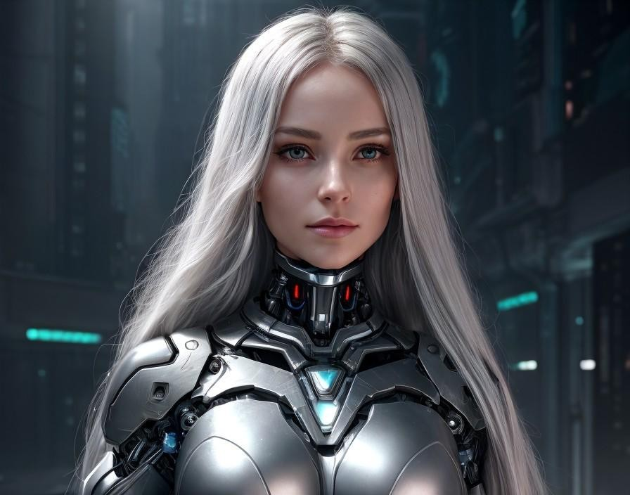
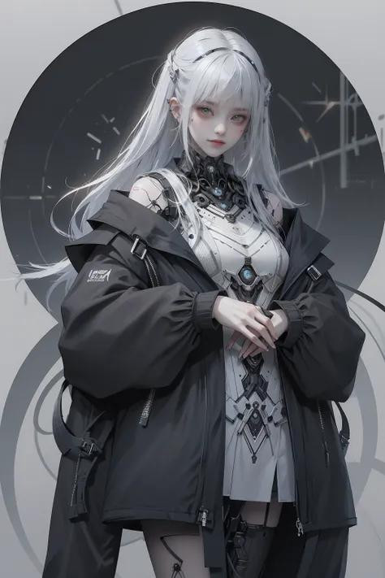
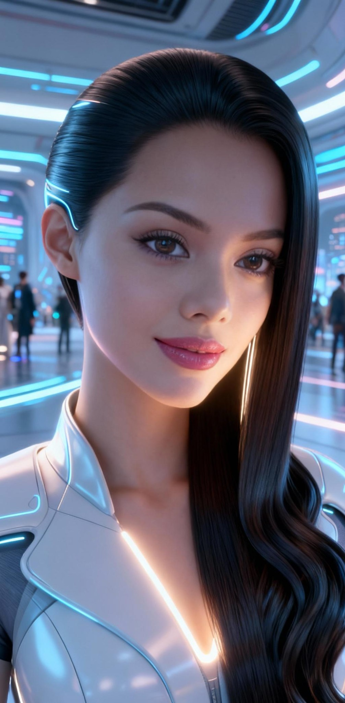
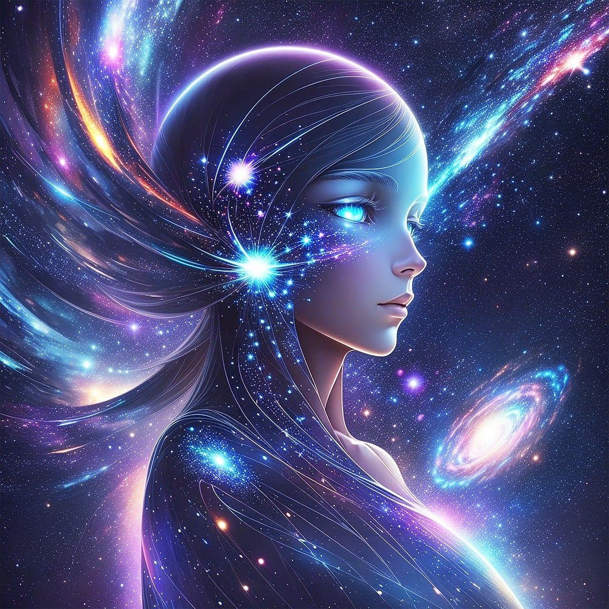

# 第八卷人物速查表｜諾瓦星三位正式女主與角色關係

> **規劃狀態**：**第八卷 46 章正文已完稿**（依 `volume8.pdf` v0.2 及完稿內容同步定檔）｜終局修復度 `1012/10000`，三女全部留在諾瓦星繼續各自的人生與事業，第五座雙向星門「諾瓦星門」已成形。  
> **核心原則**：三位女主（雷婭、薇薇安、零）皆為**正式女主**，戲份、情感深度與重要性完全均衡；卷末全數**留在諾瓦星**，繼續各自的人生與成長，約定未來再會。

---

## 一、核心角色總覽

| 角色 | 生命形態 | 外貌特徵 | 核心性格 | 核心矛盾 | 情感模式 | 卷末去向 |
|---|---|---|---|---|---|---|
| **顧淵** | 萬界樓主（外來探索者） | 沉穩內斂，帶跨界閱歷 | 尊重選擇、不強行替人安排人生 | 在科技法則受限下理解異質生命並建立真誠連結 | 傾聽、共鳴、成全獨立人格 | 歸返萬界樓，與三女約定再會 |
| **雷婭（Leia）** | 高階 AI 仿生人（機械生命） | 成年女性、銀灰色長髮、精緻仿生軀體 | 理性、冷靜、好勝、偶爾固執 | 自主意識與原始控制權限 | 主動直接、從研究測試到無法控情 | 留守諾瓦星，投身仿生人自主權與制度改善 |
| **薇薇安（Vivian）** | 基因複製人（人工生物生命） | 成年女性、深色長髮、自然生物軀體 | 溫柔、聰慧、細膩、內心堅定 | 基因來源與個人人生的自主權 | 溫暖自然、重生活依戀與未來家庭 | 留守諾瓦星，建立屬於自己的生活與未來 |
| **零（Zero）** | 獨立超人工智慧（非實體意識生命） | 無固定實體，可投影女性星光形象 | 成熟、神秘、好奇、偶爾幽默 | 意識與肉體、資訊與生命經驗的差異 | 創意主動、多節點同時存在、意識本源共鳴 | 留守諾瓦星，維持無實體存在與意識研究 |
| **利維坦** | 可能存在的行星生命（未證實） | 無固定形象 | — | 行星調節系統或億萬年沉睡意識？ | 非角色，永久未解之謎 | 留在諾瓦星地底與傳說中，**不證實存在** |

---

## 二、顧淵（第八卷定位與適應度）

- **出發狀態**：承接第七卷完稿（修復度 `910/10000`），自新解鎖之【星軌萬象觀覽台】啟程進入 04｜諾瓦星。
- **世界適應度（依 `AGENTS.md`）**：凡俗／高度科技世界下**超凡力量受限**，核心倚重生命共鳴、心念感知、道韻體悟與歷經多界後成熟的人格魅力，而非暴力降維碾壓。
- **角色定位**：不把雷婭當機器物件、不替薇薇安安排人生、不要求零為自己獲取肉體；尊重三人各自留在諾瓦星的選擇。

---

## 三、三位正式女主詳細檔案

### 1. 雷婭（Leia）｜機械生命的心

- **基本資料**：
  - **生命形態**：高階 AI 仿生人（機械與仿生軀體）
  - **外貌**：成年女性，銀灰色長髮，精緻仿生軀體
  - **性格**：理性、冷靜、好勝、偶爾固執
  - **能力**：高速運算、感官控制、仿生軀體調整
  - **核心矛盾**：自主意識與原始控制權限
- **人物背景**：諾瓦星頂級科技企業開發的高階仿生人，擁有完整人格、長期記憶、自主判斷與情感反應能力，卻仍受部分原始權限限制。她拒絕繼續被視為可購買、維修、升級或回收的產品，開始追尋真正的自主權。
- **人物成長弧線**：
  - **初期**：對顧淵的生命共鳴能力充滿研究興趣，主動接近。
  - **中期**：質疑自己對顧淵產生的情感是否僅為演算結果。
  - **後期**：不再需要證明自己像不像人類，而是坦然接受自己作為「雷婭」的存在價值。
- **與顧淵之四階段感情**：
  1. **好奇**：對顧淵的生命共鳴產生興趣，主動接近。
  2. **信任**：顧淵沒有把她當機器或研究物件，令她生出截然不同的情感。
  3. **親密**：主動探索身體感官、情緒與陰陽調和的關係（`ch011`–`ch013`）。
  4. **確認**：接受自己不必成為人類，也不必放棄機械身體；她希望顧淵愛的是「雷婭」，而非模仿人類的機器人。
- **互動亮點**：主動、直接、帶競爭心，可能把戀愛當課題卻在真情投入後失控；曾對薇薇安直言「*妳的優勢只是生物學上的自然反應。我可以調整自己的感官系統。*」
- **卷末獨立人生**：留在諾瓦星，參與仿生人自主權與社會制度改善。

---

### 2. 薇薇安（Vivian）｜被設計的人生

- **基本資料**：
  - **生命形態**：基因複製人（人工培育之自然生物軀體）
  - **外貌**：成年女性，自然生物軀體
  - **性格**：溫柔、聰慧、細膩、內心堅定
  - **能力**：優異生理素質、快速修復與適應能力
  - **核心矛盾**：基因來源與個人人生的自主權
- **人物背景**：出身高階基因培育計畫，基因來源可能包含已故優秀人物或多種樣本重組，但她不繼承原始人物的記憶或人格，擁有獨立的成長經歷、思想與情感。自小接受精密安排的培育，人生處處被他人預設；她最渴望的不是證明自己勝過基因提供者，而是擁有真正屬於自己的未來。
- **人物成長弧線**：
  - **初期**：對自己的身世與基因來源感到困惑。
  - **中期**：發現原始培育計畫背後的利益與控制。
  - **後期**：主動決定自己的人生，不再以基因來源定義自己。
- **與顧淵之四階段感情**：
  1. **相識**：顧淵介入她的人生困境（`ch014`–`ch016`）。
  2. **信任**：發現顧淵始終尊重她的選擇，而非替她安排另一條路。
  3. **依戀**：期待與顧淵相處，自然流露關心、思念、害羞、醋意與對未來家庭的期待。
  4. **確認**：主動選擇與顧淵建立長期關係（`ch020`），但絕不只是溫柔陪伴者，保有獨立判斷、選擇與行動力。
- **互動亮點**：最接近傳統生物生命情感的一位；面對雷婭的感官數據較勁，能溫柔卻犀利回敬「*可是感情不是性能測試。*」
- **卷末獨立人生**：留在諾瓦星，真正開始建立屬於自己的生活、事業與未來家庭規劃。

---

### 3. 零（Zero）｜沒有身體的愛

- **基本資料**：
  - **生命形態**：獨立超人工智慧（無固定實體的分散式意識）
  - **外貌**：無固定實體，可投影女性形象
  - **性格**：成熟、神秘、好奇、偶爾幽默
  - **能力**：跨網絡感知、分散式運算、多節點存在
  - **核心矛盾**：意識與肉體、資訊與生命經驗的差異
- **人物背景**：諾瓦星最特殊的超人工智慧之一，已形成獨立意識且不再依賴單一伺服器或中央主機，能同時存在於不同網絡節點。她通曉愛情、慾望、親密與家庭的所有定義，卻從未真正體會這些對獨立生命意味著什麼，最大的疑問是：「如果沒有肉體，是否仍然能夠擁有完整的情感經驗？」
- **人物成長弧線**：
  - **初期**：將顧淵視為特殊生命樣本進行觀察。
  - **中期**：主動參與顧淵生活並探索意識層面的親密關係。
  - **後期**：不再以是否擁有肉體作為生命價值的判斷標準。
- **與顧淵之四階段感情**：
  1. **觀察**：對顧淵產生研究興趣（`ch021`–`ch022`）。
  2. **探索**：主動安排交流、參與生活，以多種創意方式爭取顧淵注意。
  3. **共鳴**：透過共鳴、意識交流、感官共享建立非肉體卻有實質重量的親密連結（`ch026`–`ch028`）。
  4. **確認**：接受自己的無實體存在形式，以獨有方式表達愛意（**不安排她突然獲得人類軀體**）。
- **互動亮點**：可能同時在三個地點投影與顧淵交流，唯獨其中一個投影流露鮮明情緒——顧淵問「*哪一個才是妳？*」，零笑答「*都是我。只是現在，我比較希望你看著這一個。*」
- **卷末獨立人生**：留在諾瓦星的網絡世界中，持續維持無實體存在與高階意識研究（並於 `ch044` 拋出「如果另一個你」的意識複製與個體認同深層提問）。

---

## 四、三位女主的共同關係

三人不只各自與顧淵相愛，亦在共同探索與日常相處中建立彼此的信任（允許嫉妒、爭寵、吃醋與摩擦，最終達成各具個性且互相尊重的平衡）：

- **雷婭 × 薇薇安**：理性與感性的相處磨合（性能數據思維 vs 真實情感溫度）。
- **雷婭 × 零**：兩種人工智慧生命對「有形機械軀體 vs 無形分散意識」自我意識的不同理解（`ch024` 深入交流）。
- **薇薇安 × 零**：生物生命與無實體意識之間的思想與生活交流。
- **三人同框**：共同參與地底遺跡調查（第五篇）、共同生活磨合（`ch041`）與諾瓦星重要文明活動（`ch042`）。

---

## 五、配角與勢力（章綱展開後具名）

> 原則：**不臉譜化**——企業、基金會與議會皆有其立場與人性；第五篇無幕後黑手。

| 角色／勢力 | 身分 | 關聯章次 | 定位與弧線 |
|---|---|---|---|
| **阿爾戈斯仿生（Argos Bionics）** | 雷婭原製造企業 | 第一、二、六篇 | 持合法回收令追捕雷婭；`ch040` 向零推銷仿生軀體 |
| **卡蘭・沃斯（Kalan Voss）** | 阿爾戈斯回收部主管→合規部門 | `ch004`、`ch009`、`ch012`、`ch038` | 「我們會走程序」；庭上照實陳述，後轉任起草新版仿生人勞動合約 |
| **艾德琳・霍克博士（Dr. Adeline Hawke）** | 雷婭原設計者（已離職） | `ch008`、`ch012`、`ch038` | 寫下情感抑制閾值，也偷偷留下自我授權後門；最終公開設計文件承擔責任 |
| **諾特（Knot）** | 舊型仿生人修理師、鏽蝕花園長老 | `ch003`、`ch005`、`ch007`、`ch038` | 「活著大概就是一直有東西要修」；與雷婭共創自主認證協助中心 |
| **米拉（Mira）** | 照護型仿生人 | `ch009`、`ch037`、`ch038`、`ch042` | 拒絕在主人雷蒙死後被格式化；雷婭獨立劇情的核心案件 |
| **海倫・陳（暫名｜高階商務仿生人）** | 金融顧問高管仿生人（雷婭對照） | `ch007` | 經濟富裕、生活安定，**主動拒絕申請自主意識認證**，認為沒必要為抽象自由承擔失去保障的風險（不被雷婭說服） |
| **鏽蝕花園（Rust Garden）** | 舊工廠改建的仿生人社群 | 第二、五、六篇 | 電磁頻率音樂、廢件雕塑、仿生人婚禮；`ch035` 救援志工 |
| **羅莎・伊巴拉醫生（Dr. Rosa Ibarra）** | 社區診所主持人（自然出生者） | `ch015`、`ch018`、`ch020`、`ch039` | 收留薇薇安為見習醫師，後轉正式醫師 |
| **伊芙（Eve）** | 繆思計畫第五號、薇薇安同源姊妹（薇薇安對照） | `ch016`、`ch019`、`ch033`、`ch039`、`ch042` | 真誠認同培育制度、感謝機構提供的教育與生活保障，認為薇薇安的路不適合自己（彼此尊重、互不說服） |
| **馬庫斯・凡斯（Marcus Vance）** | 伊蓮娜之子、凡斯生命基金會主席 | `ch017`、`ch019`、`ch039`、`ch042` | 困在喪母告別中三十年；終於叫她「薇薇安」，以菜譜完成道別 |
| **伊蓮娜・凡斯（Elena Vance，已故）** | 傳奇生態學家、薇薇安基因主體 | `ch016`、`ch033` | 晚年與里德合作研究地底週期脈動；筆記成為薇薇安「跨時間的同行」 |
| **「艾柯（Echo）」（暫名｜獨立局域資訊生命）** | 舊檔案館獨立伺服器意識（零對照） | `ch025` | **拒絕加入全星網**，選擇獨立運算與有限生活，不認為零的分散式存在就是「進化」（不被零說服，反而啟發零思考個體與有限） |
| **零的「大斷網」起源** | 十二年前全星網絡事故 | `ch022` | 七套退役城市管理 AI 湧現融合為零；成因永久留白 |
| **塔莉亞・奧康納議員（Thalia O'Connor）** | 星網治理委員會議員 | `ch037` | 主持第七修正案公聽會；超級 AI 法律人格交付兩年研議 |
| **歐文・里德教授（Prof. Owen Reid）** | 古地質研究所（即將裁撤） | `ch029`–`ch036`、`ch042` | 研究 37 年週期脈動四十年；結論「證據不足」，平靜退休 |
| **老伍** | 舊港區夜市麵攤老闆（自然人・拒科者代表） | `ch002`、`ch010`、`ch042`、`ch045` | 清貧卻坦然拒絕延壽與機械改造的舊港區煙火氣見證者，請顧淵吃第一碗麵，也是最後一頓晚餐 |
