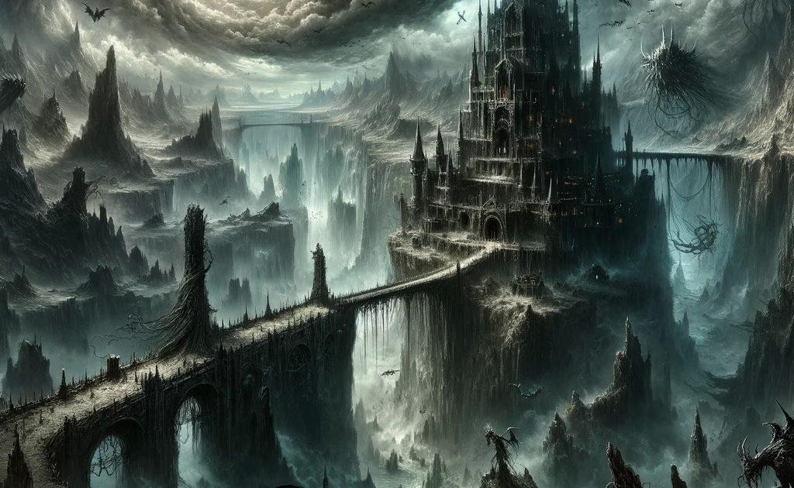
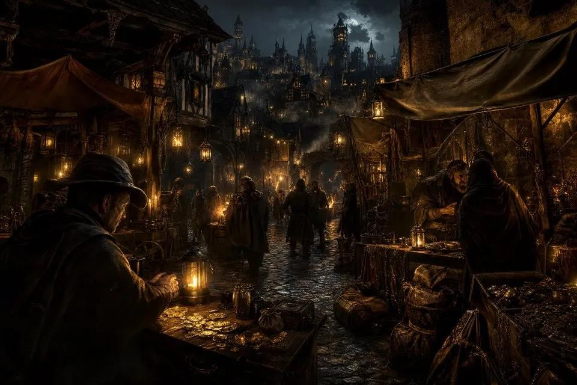
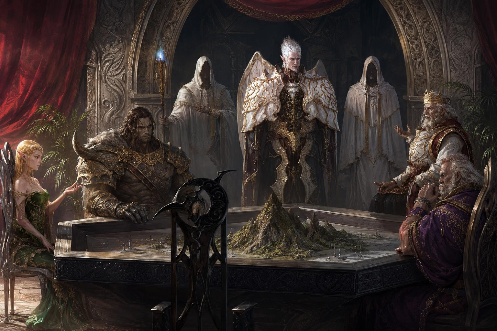
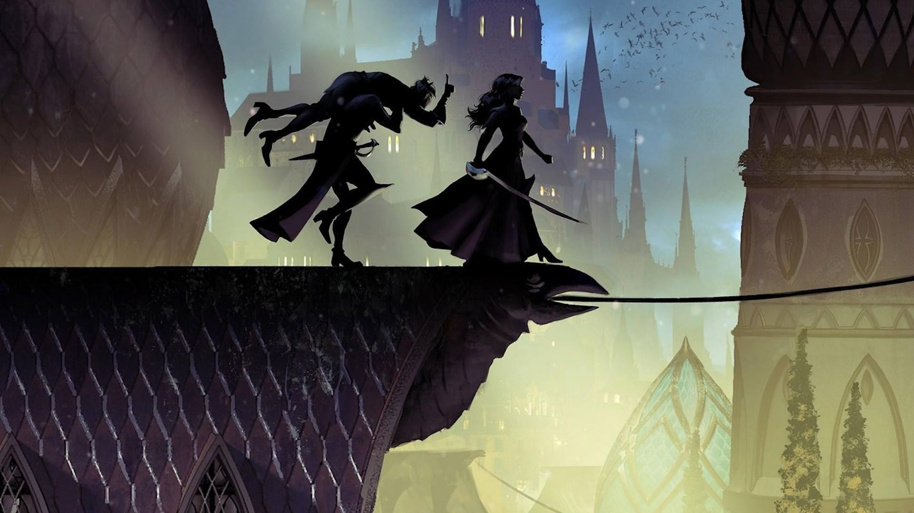
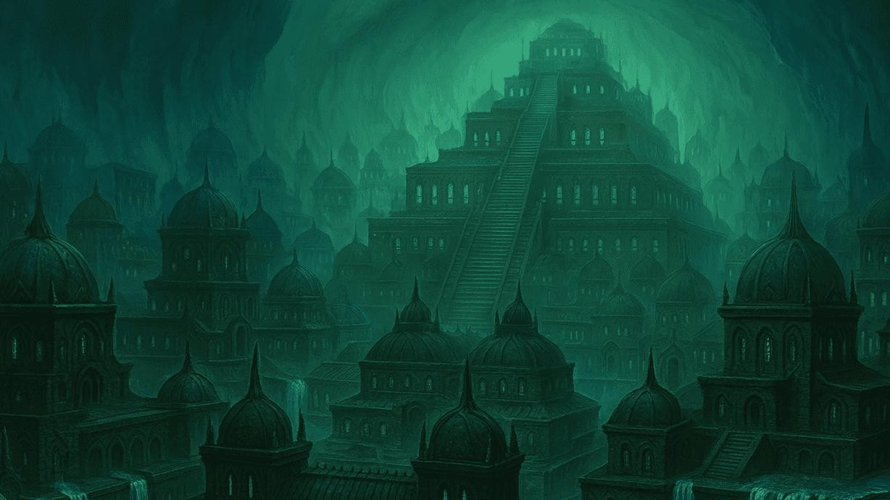
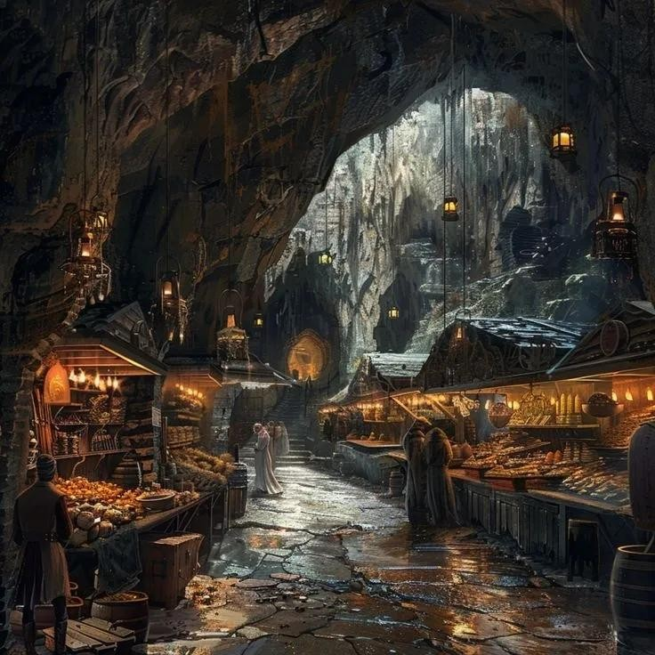

# 第九卷總綱與世界基本資料｜《幽羅界》

> **規劃狀態**：基本資料、世界機制與雙女主正式定名已完成（**高位階女主：閻玄霜／低位階女主：夜千羅**）｜**尚未展開章節細綱與正文**；各篇實際章數依彈性建議區間微調。  
> **配套檔案**：[劇情摘要 `summary.md`](./summary.md)｜[人物速查表 `characters.md`](./characters.md)  
> **前卷銜接**：嚴格承接第八卷《諾瓦星・生命之問》完稿狀態——萬界樓修復度 **`1012/10000（10.12%）`**、**第二重天樓（二層）已首度解封**、五座雙向星門（青玄／滄瀾／九曜／艾瑟蘭／諾瓦）已穩固、【諸天神藏殿】外殿／【星軌萬象觀覽台】／二樓【萬靈共鳴苑】與【星箋亭】皆已啟用，器靈靈素完成首次實質蛻變、文瀾界三錨點絕靈霧初鬆，**《太上玄奼真經》第五篇《乾坤互補》總綱扉頁亦已顯影（待本卷實修契機）**；顧淵憑破千新解鎖之「太古萬界道標主動共鳴權限」於觀覽台鎖定來自 `06｜幽羅界` 的異常道標共鳴訊號（入界調查後方查明對應實物，真相揭露前稱「古代遺物」，揭露後正式稱「萬界道標物」）。

---

## 一、本卷核心主題與世界定位

> **與世界檔案 `06_youluo.md` 之銜接說明**：本卷對應諸天編號 `06｜幽羅界`（[世界檔案](../../worlds/06_youluo.md)），暗黑幽邃的建築美學與修煉氛圍可作參考；惟**本卷之「天序位階社會」、六種立場與利益網絡、雙女主（閻玄霜／夜千羅）身分與反差情感弧線、古代遺物（揭露後確認為萬界道標物）失蹤主線及「不拯救原界／不帶離女主」之結局架構，一律以本卷最新正式規劃（`volume9.pdf` 與後續修訂）為準**。

### 1. 核心主題：出生決定起點，選擇決定方向

幽羅界是一個深信**「天序」**的世界。生命出生時即被認定位階，位階深刻決定權利、資源、職業、婚姻與命運。修為可以提升、個人也有機會爭取晉升，但**改變自己的社會位置，遠比提升力量困難**。

本卷不打算推翻幽羅界的天序，而是透過一場沒有人真正理解的失蹤事件，讓三個人重新思考自己的人生。

### 2. 沒有絕對善惡的六種立場（與利益網絡）

幽羅界的各方人物各有生存邏輯與行動方式，絕非簡單的正邪對立。**本卷統一稱為「六種立場」或「利益網絡」（切忌誤稱「六派勢力」，亦不可將其扁平化為「六個正式組織」或「六支軍隊」）**——其中「改革派／奪權派」的關鍵差異在於**改變制度或僅換掌權者**，「利用派／滲透網絡」則分別代表**利益邏輯**與**跨陣營行動方式**：

| 立場 | 核心邏輯與面貌 |
|---|---|
| **守序派** | 相信天序能維繫穩定，有維持既有秩序的現實理由，卻也可能為了穩定默許不公 |
| **改革派** | **真正想改變制度本身**，主張鬆動或改寫位階限制，讓原本受限的人獲得更多選擇與真實機會；前期可能與奪權派共享口號並合作，但到了權力即將重新分配時便可能反目 |
| **奪權派** | **真正想改變的是掌權者**——善於借用低位階訴求發動群眾、藉亂局奪取最高控制權，讓自己成為新的統治者，卻**未必打算改變天序制度本身**（呼應核心問題：**「換了統治者，不等於換了命運」**） |
| **利用派** *(利益邏輯)* | 不問立場只看籌碼與生存的利益邏輯：不僅買賣情報，也經營人口交易、升階仲介、資源供應，甚至同時向敵對雙方出售服務；因利而聚，內部亦會自相殘殺 |
| **旁觀派** | 表面中立自保、衡量家族長遠利益（如高門閻氏）；不必然冷血，但中立本身往往令衝突得以持續 |
| **滲透網絡** *(行動方式)* | **不必是正式組織，亦無統一領袖**，而是跨陣營的情報關係網與雙面暗線——表面效忠一方、私下替另一方或最高出價者辦事 |

### 3. 幽羅界修煉機制：序紋納煞（天序的技術鎖鏈）

為使修煉因果與天序位階制度渾然一體，幽羅界的核心修煉機制定為 **「序紋納煞」**（承接 [06_youluo.md](../../worlds/06_youluo.md) 之九幽煞氣與魔紋底色）：

- **幽煞靈機與「序紋」承壓**：幽羅界地氣本質是沉重、躁烈且具強排異性的幽煞靈機，修士須藉體內經脈與丹田的**「序紋」**（導流刻痕與承壓閥）納煞修煉。
- **高低位階的技術壟斷**：高位階者天生（或藉家族秘儀開鑿）多道**分流迴紋**，且高門壟斷了配套的**鎮煞引／分流導流法**，方能煉化高純度資源；低位階者只有狹窄的**單線序紋**，平日只能吸收稀釋後的散煞。這說明了「力量可修、位階難越」並非玄學天命，而是資源與配套導流技術被頂層鎖死。

---

## 二、敘事革新與三條不可犧牲的設計

### 1. 三人有限第三人稱視角
本卷以**顧淵**、**閻玄霜**（高位階女主）、**夜千羅**（低位階女主）三人採取**有限第三人稱視角**輪替敘事，不再讓顧淵壟斷視角——讓讀者看見同一場交易、同一場衝突與同一段親密關係，在不同人物心中的截然不同意義。

### 2. 三條不可在後續修稿中犧牲的設計
1. **幽羅界不能因為顧淵而被拯救**：他可以改變某些人的命運、阻止不可逆的災禍，卻不能替整個世界完成制度改革。
2. **兩位女主不能被帶離原界**：閻玄霜與夜千羅必須留在幽羅界繼續面對家族、情報網與失蹤事件餘波，不成為每卷跟隨顧淵移動的固定班底；未來顧淵重訪時，面對的將是經歷多年變化、擁有全新地位與勢力的兩名獨立女性。
3. **她們的改變必須有實際代價**：閻玄霜基於自行查證的獨立判斷而非一時同情違逆閻氏，實質失去部分家族信任與原有安全感；夜千羅打破「只要我不直接動手，後果就不必由我負責」的舊生存邏輯，**親手放棄多年苦心籌謀、由即將離任之序紋司審核執事握有的半合法「補錄開紋資格（開紋薦舉契）」**（錯過即可能多年甚至終生不再出現的合法改命窗口）並承擔過往交易後果。代價不是裝飾，而是真正做出選擇的證明。

---

## 三、劇情主線：一場沒有人真正理解的失蹤事件

故事核心不是單純的人口失蹤，而是：**幽羅界各方勢力，都在尋找一件他們以為能改變世界的東西**，失蹤人口則是天序制度下這場爭奪的必然副產物。

- **失蹤者為什麼是必要的（嚴禁寫成活人血祭套路，核心為「制度性試錯＋流轉封口」雙軌因果）**：
  1. **制度性試錯（天序最赤裸的殘酷）**：高層接觸古代遺物（及其外溢異常波動）後，發現體內刻滿多道精密「分流迴紋」的高位階修士一旦以煞氣探查遺物，反而會遭強烈的異界空間斥力劇烈排異、震傷珍貴迴紋；反倒是結構簡單的**低位階單線序紋**（或曾歷經煞氣逆衝的異變序紋）衝突面積小，竟能短暫撐住共鳴。幽羅界人不懂跨界道標，全將其**誤讀為「繞過血統、由低階重塑序紋的太古升階秘法」**。高門與掌權者捨不得拿自身序紋冒險，遂勾結利用派與旁觀派灰色資金，包裝出名為**「升階試煉」**的秘密場所，以改命為餌誘騙或招攬自願簽契的低位階修士充當**活體試錯樣本**（記錄共鳴門檻與序紋承受極限；第一篇夜千羅買到的高純凝煞髓即其外流副產品）；失敗傷殘或精神錯亂者為防洩密被永久留置，成為失蹤者。
  2. **出土流轉鏈的封口與搶人（解釋高位階失蹤者）**：古代遺物最初係於數月前舊墟地脈異動中出土，經暗市與鑑定師幾度轉手才落入暗局；凡曾經手、鑑定或描繪過紋路的各階修士（含部分高位階鑑定師與管事），分別被各立場暗中劫走以逼問線索或滅口封口。
- **各方誤解**：守序派、改革派、奪權派皆以為失蹤者與**古代遺物**掌握了某種力量源頭、古代開關或打破天序的秘密。
- **真正真相**：眾人爭奪的古代遺物，實為**萬界道標物**之一——它不是力量源頭，也不是控制或改寫幽羅界規則的萬能開關，而是具有跨界指向意義的特殊道標，更不需要活人獻祭啟動。其真正用途只有顧淵在調查過程中逐步發現。
- **稱謂與敘事節奏**：**這個真相不可太早揭露。** 在第七篇真相正式揭露前，劇情內統一稱為**「古代遺物」**；待第七篇顧淵透過萬界樓徹底驗證並揭露真相後，方正式稱為**「萬界道標物」（簡稱「道標物」）**。

---

## 四、全卷八篇劇情綱要（彈性章數參考，合計約 42–51 章）

> 以下為八個劇情階段，並依事件密度標註**彈性建議章數區間**（參照第八卷 46 章體量，不鎖死固定數字，重要篇章可依正文節奏微調）；**本階段暫不展開單章細綱**。

### 第一篇：異界來客（相遇・首次雙修｜建議 5–6 章）

- 顧淵降臨幽羅界一座普通城鎮（非王庭或高位階勢力核心），直觀感受當地滲入日常交易、居住與交往的位階認同。
- 遇見機靈務實的低位階情報掮客**夜千羅**（利用派）；她看準外來者身上的價值主動接近，展開各取所需的情報與資源交易。
- **首次雙修《逆行的修為》**（修煉因果完全由兩界體系與現實階級條件推導，既不開臨時治療外掛，亦不將幽羅界既有修煉與醫療體系寫成無能）：
  - **為何失控**：夜千羅自地下管道購得原供高門使用、暗連第五篇「升階試煉」供應鏈的**高純凝煞髓**，賣家隱匿／扣留了配套的鎮煞引與分流導流法；她以低階**單線序紋**強行吞煉後，過量高純煞氣在狹窄節點無處分流，**撞壁倒灌、逆衝經脈**（扣合篇名《逆行的修為》），越強壓反噬越烈。
  - **為何主動選擇顧淵雙修（四層現實約束，非絕對無解）**：① **一般高位階修士**雖能以強壓修為鎮住煞氣保命，卻不擅長細緻處理低位階單線序紋的逆向倒灌，強壓極易震毀她辛苦修來的單線根基；② **高門專門醫術**雖握有成熟鎮煞與分流導流法，但被頂層嚴密壟斷、代價高昂，絕不會輕易用在毫無背景的地下低位階掮客身上（求醫反暴露私藏高純凝煞髓之罪）；③ **原賣家**確有能力處理反噬，但她深知回頭求助極可能淪為秘密場所的異常序紋樣本；④ **顧淵**的異界體系不受幽煞序紋結構限制、氣息中正溫潤，恰好提供了她當下**唯一負擔得起、不致暴露死罪且願意冒險一搏的交易途徑**，遂精明地主動提出雙方知情自願的雙修交易，借顧淵作為暫時的「外部迴路（分流池）」。
  - **既有規則自然解局（僅為《乾坤互補》前置現象，並非正式修煉）**：全程僅動用《太上玄奼真經》**前四篇既有能力**（自願合一構成雙人陰陽迴路→純陽本源借道洩壓、中和狂煞、撫平經脈），僅在疏導思路上偶借第八卷扉頁一句微意，將逆衝狂煞化作單線序紋可承之溫潤餘流緩緩回渡吸收。危機化解、修為獲突破契機，但**單線序紋出身印記與社會位階完全不變**，事後《乾坤互補》扉頁一閃即黯、正篇並未展開；並埋下三大伏筆（資源來源與失蹤有關／對顧淵認知不完整／修為驟變引來暗中盯梢）。
- 夜千羅由某筆交易得知近期跨位階連環失蹤案，顧淵察覺其與萬界樓探索目標相關，決意追查。
- **重點**：先呈現夜千羅靠自己在複雜環境求生的模樣，她絕非等待拯救的弱者。

### 第二篇：旁觀者的委託（第二位女主登場｜建議 4–5 章）

- 旁觀派高門閻氏重要成員**閻玄霜**（高位階女主）奉家族之命，查清失蹤案是否牽連閻氏掌握的某項機密情報。
- 她盯上情報市場異常活躍的夜千羅，透過家族管道接觸；兩女首度正式交鋒——一方握有高門身分與資源，一方手握地下人脈與情報。
- 顧淵因追查失蹤事件意外成為兩人交易的關鍵樞紐；閻玄霜察覺顧淵不屬任何已知勢力，開始對其來歷起疑。
- **重點**：兩女切忌一見如故，先互相試探、互相利用，同時逐漸認可對方不可替代的價值。

### 第三篇：失蹤者的名單（調查擴大｜建議 5–6 章）

- 三人基於各自目的暫時組成調查關係，發現失蹤名單涵蓋低位階、高位階乃至修為不俗者；且並非全是綁架，有人受騙、有人自願、有人為求升階機會而消失。
- 夜千羅驚覺自己過去按專業判斷出售的一批情報（並非直接出賣某人住址，而是某類人常出現的地點、特定修煉資源流向或一份她原以為已過期的舊情報；她當時知道有風險卻不知會落到誰身上）正與失蹤者軌跡高度重疊；閻玄霜則發現閻氏早已握有部分名單卻秘而不宣，對家族「乾淨中立」的認知出現第一道裂縫。
- 顧淵察覺數處失蹤地點的共同特徵與萬界樓異常反應吻合。
- **重點**：三人各自隱瞞秘密，讀者清楚看見他們尚未真正信任彼此。

### 第四篇：各方的答案（勢力交鋒｜建議 5–6 章）

- 三人深入跨立場交易圈，確認守序派、改革派、奪權派都在爭奪同一件東西（改革派與奪權派前期甚至共享口號、暗中合作，實則一者欲改制、一者僅欲換主）；循利用派利益邏輯行事的掮客、仲介與供應商同時向敵對雙方出售情報、升階門路與資源，甚至刻意製造失蹤；跨陣營的滲透網絡暗線雙面潛伏；旁觀派內部出現中立與擴張之爭。
- 閻玄霜接獲家族命令要求中止追查特定線索；夜千羅一面暗中推進自己多年經營的**序紋司「補錄開紋資格（開紋薦舉契）」**審核線索（搭上即將離任的序紋司審核執事），一面收到天價委託要她交出顧淵行蹤。
- 三人首度面臨實質利益衝突；夜千羅過去的交易與隱瞞引爆與顧淵的爭議，證明「曾雙修不代表信任」。
- **重點**：六種立場化為具體交易、背叛與利益衝突。

### 第五篇：被選中的人（真相逼近｜建議 6–7 章）

- 三人尋獲失蹤者集中地——並非單純監牢或血祭祭壇，而是一處以「升階試煉」為名的秘密測試與留置場所，由多方勢力各懷鬼胎共同維繫：被騙或自願進入的低位階修士實為**替高層測試古代遺物序紋共鳴門檻的活體試錯樣本**，部分高位階與鑑定師則是因經手遺物流轉鏈而遭扣押封口的知情者。
- 夜千羅確認自己過往「看似合理、未直接動手」的情報交易正是將部分失蹤者推入此地的環節之一，她長期信奉的生存邏輯——**「只要我不直接動手，後果就不必由我負責」**——徹底崩解；閻玄霜則透過自行查證，看清**閻氏的中立並非沒有代價、家族的安全與利益部分建立在他人犧牲之上、過去相信的家族運作方式並不如想像中乾淨**。
- 夜千羅與顧淵關係陷入低潮甚至決裂；閻玄霜並非被顧淵說服，而是基於自身查證與獨立判斷（對顧淵可以認同部分觀點、同時不同意他的做法），開始以個人意志而非家族代表行事。
- 顧淵尋獲各方爭奪的古代遺物，初步察覺它並非眾人以為的力量之源。
- **重點**：兩位女主直面過去的選擇，**以行動而非空洞懺悔回應責任**。

### 第六篇：背叛者的宴席（立場決裂・失控轉折｜建議 6–7 章）

- 各方代表召開表面商討失蹤案、實為壓下「升階試煉」黑幕並瓜分古代遺物的秘密會議；三人以不同身分潛入或出席。
- 閻玄霜面臨家族命令與個人判斷的正面抉擇；夜千羅設局交易卻反遭更高層情報商人算計利用；顧淵則察覺這件古代遺物與萬界樓跨界機制產生強烈共鳴（此時尚未正式定性揭露）。
- **真正讓密室會議演變成全界危機的「四方誤判連鎖」**（非單純反派搶寶，而是各方基於自身邏輯做出「自以為正確」的決定互撞成災）：
  1. **導火索**：高層交易商反向算計與跨陣營滲透暗線兩頭點火，令「失蹤者實為序紋試錯樣本與封口知情者」與「古代遺物已現身」兩大機密在會場走漏、各方互相指控；但此時仍存在最後一個將衝突壓回檯面下的窗口期。
  2. **旁觀派冷靜抽身（撤掉最後一道緩衝閥）**：握有主城關鍵緩衝通道與調停公信力的旁觀派高門閻氏，不願暴露暗中牟利帳目、更不願為任何一方擔責，於關鍵時刻**拒絕調停並立刻封閉家族緩衝關卡與資源通道**——閻玄霜親眼見證「置身事外」本身如何成為推落災禍的手。
  3. **守序派預防性過度鎮壓**：見旁觀派抽身、消息已壓不住，守序派代表出於「絕不能讓底層暴亂摧毀數百年秩序」的鐵腕思維，做出自以為能快速止血的錯誤決斷——**不等查清細節即下令封鎖下城坊市、切斷日常散煞供應，並按外洩名冊大規模拘捕低位階知情者與改革派骨幹**（同時企圖將古代遺物與外來者顧淵強押封口）。
  4. **改革派被迫提前舉事**：眼見守序派封城清剿、數十年骨幹與火種面臨滅頂之災，改革派在退無可退下咬牙**提前向全城拋出失蹤案與「升階試煉」黑幕，號召下城修士抗命破封、衝擊鎮煞禁制**，徹底引爆街頭民變。
  5. **奪權派順勢點火與趁亂奪物**：奪權派藉滲透網絡暗線散播扭曲傳言（如「守序派欲血洗下城」「奪得遺物可重寫序紋、成新天序之主」），一邊以改革派與群眾牽制守序派，一邊趁亂搶走古代遺物。
- 會場與全城秩序瞬間瓦解，三人被迫分開行動（有人被捕或遭追殺、有人脫身逃亡、古代遺物被奪權派趁亂帶走）。
- **重點**：三人不再是穩定小隊，閻玄霜與夜千羅必須在系統性崩盤中獨立做出選擇。

### 第七篇：幽羅之亂（高潮・情感成熟與雙修｜建議 8–10 章）

- 第六篇的四方連鎖誤判徹底引爆幽羅界既有矛盾的集中爆發：守序派以鐵腕封鎖與清剿強硬維穩；改革派在街頭動盪中發現奪權派從未想過改制、只在權力即將重分配時**反手背刺奪位**，兩派正式反目（正面印證「換了統治者，不等於換了命運」）；利用派各路仲介與交易商因封城與籌碼翻盤彼此出賣自相殘殺；滲透網絡暗線趁亂倒戈或斷尾求生。
- **「不可逆災禍」的真相揭露與三層止災機制（嚴格限定顧淵只「阻止異界共鳴擴大」，絕不修復幽羅界地脈）**：
  - 帶走古代遺物的奪權派（或陷入絕境的奪位方）懷著對古代傳說的致命誤解，強行將古代遺物接入主城**「幽煞地脈樞紐」**，企圖灌注全城地脈煞氣強改天序主權；顧淵追至現場並透過萬界樓徹底驗證其跨界指向本質，**至此正式揭曉古代遺物實為「萬界道標物」**——幽羅界狂暴地脈煞氣強灌入不相容的外界道標，非但改不了天序，反而撕裂空間縫隙、引發**全城規模的地脈煞氣倒灌暴走**（與第一篇夜千羅個人經脈的「逆行」形成宏觀鏡像，首當其衝的是只有單線序紋、無大陣庇護的下城平民）。
  - **止災三層分工**：
    1. **道標物共鳴確認**：顧淵憑「太古萬界道標主動共鳴權限」、神識內【星軌萬象觀覽台】鎖定牽引與近距離《太上玄奼真經》氣機感應，確認只要道標物仍嵌於陣眼吸煞，失頻共振與跨界撕裂便不會停止。
    2. **切斷共鳴與裂隙自然收縮**：在兩女外部牽制與開路配合下，顧淵衝至樞紐核心以萬界樓主原生權限將道標物**強行剝離地脈陣眼並收入樓內壓制共鳴**；失去共振與持續灌煞支撐後，尚未完全成形的細小空間裂隙依賴**幽羅界本土世界壁壘的自然排異與彈性逐步收縮癒合**（非顧淵法力瞬間「修好」，癒合前仍有短暫餘震亂流）。
    3. **已倒灌之地脈煞潮由幽羅界自行承擔**：**顧淵絕不修復幽羅界地脈**，其作用嚴格止於拔除異界病灶、阻止災禍升級為不可逆滅城；已經倒灌進城池的狂暴煞潮與地脈創傷，由守序派倉促調動上城鎮煞大陣強行改道、改革派與下城修士自發築障、**閻玄霜**違令開啟閻氏緩衝泄壓閘口與私人避難通道、**夜千羅**以情報網精準引導撤離共同扛下善後。城區依然重創需數年休養，所有制度裂痕完整留存。
- **兩女獨立成長行動與具體代價**：
  - **閻玄霜**並非一時「良心發現」或受顧淵說服，而是在自行查證家族中立代價、並親眼見證閻氏封門抽身如何撤掉最後安全閥後，憑獨立判斷違逆家族封門命令，強開家族控制的緩衝泄壓閘口與私人通道護下被夾擊的局外無辜者。
  - **夜千羅**在亂局當夜迎來她多年苦求的唯一改命窗口——即將離任的**序紋司審核執事**願趁亂為她完成最後蓋印交割、帶她離城過審那份稀有的半合法**「補錄開紋資格（開紋薦舉契）」**（條件是立刻抽身、別插手試煉場營救並把顧淵與名單留在原地）。她親手推回那份已蓋了一半印泥的薦舉契，徹底放棄這張錯過便可能多年甚至終生不再出現的合法升階門票，轉而動用情報網引導撤離失蹤者，並在危急時刻不計報酬為顧淵打通前往地脈樞紐的血路。
- **兩條感情線各自成熟與《乾坤互補》正式實修（去系統判定化，回歸「神意無間、彼此託付」）**：
  - **夜千羅**卸下交易盔甲，在不計算任何報酬下將真實意志託付顧淵，迎來代表情感選擇的第二階段雙修；**閻玄霜**在不依附家族、亦不需要顧淵拯救的前提下，於完全有能力拒絕時以平等獨立姿態自主選擇與他共度親密共鳴，完成首次雙修。兩段形式截然不同、各自獨立成立的「神意無間」，自然契合並正式開啟《乾坤互補》正篇實修。
- **重點**：成長透過行動與真實代價呈現，不靠高潮後的大段說教對白。

### 第八篇：各自的道路（收束與新生｜建議 3–4 章）

- 失蹤事件落幕，但幽羅界的天序並未消失；部分失蹤者返家、部分遠走、部分再也無法歸來。
- 閻玄霜留於閻氏卻不再只是家族意志的執行者；夜千羅重整情報網卻立下不可逾越的交易底線；兩女雖未必完全認同對方，卻已建立深厚信賴。
- 顧淵完成萬界樓道標與修復收穫後告別離界；閻玄霜與夜千羅留在幽羅界繼續各自道路，沒有約定等待，也沒有保證必然重逢，但第一次真正以自己意志決定未來。

---

## 五、雙修節奏與萬界樓收穫

### 1. 兩位女主的反差情感與雙修節奏

| 篇章 | 夜千羅（低位階｜先雙修，後相愛） | 閻玄霜（高位階｜先信任，後親密） |
|---|---|---|
| **第一篇** | 因修煉失控主動提出首次雙修（純利益與修煉合作，無感情承諾） | 尚未登場 |
| **第二篇** | 雙修後各取所需展開合作，仍各自盤算 | 初次接觸顧淵，彼此觀察評估價值 |
| **第三篇** | 合作中生出初步信任與依賴，但雙方對關係理解不一致 | 合作建立，看見顧淵不同於幽羅界眾人的一面 |
| **第四篇** | 因利益、隱瞞與失蹤事件爆發衝突；過往雙修反成引線 | **開始產生真正興趣**，超越單純利益衡量（認同與分歧並存） |
| **第五篇** | 關係陷入低潮、疏遠甚至決裂，重新思索彼此價值 | **興趣深化**並逐漸放下戒心，基於獨立判斷有意識地自主做選擇 |
| **第六篇** | 經歷信任考驗（危機中不計報酬選擇幫顧淵），轉向真正理解 | 面對家族利益與個人意志衝突，**與顧淵建立深層信任** |
| **第七篇** | 感情真正確認，卸下盔甲不計報酬託付意志，迎來第二階段雙修 | **信任深化並確認心意**，在有能力拒絕下平等自主選擇首次雙修 |
| **第八篇** | 留在幽羅界經營有底線的情報網與事業 | 留在幽羅界重塑與閻氏的關係與獨立道路 |

### 2. 萬界樓收穫與修復規則（嚴格分開定義：一般資源／道標物／修復度）

| 項目 | 定義、劇情用途與規則 |
|---|---|
| **一般探索／運轉資源** | 經由探索、交易與事件取得之幽羅界靈材、典籍、情報或樓內日常運轉物資；**屬一般資源，與萬界樓「修復度」完全分開，不可混淆** |
| **萬界道標物** *(揭露前稱「古代遺物」)* | 萬界樓跨界探索相關的重要核心收穫，具跨界指向意義，**不可作為直接改寫幽羅界規則的萬能物件**；第七篇真相揭露前統一稱「古代遺物」，揭露後方正式稱「萬界道標物」（簡稱「道標物」）。**取得道標物本身不增加修復度** |
| **失蹤者事件** | 各立場爭奪古代遺物的線索與現實代價 |
| **功法進階（《乾坤互補》）** | 承接第八卷破千顯影之《太上玄奼真經》第五篇《乾坤互補》總綱扉頁，**須在章節細綱中明確區分「前置現象」與「正式修煉」，並嚴防寫成「好感度達標解鎖的系統判定」**： ① **第一篇＝前置現象（未入篇）**：化解夜千羅《逆行的修為》實質動用的仍是**前四篇既有雙修迴路**，僅在疏導思路上偶借扉頁「不強行壓制異勢、順勢借道分流」一句微意；此刻兩人各懷戒心純屬交易，遠未達《乾坤互補》「神意無間、彼此託付」入篇門檻；事後內視**扉頁僅微光一閃即歸黯淡、正篇經文完全未展開**，萬界樓照常規結算（不跳階、不觸發第五篇進階）。 ② **第七篇＝正式修煉（入篇開啟）**：核心在**「神意無間、彼此託付」**而非好感度或人數解鎖——**夜千羅**由最初精算交易轉為不計報酬地將真實意志交給顧淵；**閻玄霜**由最初以家族理性衡量轉為不依附閻氏、不需要拯救下依然自主選擇平等同行一段親密關係。兩段截然不同且各自成立的契合，方使《乾坤互補》實修在劇情與大道上皆站得住腳（深化本源調和與跨體系兼容，不造成個人戰力暴漲或推翻天序） |
| **修復點數（修復度）** | **嚴格沿用既有萬分制自願雙修規則**，與一般資源及道標物完全分開計算（探索、冒險、取得古代遺物／道標物本身皆不增加修復度）。**本階段不先填寫預估修復度結果**；待第一篇與第七篇實際雙修情節定案後，再依既有萬分制規則精確計算 |
| **後續伏筆** | 道標物推動萬界樓跨界探索能力或深層星域線索進展 |

---

## 六、本卷三個必留結尾畫面

1. **第一幕｜閻玄霜（高位階女主）**：她回到閻氏家族，面對家族長輩的質問。她沒有離開家族，也沒有宣布反抗，只是第一次明確表示：**有些事情，她不會再按照家族的意思處理。**
2. **第二幕｜夜千羅（低位階女主）**：她重新坐回自己的交易桌前。有人拿出一份報酬極高的情報委託，她看完內容，平靜將委託推回去。她依然是那個精明的交易者，**只是有些價格，她不願意接受。**
3. **第三幕｜顧淵離開**：顧淵離開幽羅界。閻玄霜與夜千羅沒有跟著他走，而是站在不同的位置，看著萬界樓的光芒消失。她們沒有約定等待，也沒有保證未來一定重逢——**因為她們已經有了自己的路。**

---

## 七、第九卷插圖索引（20 張）

### 兩位女主概念圖

### 八篇場景概念圖

### 幽羅界風貌與市井氛圍圖

