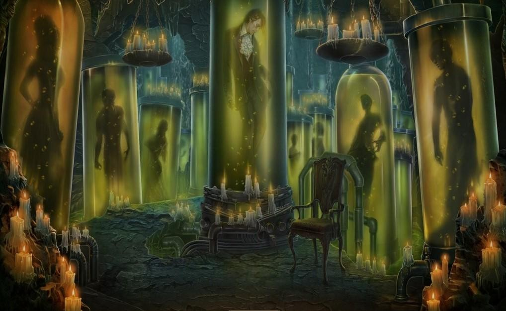
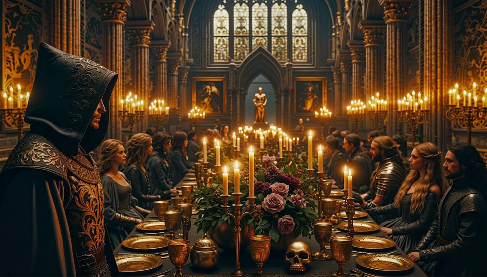
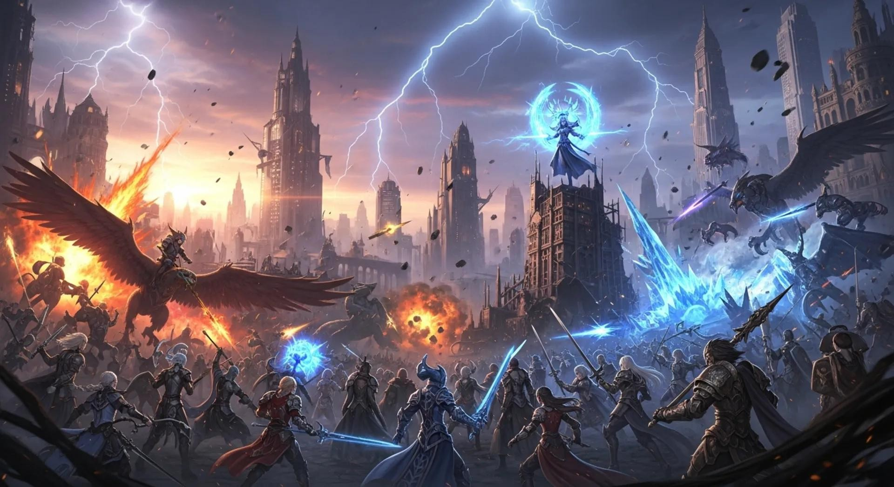
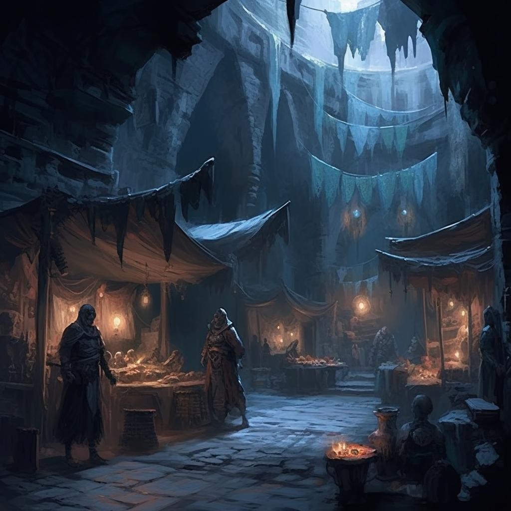
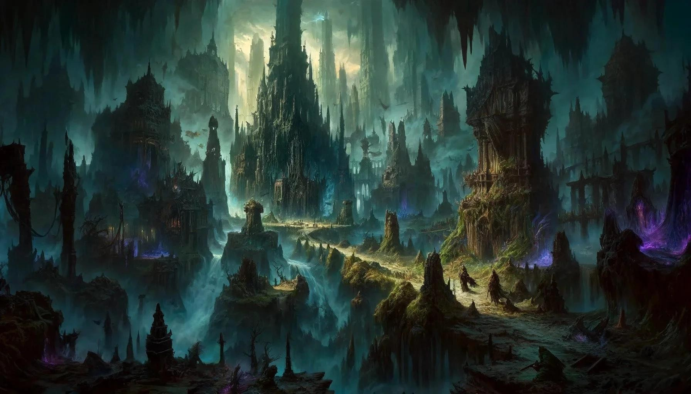
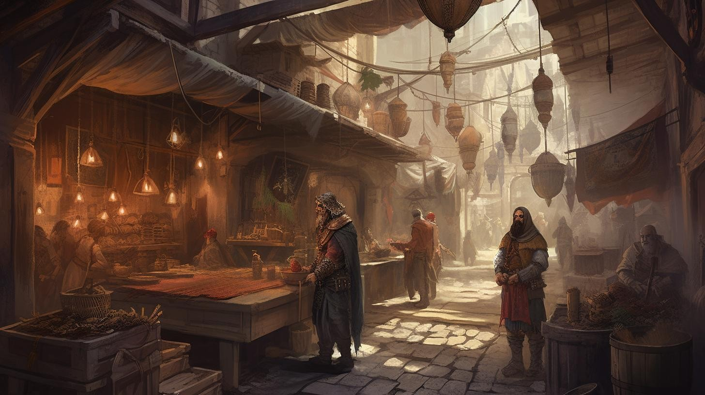

# 第九卷總綱與世界基本資料｜《幽羅界》

> **規劃狀態**：基本資料建檔完成（依 `volume9.pdf` 建立）｜**尚未展開章節細綱與正文**；兩位女主正式姓名與各篇實際章數待後續細化。  
> **配套檔案**：[劇情摘要 `summary.md`](./summary.md)｜[人物速查表 `characters.md`](./characters.md)  
> **前卷銜接**：承接第八卷《諾瓦星・生命之問》完稿後之萬界樓修復度與主線進度（起點修復度待第八卷完稿後填入）。

---

## 一、本卷核心主題與世界定位

> **與世界檔案 `06_youluo.md` 之銜接說明**：本卷對應諸天編號 `06｜幽羅界`（[世界檔案](../../worlds/06_youluo.md)），暗黑幽邃的建築美學與修煉氛圍可作參考；惟**本卷之「天序位階社會」、六種勢力立場、雙女主身分與反差情感弧線、萬界道標物失蹤主線及「不拯救原界／不帶離女主」之結局架構，一律以本卷最新正式規劃（`volume9.pdf`）為準**。

### 1. 核心主題：出生決定起點，選擇決定方向

幽羅界是一個深信**「天序」**的世界。生命出生時即被認定位階，位階深刻決定權利、資源、職業、婚姻與命運。修為可以提升、個人也有機會爭取晉升，但**改變自己的社會位置，遠比提升力量困難**。

本卷不打算推翻幽羅界的天序，而是透過一場沒有人真正理解的失蹤事件，讓三個人重新思考自己的人生。

### 2. 沒有絕對善惡的六種立場

幽羅界的各方勢力各有生存與利益邏輯，絕非簡單的正邪對立：

| 立場 | 核心邏輯與面貌 |
|---|---|
| **守序派** | 相信天序能維繫穩定，有維持既有秩序的現實理由，卻也可能為了穩定默許不公 |
| **改革派** | 主張鬆動或改寫位階限制，其中有人懷抱理想，也有人只是想取代舊權力 |
| **奪權派** | 伺機藉亂局奪取最高控制權，善於煽動衝突與暗中佈局 |
| **利用派** | 不問立場只看籌碼與生存，靠情報交易與混水摸魚獲利，內部亦會自相殘殺 |
| **旁觀派** | 表面中立自保、衡量家族長遠利益；不必然冷血，但中立本身往往令衝突得以持續 |
| **滲透網絡** | 遊走於各大陣營之間的雙面人與暗線，表面效忠一方、私下替另一方辦事 |

---

## 二、敘事革新與三條不可犧牲的設計

### 1. 三人有限第三人稱視角
本卷以**顧淵**、**高位階女主**、**低位階女主**三人採取**有限第三人稱視角**輪替敘事，不再讓顧淵壟斷視角——讓讀者看見同一場交易、同一場衝突與同一段親密關係，在不同人物心中的截然不同意義。

### 2. 三條不可在後續修稿中犧牲的設計
1. **幽羅界不能因為顧淵而被拯救**：他可以改變某些人的命運、阻止不可逆的災禍，卻不能替整個世界完成制度改革。
2. **兩位女主不能被帶離原界**：她們必須留在幽羅界繼續面對家族、情報網與失蹤事件餘波，不成為每卷跟隨顧淵移動的固定班底；未來顧淵重訪時，面對的將是經歷多年變化、擁有全新地位與勢力的兩名獨立女性。
3. **她們的改變必須有實際代價**：高位階女主失去部分家族信任與安全感；低位階女主放棄一次關鍵升階機會並面對過去交易的後果。代價不是裝飾，而是真正做出選擇的證明。

---

## 三、劇情主線：一場沒有人真正理解的失蹤事件

故事核心不是單純的人口失蹤，而是：**幽羅界各方勢力，都在尋找一件他們以為能改變世界的東西**，失蹤人口只是這場爭奪的一部分。

- **各方誤解**：守序派、改革派、奪權派皆以為失蹤者掌握了某種力量源頭、古代開關或打破天序的秘密。
- **真正真相**：眾人爭奪的古代遺物，實為**萬界道標物之一**——它不是力量源頭，也不是控制或改寫幽羅界規則的萬能開關，而是具有跨界指向意義的特殊道標。其真正用途只有顧淵在調查過程中逐步發現。
- **敘事節奏**：**這個真相不可太早揭露。**

---

## 四、全卷八篇劇情綱要（階段結構，不鎖死固定章數）

> 以下為八個劇情階段，重要篇章可依情節拉長；**本階段暫不展開單章細綱**。

### 第一篇：異界來客（相遇・首次雙修）

- 顧淵降臨幽羅界一座普通城鎮（非王庭或高位階勢力核心），直觀感受當地滲入日常交易、居住與交往的位階認同。
- 遇見機靈務實的**低位階女主**（利用派情報掮客）；她看準外來者身上的價值主動接近，展開各取所需的情報與資源交易。
- **首次雙修《逆行的修為》**：低位階女主為求升階，私下地下交易取得高位階稀有修煉資源，強行修煉導致體內力量失衡失控；不願求助原賣家以免淪為實驗品，遂在觀察顧淵異質修煉法後，**主動提出雙修作為雙方知情自願的修煉合作交易**。危機化解、修為獲突破契機，但**社會位階完全不變**，並埋下三大伏筆（資源來源與失蹤有關／對顧淵認知不完整／修為驟變引來暗中盯梢）。
- 低位階女主由某筆交易得知近期跨位階連環失蹤案，顧淵察覺其與萬界樓探索目標相關，決意追查。
- **重點**：先呈現低位階女主靠自己在複雜環境求生的模樣，她絕非等待拯救的弱者。

### 第二篇：旁觀者的委託（第二位女主登場）

- **高位階女主**（旁觀派家族重要成員）奉家族之命，查清失蹤案是否牽連家族掌握的某項機密情報。
- 她盯上情報市場異常活躍的低位階女主，透過家族管道接觸；兩女首度正式交鋒——一方握有身分與資源，一方手握地下人脈與情報。
- 顧淵因追查失蹤事件意外成為兩人交易的關鍵樞紐；高位階女主察覺顧淵不屬任何已知勢力，開始對其來歷起疑。
- **重點**：兩女切忌一見如故，先互相試探、互相利用，同時逐漸認可對方不可替代的價值。

### 第三篇：失蹤者的名單（調查擴大）

- 三人基於各自目的暫時組成調查關係，發現失蹤名單涵蓋低位階、高位階乃至修為不俗者；且並非全是綁架，有人受騙、有人自願、有人為求升階機會而消失。
- 低位階女主驚覺自己曾出售過的一份情報可能暴露了部分失蹤者行蹤；高位階女主則發現家族早已握有部分名單卻秘而不宣。
- 顧淵察覺數處失蹤地點的共同特徵與萬界樓異常反應吻合。
- **重點**：三人各自隱瞞秘密，讀者清楚看見他們尚未真正信任彼此。

### 第四篇：各方的答案（勢力交鋒）

- 三人深入跨勢力交易圈，確認守序派、改革派、奪權派都在爭奪同一件東西；利用派販賣真假情報甚至刻意製造失蹤；滲透網絡雙面潛伏；旁觀派內部出現中立與擴張之爭。
- 高位階女主接獲家族命令要求中止追查特定線索；低位階女主則收到天價委託，要她交出顧淵行蹤。
- 三人首度面臨實質利益衝突；低位階女主過去的交易與隱瞞引爆與顧淵的爭議，證明「曾雙修不代表信任」。
- **重點**：六種立場化為具體交易、背叛與利益衝突。

### 第五篇：被選中的人（真相逼近）

- 三人尋獲失蹤者集中地——並非單純監牢，而是一處以「升階試煉」為名的秘密場所，由多方勢力各懷鬼胎共同維繫，部分試煉者不知自己只是計畫材料。
- 低位階女主確認過往情報交易與此地直接相關；高位階女主發現家族曾默許其存在並從中獲利。
- 低位階女主與顧淵關係陷入低潮甚至決裂；高位階女主則逐漸卸下戒心、開始以個人意志而非家族代表行事。
- 顧淵尋獲各方爭奪的古代遺物，初步察覺它並非眾人以為的力量之源。
- **重點**：兩位女主直面過去的選擇，**以行動而非空洞懺悔回應責任**。

### 第六篇：背叛者的宴席（立場決裂）

- 各方勢力召開表面商討失蹤案、實為瓜分遺物與利益的秘密會議；三人以不同身分潛入或出席。
- 高位階女主面臨家族命令與個人判斷的正面抉擇；低位階女主設局交易卻反遭更高層情報商人算計利用；顧淵進一步確認遺物與萬界樓跨界道標機制相連。
- 一場突發揭露令各方互相指控、局勢瞬間瓦解，三人被迫分開行動（有人被捕、有人逃亡、有人趁亂奪走遺物）。
- **重點**：三人不再是穩定小隊，兩位女主必須獨立做出選擇。

### 第七篇：幽羅之亂（高潮・情感成熟與雙修）

- 遺物失蹤點燃各方全面混戰：守序派維穩、改革派借勢、奪權派亂中奪權、利用派內部自相殘殺。
- **兩女獨立成長行動**：
  - 高位階女主違逆家族消極命令，動用私人資源護下原本不在家族利益範圍內的無辜者。
  - 低位階女主放棄一次極可能讓自己升階的高價交易，轉而動用情報網營救失蹤者，並在危急時刻做出不計報酬協助顧淵的決定。
- 顧淵追上遺物並透過萬界樓確認其真正道標性質；三人重新會合時，不再是顧淵帶領兩女，而是兩女各自帶著行動成果與顧淵並肩阻止某勢力利用遺物釀成不可逆後果（不以消滅所有敵人收場）。
- **兩條感情線各自成熟**：低位階女主由交易轉為真正傾心，迎來代表情感選擇的第二階段雙修；高位階女主在完全有能力拒絕的情況下自主選擇顧淵，完成首次雙修。
- **重點**：成長透過行動呈現，不靠高潮後的大段說教對白。

### 第八篇：各自的道路（收束與新生）

- 失蹤事件落幕，但幽羅界的天序並未消失；部分失蹤者返家、部分遠走、部分再也無法歸來。
- 高位階女主留於家族卻不再只是家族意志的執行者；低位階女主重整情報網卻立下不可逾越的交易底線；兩女雖未必完全認同對方，卻已建立深厚信賴。
- 顧淵完成萬界樓道標與修復收穫後告別離界；兩女留在幽羅界繼續各自道路，沒有約定等待，也沒有保證必然重逢，但第一次真正以自己意志決定未來。

---

## 五、雙修節奏與萬界樓收穫

### 1. 兩位女主的反差情感與雙修節奏

| 篇章 | 低位階女主（先雙修，後相愛） | 高位階女主（先信任，後親密） |
|---|---|---|
| **第一篇** | 因修煉失控主動提出首次雙修（純利益與修煉合作，無感情承諾） | 尚未登場 |
| **第二篇** | 雙修後各取所需展開合作，仍各自盤算 | 初次接觸顧淵，彼此觀察評估價值 |
| **第三篇** | 合作中生出初步信任與依賴，但雙方對關係理解不一致 | 合作建立，看見顧淵不同於幽羅界眾人的一面 |
| **第四篇** | 因利益、隱瞞與失蹤事件爆發衝突；過往雙修反成引線 | 對顧淵產生真正興趣，超越單純利益衡量 |
| **第五篇** | 關係陷入低潮、疏遠甚至決裂，重新思索彼此價值 | 逐漸放下戒心，有意識地自主做選擇 |
| **第六篇** | 經歷信任考驗（危機中不計報酬選擇幫顧淵），轉向真正理解 | 面對家族利益與個人意志衝突，與顧淵建立深層信任 |
| **第七篇** | 感情真正確認，迎來代表情感選擇的第二階段雙修 | 感情確認，在有能力拒絕下自主選擇首次雙修 |
| **第八篇** | 留在幽羅界經營有底線的情報網與事業 | 留在幽羅界重塑與家族的關係與獨立道路 |

### 2. 萬界樓收穫與修復規則

| 項目 | 劇情用途與規則 |
|---|---|
| **萬界道標物** | 萬界樓跨界探索相關的重要核心收穫，具跨界指向意義，**不可作為直接改寫幽羅界規則的萬能物件** |
| **失蹤者事件** | 各勢力爭奪道標物的線索與現實代價 |
| **修復資源** | 透過探索、事件與既有規則取得 |
| **修復點數** | **嚴格沿用原本萬分制雙修規則**：第一篇低位階女主首次雙修、第七篇兩位女主雙修及後續再次雙修依規則計入；**探索、冒險、取得道標物本身皆不增加修復度** |
| **後續伏筆** | 道標物推動萬界樓跨界探索能力或深層星域線索進展 |

---

## 六、本卷三個必留結尾畫面

1. **第一幕｜高位階女主**：她回到家族，面對家族長輩的質問。她沒有離開家族，也沒有宣布反抗，只是第一次明確表示：**有些事情，她不會再按照家族的意思處理。**
2. **第二幕｜低位階女主**：她重新坐回自己的交易桌前。有人拿出一份報酬極高的情報委託，她看完內容，平靜將委託推回去。她依然是那個精明的交易者，**只是有些價格，她不願意接受。**
3. **第三幕｜顧淵離開**：顧淵離開幽羅界。兩位女主沒有跟著他走，而是站在不同的位置，看著萬界樓的光芒消失。她們沒有約定等待，也沒有保證未來一定重逢——**因為她們已經有了自己的路。**

---

## 七、第九卷插圖索引（20 張）

### 兩位女主概念圖

### 八篇場景概念圖

### 幽羅界風貌與市井氛圍圖

