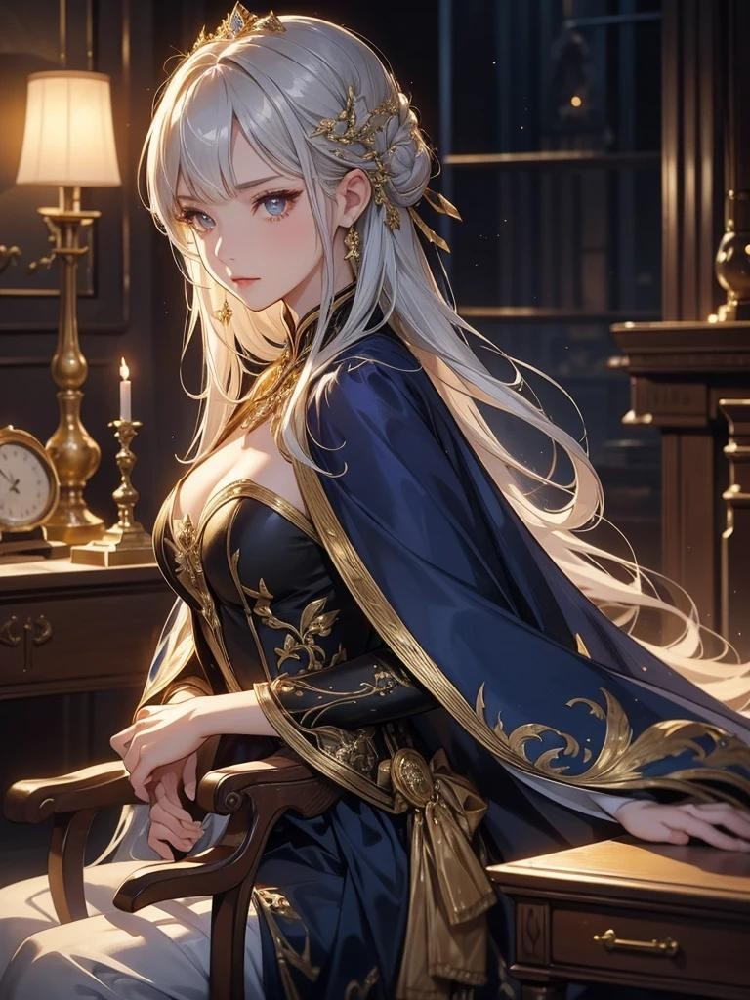

# 第九卷人物速查表｜三位核心人物（三人視角）與六派勢力

> **規劃狀態**：依 `volume9.pdf` 建立｜**兩位女主正式姓名待後續定案**，暫以「高位階女主」「低位階女主」標示，切勿提前寫死未確認名字。  
> **敘事特色**：本卷採用**有限第三人稱三人視角**（顧淵、高位階女主、低位階女主），讓讀者同時看見同一段衝突與關係在三人眼中的不同意義。

---

## 一、三位核心人物對照總覽

| 人物 | 定位與所屬立場 | 開始時追求 | 經歷的代價 | 結束時的方向 | 感情與雙修節奏 |
|---|---|---|---|---|---|
| **顧淵** | 外來的探索者（萬界樓主） | 萬界道標物與修復資源 | 被捲入幽羅界多方利益衝突，理解無法永遠置身事外 | 帶著道標與收穫離界，留下深遠影響 | 非救世主、非命運安排者；以尊重回應兩種截然不同的感情弧線 |
| **高位階女主** *(待定名)* | 旁觀派家族的重要成員 | 處理失蹤案並維護家族長遠利益，避開無謂衝突 | 失去部分家族信任與原有安全感 | 留在幽羅界與家族中，開始獨立決定自己的道路 | **先認同、欣賞與信任，後親密**：第七篇在有能力拒絕下自主選擇首次雙修 |
| **低位階女主** *(待定名)* | 利用派的情報掮客 | 藉情報交易累積財富、爭取升階機會與改變生存環境 | 放棄一次關鍵升階機會，直面過去交易造成的後果 | 留在幽羅界，建立有原則底線的獨立情報網與事業 | **先雙修，後相愛**：第一篇因修煉危機主動交易雙修 → 衝突決裂 → 第七篇真心相契再雙修 |

---

## 二、三位核心人物詳細檔案

### 1. 顧淵｜外來的探索者

- **初始目標**：探索幽羅界，尋找萬界樓所需的修復資源與跨界道標物。
- **行動方式**：以觀察、交易、調查逐步切入當地事件，保持克制而不貿然充當仲裁者。
- **人物變化**：從試圖旁觀幽羅界紛爭，到理解自己既然身在局中便並非永遠能置身事外。
- **故事定位**：**他不是幽羅界的救世主，也不是兩位女主的命運安排者。** 面對低位階女主的交易試探不輕信、面對高位階女主的反對能平等相處，並尊重兩人留在原界的決定。

---

### 2. 高位階女主（待定名）｜旁觀派家族的重要成員

- **外貌印象**：氣質冷豔高雅、銀髮華服（見概念圖），自帶高位階世家女子的沉靜威儀與克制分寸。
- **初始目標**：奉命處理失蹤事件中與家族利益相關的隱患，避免旁觀派家族被拖入不必要的正面衝突。
- **個性方向**：冷靜、自持、判斷力敏銳，習慣從長遠利害衡量人與事。
- **隱藏矛盾**：家族標榜的「中立」並不代表沒有參與，甚至默許秘密場所運作並從中獲利，正是讓衝突得以持續的推手之一。
- **感情弧線（先信任，後親密）**：
  - 第二至三篇：初遇顧淵，彼此觀察、試探與評估合作價值。
  - 第四至五篇：對顧淵產生超越利益評估的真正興趣，開始放下戒心、嘗試脫離家族立場做判斷。
  - 第六至七篇：面對家族命令與個人意志衝突，違逆消極指令動用自身資源護下局外無辜者；確認心意後，在**完全有能力拒絕的前提下**自主選擇顧淵，完成首次雙修。
  - 她可以欣賞顧淵，也可以反對他。
- **最終改變與結尾畫面**：失去部分家族信任與安全感，但不再將家族利益視為唯一答案，願為自己的選擇承擔代價。回到家族面對長輩質問時，既未出走也未口頭宣戰，只平靜宣告：「*有些事情，她不會再按照家族的意思處理。*」

---

### 3. 低位階女主（待定名）｜利用派的情報掮客

- **外貌印象**：黑髮利落勁裝、眼神銳利帶市井淬鍊出的警覺與韌性（見概念圖）。
- **初始目標**：在嚴苛的天序底層憑情報交易累積資源，爭取難得的升階機會，徹底擺脫原本的生存環境。
- **個性方向**：精明、機靈、務實，懂得經營人情與精算籌碼，絕非等待男主拯救的弱者。
- **隱藏矛盾**：過去某筆情報交易可能直接導致失蹤者暴露行蹤，她無法確定自己究竟是受害者、參與者，還是幫兇。
- **核心設計：五階段感情線（先雙修，後相愛）**：
  1. **第一階段｜一場有目的的雙修（第一篇《逆行的修為》）**：私下交易高位階修煉資源導致修為失控，不願向原賣家求助，遂在觀察顧淵後主動提出雙修作為知情自願的修煉合作。危機化解、修為獲突破契機，但**社會位階完全未變**（親身體會「力量可變、位置難改」之天序核心矛盾），並埋下資源來源、對顧淵誤判、修為變化遭盯梢三大伏筆。
  2. **第二階段｜雙修不代表信任（第二～三篇）**：兩人各有盤算，她仍可能向其他勢力出售情報讓顧淵惹上麻煩。
  3. **第三階段｜爭議與決裂（第四～五篇）**：隱瞞與交易曝光爆發衝突，她自認從未承諾全盤托出，顧淵則不滿她將一切視為買賣；兩人不必立刻和解。
  4. **第四階段｜沒有交易的選擇（第六～七篇）**：放棄一次可能讓自己升階的高價交易轉而救失蹤者，並在顧淵遇險時第一次做出**不計算報酬的決定**；顧淵也理解她並非無情，只是習慣用交易保護自己。
  5. **第五階段｜真正的傾心（第七～八篇）**：重塑信任，第二階段雙修不再是交換條件，而是雙方真正的情感選擇（第一次是交易，後來是情感）。
- **最終改變與結尾畫面**：依然精明能幹、經營自己的情報網，不必為顧淵放棄事業，但立下了不可退讓的底線。坐回交易桌前看完一份報酬極高的情報委託，平靜將其推回——「*有些價格，她不願意接受。*」

---

## 三、兩位女主的關係演化

- **初遇（第二篇）**：立場天差地別——一方握有高位階身分與資源，一方手握地下情報與市井人脈；絕不一見如故，而是互相試探、互相利用。
- **磨合與碰撞（第三～六篇）**：各自隱瞞、面臨家族與利益衝突，甚至在秘密會議崩盤後分頭求生。
- **並肩與信賴（第七～八篇）**：各自獨立做出有代價的選擇、共同承擔風險，最終建立起「**不必完全認同對方立場，卻深知對方值得信賴**」的成熟雙強關係。

---

## 四、幽羅界六派勢力與配角預留表（待展開章綱前細化）

| 勢力／角色群體 | 核心立場與劇情功能 |
|---|---|
| **守序派代表** | 維繫天序體制，欲掌控古代遺物以防止位階動盪，高潮時試圖強行鎮壓局勢 |
| **改革派代表** | 意圖藉遺物撼動天序，內含懷抱理想者與僅想取而代之的野心家 |
| **奪權派代表** | 暗中推波助瀾、利用滲透網絡與試煉計畫，妄圖藉遺物奪取不可逆的控制權 |
| **旁觀派家族長輩／激進支脈** | 高位階女主所屬家族內部勢力；有人主張死守中立、有人主張趁機擴張，曾默許秘密場所牟利 |
| **高層情報商人（利用派上層）** | 第六篇秘密會議中反向利用低位階女主的幕後對手，第七篇利用派內訌關鍵推手 |
| **滲透網絡暗線** | 表面效忠守序派、實則替奪權派辦事的雙面棋子 |
| **失蹤者群體** | 橫跨高低位階，包含遭欺騙者、自願尋求升階者與試煉犧牲品；具象化天序制度下的真實代價 |
