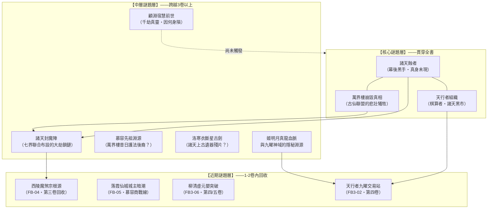
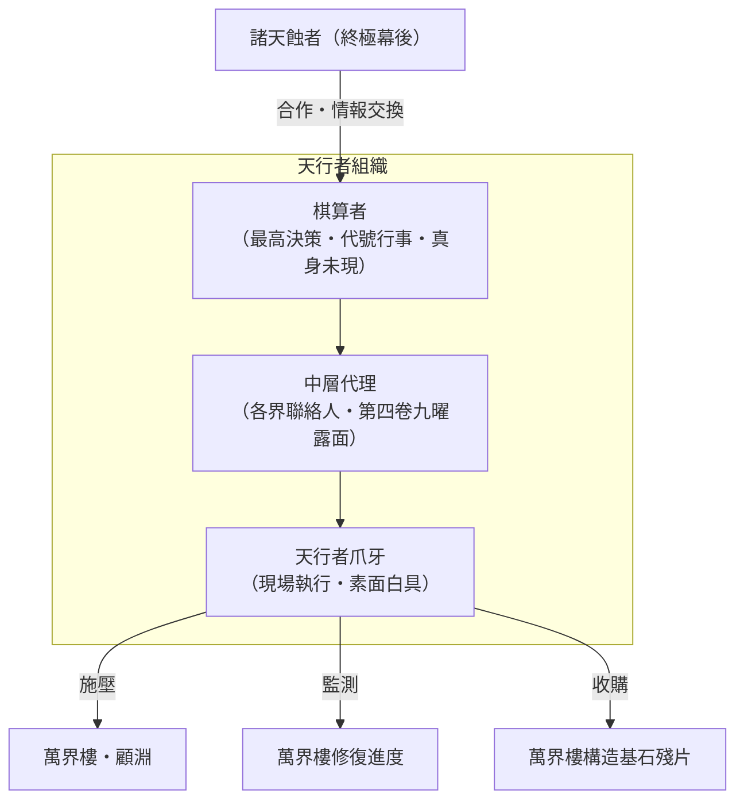

# 《萬界風月樓》全書暗線伏筆總覽（總庫）

> **文檔定位**：全書跨卷主線伏筆・暗線・長期謎題的唯一中央統一管理文件。  
> **整合原則**：各分卷（第一卷、第二卷、第三卷及未來各卷）之暗線檔案已全面整併入本總表統一管理，分卷目錄下不再保留獨立的 `foreshadowing.md`，以此確保跨卷因果追蹤單一真實數據源（Single Source of Truth）。  
> **最後更新**：第三卷綱要完成後（ch053-ch088 規劃階段）

---

## 一、全書暗線架構圖

---

## 二、核心暗線詳細狀態表

### 【S級・全書主線暗線】跨越所有卷次

| 編號 | 暗線名稱 | 首次埋設 | 當前進展 | 預計揭曉卷次 |
|:---:|:---|:---:|:---|:---:|
| **SL-01** | **諸天蝕者・真身** | 卷一 ch001 | 只有模糊輪廓（第三卷 ch066 殘念記憶） | 後期卷（第7卷以後）|
| **SL-02** | **萬界樓崩毀的真相** | 卷一 ch001 | ✅ 核心真相第三卷揭曉：古仙聯盟主動引爆作為法陣核心，換取封印幕後黑手 | 完成（後續深化）|
| **SL-03** | **諸天封魔陣為七界聯合布設** | 卷三 ch059 | 剛揭示——青玄界只是節點之一，七界封印鎖鏈的完整圖景仍不明 | 中後期卷 |
| **SL-04** | **顧淵前世因何身隕** | 卷一 ch001 | 完全未觸發，僅知「千劫真靈、看遍三千大道興衰」 | 高潮卷（全書後三分之一）|

---

### 【A級・長期暗線】跨越3卷以上

| 編號 | 暗線名稱 | 首次埋設 | 當前狀態 | 下一個推進節點 |
|:---:|:---|:---:|:---|:---:|
| **AL-01** | **天行者組織・棋算者真身** | 卷三 ch070 | 組織存在確認、爪牙兩人被擊潰、密碼盤破解 | **第四卷**：九曜神域黑市站・棋算者中層代理首次露面 |
| **AL-02** | **慕容先祖淵源（殘月古玉）** | 卷一 ch014 | 古玉已用於修復天機閣星盤，先祖身份仍未查明 | 慕容玥整理宗譜秘庫時——**第四卷或第五卷** |
| **AL-03** | **洛寒衣斷星古劍身世** | 卷三 ch062（沈玄清提示） | 沈玄清察覺斷星古劍與青玄古仙遺器波動「相當接近」，尚未深查 | **第五卷或第六卷**（洛寒衣身世篇）|
| **AL-04** | **姬明月真龍血脈與九曜神域淵源** | 卷三 ch087 | 姬明月提及大乾太史令記載，僅是線索投影 | **第四卷**：九曜神域中尋找大乾太祖與天曜神域分支的連結 |

---

### 【B級・中期暗線】跨越2-3卷，預計近期回收

| 編號 | 暗線名稱 | 首次埋設 | 當前狀態 | 預計回收卷次 |
|:---:|:---|:---:|:---|:---:|
| **BL-01** | **沈玄清大劫殘印** | 卷一 ch008 | ✅ **第三卷 ch067 完全回收**：殘印洗滌清除，沈玄清突入半步化神境 | 已回收 |
| **BL-02** | **西陵魔煞宗・深淵枯骨老魔** | 卷一 ch012 | ✅ **第三卷 ch079-082 完全回收**：老魔侵吞東華，三女應戰，顧淵焚滅幽冥魔網殘絲，永久消散 | 已回收 |
| **BL-03** | **落霞仙城城主與三十六世家暗潮** | 卷一 ch014 | 慕容玥以商盟震懾，城主仍態度曖昧 | **第四卷**：慕容商道覆蓋三洲後正面清算 |
| **BL-04** | **柳清虛境界進展（九品金丹圓滿至元嬰突破契機）** | 卷一 ch002 / 卷三 ch060 | 卷一「半步金丹」──> 卷二「結丹升品」──> 卷三「九品圓滿、元嬰胎動」；本卷結束元嬰尚未凝成，但突破契機已完全具備 | **第四卷或第五卷**：臨門一腳正式碎丹成嬰 |
| **BL-05** | **萬界通商行的諸天黑市衝突** | 卷三 ch074 | 天行者爪牙被擊退，密碼盤破解，黑市知道萬界樓正在擴張 | **第四卷**：九曜神域黑市站的正面對決 |

---

### 【C級・卷內暗線】已回收完畢（存檔）

| 編號 | 暗線名稱 | 埋設卷次 | 回收卷次 | 備註 |
|:---:|:---|:---:|:---|:---:|
| **CL-01** | 柳清虛衝擊九品天道金丹 | 卷一 FB-06 | ✅ 卷二 ch021 | 獨渡天劫，立威東華 |
| **CL-02** | 武神燕驚鴻殉道真相 | 卷二 FB2-01 | ✅ 卷二 ch044 | 揭露三千年前封魔往事 |
| **CL-03** | 幽冥魔網第二節點 | 卷二 FB2-02 | ✅ 卷二 ch049 | 一劍開天熔斷 |
| **CL-04** | 滄瀾百年無武神天地枷鎖 | 卷二 FB2-08 | ✅ 卷二 ch049 | 枷鎖碎裂，仙武合一 |
| **CL-05** | 洛寒衣斷星古劍器魂復甦 | 卷二 FB2-06 | ✅ 卷二 ch047 | 斷劍重生，涅槃武王 |
| **CL-06** | 大乾皇室真龍血脈雙修 | 卷二 FB2-04 | ✅ 卷二 ch038 | 姬明月入後宮 |
| **CL-07** | 百兵神宮祭壇萬界銘文 | 卷二 FB2-03 | ✅ 卷二 ch032 | 鑄兵星盤認祖 |

---

## 三、分卷原始伏筆全覽對照表（整併存檔）

### 1. 第一卷原始伏筆表（FB-01 ～ FB-10）

| 原始編號 | 伏筆項目 | 埋設章節 | 核心關鍵字 | 最終進展與回收卷次 | 當前狀態 |
| :---: | :--- | :---: | :--- | :--- | :---: |
| **FB-01** | 萬界樓崩毀真相與靈素殘缺記憶 | ch001 | 萬界浩劫、黑手、道陣破碎 | 第三卷 ch066 古仙殘念揭曉古仙自爆真相；蝕者真身轉為 SL-01 | **階段回收** |
| **FB-02** | 沈玄清元嬰大劫殘印與幽冥魔網 | ch008, 009 | 煞氣印記、同化共存、深層隱患 | 第二卷跨界同頻，第三卷 ch067 雙修徹底洗淨 | **完全回收** |
| **FB-03** | 慕容祖傳殘月古玉與先祖淵源 | ch014, 015 | 天機星盤、陣匙、始祖宗譜 | 卷一修復星盤；先祖血脈線轉為 AL-02 | 部分回收 |
| **FB-04** | 西陵魔煞宗太上老怪黑煞之怒 | ch012, 013, 016 | 魔煞宗本部、黑煞老怪、長老殞落 | 第三卷 ch078～082 枯骨老魔侵吞東華，顧淵焚滅核心 | **完全回收** |
| **FB-05** | 落霞仙城城主與三十六世家暗潮 | ch014, 016 | 玄金密冊、城主暗帳、經濟反撲 | 轉為 BL-03，慕容三洲商盟建立後第四卷清算 | 掌控推進中 |
| **FB-06** | 柳清虛衝擊九品天道金丹 | ch002, 010 | 半步金丹、水靈道胎、雷劫 | 第二卷 ch021 獨登通天峰引天劫成就九品金丹 | **完全回收** |
| **FB-07** | 青雲後山古仙界大劫秘卷整理 | ch009 | 藏經閣密卷、古仙界崩塌 | 第二卷破譯《太素天變錄》，第三卷證實封魔陣節點 | **完全回收** |
| **FB-08** | 慕容玥與顧淵的情感「日久生情」 | ch015, 016 | 盟誓漸深、商道道侶、知遇之恩 | 第三卷萬界商票通航，算盤暗刻「淵」字深情確認 | **深度收穫** |
| **FB-09** | 滄瀾界高武大爭之世開啟 | ch016 | 02號世界、宗師如雲、異能神兵 | 第二卷全卷貫穿，平定九幽大劫後定錨滄瀾 | **完全回收** |
| **FB-10** | 顧淵宿慧前世因果與萬界星脈 | ch001, 009 | 千劫真靈、星脈成型、仙武融合 | 第二卷開闢混沌武仙法相；前世身世轉為 SL-04 | 探索推進中 |

---

### 2. 第二卷原始伏筆表（FB2-01 ～ FB2-09）

| 原始編號 | 伏筆名稱 | 埋設章節 | 核心關鍵字 | 最終進展與回收章節 | 當前狀態 |
| :---: | :--- | :---: | :--- | :--- | :---: |
| **FB2-01** | 武神燕驚鴻捨身殉道真相 | ch021, 044 | 燕驚鴻、武神殉道、禁域陣眼 | 第二卷 ch044 九幽地宮見得英魂，交付第二碎片 | **卷內回收** |
| **FB2-02** | 幽冥魔網第二節點異動 | ch040, 045 | 跨界魔網、魔網節點、黑天魔皇 | 第二卷 ch049 一劍開天徹底熔斷魔網第二節點 | **卷內回收** |
| **FB2-03** | 百兵神宮祭壇萬界銘文 | ch031, 032 | 太古鑄兵星盤、萬界分殿投影 | 第二卷 ch032 段百狂密室解密，鑄兵星盤認祖 | **卷內回收** |
| **FB2-04** | 大乾皇室真龍異能與雙修 | ch035, 038 | 紫霄真龍、反噬化煞、帝女結契 | 第二卷 ch038 行宮雙修春風化煞，姬明月入後宮 | **卷內回收** |
| **FB2-05** | 第二碎片中的【九曜星圖】 | ch051 | 星辰古圖、神話文明、第三世界 | 第二卷末天機閣解讀，引出第四卷核心坐標 | **完全回收** |
| **FB2-06** | 洛寒衣身世與斷星劍器魂 | ch026, 030 | 先天劍骨、界外星隕、器魂復甦 | 第二卷 ch047 斷劍重生破境武王；深層身世轉為 AL-03 | 階段回收 |
| **FB2-07** | 青玄界未知貨物流入源頭 | ch033 | 異界走私、神秘晶石、虛空裂痕 | 第三卷 ch070 確認為萬界樓殘片被拆解，轉為 AL-01 | **升格深化** |
| **FB2-08** | 滄瀾百年無武神天地枷鎖 | ch021, 049 | 獨孤絕、天地有鎖、魔網抽取本源 | 第二卷 ch049 斬滅黑天魔皇，天地枷鎖徹底擊碎 | **卷內回收** |
| **FB2-09** | 雙女主皇朝與江湖同盟 | ch038, 050 | 姬明月天策禁軍、洛寒衣天劍山 | 第二卷決戰中雙女主默契配合平叛救世 | **卷內回收** |

---

### 3. 第三卷原始伏筆表（FB3-01 ～ FB3-06）

| 原始編號 | 伏筆名稱 | 埋設章節 | 核心關鍵字 | 預計回收卷次／節點 | 當前狀態 |
| :---: | :--- | :---: | :--- | :--- | :---: |
| **FB3-01** | 諸天蝕者之面目輪廓與封印裂痕 | ch066, 076 | 諸天蝕者、古仙遺志、封印反噬 | 轉入 **SL-01**，第七卷及高潮期 | 核心潛伏中 |
| **FB3-02** | 天行者九曜神域黑市主要交易站 | ch070, 076 | 天行者、棋算者代理、密碼盤 | 轉入 **BL-05**，**第四卷《九曜神域篇》** | **即將觸發** |
| **FB3-03** | 洛寒衣斷星古劍與諸天古器淵源 | ch062 | 斷星古劍、器魂同頻、古仙遺器 | 轉入 **AL-03**，第五或第六卷（身世揭秘） | 萌芽中 |
| **FB3-04** | 姬明月真龍血脈與天曜神宮的分支 | ch087 | 大乾太史令、紫霄真龍、天象神祇 | 轉入 **AL-04**，**第四卷《九曜神域篇》** | **即將觸發** |
| **FB3-05** | 諸天七界封魔鎖鏈剩餘節點 | ch059, 066 | 七界節點、大劫鎖鏈、古仙陣圖 | 轉入 **SL-03**，後續諸界探索主線 | 貫穿展開 |
| **FB3-06** | 柳清虛道基內元嬰胎動蘊育 | ch060, 084 | 九品金丹圓滿、元嬰胎動、突破契機已備（元嬰尚未凝成） | 轉入 **BL-04**，第四卷末或第五卷初 | 蓄勢蘊育中 |

---

## 四、天行者組織檔案（跨卷追蹤）

> **命名梗**：「天行者」——諸天間自由穿行的黑市勢力。名字瀟灑，幹的是最骯髒的買賣。

### 組織層級

### 各卷進展追蹤

| 卷次 | 事件 | 信息增量 |
|:---:|:---|:---|
| 卷二 | 神秘星紋晶石流入黑市（慕容玥查獲） | 確認異界走私黑網存在 |
| 卷三 ch070 | 破妄真視確認晶石為萬界樓基石殘片 | 確認有人在系統化拆解萬界樓殘骸 |
| 卷三 ch074-075 | 天行者爪牙兩名被擊退 | 外貌：素面白具・行事輕聲細語；組織不滿萬界商道橫插 |
| 卷三 ch076 | 密碼盤破解 | 九曜神域存在主要交易站；與諸天蝕者有情報合作 |
| **第四卷** | 九曜神域黑市站 | 棋算者一位中層代理首次露面（待設計） |
| 後期卷 | — | 棋算者真身揭曉；與諸天蝕者關係明朗 |

### 行事準則（已知）
- 「我們不打架。我們只是提醒。」（開場白）
- 一旦提醒被無視，立即升級為殺意，不留情面。
- 核心業務：**收購萬界樓殘片、監測各界強者動向、為諸天蝕者提供情報**。

---

## 五、諸天蝕者相關線索彙整（SL-01）

> 諸天蝕者是全書的終極幕後黑手。目前線索極度碎片化，以下按卷次整理所有已知資訊。

| 卷次 | 線索來源 | 內容 |
|:---:|:---|:---|
| 卷一 | 沈玄清殘印窺見「幽冥魔網輪廓」 | 青玄界的魔煞之劫有更高維度勢力在暗中推動 |
| 卷二 | 滄瀾界幽冥魔網、黑天魔皇投影 | 魔網跨越青玄、滄瀾兩界，節點被逐一熔斷——魔網只是蝕者的一個工具 |
| 卷二 | 燕驚鴻武神殘念 | 三千年前的魔劫、萬界樓崩毀，蝕者當時已存在 |
| 卷三 | 九霄古仙殘念（ch066） | 古仙聯盟當年以萬界樓為法陣核心引爆自身，才換取封印蝕者數萬年；蝕者的面目「模糊輪廓」首次出現在古仙遺志記憶中 |
| 卷三 | 天行者密碼盤（ch076） | 蝕者透過天行者監測各界強者，說明蝕者封印的裂縫已經開始鬆動 |

**當前定性**：蝕者的封印因萬界樓崩毀大劫已持續數萬年，但隨著萬界樓修復度持續提升，封印正在從內部緩緩鬆動——顧淵修復萬界樓的每一步，既是解封諸天防線，也是在加速蝕者的覺醒。這是全書最深層的悖論式張力。

---

## 六、萬界樓修復度跨卷總覽

| 卷次 | 關鍵事件 | 增量 | 累計進度 |
|:---:|:---|:---:|:---:|
| 卷一 | 柳清虛初階共鳴 | +1 | 1/10000 |
| 卷一 | 沈玄清雙修解煞 | +5 | 6/10000 |
| 卷一 | 慕容古玉歸位+共鳴 | +2 | **8/10000（0.08%）** |
| 卷二 | 滄瀾界初入・萬界門定錨 | +7 | 15/10000 |
| 卷二 | 中卷萬界樓重聚・五人共鳴 | +15 | 30/10000 |
| 卷二 | 姬明月真龍雙修 | +25 | 55/10000 |
| 卷二 | 第二碎片歸位 | +30 | 85/10000 |
| 卷二 | 滄瀾紅顏錨點建立・五道侶圓滿 | +15 | **100/10000（1.00%）** |
| 卷三 | 三界聯動會議 | +10 | 110/10000 |
| 卷三 | 柳清虛深夜陰陽共鳴 | +10 | 120/10000 |
| 卷三 | 沈玄清殘印洗滌雙修 | +20 | 140/10000 |
| 卷三 | 第三碎片（古仙遺志封印片）歸位 | +60 | **200/10000（2.00%）** |
| 卷三 | 跨界商道通航・慕容商業反哺 | +20 | 220/10000 |
| 卷三 | 青玄危局平定・五大錨點共鳴 | +40 | 260/10000 |
| 卷三 | 萬界通商行解鎖 | +20 | **280/10000（2.80%）** |
| **第四卷目標** | 九曜神域征途 | +220 | **500/10000（5.00%）** |

---

## 七、各卷新解鎖萬界樓設施

| 設施名稱 | 解鎖卷次 | 解鎖條件 | 核心功能 |
|:---|:---:|:---|:---|
| 樓主殿（一層） | 卷一 | 顧淵入主 | 乾坤道台・統御核心 |
| 風月苑（太微清虛閣） | 卷一 | 柳清虛陰陽共鳴 | 安全雙修環境 |
| 天機閣（一層星盤・二層推演） | 卷一 | 殘月古玉歸位 | 諸天坐標推演 |
| 靈修殿（二層功法熔煉） | 卷一 | 沈玄清雙修 | 功法解析・體系轉換 |
| 珍寶閣（初階調配） | 卷一 | 慕容玥道契 | 跨界物資調配 |
| 萬界門（青玄定錨・滄瀾開啟） | 卷一-卷二 | 時空錨點建立 | 跨界傳送 |
| **萬法演武殿** | **卷二** | 破百（100/10000）+ 第二碎片 | 功法推演・萬界武道研習 |
| **天機秘庫** | **卷三** | 第三碎片（古仙遺志）歸位 | 儲存諸天珍稀功法・情報文獻 |
| **萬界通商行** | **卷三** | 三界商道通航完成 | 跨界物資自動轉運・萬界商票清算 |
| **時空定標儀（三界同步版）** | **卷三** | 萬界通商行解鎖 | 三界同步「上線」・實時動態感知 |
| 第四卷待解鎖設施 | 第四卷 | 九曜神域征途（目標 500/10000） | 待設計 |
