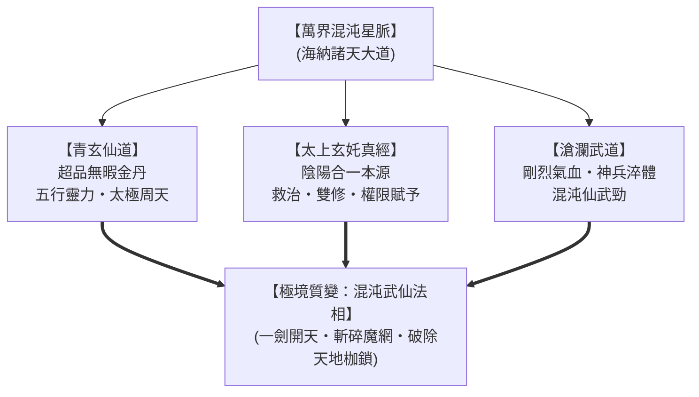

# 《萬界風月樓》男主角設定檔案｜顧淵（萬界樓主）

> **文檔定位**：全書唯一男主角完整設定檔案。涵蓋人物本質、外貌氣度、功法星脈、帝師心態、對敵原則，以及與各卷女主的相處模式與專屬情調。  
> **核心修煉核心**：仙武同修先行者・混沌純陽道體・萬界大道執棋人。

---

## 一、基礎檔案與外貌氣質

* **姓名**：顧淵
* **尊號／身份**：
  * 萬界風月樓之主（執掌諸天樞紐）
  * 青玄界青雲觀首席客卿（位同副掌門）
  * 滄瀾界拯救者、名譽武神、帝國最高道侶盟友
* **外貌特質**：
  * 長身玉立，俊逸出塵，氣度深遠如淵。
  * 膚若寒玉，墨髮以素白羊脂玉簪隨意挽起，常著一襲玄墨描金或月白暗紋廣袖長袍。
  * **破妄真視（混沌金瞳）**：雙眸平日深邃如古潭，運轉神通時浮現淡淡金色神紋，能洞悉諸天氣運流轉、功法破綻、神兵器魂與魔煞死穴。
  * 隨身佩戴物：尋常竹骨素面折扇（隨手化勁、瀟灑隨性）、萬界樓主乾坤道印（識海）。
* **氣度與風采**：
  * **「強勢源於從容，非急躁粗獷；威嚴出於超然，非以勢壓人。」**
  * 他行走於凡俗與仙宗之間，既無名門大派的腐朽傲慢，亦無暴發戶的張揚跋扈；無論面對金丹老怪、一國帝尊，抑或落魄散修、凡塵女子，皆神態從容自若。

---

## 二、性格內核與行為鐵律

### 1. 核心性格特質
1. **洞若觀火，從容執棋**：身懷宿慧與萬界樓主權限，看透各界文明法則與人心算計。喜歡居於幕後提綱挈領，指點女主與盟友逆風翻盤，享受「帝師執棋」之快意。
2. **尊重人格，拒絕物化（遵循寫作總綱 R20、R23）**：
   * 絕不將女性視為收集品或升級工具。他深刻理解並尊重每位女主的獨立信念：
     - 支持柳清虛親自拔劍整肅宗門，立威東華；
     - 尊重沈玄清身為仙尊的道行與求索，並肩推演古陣；
     - 欣賞慕容玥在商場上的精明狠辣，放手讓其建立商盟；
     - 敬佩洛寒衣對劍道的純粹執著，絕不要求其放棄佩劍；
     - 認同姬明月守護大乾社稷的帝王抱負，甘為其後盾而非奪其權柄。
3. **溫柔耐心，極致克制**：
   * 在親密關係中始終是引導者與護道者。只有在彼此心意相通、女主自願託付時方才行雙修造化，從不趁人之危，亦不強逼索求。
4. **殺伐果決，除惡務盡**：
   * 面對阻礙大道、殘害生靈的敵人（如東華王氏、西陵魔煞、九幽黑天魔皇），出手狠辣乾脆，彈指間抹殺死穴，絕不聖母留患。

---

## 三、力量體系與功法神髓

1. **萬界混沌星脈**：萬界樓核心傳承道脈，具備海納百川的熔煉特性。可將異界武意、真龍血脈、神兵星隕無衝突轉化為純陽本源。
2. **核心根本功法《太上玄奼真經》**：
   * 諸天第一陰陽合一至高秘典。交合即是權限授予，雙修即是大道共鳴。
   * 具備「逆轉死煞、洗髓重塑、陰陽互濟、時空定錨」四大造化威能。
3. **仙武合一神通「混沌武仙法相（雛形）」**：
   * 第二卷九幽決戰時於萬法演武殿推演大成，千丈法相身披星甲、手托青蓮，打破位面天地枷鎖，具備弒神滅魔之大威能。

---

## 四、顧淵與五位女主的專屬相處模式與情調

| 女主姓名 | 人物身份 | 顧淵的相處模式與態度 | 專屬情感互動與情調特質 |
| :--- | :--- | :--- | :--- |
| **柳清虛** | 青雲掌門 清麗仙子 | **相濡以沫的靈魂道侶・幕後護道客卿**。 尊重其掌門尊嚴，私下則是她唯一能卸下重擔放鬆依靠的避風港。 | **「外嚴內柔，春水初融」**。 言談風雅含蓄，清茶相伴，指尖相扣。在她羞澀逞強時輕輕攬入懷中，溫柔撫慰其疲憊。 |
| **沈玄清** | 太上仙尊 寒玉尊師 | **知己道友＋禁忌雙修道侶**。 敬重其閱歷修為，以平輩相交；但在情愛中偶爾打破長幼尊卑，展現成熟男人的掌控力。 | **「尊威之下，紅浪翻飛」**。 在深夜密室共同推演古仙抗魔圖；雙修時看著平日高冷肅穆的仙尊師父耳根泛紅、嬌羞隱忍，享受極致反差張力。 |
| **慕容玥** | 商盟盟主 精明商女 | **勢均力敵的博弈對手＋大掌櫃背後的靠山**。 欣賞其精明算計，縱容其小手段，在利益博弈中互撩心弦。 | **「利益博弈，情絲深纏」**。 她撥弄算盤計較得失，他從容一笑摟過纖腰索要紅利；她在商場殺伐果斷，在他懷裡化為風情萬種的小狐狸。 |
| **洛寒衣** | 天劍首徒 女武王劍仙 | **以劍相印的求道知己＋生死戰友**。 不以境界壓人，以純粹道韻點化其劍道，護其道基，見證其破繭化蝶。 | **「霜雪融春，劍心相許」**。 平日裡是言簡意賅的切磋探討；雪峰之上，看著孤傲不屈的女劍仙笨拙地遞來溫酒、臉紅牽手，體驗融化冰山的極致成就感。 |
| **姬明月** | 監國帝女 紫霄女帝 | **旗鼓相當的智性盟友＋撕開棋局的知己**。 不為皇權所誘，跳脫其棋盤，給予她唯獨缺失的安全感與平起平坐的尊重。 | **「帝王心術，私密卸防」**。 朝堂之上君臣相敬，水榭席間機鋒相對；行宮寢殿內，威嚴女帝汗透重裳、自願卸下萬丈孤寒，享受兩大強者靈魂共振的極致愉悅。 |
