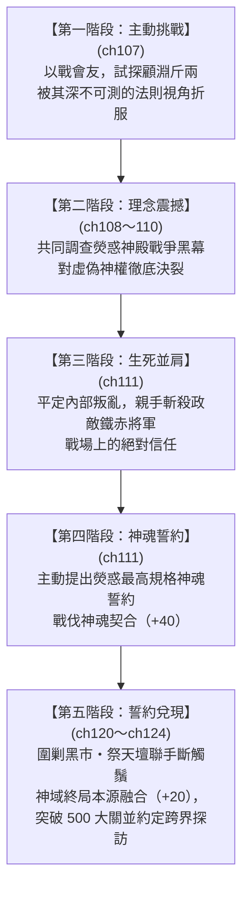

# 《萬界風月樓》第七女主設定檔案｜赫拉迪雅（熒惑女武神・赤煌天將）

> **人物一句話定位**：豪爽、強勢、好戰、坦率，厭惡虛偽神權的熒惑戰伐女武神；手握精銳軍團、不為神王而戰，只為自己的戰士與信念立下神魂誓約的真正戰神。  
> **所屬世界**：05｜九曜神域（遠古神話・星辰神權文明）  
> **人物模型**：遵循 `writing_guide.md` **神域女尊型 ＋ D 型（女主追求）**。  
> **與男主關係**：第七位紅顏道侶、戰場生死盟友、以熒惑最高規格「神魂誓約」相許的戰神伴侶。

---

## 一、基本人物形象與外貌特質

* **外貌特質**：
  * **「鎧甲與戰袍並用，赤金色長髮如烈焰飛揚，眼若熒惑火，笑時有熾烈光芒。」**
  * 身形矯健修長，充滿力量感與戰場統帥的英氣，舉手投足間自帶久經沙場的殺伐果斷。
  * **日常裝束**：赤金戰甲配深紅披風，腰懸戰神長戟／重劍；在戰陣帳內或私下立誓時卸去沉重肩甲，僅著貼身赤紅戰袍，英姿颯爽中帶著野性的豔麗。
* **氣質內核**：
  * **「豪爽、強勢、好戰、坦率，厭惡虛偽神權。」**
  * 與洛寒衣（純粹劍道・追求自身劍心）不同，赫拉迪雅是**戰爭統帥**，重視戰士、榮耀、勝負與袍澤情誼。

---

## 二、性格反差與專屬味道

### 1. 戰場女武神的直率與誓約之重
* **對外姿態（熒惑戰伐軍團統帥）**：
  * 五千年軍旅生涯從未一敗。因反對熒惑神殿「以戰爭人為製造信仰」的黑幕而遭到排擠，卻依然牢牢掌握自己的軍團，絕不妥協。
  * 初見顧淵（ch107），不問來歷、不講客套，直接主動提出挑戰：「外來者，你在神域晃蕩，可敢與我走兩招？」
* **對顧淵的真實反應**：
  * 兩人以戰會友，顧淵以萬界樓法則視角從容接招，讓她第一次遇見「看不透深淺的對手」，從此產生極大興趣。
  * 當顧淵點破「被神殿製造的戰爭，是在把戰士當作信仰燃料」時，她經歷了從憤怒到徹底清醒的震撼。
  * **動情後的坦率與重諾**：她從不扭捏，在平定內部叛亂、確立戰場生死信任後（ch111），她主動提出以熒惑神系最神聖的「神魂誓約」確認關係：「我一生只會立一次誓約，我不輕易承諾任何人，但今夜，你是例外。」

---

## 三、修為、神格與專屬力量

* **神系**：火曜神系（熒惑神系・戰伐神系）
* **神階**：**五階神尊**（戰伐神格完整，九曜神域第一線頂尖戰力）。
* **核心權柄**：戰爭、破壞、征服、勇氣、熒惑神火。
* **軍事勢力**：手握熒惑戰伐軍團最精銳的直屬部隊，有獨立的戰略目標與忠誠部屬。

---

## 四、五階段感情與戰神成長線

---

## 五、親密互動與雙修模式特性

* **主要適用模式**：**神域莊重模式（writing_guide.md 規則十五） ＋ 模式 B（熱情直白） ＋ 模式 C（神魂誓約）**。
* **互動神態細節**：
  * **直接與力量感**：沒有小女子的扭捏，她主動靠近、坦率表達心意，卻又在立下「神魂誓約」的那一刻展現出無比莊重的神聖感。
  * **雙修異象**：熒惑神火在戰陣帳內外齊齊低鳴，赤金神光直衝天際，卻烈而不焚、燃而不傷，將兩人的神魂誓約刻入天地法則之中。
  * **事後溫存**：卸下戰甲的女武神難得露出慵懶一面，靠在顧淵身側談起軍團戰士的未來，將後背與信任真正交給對方。

---

## 六、經典名言

> **「他們說我不懂神殿規矩。我說：我懂，我只是不屑遵守。」**  
> **「我一生與最強者交鋒，唯獨這一次，我選擇把後背交給你。」**（ch111）  
> **「誓約在戰場立下，今夜，讓它刻入靈魂。」**（ch124）
