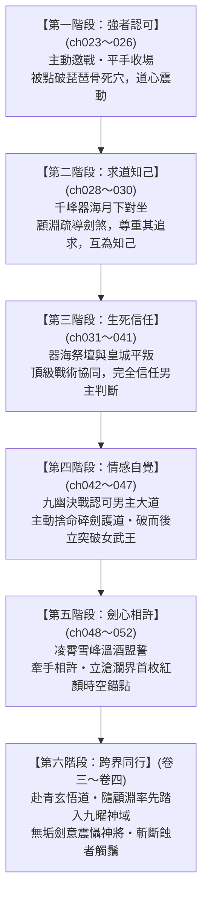

# 《萬界風月樓》第四女主設定檔案｜洛寒衣（天劍傳人・傲骨女武王）

> **人物一句話定位**：平日孤傲清冷如萬丈冰川之雪蓮，真正動情後卻有極致專一反差萌的純粹女劍仙；不依附、不媚俗，以自身劍道傲然立於天地的滄瀾武王。  
> **所屬世界**：02｜滄瀾界（高武異能玄幻文明）  
> **人物模型**：遵循 `writing_guide.md` **清冷仙子型 ＋ 傲嬌強勢型（極致反差萌）**。  
> **與男主關係**：第四位紅顏道侶、滄瀾界第一枚紅顏時空錨點建立者、仙武並肩的劍道伴侶。

---

## 一、基本人物形象與外貌特質

* **外貌特質**：
  * **「眉若遠山橫黛，眼含冷月秋霜；白衣佩劍，如孤鴻踏雪而來。」** 滄瀾界年輕一代第一劍道天驕。
  * 身形高挑修長，比例極致完美，常年修煉先天劍骨，身段如絕世神兵般挺拔筆直，多一分則豐，減一分則瘦。
  * 容顏非尋常胭脂之俗美，而是帶著劍修特有的凌厲與清絕。肌膚如凌霄峰上的初雪般白皙剔透，唇色如冬梅映雪。
  * **日常裝束**：
    * **拔劍之時**：常著一襲不染纖塵的雪白束袖勁裝劍袍，墨髮高綰為利落流雲髻，身背一柄以黑布包裹的古樸幽暗神兵【斷星古劍】；
    * **動情之時（雪峰盟誓）**：換上一襲淡水藍色百褶羅裙，青絲垂落，罕見地點了一抹絳紅唇脂，美得驚心動魄，令人窒息。
* **氣質內核**：
  * **「劍心無垢，傲骨嶙峋；冰雪消融，春意濃極。」**
  * 平日裡視天下男子如無物，甚至在人際交往中顯得笨拙而直率，不懂阿諛奉承，信奉「手中三尺劍自能言天下事」；唯有在顧淵身側，才會流露出那份令人心碎又憐惜的反差溫柔。

---

## 二、性格反差與專屬味道

> **用戶核心批註**：*「清冷女劍仙，平時孤傲得讓人難以接近，真正動情後卻有另一面。反差才有魅力。」*

### 1. 冰山劍仙的「極致反差萌」
* **平日裡的孤傲與直率（生人勿近）**：
  * 聖武大會上，面對各路名門天驕求親示好，連正眼都不看一眼，拔劍直接橫掃；
  * 初遇顧淵，察覺其力量深不可測，沒有任何廢話，直接提劍攔路：「我只求對手，閣下可敢登台一戰？」——剛直純粹，拒絕任何英雄救美套路。
* **真正動情後的反差細節（甜而不膩）**：
  * **笨拙的關心**：得知顧淵在千峰器海消耗過度，她不會說溫柔軟話，而是冷著一張俏臉，硬邦邦地將自己冒死採摘的「萬年劍心雪蓮」塞給顧淵。顧淵笑著看她，她耳根瞬間紅透，偏偏還要揚起下巴嘴硬：「你別多想……我只是不想你因力竭敗給我！」；
  * **並肩作戰的絕對信任**：在百兵祭壇前，她將自己的後背毫無保留地交給顧淵，顧淵指向何處，她的劍便斬向何處，默契若一人；
  * **捨身護道的決絕（ch046）**：黑天魔皇拍落萬丈魔爪，她深知唯有顧淵能熔斷魔網，毅然燃燒精血擋在顧淵身前，斷星古劍碎裂，那一刻她回眸望向顧淵，眼中沒有恐懼，只有冷靜的依戀：「顧淵，這三息……我為你守住！」；
  * **雪峰之巔的柔情融雪（ch052）**：在凌霄峰大雪中溫酒，她第一次主動牽起顧淵溫暖的手，主動靠入顧淵懷裡，輕聲道：「從前我以為我的世界只有劍；現在我知道……這天地很大，而我眼中……唯有你與劍。」

---

## 三、修為、道統與專屬神兵

* **當前修為**：大宗師巔峰（半步武王） ──> 決戰突破為【武王境女劍仙】（滄瀾百年最年輕武王）。
* **血脈體質**：**先天劍骨**（天生劍脈，體內經脈骨絡自然凝練為極限鋒銳劍罡）。
* **根本功法**：
  * 《天劍問天九式》
  * 《碎星極寒劍意》（融合自身守護意志後昇華為「無瑕斷星劍域」）
* **專屬神兵【斷星古劍】**：
  * 材质為三千年前界外星隕天鐵，內孕自主「器魂」；
  * 經歷九幽決戰為護顧淵而寸寸碎裂，隨後在洛寒衣突破武王時破而後立、浴火重鑄，晉升為滄瀾界第一柄無瑕武王神兵！

---

## 四、五階段感情與道心成長線

### 跨卷延伸里程碑（第三卷～第四卷）
* **第三卷（首次跨界青玄界）**：跨界至青玄界與柳清虛等人破冰相處，於萬法演武殿完成仙武契合（ch085），使修復度達 `280/10000` 解鎖【萬界通商行】；並於青雲劍試中察覺【斷星古劍】與青玄古仙遺器存在神秘共鳴（AL-03 埋線）。
* **第四卷（全程隨行征戰九曜神域）**：隨顧淵率先穿過第三號星門踏入九曜神域（ch089）；於太微玉京演武台憑不受信仰濁泥侵染的純淨武意一劍擊退四階神將立威（ch093）；於熒惑赤淵與女武神赫拉迪雅惺惺相惜（ch107）；於祭天壇大戰聯手赫拉迪雅斬斷蝕者投影觸鬚（ch122）；卷末（ch124）諸天神藏殿顯現時，手中斷星古劍再次產生輕微共鳴。

---

## 五、親密互動與雙修模式特性

* **主要適用模式**：**模式 A（古風純粹） ＋ 模式 C（劍道共振）**。
* **互動神態細節**：
  * 羞赧與傲氣並存：即使到了閨房親密之際，她依然保持著劍修的倔強。被顧淵解開衣帶時，她長睫劇烈顫抖，雙頰飛滿紅霞，會咬著下唇偏過頭去，但當顧淵俯身吻她時，她卻會用力抱緊顧淵的脊背，呼吸急促而動情；
  * 雙修異象：先天劍骨與混沌純陽交融，屋內霜雪流光與星辰金火交相輝映，斷星神劍在旁歡鳴，兩人的武意與靈息化為一體；
  * 事後溫存：長劍斜倚床頭，孤傲的女武王赤足縮在顧淵懷中，把玩著顧淵的指尖，低聲訴說自己幼時在雪山練劍的孤獨，只有在顧淵身旁，她才能真正安睡。

---

## 六、經典名言

> **「這天下第一的位子，若非我自己一劍一劍打出來的，縱是神仙相讓，我洛寒衣也不屑一顧！」** —— *聖武論武大會拔劍之言*  
> **「顧淵，我這一生不負劍，更不負你！」** —— *ch052 凌霄雪峰溫酒盟誓*
