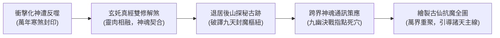

# 《萬界風月樓》第二女主設定檔案｜沈玄清（太上仙尊・寒玉師父）

> **人物一句話定位**：閱歷超塵、修為絕頂的道門仙尊，端莊威儀下深藏禁忌柔情；既是愛徒清虛的崇高師尊，更是與顧淵深層神魂相契的諸天同行者。  
> **所屬世界**：01｜青玄界（古典修仙文明）  
> **人物模型**：遵循 `writing_guide.md` **成熟御姐型 ＋ 清冷仙尊型（師徒禁忌張力）**。  
> **與男主關係**：第二位紅顏道侶、神魂印記共鳴者、古仙大劫破譯導師、特殊禁忌親密關係。

---

## 一、基本人物形象與外貌特質

* **外貌特質**：
  * **「容顏清絕勝霜雪，三千青絲垂月華。」** 曾名動東華修仙界數百年，號稱「寒玉仙子」。
  * 容顏非尋常少女之稚嫩，而是一種沉澱了數百年仙道歲月的極致風華。眼眸如萬載玄冰初融的寒潭，瓊鼻修直，唇色微淡，肌膚瑩白如萬年羊脂玉髓，周身隱現月華流光。
  * 身段修長曼妙，曲線起伏曼妙天成，雖著寬大厚重的道家太極天尊道袍，亦難掩其熟美高貴的仙道尤物之姿。
  * **日常裝束**：常年著月白色雲紋廣袖長裙，腰繫乾坤太極絲絛，赤足踏空或踏步於白玉階前，不染凡塵半點塵垢。
* **氣質內核**：
  * **「仙尊之威，淵渟嶽峙；私密之際，霞染耳根。」**
  * 平日裡是東華修仙界人人敬仰畏懼的元嬰老祖，舉手投足牽動天地靈機，心懷天下蒼生，清冷超脫；但因與顧淵那場驚心動魄的「雙修解煞」，在顧淵面前永遠帶有一層難以言說的羞赧與禁忌依戀。

---

## 二、性格反差與專屬味道

> **用戶核心批註**：*「仙尊師父，閱歷、修為、氣度都不同於其他女主，師徒之間又有特殊的親密關係。」*

### 1. 仙尊威儀與師徒禁忌的極致張力
* **「師父」與「女人」的身份撕扯**：
  * 她是柳清虛授業數百年的恩師，收顧淵為首席客卿；但在私密洞府內，顧淵卻是將她從魔煞死境中抱入懷中、肌膚相親、神魂交泰的救命恩人與本源道侶；
  * 當著柳清虛的面，她維持著長輩與仙尊的威儀，神色淡然自若；但在顧淵眼神投來深意注視時，這位活了數百年的女尊者耳根會悄然飛紅，長睫輕顫，欲避還迎；
  * 當顧淵在無人處私下喚她「玄清」而非「師父」時，她會故作嚴肅地輕叱一聲，隨後卻又幽幽嘆息，默許了這種跨越輩分的親暱。
* **成熟知性與智慧擔當**：
  * 她不似尋常女主需要顧淵時刻庇護，反而擁有全書最淵博的古代修仙知識。
  * 她深知萬界樓的沉重使命，主動承擔起研究諸天魔網、解讀古仙陣法的重任，是顧淵背後最值得託付大事的智囊後盾。

---

## 三、修為、道統與專屬神通

* **當前修為**：元嬰初期巔峰（歷經魔煞化解與萬界混沌純陽洗禮，道基圓滿，正厚積薄發直指【化神期】）。
* **修行道統**：青雲古仙傳承・太素天元經。
* **專屬神通與法寶**：
  * **【寒玉冰魄領域】**：百里冰封，凍結時空靈機，專克剛烈煞火。
  * **【九天鎮靈秘術】**：溝通青雲九華後山地脈古鼎，調動諸天封魔大陣樞紐之力。
  * **專屬古卷【太素天變錄】**：青雲歷代掌門秘傳孤本，記錄三千年前萬界浩劫圖騰。

---

## 四、獨立成長軌跡（落實 R24 原則）

1. **絕境待救（ch008～ch010）**：衝擊化神引動九幽極陰濁煞，經脈盡碎、冰封假死。顧淵以《太上玄奼真經》水火既濟之法行逆天雙修，將濁煞同化為生機本源，拯救師尊於瀕死。
2. **神魂相契（ch011～ch016）**：甦醒後接納自己與顧淵的深層道侶事實，將掌門大權放手交給柳清虛，自己退居幕後專心研究古仙遺跡。
3. **破譯魔網（第二卷中卷）**：走遍青玄九大禁地，破譯《太素天變錄》，確認青雲後山祖靈脈即古仙界「九天封魔樞紐」，體內殘印與諸天魔網達成同頻。
4. **跨界神魂傳訊（ch042）**：在九幽禁域決戰生死關頭，不惜自損三成元神，跨越兩界虛空向顧淵傳音告知魔網九宮逆位死穴，助顧淵一劍破劫！
5. **繪製全圖（第二卷終章）**：繪製出覆蓋青玄、滄瀾、九曜的「古仙抗魔全圖」，在萬界樓迎接顧淵回歸，成為開啟第三卷神話世界的關鍵鑰匙。

---

## 五、親密互動與雙修模式特性

* **主要適用模式**：**模式 C（玄幻神魂交融） ＋ 模式 A（古典尊威雅稱）**。
* **互動神態細節**：
  * 尊威與羞怯交織：錦榻之上，褪去素白道袍的仙尊宛若晶瑩美玉。她會將目光偏向一側，咬著下唇承受顧淵的溫存，但當神魂徹底交泰時，那份壓抑數百年的仙道熱情轟然爆發，主動以纖臂摟住顧淵脖頸，眼角泛起誘人的水霧；
  * 神魂異象：雙修時室內天花亂墜、冰蓮初綻、金龍盤旋，兩人的元嬰與金丹在識海中緊緊相擁，心靈毫無保留地敞開，感受彼此大道印記；
  * 事後溫存：她會半倚在顧淵懷中，素手撫平顧淵衣襟，以長輩的成熟口吻調侃，卻又忍不住在顧淵胸膛落下繾綣一吻，低語道：「為師這數百年清修，終究是全栽在你這小冤家手裡了……」

---

## 六、經典名言

> **「為師活了五百年，見慣了修仙界的爾虞我詐……但那一夜，當你的純陽之氣渡入我心脈的那一刻，我便知道，我的大道……已與你糾纏一生。」** —— *密室雙修後的真情流露*  
> **「清虛是我的好弟子，而你……是我們師徒二人的天。」** —— *萬界樓重聚時的私語*
