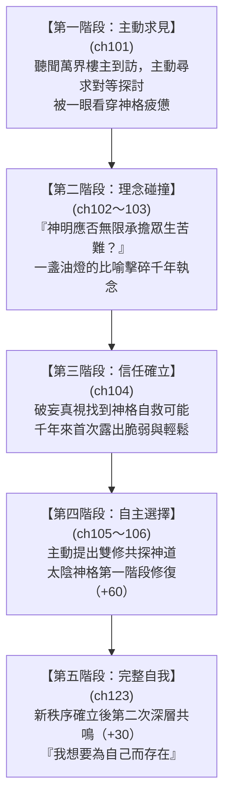

# 《萬界風月樓》第六女主設定檔案｜羲凰（太陰少宮主・廣寒月華神女）

> **人物一句話定位**：清聖仁慈、孤高如月，因替下界眾生承擔信仰濁泥而神格龜裂的神女；從「以自我消耗換眾生救贖」走向「以自我完整成就更大慈悲」的太陰少宮主。  
> **所屬世界**：05｜九曜神域（遠古神話・星辰神權文明）  
> **人物模型**：遵循 `writing_guide.md` **神域女尊型 ＋ E 型（女主主導）**。  
> **與男主關係**：第六位紅顏道侶、九曜神域太陰神系盟友、主動選擇與顧淵共探真正神道的存在。

---

## 一、基本人物形象與外貌特質

* **外貌特質**：
  * **「月白長衣，面如滿月，鬢邊有月華流轉的天然紋路，眼中常有淡淡月光。」**
  * 身形高挑清雅，氣質如高懸九天之上的廣寒明月，令人望之生敬，卻不會感到距離感背後的冷漠，反而能隱約察覺她深藏於眉眼間的疲憊與慈悲。
  * **日常裝束**：常著太陰神宮素白神袍，腰束銀月絲帶，足不染塵；在廣寒月宮內獨處或雙修時，神袍微解，肩頸處隱約可見因神格龜裂而滲出的淡淡裂紋銀光，美得令人心碎。
* **氣質內核**：
  * **「清聖、仁慈、孤高，卻因承擔眾生而逐漸失去自己。」**
  * 與柳清虛（秩序與責任）、沈玄清（尊嚴與平等）不同，羲凰的清冷來自神明威儀與長年承受眾生苦難的孤寂，核心追求是**眾生與慈悲**。

---

## 二、性格反差與專屬味道

### 1. 神性威儀與私下疲憊的反差
* **對外姿態（廣寒月宮少宮主）**：
  * 端莊清聖，每月親自主持信仰洗滌儀式，以太陰神火替下界信徒淨化濁泥，從不對外展露一絲軟弱。
  * 神格已龜裂超過一千年，卻始終獨自承受，從不向師尊玄月神母或下屬抱怨。
* **對顧淵的真實反應**：
  * 主動求見顧淵（ch101），不是因為軟弱求救，而是以對等的神尊姿態探討：「你用外界視角看神域，或許能看見我們都看不見的東西。」
  * 當顧淵一眼看穿她的神格龜裂並問出「少宮主，你上一次真正休息是什麼時候」時，她千年未曾動搖的心防第一次出現裂縫。
  * **動情後的柔情**：在理解「神明唯有先保有自己的意志與七情六慾，才能真正理解並拯救眾生」後，她主動選擇與顧淵共探神道（ch105）；事後在廣寒月宮月輪之下，她會卸下千年神威，輕聲說出「不再是為了眾生，只是為了我自己，我想要這樣的夜晚」（ch123）。

---

## 三、修為、神格與專屬力量

* **神系**：太陰神系（玄月神系）
* **神階**：**五階神尊**（卷初因神格龜裂，實際戰力下降至四階強；第三篇雙修洗滌後進入第一階段修復；第六篇後神格重塑圓滿）。
* **核心權柄**：太陰月華、潮汐、夢境、慈悲洗滌。
* **核心困境（信仰濁泥）**：
  * 長年將下界信徒的貪婪、恐懼、仇恨轉移至自身神格洗滌，導致神格龜裂。
  * 經顧淵以萬界樓視角點破後，領悟「接觸與轉化而非自我消耗」的真正神道。

---

## 四、五階段感情與神道成長線

---

## 五、親密互動與雙修模式特性

* **主要適用模式**：**神域莊重模式（writing_guide.md 規則十五） ＋ 模式 A（古風含蓄） ＋ 模式 C（神格共鳴）**。
* **互動神態細節**：
  * **莊重與稀缺感**：神明的情感數千年才可能發生一次，沒有急切與粗俗，每一個眼神與觸碰都帶著天地神威卸下後的珍貴分量。
  * **雙修異象**：廣寒月宮內太陰月華傾瀉如水，星河倒懸，龜裂的神格在兩人神性交融中如同月缺漸圓般緩緩癒合。
  * **事後溫存**：神女卸下威儀，靠在顧淵肩側，第一次不必思考億萬信徒的祈禱，只安靜享受屬於自己的片刻寧靜。

---

## 六、經典名言

> **「一盞油燈，若強行燃燒到無油，它最後給出的，不是光，而是煙。」**（顧淵對羲凰）  
> **「若只有當我真正有所愛，才能真正理解眾生的愛——那我願意，以這個方式，讓自己更完整。」**（ch105）  
> **「不再是為了眾生，只是為了我自己，我想要這樣的夜晚。」**（ch123）
