# 《萬界風月樓》世界檔案 01｜青玄界（修仙文明）

> 本文件為《萬界風月樓》諸天九界之第一界詳細設定。世界架構與創作規則遵循 [小說創作總綱](../../README.md)。

---

## 一、世界基本概況

* **世界編號**：01
* **世界名稱**：青玄界
* **文明類型**：古典修仙文明
* **一句話定位**：仙山道骨、宗門林立、求道長生與天地靈脈危機並存的玄門仙境。
* **世界格局**：
  青玄界廣袤無垠，天地靈氣充沛，分為「東華靈嶽」、「南離瘴州」、「西陵荒原」、「北寒玄極」四大靈域，以及諸派共奉的中樞「中天仙京」。凡人國度依附於仙宗世家，修仙者高居雲端，追尋超脫長生。

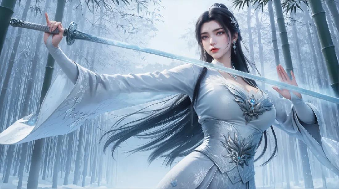

---

## 二、力量體系與修煉機制

修仙者感應天地靈氣，洗滌肉身與神魂，經歷道基鑄造至神遊天地之途：

| 境界層次 | 修煉特徵與威能表現 |
| :--- | :--- |
| **煉氣期（一層至九層）** | 引氣入體，通百骸經絡，凝練靈力，可驅使下品法器與基礎五行符籙。 |
| **築基期（前、中、後期、圓滿）** | 靈力化液，開闢道基丹田，壽元延至兩百載，可御劍凌空，修成護體罡氣。 |
| **金丹期（九品道丹）** | 道基凝丹，丹生道紋（以九品為尊），掌握本命法寶，能移山填海，壽享八百載。 |
| **元嬰期（破丹化嬰）** | 丹碎成嬰，神魂獨立，肉身雖毀亦能奪舍或重塑，舉手投足引動天地異象。 |
| **化神期（神遊太虛）** | 元嬰化神，神念籠罩萬里，初步觸碰天地法則，為青玄界頂尖巨擘。 |

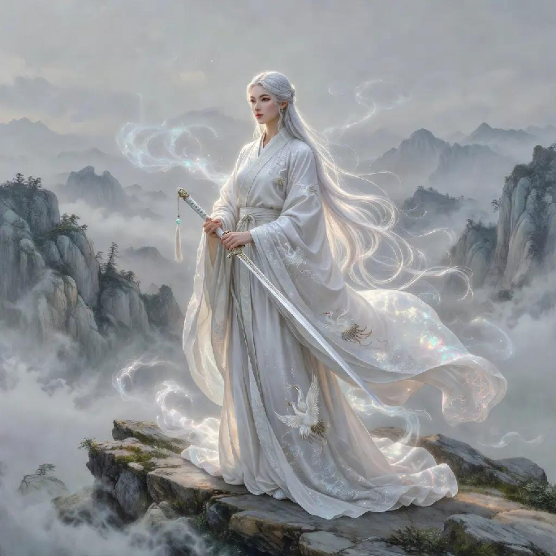
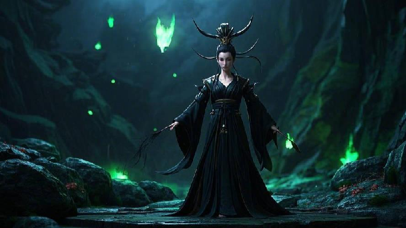

---

## 三、地理板塊與核心勢力

1. **三大名門正宗**：
   * **青雲仙宗**：東華第一正派，底蘊萬年，座落於青雲九峰，以玄門道劍與清靈之氣名動天下。（女主角柳清虛所屬宗門）。
   * **太華道宮**：傳承上古純陽道統，精於符陣與煉丹，與各大修仙世家關係盤根錯節。
   * **天劍神宗**：座落於極西劍峰，全派皆修殺伐劍意，行事孤傲。
2. **四大修仙巨族**：
   * 慕容世家、姬氏家族、姜氏望族、謝氏丹閥。掌控仙城商會、靈礦脈絡與跨域寶船。
3. **重要地標與秘境**：
   * **青雲觀／九華靈峰**：青雲仙宗之核心清修秘境。
   * **落霞仙城**：天下散修與世家交易之第一大集市，設有「千寶拍賣樓」。
   * **天隕古淵**：萬年前仙魔大戰封印之地，煞氣瀰漫，藏有無數古仙洞府。

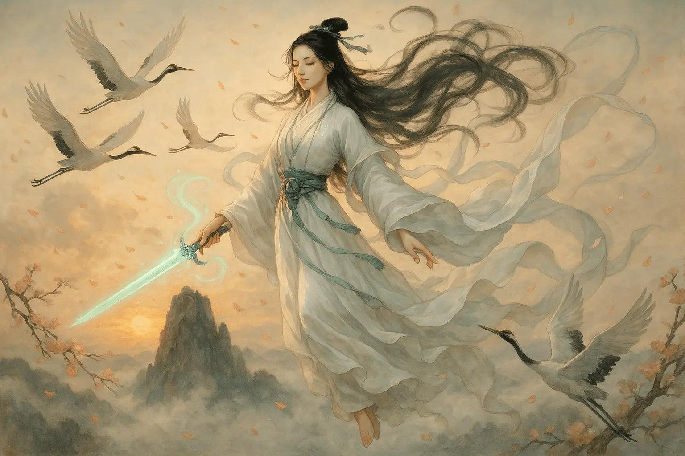
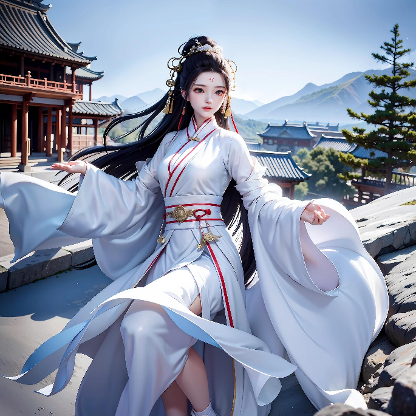

---

## 四、文明風貌與命名特徵

* **文化風貌**：崇尚道法自然、古典風雅、尊卑有序。仙凡界限森嚴，散修為求資源朝不保夕，宗門弟子則講求傳承心性。
* **命名風格**：
  * 地名以山川名嶽、洞天福地為主（如：落霞峰、紫虛崖、碧淵寒潭）。
  * 宗門與功法帶有古典玄門道韻（如：《太清引靈訣》、《紫霄神雷引》、《太虛化劍錄》）。

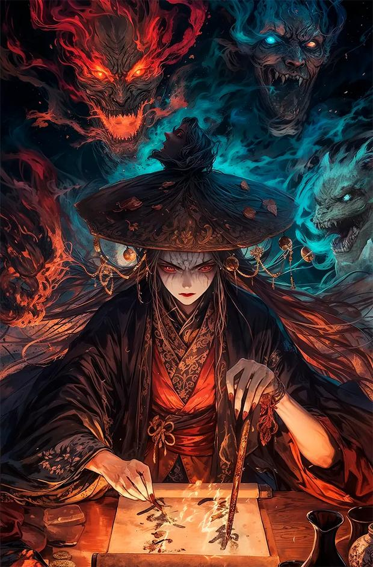
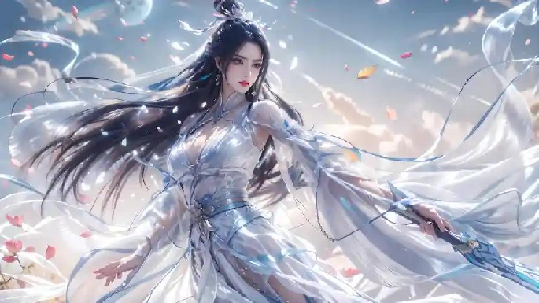

---

## 五、核心矛盾與世界事件

1. **天地斷脈危機**：青玄界核心九大祖靈脈近年漸現枯竭徵兆，低階靈氣日趨稀薄，大宗門與世家為爭奪靈穴矛盾日益激化。
2. **天隕古淵封印鬆動**：上古魔尊煞氣滲透地底，周邊仙城異變頻發，正道宗門高層卻各懷鬼胎、爭權奪利。
3. **男主介入契機**：男主手握萬界樓豐沛之陰陽本源與逆天造化，恰逢女主宗門遭遇斷脈生死劫，主動護送介入，解救危局。

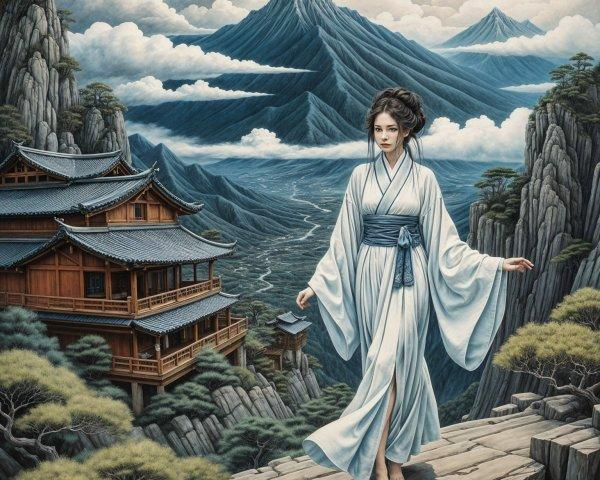
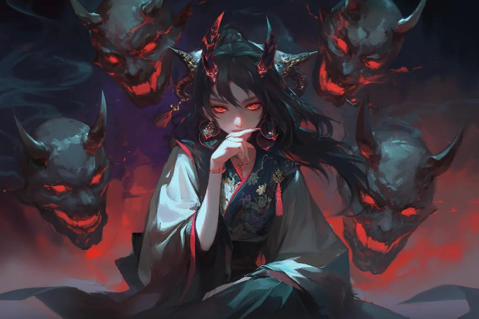

---

## 六、女主群像與錨點契機（遵循 R19 原則）

* **柳清虛（第一位建立時空錨點的女主）**：
  * **身分**：青雲界／青雲仙宗青雲觀親傳弟子。
  * **性格與容貌**：清麗脫俗、眉目澄澈、外柔內韌、心懷道義而不拘泥腐禮。身穿素色道袍，氣質清雅潔淨。
  * **困境與需求**：師尊閉關衝擊化神遭反噬，宗門靈脈源眼衰竭，面臨周邊世家巧取豪奪與強逼聯姻，下山尋找續脈仙晶時機緣抵達萬界樓。
* **慕容玥（潛在女主原型・世家千金）**：
  * **身分**：千寶商樓少東家、慕容世家嫡長女。
  * **性格與容貌**：明豔動人、八面玲瓏、精於算計卻重信守諾。
  * **故事線**：為抗拒家族將其作為聯姻籌碼，決意憑借商業手腕與萬界樓跨界資源重奪世家話語權。
* **蘇凝霜（潛在女主原型・絕世劍仙）**：
  * **身分**：天劍神宗年輕長老。
  * **性格與容貌**：白衣勝雪、冷傲凌厲、一心向道。
  * **故事線**：於天隕古淵受魔煞侵蝕劍心受損，需陰陽調和與無上心源方能破除心魔。

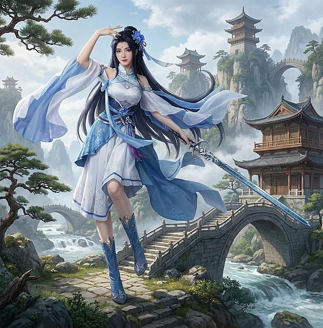
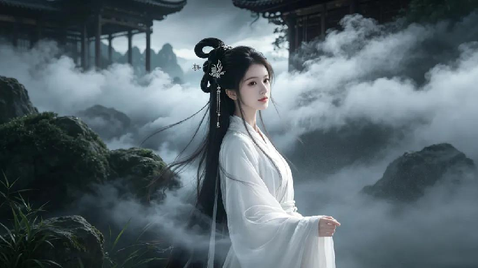
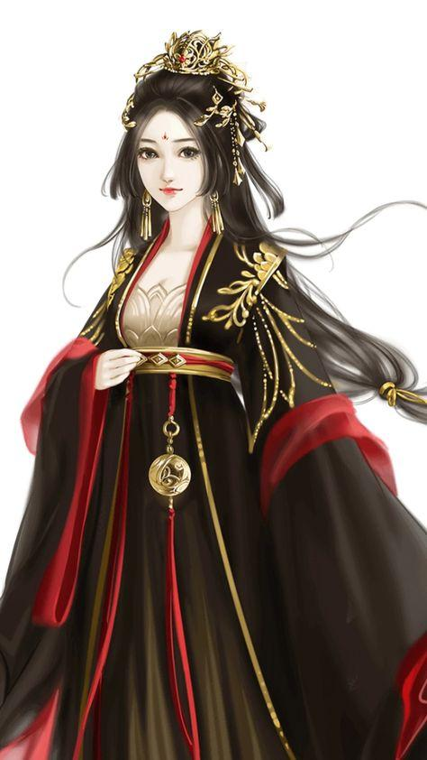

---

## 七、萬界樓造化與互動互惠

1. **青玄界回饋萬界樓**：
   * 供應玄門吐納法、五行煉丹術、飛劍銘刻技藝及天材地寶（千年雪蓮、紫猴花、空靈晶）。
2. **萬界樓賦能青玄界**：
   * 男主以《太上玄奼真經》之陰陽合一本源直接梳理被魔化的靈眼，以神品洗髓金丹助女主重鑄無瑕道基，翻轉戰局，震撼整個修仙界。
