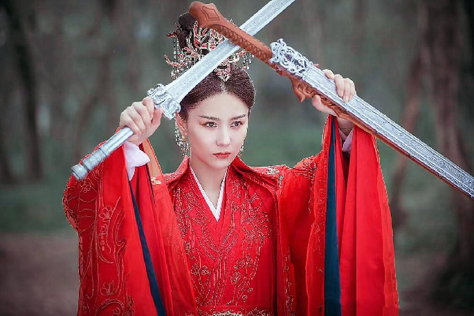
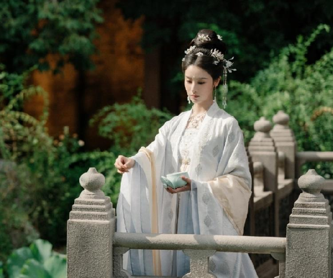
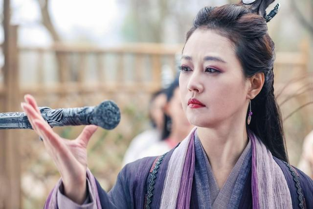
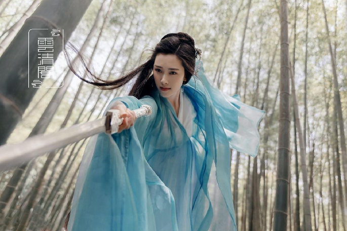
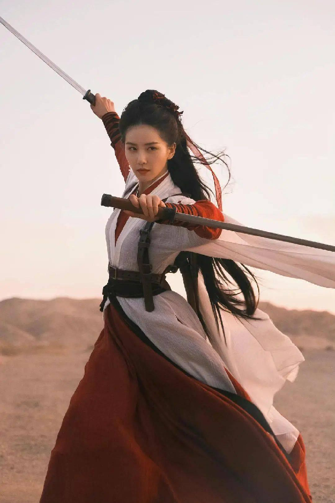
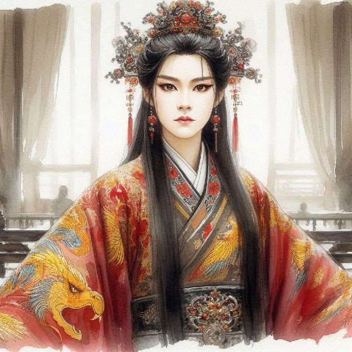
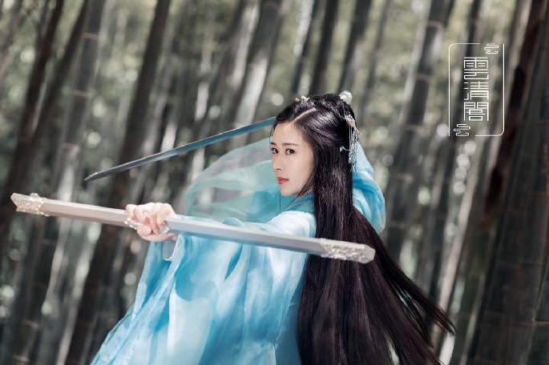
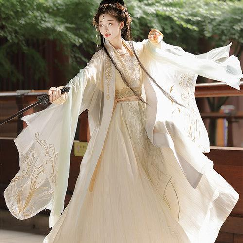
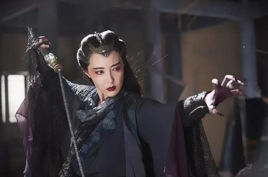

# 《萬界風月樓》世界檔案 02｜滄瀾界（武俠文明）

> 本文件為《萬界風月樓》諸天九界之第二界詳細設定。世界架構與創作規則遵循 [小說創作總綱](../world_bible.md)。

---

## 一、世界基本概況

* **世界編號**：02
* **世界名稱**：滄瀾界
* **文明類型**：高武傳統武俠文明
* **一句話定位**：江河遼闊、刀光劍影、朝堂權謀與快意恩仇交織的血性武林。
* **世界格局**：
  大朔王朝定鼎天下已歷三百年，中央設「鎮武司」與「六扇門」監控武林；民間則被八大名門正派、綠林三十六寨與神祕的「幽冥血教」割據。俠以武犯禁，朝廷削藩收權，整座江湖暗流洶湧。

---

## 二、力量體系與修煉機制

滄瀾武道注重鍛體洗髓、周天經脈運行與意境昇華：

| 境界層次 | 修煉特徵與實戰威能 |
| :--- | :--- |
| **後天鍛體（一至九重）** | 煉皮肉、鑄筋骨、易髓換血。修成千斤巨力，內息初成，可踏波飛簷。 |
| **先天真氣（通奇經八脈）** | 內息化為純陽/純陰先天真氣，隔空傷人，外放凝為三尺罡氣罩，刀槍不入。 |
| **化境宗師（意境初顯）** | 貫通天地之橋，武學孕育專屬武道真意（如寒江劍意、烈陽刀意），百步之內取人首級。 |
| **天人大宗師（天人合一）** | 身融天地，引動風雲變色，舉手投足具百人莫敵之威，已有凌虛踏空半個時辰之能。 |
| **破碎虛空（傳說之境）** | 氣血凝神，以極致武意撕裂虛空壁障，登仙跨界（歷史僅留殘碑傳說）。 |

---

## 三、地理板塊與核心勢力

1. **朝堂中樞**：
   * **大朔皇城（承天府）**：大權在握的帝王與三位手握兵權的王爺爭奪繼位大統。
   * **鎮武司六扇門**：由皇室直轄的高手衙門，專司緝捕江湖逆犯、平定門派禍亂。
2. **正道巨擘**：
   * **滄江劍派**：座落於怒江天險之側，劍法大氣磅礡，被譽為天下第一劍宗。
   * **真武純陽宮**：道門武學聖地，執掌玄門正宗內功。
   * **少華禪林**：金剛不壞神功與少華七十二絕技名震天下。
3. **邪派與黑道**：
   * **幽冥血教**：盤踞黑木崖，修煉吸人精血與殘虐毒功，沉寂二十年後再度復出。
   * **四海鏢局天下會盟**：富可敵國的民間武裝網絡，耳目遍布九州茶肆客棧。

---

## 四、文明風貌與命名風格

* **文化特質**：重承諾、尚義氣、論名望。飲烈酒、快意恩仇、血性豪爽。客棧酒肆、煙雨江南、斷崖古廟是經典場景。
* **命名風格**：
  * 地貌多結合江河水脈（如：沉劍峽、洗墨江、風陵渡、落雁關）。
  * 招式與稱號偏向古典武俠意境（如：「驚鴻照影劍」、「大伏魔金剛掌」、「踏雪無痕」）。

---

## 五、核心矛盾與世界事件

1. **大朔奪嫡與武林清洗**：老皇帝病危，長公主與皇子爭權，意圖借助正邪門派之力相互傾軋，武林浩劫將至。
2. **太祖龍脈寶藏現世**：傳說大夏前朝國庫遺圖流落江湖，內有直通「破碎虛空」的無上神功《洗髓神照經》，各方血腥爭搶。
3. **男主護送與爽點展現**：男主以萬界樓主身分，偕同女主重回江湖，以超出凡世的絕頂手段揮灑風采，橫壓朝堂鷹犬與邪道宗師。

---

## 六、女主群像與錨點契機（遵循 R19 原則）

* **謝晚棠（滄江劍派首徒・霜刃凌雪）**：
  * **身分**：天下第一劍宗掌門獨生女兼門派大師姐。
  * **性格外貌**：冷豔高傲、內藏堅毅、英姿颯爽。白衣佩劍，身段婀娜修長，劍法凌厲非凡。
  * **命運困境**：掌門父親中幽冥血毒性命垂危，同門師兄勾結鎮武司意欲篡位並強逼下嫁，謝晚棠身負重傷逃亡之際誤入萬界樓。
* **蕭明月（大朔王朝長公主・紅顏弄權）**：
  * **身分**：大朔當朝長公主、兼領鎮武司幕後大統領。
  * **性格外貌**：雍容華貴、傾國傾城、心機如海卻深懷家國大義。
  * **故事線**：在皇室宮廷內鬥中腹背受敵，男主護送謝晚棠重返滄瀾界時與其相識，從交鋒試探至心悅誠服。
* **楚小蠻（四海鏢局少鏢頭・靈狐神偷）**：
  * **身分**：綠林豪俠養女、精通天下機關暗鎖之第一妙手。
  * **性格外貌**：古靈精怪、身手敏捷、口硬心軟。

---

## 七、萬界樓互動與造化機緣

1. **滄瀾界回饋萬界樓**：
   * 輸出一流人體經脈內功真訣、武學拳腳神髓、珍稀玄鐵鑌鐵與秘製江湖奇毒解藥。
2. **萬界樓賦能滄瀾界**：
   * 男主以仙家洗髓神露解除奇毒，以至陽內息助女主瞬間打通奇經八脈，助其一夜晉升先天大宗師，逆風翻盤名震天下。
