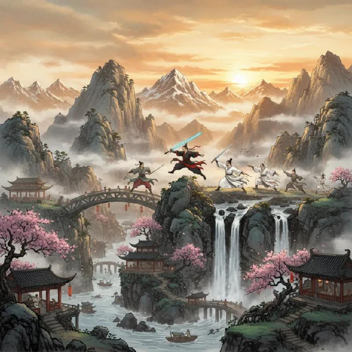
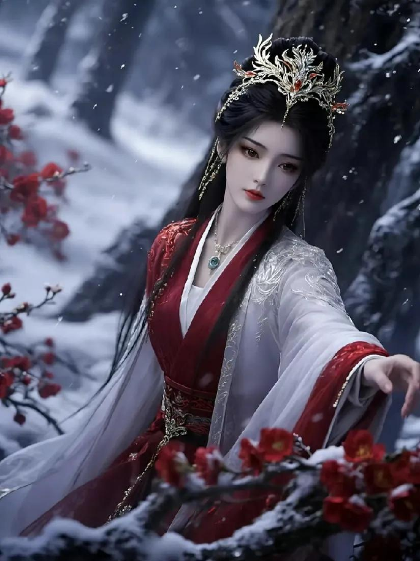
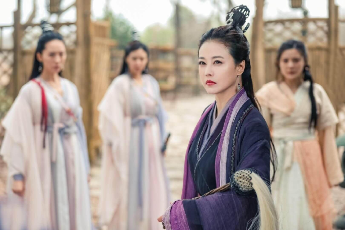
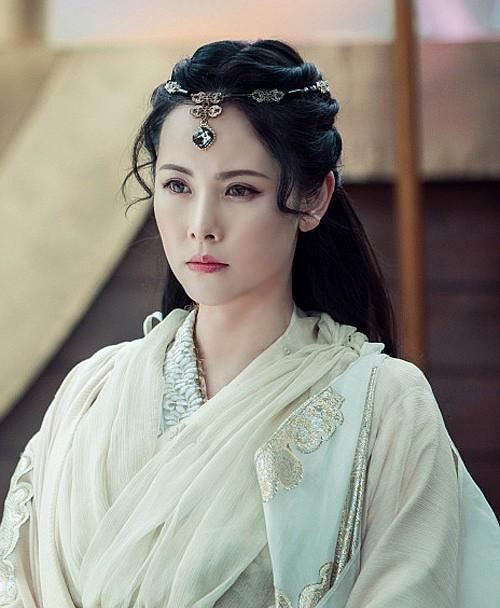

# 《萬界風月樓》世界檔案 02｜滄瀾界（高武異能玄幻文明）

> 本文件為《萬界風月樓》諸天九界之第二界詳細設定。世界架構、歷史編年與創作規則完全遵循 [小說創作總綱](../../README.md) 與 [第二卷世界設定](../arcs/02/01_world_setting.md)。

---

## 一、世界基本概況

* **世界編號**：02
* **世界名稱**：滄瀾界
* **文明類型**：高武異能玄幻文明
* **一句話定位**：肉身破山河、神兵鎮九幽、血脈引紫霄、朝堂與武林共爭「天下第一」的熱血玄幻世界。
* **世界格局**：
  滄瀾界並非低武凡世，亦非修仙仙域，而是具備獨立成熟法則的高武異能文明。大乾皇朝定鼎中原，以「紫霄真龍血脈」威凌天下；天劍山凌霄孤傲，天下第一劍道名動西陲；武極殿坐鎮聖武城，統攝天下宗門百派；百兵神宮雄踞南方千峰器海，執掌天下傳世神兵與太古祭壇；東南死境「九幽禁域」萬里永夜，封印著遠古大劫之第二節點與核心碎片。天下第一百年空懸，大爭之世已然啟幕！

---

## 二、力量體系與修煉機制（三大支柱與八大境界）

滄瀾界超凡力量由「武道」、「異能血脈」、「傳世神兵」三大支柱交融構成，修行不修五行靈根，專修氣血肉身、天地內勁與心靈武意。

### 1. 三大力量支柱
* **武道體系**：煉皮肉、易筋骨、運內勁、通經脈、凝武意、開法相。氣血為鼎，武意為綱。
* **異能血脈**：太古神魔或天地法則烙印遺留之天賦（如大乾皇室「紫霄真龍血脈」、洛寒衣「先天劍骨」）。需強悍武魄承載，否則反噬經脈。
* **神兵體系**：以界外星隕、太古精金熔鑄，孕育自主「器魂」。非契合心性者不可認主，人器合一可逆伐高境。

### 2. 八大武道境界階梯

| 境界名稱 | 修煉核心與戰力指標 | 壽元與社會地位 | 對標青玄仙道 |
| :--- | :--- | :---: | :--- |
| **一、鍛體境** | 煉皮肉筋骨髓，力達千斤，奔跑如豹，肉身生抗凡鐵刀劍。 | 100歲，軍卒與民間護院（百萬級）。 | 練氣初期（一至三層） |
| **二、通脈境** | 內勁自生，貫通奇經八脈與十二正經，飛簷走壁，拳裂巨石。 | 120歲，鏢頭、宗門弟子（數十萬級）。 | 練氣中後期（四至七層） |
| **三、先天境** | 內勁化真氣，罡氣外放達丈外，凝護體真罡，凌空踏步數息。 | 150歲，名門精銳、偏將（萬人級）。 | 練氣大圓滿～半步築基 |
| **四、宗師境** | 貫通天地之橋，凝聚專屬**【武道真意】**，飛花摘葉百步取人首級，開宗立派。 | 180歲，三品門派掌教、名宿（千人級）。**姬明月（初期宗師巔峰）**。 | 築基初期～中期 |
| **五、大宗師境** | 真意化為**【武道領域】**（十丈至百丈控元氣），凌空踏虛，一人可敵千軍。 | 220歲，天驕榜魁首、大乾神捕（數百人級）。**洛寒衣（初期大宗師巔峰）**。 | 築基大圓滿～假丹境 |
| **六、武王境** | 破碎山河，身具皇極真罡，武意化形外顯，調動百里天地元氣。 | 300歲，泰斗巨擘（天劍山主、武極長老，全界數十人）。**洛寒衣決戰突破此境**。 | 金丹期（初至後期） |
| **七、武皇境** | 鑄就「皇極武域」，領域內自成法則，觸摸空間裂隙，移山填海。 | 500歲，當世神話，隱世殿主、皇室太祖供奉（全界不足五人）。 | 金丹巔峰～半步元嬰 |
| **八、武神境** | 武道通神，肉身不死，法相頂天立地，以極致武意撕裂虛空超脫本界。 | 千載以上，傳奇神話（三千年燕驚鴻一人，近百年空懸）。 | 元嬰尊者～半步化神 |

---

## 三、天下格局與五大頂尖勢力

1. **大乾皇朝（中原皇權・紫霄真龍）**：
   * **都城與樞紐**：中原【承天京】。百丈玄鐵城牆，九重宮闕，巡天異能陣法晝夜運轉。
   * **核心權力與軍事**：天策禁衛（十萬精銳）、奉天巡察司（暗探刺客）、皇室供奉堂。
   * **代表人物**：老帝尊（昏聵病危）、監國帝女姬明月（長公主、智勇雙全、天策大統領）、三皇子（勾結魔教兵變）。
2. **天劍山（極西聖地・劍道獨尊）**：
   * **宗門地貌**：西陲凌霄峰，萬仞冰壁，劍氣如雷，問天台大雪漫天。
   * **核心理念**：「劍道無捷徑，天下第一當自取之。」
   * **代表人物**：天劍山主劍無塵（當代天下第一劍客、武王後期巔峰）、首席弟子洛寒衣（先天劍骨、女武王）。
3. **武極殿（中州武盟・群雄共治）**：
   * **總部與樞紐**：中州【聖武城】。設三位輪值殿主與九大長老堂。
   * **核心職能**：統籌天下門派，頒布「天下武林令」，主持「天下論武大會」，評定「滄瀾天驕榜」。
   * **代表人物**：楚烈天（大長老、武皇初期、剛正威嚴）。
4. **百兵神宮（南方南嶺・神兵聖地）**：
   * **宗門地貌**：南嶺【千峰器海】。地火熔岩翻滾，萬千神兵插滿劍塚刃壁。
   * **深層隱秘**：世代守護地底「太古鑄兵星盤祭壇」（萬界樓下界造化神兵殿投影分殿）。
   * **代表人物**：段百狂（宮主、大宗師巔峰、痴狂神匠）。
5. **九幽禁域（東南魔淵・大劫源頭）**：
   * **地理特質**：萬里黑沼天塹，天色永夜，大地裂痕如蛛網，黑霧魔煞升騰。
   * **禁區真相**：三千年前武神燕驚鴻以自身為陣眼鎮壓幽冥魔網第二節點之地；封印第二塊大劫核心碎片。

---

## 四、歷史真相與魔劫因果（四大歷史編年）

1. **三千年前（武神燕驚鴻殉道）**：
   * 域外黑手降下「幽冥魔網」吞噬滄瀾。第一武神燕驚鴻放棄破空超脫之機，以自身神兵法相為鎖，將萬界樓第二塊大劫核心碎片釘入陣眼，化身為萬里九幽禁域，永鎮魔網第二節點。
2. **一千年前（第一神兵太初玄天刃失蹤）**：
   * 太古第一神兵感應魔劫異變遁入虛空，百兵神宮自此封閉千峰器海，立下神兵擇主鐵律。
3. **五百年前（九幽初變與武極殿立）**：
   * 封印鬆動引發魔潮，吞噬東南三城，天下門派痛定思痛，聯合創立「武極殿」。
4. **一百年前（天屠武神獨孤絕消失與天地枷鎖）**：
   * 最後武神察覺天地法則凝滯，深入禁域力戰魔網寄生觸角，發現魔網抽取天地氣運化為「天地枷鎖」，導致世間再難成武神。獨孤絕力竭兵解，留刻「前路已斷，天地有鎖」。

---

## 五、核心女主群像與時空錨點（遵循 writing_guide.md 與 R19）

### 1. 洛寒衣（天劍山首徒・傲骨女劍仙）
* **身分與修為**：天劍首席傳人，大宗師巔峰（半步武王） ──> 決戰突破為【武王境女劍仙】。
* **血脈與神兵**：先天劍骨、專屬傳世神兵【斷星古劍】（界外星隕精金所鑄）。
* **性格特質**：高傲、直接、極致純粹、重諾守信。
* **成長線**：主動攔路挑戰顧淵 ──> 經脈死穴被指點後反思道心 ──> 器海祭壇並肩血戰 ──> 九幽決戰為護顧淵捨身碎劍 ──> 破而後立突破武王女劍仙 ──> 雪峰盟誓牽手定錨（滄瀾界第一枚紅顏時空錨點）！

### 2. 姬明月（大乾長公主・監國帝女・高冷女帝）
* **身分與修為**：大乾長公主、天策大統領、監國帝女。宗師巔峰 ──> 雙修後破境至【大宗師後期】。
* **血脈異能**：紫霄真龍血脈（引動九天紫龍雷罡、皇極天子威壓）。
* **性格特質**：雍容華貴、冷靜理智、精通帝王心術、深懷家國大義。
* **成長線**：攬月水榭智鬥試探顧淵 ──> 平定紫宸殿血夜兵變 ──> 真龍血脈遭魔煞反噬瀕死 ──> 行宮深處卸防，自願與顧淵運轉玄奼真經純陽雙修 ──> 破除魔毒血脈九重大圓滿 ──> 監國執政，調全國大軍共赴九幽，確立大乾與萬界樓永固道侶同盟！

---

## 六、跨界機制與萬界樓賦能（遵循 7.1～7.4 與 R24 原則）

1. **跨界通行權限不對稱性**：
   * **顧淵**：享有樓主最高特權，隨時隨地自由穿梭萬界樓與青玄界；初臨滄瀾受限於荒谷出口，卷末與洛寒衣雪峰定錨後，解鎖滄瀾全境隨地穿梭。
   * **女主通行**：青玄三女（柳清虛、沈玄清、慕容玥）暫無自主跨入滄瀾界權限，但享有進出萬界樓之權（ch033末中卷樓主殿四大道侶重聚）。
2. **世界自主演化（青玄界平行線）**：
   * 柳清虛獨立渡九品水火金丹劫，頒布青雲新令，收攏宗門大權，傲立東華道門之巔。
   * 沈玄清破譯《太素天變錄》，發掘青雲祖脈九天封魔樞紐，跨界神魂通訊指點九幽魔網死穴，繪製「古仙抗魔全圖」。
   * 慕容玥反擊仙商圍剿成立「東華萬界商盟」，繳獲界外走私星紋晶石，建立諸天商業情報網。
3. **萬界樓下界投影與系統質變**：
   * 百兵神宮「太古鑄兵星盤」重啟，萬界樓下界神兵分殿認祖歸位（修復度 +7/10000）。
   * 融合燕驚鴻第二塊核心碎片，萬界樓總修復度突破 **100/10000（1.00% 破百大關！）**。
   * 全面解鎖第三核心樞紐【萬法演武殿】，開啟跨界功法推演與仙武法相對練，天機星盤鎖定 03 號神話世界【九曜神域】！
