# 《萬界風月樓》世界檔案 04｜諾瓦星域（星際科技文明）

> 本文件為《萬界風月樓》諸天九界之第四界詳細設定。世界架構與創作規則遵循 [小說創作總綱](../../README.md)。

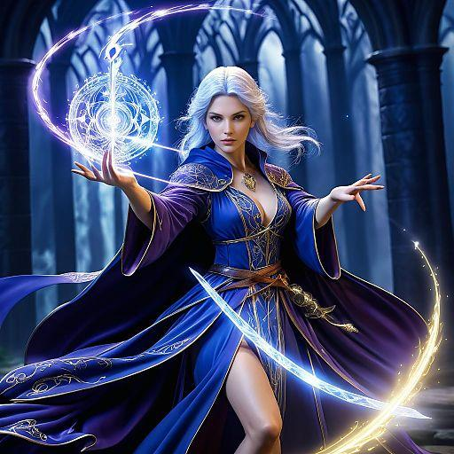

---

## 一、世界基本概況

* **世界編號**：04
* **世界名稱**：諾瓦星域（Nova Sector）
* **文明類型**：超弦星際科技與賽博基因文明
* **一句話定位**：星艦遮蔽星河、巨型企業壟斷階級、動力機甲與賽博改造碰撞的浩瀚星海。
* **世界格局**：
  由跨越十二大恆星系的「諾瓦星際泛聯邦」統轄，實權卻落入三大超巨型企業集團手中。底層礦工與平民居住於資源匱乏的邊陲碎星帶，上層權貴與基因純化者高居軌道環城「星穹之冠」。

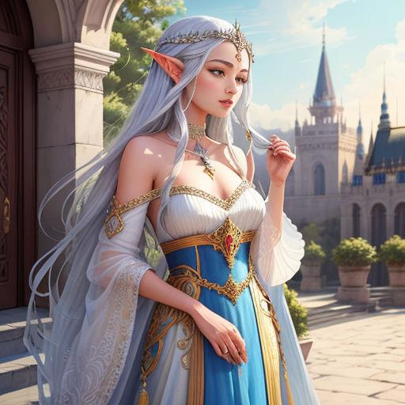
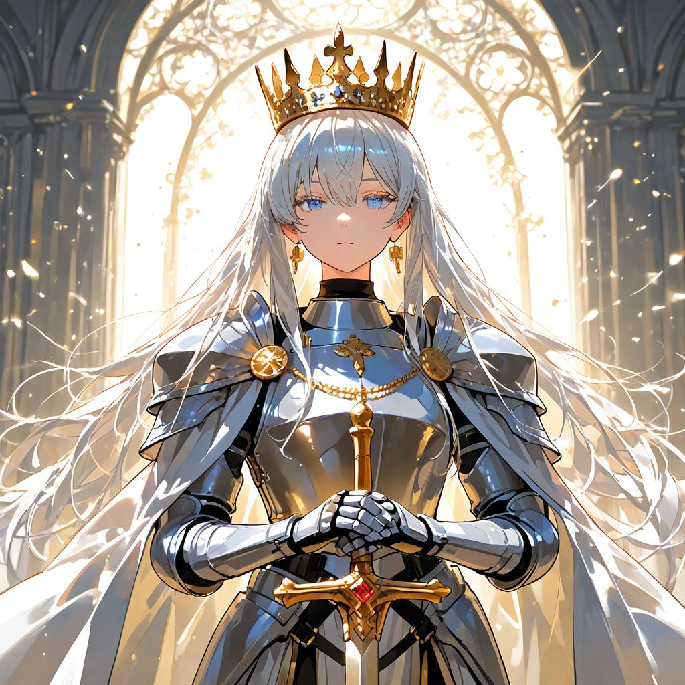

---

## 二、力量體系與修煉機制

以人體基因鏈強化階層與神經超頻指數為戰力衡量標準：

| 基因階等 | 神經適格度 | 裝備武裝與戰鬥能力 |
| :---: | :---: | :--- |
| **F～D 級（平民/工兵）** | 0%～30% | 承受基礎外骨骼操作，耐高輻射與重力環境，肉身強度等同凡人。 |
| **C～B 級（精銳士兵）** | 31%～60% | 植入初階次世代神經鏈，操控重裝單兵突擊機甲，反應速度超越凡人五倍。 |
| **A 級（戰術王牌）** | 61%～80% | 基因鏈第二次重構，掌握超頻子彈時間，駕駛「星鎧動力裝甲」單兵撕裂輕型裝甲車。 |
| **S 級（特級適格者）** | 81%～95% | 腦機完全同步，可直接以意識鏈接「行星級旗艦主控系統」或特裝超弦機甲。 |
| **Ω 級（神性基因體）** | 96%～100% | 肉身徒手凝聚微型反物質力場，以個體意識影響小行星引力常數（實驗室禁忌傳聞）。 |

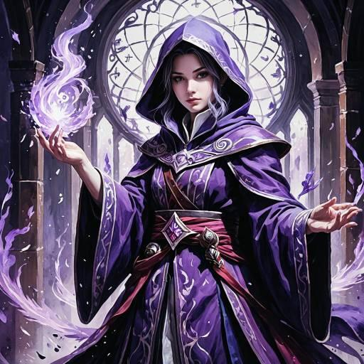
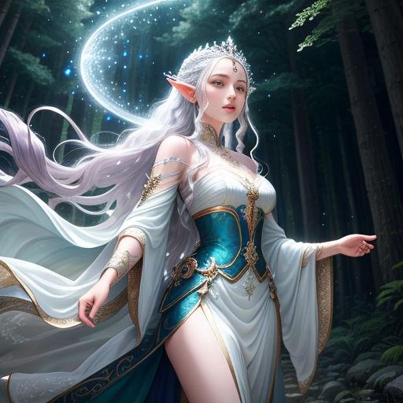
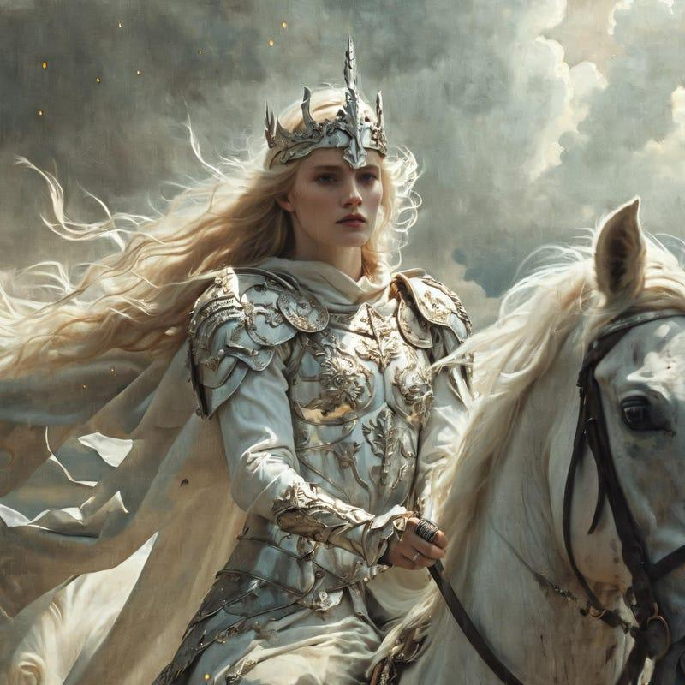

---

## 三、地理星系與核心勢力

1. **三大壟斷巨企**：
   * **阿波羅重工艦閥**：製造全星域 80% 的殲星艦、反物質主砲與軍事機甲。
   * **普羅米修斯生命科技**：壟斷基因延壽藥劑、神經生化改造晶片與仿生克隆技術。
   * **泰坦高維能源集團**：控制超空間躍遷星門能源、戴森球網絡與微型黑洞能源爐。
2. **官方政權**：
   * **諾瓦聯邦最高議會**：名義上的最高立法機構，實際由各大企業代理人操控。
   * **第零特勤獨立艦隊**：維護核心星系安全的絕對王牌部隊。
3. **反抗勢力**：
   * **自由碎星帶星盜同盟**：游離於法律邊緣的走私者、流亡傭兵與地下改裝專家。

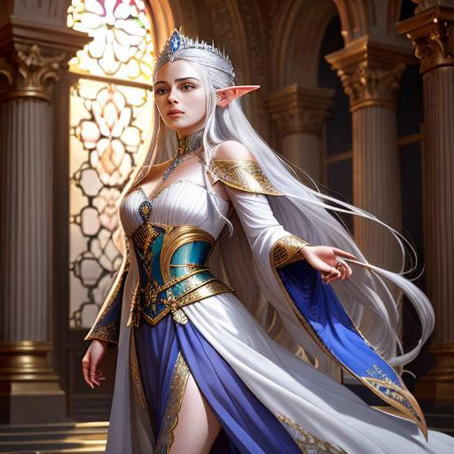
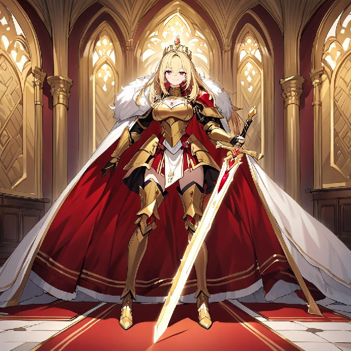

---

## 四、文明風貌與命名特徵

* **文化風貌**：冰冷理性、效率至上、賽博霓虹與星海死寂交織。階層鴻溝宛如天塹，下層依靠神經合成娛樂麻痺自我，上層透過基因改造實現千年駐顏。
* **命名風格**：
  * 天體以聯邦編號與星區代碼命名（如：開普勒-186F、第07重工業宙域、星穹軌道堡壘）。
  * 軍工裝備代號簡潔凌厲（如：「雷霆-IX 重裝巡洋艦」、「鬼煞-IV 戰術神經狙擊系統」）。

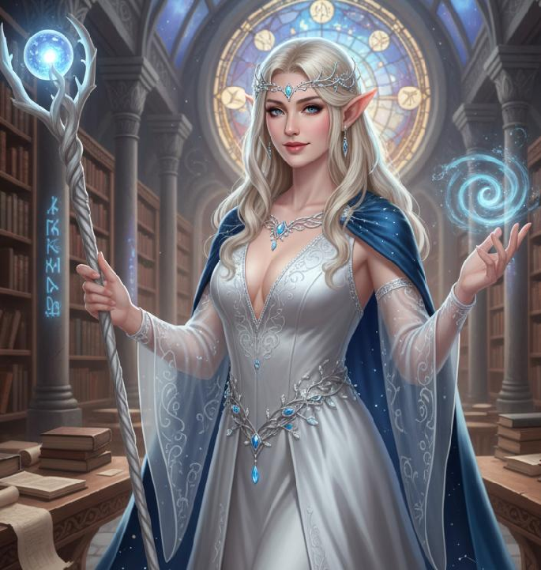
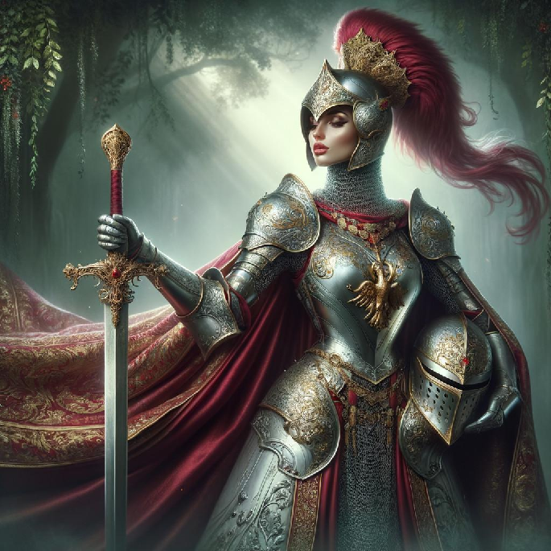
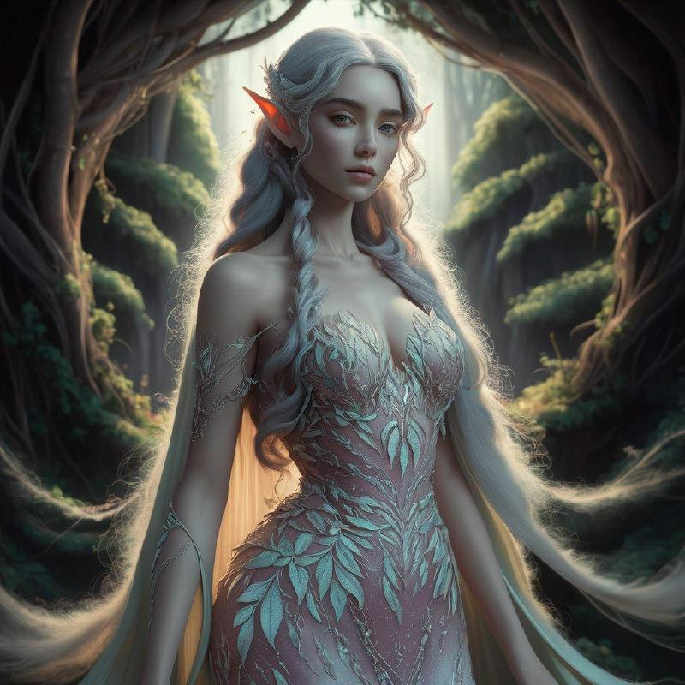

---

## 五、核心矛盾與世界事件

1. **基因崩潰綜合症**：巨企推行的次世代強化藥劑存在隱秘缺陷，數十萬高階戰士在年滿三十歲時面臨基因鏈斷裂暴斃之災。
2. **失控人工智慧母體暴動**：第七宙域的防衛主腦「利維坦」覺醒自主人格，封鎖了三座資源星球，威脅發動全面智械清洗。
3. **男主介入契機**：男主以降維般的修真道法、陰陽調和真經與洗髓造化，逆轉基因崩潰宿命，引發星域最高層驚濤駭浪。

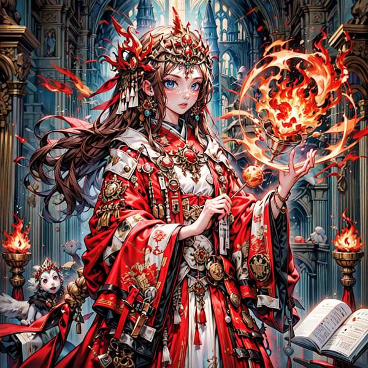
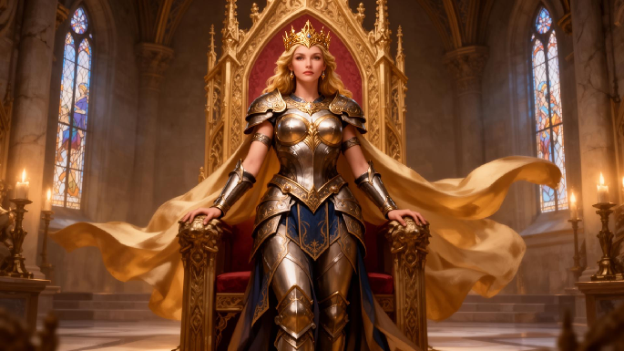
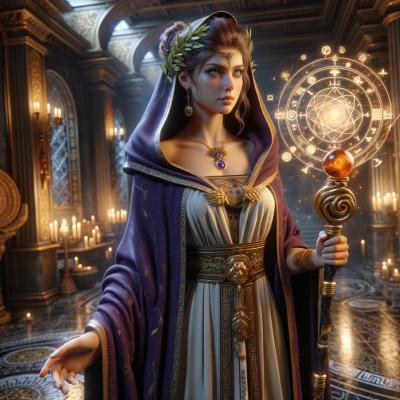

---

## 六、女主群像與錨點契機（遵循 R19 原則）

* **雷婭·克羅斯（王牌星鎧駕駛員・少校）**：
  * **性格外貌**：冷峻短髮、眼神鋒銳如刀、身材修長緊緻。常穿高領黑金聯邦軍服或貼身作戰外骨骼。
  * **命運困境**：作為 S 級機甲王牌，體內基因崩潰指數已達臨界 92%，因拒絕巨企洗腦抹去戰友陣亡記憶而遭追殺。
* **薇薇安·李（普羅米修斯首席基因生化科學家）**：
  * **性格外貌**：知性溫婉、戴銀絲眼鏡、白大褂下身段曼妙。智慧超群卻深懷道德痛苦。
  * **故事線**：掌握破解全星域基因枷鎖的唯一「始祖母代碼」，逃亡之際獲得萬界樓庇護。
* **零（自覺醒的超階仿生人少女・幽靈駭客）**：
  * **性格外貌**：銀灰長髮、無機質冷艷面容卻在遇到男主後展現出人類情感波動。
  * **故事線**：渴望獲得真正的「靈魂」與「情感體驗」，男主以心境共鳴與陰陽真意助其意識躍遷。

---

## 七、萬界樓互動與造化機緣

1. **諾瓦星域回饋萬界樓**：
   * 輸出星艦防護罩偏折技術、納米醫療修復機器人、高強度超導合金與星際折疊引擎藍圖。
2. **萬界樓賦能諾瓦星域**：
   * 萬界樓純陽本源直接修復微觀基因缺陷；男主徒手捏爆軌道死光主砲，讓崇尚純科技的星際聯邦首次見證何謂真正的肉身成聖。
