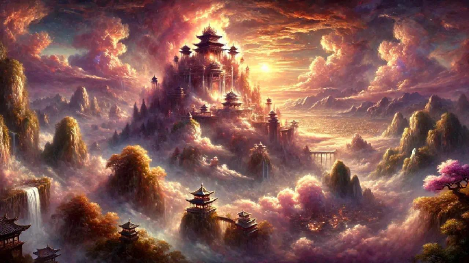
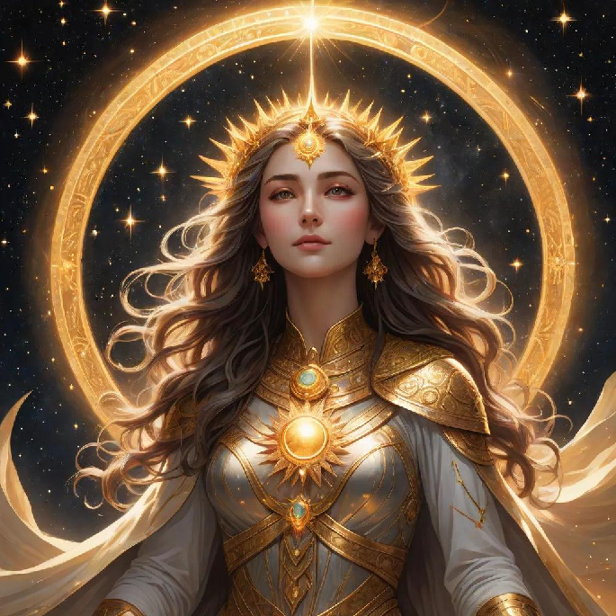

# 《萬界風月樓》世界檔案 05｜九曜神域（神話文明）

> 本文件為《萬界風月樓》諸天九界之第五界詳細設定。世界架構與創作規則遵循 [小說創作總綱](../world_bible.md)。

---

## 一、世界基本概況

* **世界編號**：05
* **世界名稱**：九曜神域
* **文明類型**：遠古神話信仰與天象神權文明
* **一句話定位**：神光璀璨照耀九重天闕、諸神俯瞰三千信徒凡界、神格與天條律令威嚴至高的神聖國度。
* **世界格局**：
  神域由高居天外的「九曜天宮」執掌天地運轉，對應太陽、太陰、辰星、熒惑、歲星、鎮星、太白、羅睺、計都九大星曜神系。億萬下界信徒城邦每日獻祭信仰香火，維繫神國繁盛。

---

## 二、力量體系與修煉機制

以神性純度、神火燃燒強度及神格概念位階為力量根基：

| 神階位次 | 境界特徵 | 掌控權柄與神聖威能 |
| :--- | :--- | :--- |
| **神眷者／神裔** | 凡俗之軀覺醒遠古神明一絲神血，具百毒不侵之體，可借用微弱神術。 |
| **半神（燃點神火）** | 聚億萬信仰，在靈魂深處點燃不朽神火，肉身褪去凡胎，壽數十萬載。 |
| **神明（凝聚真神格）** | 將所領悟的宇宙天象法則凝聚成神格晶核（如火、冰、雷、戰伐），建個人神殿。 |
| **九曜神王（主神執位）** | 執掌九大至高星曜之本源，掌握言出法隨之天規神律，一念可令星辰位移。 |
| **創世原始神（古神至境）** | 開闢宇宙天地的混沌原初存在，大部分已陷入漫長永眠或歸於天道。 |

---

## 三、天宮格局與核心神祇

1. **九大星曜神宮**：
   * **日曜天宮**：以太陽神君為首，主宰天域至剛至陽秩序與光明神威。
   * **太陰神宮**：以太陰月曜神女為核心，清冷出塵，司掌夜幕星辰與陰柔玄神泉。
   * **熒惑神殿**：司掌兵戈、戰伐、兵災之神，性情剛烈霸道。
   * **羅睺／計都魔煞宮**：司掌蝕日、隱劫與天罰刑戮之陰影宮闕。
2. **三千凡俗信仰古界**：
   * 為九曜天宮提供純粹信仰願力的下界生靈聚落，神殿騎士與祭司在凡間擁有生殺大權。
3. **諸神黃昏遺墟**：
   * 遠古古神大戰隕落之地，埋葬著無數破碎的殘缺神格與狂暴神力殘渣。

---

## 四、文明風貌與命名特色

* **文化風貌**：森嚴、威重、視眾生為螻蟻。神袍璀璨，鐘鼓齊鳴，言必稱天道法度。神明不得動凡心，視七情六慾為神火之毒。
* **命名特質**：
  * 地名以天宮、星宿、天象為主（如：太微玉京、廣寒瑤池、紫薇天關、熒惑赤淵）。
  * 神職名號莊嚴崇高（如：「九曜純陽大帝」、「太陰玄素神女」、「司晨光明尊者」）。

---

## 五、核心矛盾與世界事件

1. **信仰之毒與天人五衰**：下界凡夫七情六慾經長年香火獻祭，沉積為「欲望濁泥」，神明神格面臨腐化衰變之大劫。
2. **九曜神位爭霸奪嫡**：現任神王壽元無多即將回歸星宿，日曜與太陰神系圍繞至高神座爆發激烈神權衝突。
3. **男主介入契機**：萬界樓《太上玄奼真經》所煉之無瑕陰陽本源，能徹底煉化驅散信仰濁氣，成為救贖神明道果的唯一解藥。

---

## 六、女主群像與錨點契機（遵循 R19 原則）

* **羲凰神女（太陰神宮少宮主・月曜至尊）**：
  * **性格外貌**：廣寒仙姿、白衣飄袂、清聖絕倫。雙眸宛若寒夜明月，看似冷若冰霜，心底卻對萬物抱有仁慈。
  * **命運困境**：因替萬民化解濁毒，自身太陰神火反遭劇烈污染，神格瀕臨龜裂，唯有尋得跨越諸天的至純純陽造化方能洗滌真靈。
* **赫拉迪雅（熒惑戰伐之宮女武神）**：
  * **性格外貌**：金鎧浴火、英氣凌霄、身材高挑豐滿、性格直爽敢恨敢愛。
  * **故事線**：厭倦神界虛偽的天規神條，被男主那份灑脫不羈與深不可測的實力折服，願立下神魂誓約相隨。

---

## 七、萬界樓互動與造化機緣

1. **九曜神域回饋萬界樓**：
   * 輸出九曜星辰神液、天界不滅神火種、神格碎片、信仰神兵與遠古神諭。
2. **萬界樓賦能九曜神域**：
   * 男主以玄奼道妙洗去神女體內沉積千萬年的信仰濁毒，令羲凰神女破而後立，重塑無瑕至高月神之位。
