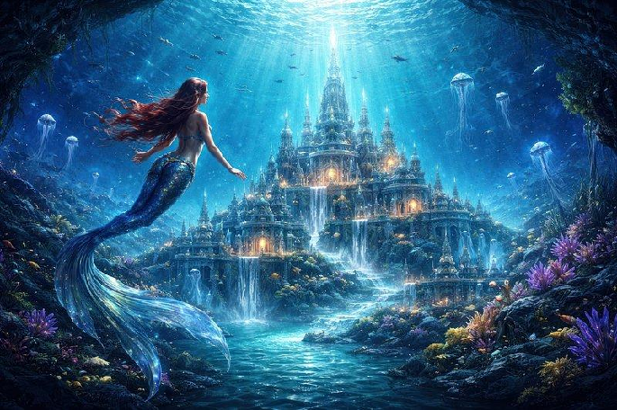
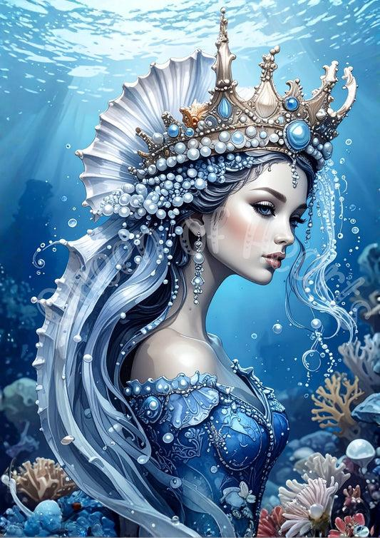

# 《萬界風月樓》世界檔案 07｜滄溟界（海洋文明）

> 本文件為《萬界風月樓》諸天九界之第七界詳細設定。世界架構與創作規則遵循 [小說創作總綱](../world_bible.md)。

---

## 一、世界基本概況

* **世界編號**：07
* **世界名稱**：滄溟界
* **文明類型**：浩瀚深海與海族神聖文明
* **一句話定位**：九萬里碧波無際、萬千珊瑚島國璀璨、鮫人踏浪吟唱、上古真龍巡弋海底的壯麗水之世界。
* **世界格局**：
  滄溟界九成以上為汪洋大海，僅有少數浮島星羅棋佈。水下分為「明海層」（珊瑚平原、珍珠城邦）、「幽海層」（四海龍宮統轄水域）與最深邃危險的「淵海層」（歸墟無底海眼）。

---

## 二、力量體系與修煉機制

以親和水元靈氣、溝通潮汐潮信以及體內海靈血脈濃郁度為晉升依據：

| 境界層次 | 水系神通與戰鬥威能 |
| :--- | :--- |
| **水靈侍（控浪踏波）** | 操縱水流凝聚水刃水盾，水下呼吸自如，駕馭百種海獸座騎。 |
| **潮汐宗師（引瀾覆舟）** | 感應日月盈虧之潮汐規律，一怒引動百丈海嘯，瞬息冰封數里洋麵。 |
| **鮫魄／真龍變（血脈覺醒）** | 鮫人族修成安魂鎮魂之天籟梵音；龍族純血進行「九轉化龍」，凝出不滅真龍鱗甲。 |
| **海皇神官（執掌天潮）** | 獲得海神三叉戟殘存印記認可，調動一海生靈願力，開闢萬里避水神域。 |
| **歸墟滄溟尊（海之本源）** | 身化無盡汪洋，身融滄溟天道，掌握水系至高生生不息之真諦。 |

---

## 三、深海格局與核心勢力

1. **滄溟四海真龍宮**：
   * 執掌幽海層秩序的至高水族皇族，座落於水晶靈脈之巔，掌控天水行雲布雨大陣。
2. **鮫人族・琉璃珍珠靈國**：
   * 棲息於溫暖明麗的萬里珊瑚海林，愛好和平，其鮫珠淚乃諸天療傷至寶。
3. **北冥巨妖古盟**：
   * 巨型鯤鵬、深海魔章與雷鰻古妖組成的兇悍聯盟，盤踞於極寒黑水之淵。
4. **歸墟海眼神禁之地**：
   * 滄溟界最神秘莫測的核心，據傳為遠古海神沉眠修養之所。

---

## 四、文明風貌與命名特色

* **文化特徵**：空靈、柔美、敬畏海洋。服飾多以天蠶水綃織造，入水不濡，珠光寶氣，樂律音律極為發達。
* **命名風格**：
  * 地名充滿水意與潮汐律動（如：落星海灣、碎浪寒礁、千珠碧落、碧瀾行宮）。
  * 招式與法寶帶有古典浪漫色彩（如：「碧海潮生曲」、「翻海覆天印」、「琉璃水月佩」）。

---

## 五、核心矛盾與世界事件

1. **歸墟海眼濁潮大爆發**：沉積千萬年的死水海煞自歸墟噴湧，淨水轉濁，無數深海巨獸暴走，威脅鮫人與龍宮安全。
2. **海皇帝印遺失與龍宮分裂**：老龍王病逝未留下遺命，大太子引外援巨妖欲奪權，少龍王遭受伏擊身陷死局。
3. **男主介入契機**：萬界樓純陽神火恰好是陰穢海煞的克星，男主以翻江倒海之大神通降臨滄溟，力挽狂瀾。

---

## 六、女主群像與錨點契機（遵循 R19 原則）

* **洛清漪（鮫人族海音王女）**：
  * **性格外貌**：水藍長髮如波浪飄逸、肌膚勝雪、眸若清泉。半人半魚之體態曼妙至極，性格溫柔純淨，心懷慈悲。
  * **命運困境**：為救治被濁煞侵蝕的族人，消耗本命精血過度，歌喉受損，鮫珠蒙塵，需無上陰陽調和聖泉續命。
* **敖紫瀾（滄溟東海龍宮少龍王）**：
  * **性格外貌**：頭角崢嶸生雙玲瓏玉龍角、身著赤金戰裙、性格剛直驕傲、霸氣內斂。
  * **故事線**：遭到族中叛逆暗中毒害，龍丹封凍，被男主所救後攜手平定龍宮叛亂。

---

## 七、萬界樓互動與造化機緣

1. **滄溟界回饋萬界樓**：
   * 提供天工鮫綃絲綢、萬年深海夜明珠、龍息神石、萬界水元本源法則。
2. **萬界樓賦能滄溟界**：
   * 男主以純陽道力淨化歸墟海煞，以造化甘露助洛清漪化形生出玉腿，成為滄溟界萬代傳頌的救世天尊。
