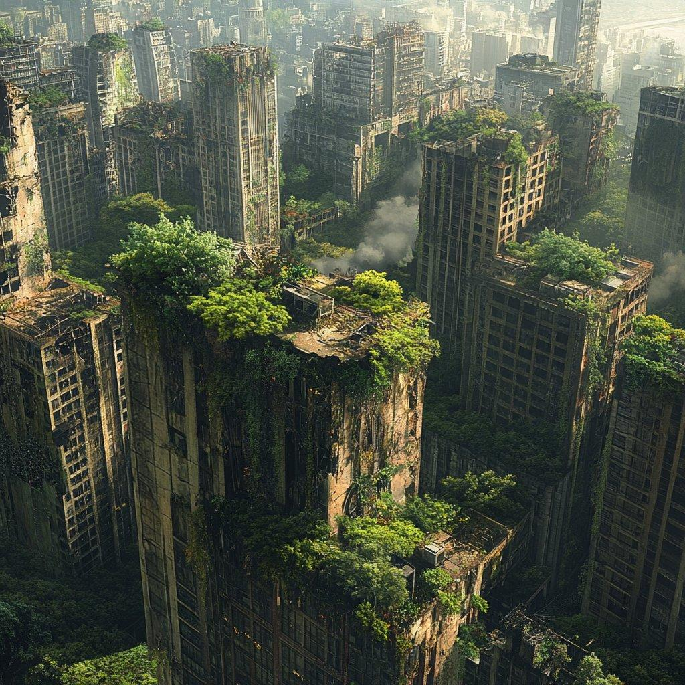

# 《萬界風月樓》世界檔案 08｜遺星界（末世遺跡文明）

> 本文件為《萬界風月樓》諸天九界之第八界詳細設定。世界架構與創作規則遵循 [小說創作總綱](../world_bible.md)。

---

## 一、世界基本概況

* **世界編號**：08
* **世界名稱**：遺星界
* **文明類型**：大災變後末世廢土與遺跡超科技文明
* **一句話定位**：黃沙席捲鋼鐵廢墟、變異狂潮威脅存亡、人類於地下城苟延殘喘、探索舊日超科技遺產的末日試煉場。
* **世界格局**：
  三百年前的一場未知災變毀滅了曾高度發達的星球文明。如今地表充斥著高能輻射與變異凶獸；倖存人類依託「黑石鋼鐵要塞」、「綠洲避難所」與地下防空堡壘生存，獵人團冒死進入「舊日巨構遺產」挖掘科技核心。

---

## 二、力量體系與修煉機制

因基因受宇宙輻射刺激而覺醒的特異功能，結合舊時代外骨骼與高能裝備：

| 異能等階 | 標誌性能力與戰鬥規格 |
| :--- | :--- |
| **初醒級（E～D 階）** | 肉體力量暴增三倍，或感知力敏銳化，能熟練運用高斯步槍與動能匕首。 |
| **突變級（C～B 階）** | 掌握元素具象化（操縱烈焰、冰霜、電弧），或物質硬化，能正面搏殺中型異化巨蜥。 |
| **超凡領主（A 階）** | 精神念力移物、肉身超速自癒、短暫滯空，單人可鎮守一座前哨要塞基地。 |
| **天災天尊（S 階）** | 體內形成微型輻能聚變核心，引發區域性電磁風暴或焚天熔岩海，威脅大型掠奪者軍團。 |
| **造物主級（Ω 禁忌）** | 完美融合舊世界「普羅米修斯納米母核」，可徒手分解重組物質（末世僅存神話記載）。 |

---

## 三、廢土地理與核心陣營

1. **黑石鋼鐵要塞**：
   * 建立在舊時代重工業基地上的最後防禦堡壘，由「鋼鐵議會」與傭兵公會聯合執政。
2. **拾荒者反抗軍同盟**：
   * 游擊於廢土荒漠與鹽湖邊緣的流民聯盟，渴望建立公平生存的新聚落。
3. **淨化者血狂教派**：
   * 盲目崇拜輻射異變的狂熱武裝組織，四處洗劫避難所，將正常人類視為「不潔祭品」。
4. **舊日地宮零號核心**：
   * 隱藏在地下一千公尺的前文明終極研究基地，據傳藏有能夠徹底淨化全界輻射的大型生態淨化發生器。

---

## 四、文明風貌與命名特色

* **文化特徵**：粗獷實用、資源至上、末路狂歡。純淨水與無污染罐頭是硬通貨。槍械彈藥改裝、焊接裝甲車、朋克重金屬是標誌元素。
* **命名風格**：
  * 地名以舊時代番號與災變特徵結合（如：輻光廢墟、第09死寂防區、鋼鐵墓碑、無水鹽磧）。
  * 武器與代號簡潔粗獷（如：「撕裂者重機槍」、「黑日狂風」、「鐵砧突擊車」）。

---

## 五、核心矛盾與世界事件

1. **最後淨水源枯竭**：黑石城維持地下農業的深井水脈遭受高濃度毒素污染，人類面臨三個月內斷水絕糧的滅頂之災。
2. **超級變異獸潮逼近**：廢土核心「赤色天坑」孕育出泰坦級巨型王獸，正率領百萬蟲群直撲黑石城防線。
3. **男主介入契機**：萬界樓豐沛的水源、靈糧與仙家辟穀丹如甘霖普降；男主一記仙法大神通瞬間蒸發整片變異獸潮，被廢土萬民奉為救世神祇。

---

## 六、女主群像與錨點契機（遵循 R19 原則）

* **葉紅衣（荒野第一獵人團團長・烈火薔薇）**：
  * **性格外貌**：紅髮高馬尾、身著做舊皮質戰術背心與迷彩長褲，英氣逼人、野性灑脫、重情重義。
  * **命運困境**：為救護避難所的一群孤兒，帶隊深入地宮零號遭遇埋伏，異能透支，瀕死之際被萬界樓神異之光接引。
* **顧青竹（前文明首席工程師遺孤・機械學者）**：
  * **性格外貌**：文靜清秀、性格倔強冷靜。戴一副戰術戰鬥目鏡，身負沉重便攜修復工具箱。
  * **故事線**：掌握啟動全界淨化塔的核心密碼晶片，遭受淨化者教派全地表追殺，在男主庇護下重拾復興文明的希望。

---

## 七、萬界樓互動與造化機緣

1. **遺星界回饋萬界樓**：
   * 輸出高密度壓縮能源晶塊、記憶合金鍛造技術、重力反轉裝置碎片。
2. **萬界樓賦能遺星界**：
   * 男主以造化仙術修復生態淨化發生器，驅散籠罩蒼穹的百年輻射塵埃，讓遺星界重現藍天與生機。
