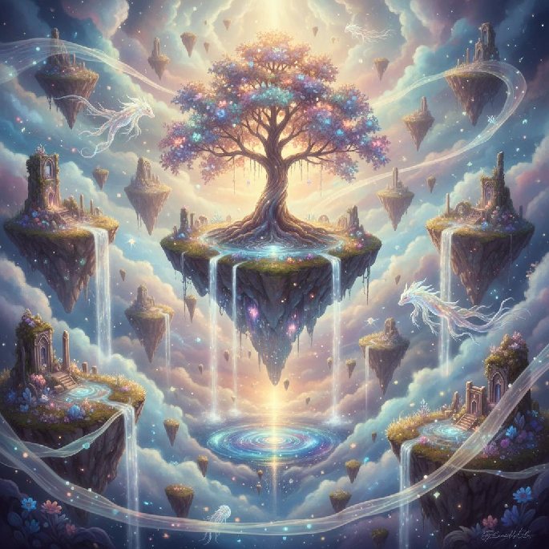
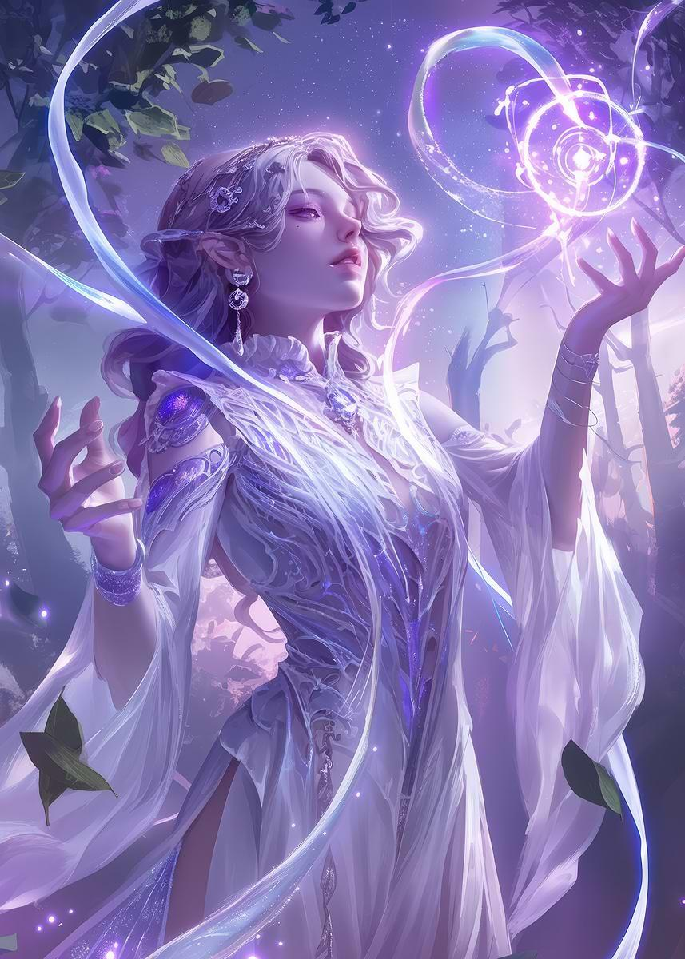

# 《萬界風月樓》世界檔案 09｜太虛界（特殊法則文明）

> 本文件為《萬界風月樓》諸天九界之第九界詳細設定。世界架構與創作規則遵循 [小說創作總綱](../world_bible.md)。

---

## 一、世界基本概況

* **世界編號**：09
* **世界名稱**：太虛界
* **文明類型**：心靈唯心、時空裂隙與因果宿命特殊法則文明
* **一句話定位**：莊周夢蝶虛實莫辨、時間長河在此分叉錯位、因果絲線交織成網的哲學概念之界。
* **世界格局**：
  太虛界沒有常規的陸地與海洋，其本質是由億萬生靈的集體潛意識、歷史回響與因果律交織而成的「時空夢織維度」。此界建築常隨觀測者的念頭而幻化重構，存在「永恆夢廊」、「因果天秤神殿」與「時光逆流迴隙」。

---

## 二、力量體系與修煉機制

以心靈意志的凝練度、觀測因果的能力及干涉時空維度的權能為進階標準：

| 法則位階 | 核心心境與神通表現 |
| :--- | :--- |
| **觀想境（凝形幻真）** | 意志定於一心，可在虛空中憑空觀想造物（如凝出實體兵刃、幻象身軀）。 |
| **破妄境（洞悉虛實）** | 雙眼看破一切物理幻覺與精神迷障，不受世俗心魔幻境侵擾。 |
| **時空刻痕（時滯與躍遷）** | 捕捉空間摺疊點，於周身三丈內短暫減緩或加速時間流速，實現虛實瞬移。 |
| **因果織者（撥弄命線）** | 雙眸能看見生靈之間延伸出的因果金色絲線，可微調機緣巧合，以因導果。 |
| **太虛主宰（真假互易）** | 達至「無我無相、萬物皆虛」之境，一念將真實化作夢境抹除，一念將虛妄化作永恆現世。 |

---

## 三、維度格局與核心聚落

1. **因果天秤神殿**：
   * 矗立在因果海中央的懸浮白玉宮，由歷代「司命」鎮守，負責維繫諸天因果天平的平穩。
2. **永恆夢廊・琉璃宮**：
   * 由億萬美夢結晶鋪就的縹緲仙境，夢境織造者在此守護眾生靈魂不被夢魘撕碎。
3. **破碎時鐘之淵**：
   * 時間法則紊亂的崩塌區域，一秒內可經歷千年枯榮，亦可令人陷入永恆的時間循環死劫。
4. **真實之錨聚落**：
   * 少數保留著物質物理法則的「島礁」，供異界穿越者與迷失靈魂落腳暫歇。

---

## 四、文明風貌與命名特徵

* **文化風貌**：縹緲超然、充滿哲理思辨、如夢如幻。此界居民行事不著痕跡，談笑間可能已借夢境交鋒千萬回合。
* **命名風格**：
  * 概念與地名帶有抽象美學色彩（如：忘川之渡、剎那浮光、溯流之涯、無生幻城）。
  * 招式與法名富有禪意與宿命感（如：「一念三千」、「溯雪回光」、「緣起生滅譜」）。

---

## 五、核心矛盾與世界事件

1. **存在抹消大危機**：太虛界時空因果絲線遭遇未知災變侵蝕斷裂，部分歷史節點與生靈開始被世界意志完全「抹殺遺忘」，宛若從未存在。
2. **夢魘心魔古神復甦**：潛意識底層的恐懼與殺戮欲望凝聚成吞噬一切的黑色夢魘，企圖侵蝕因果神殿，將虛實逆轉。
3. **男主介入契機**：萬界樓作為諸天樞紐，本身就是超越因果時空的永恆錨點；男主真靈不滅、不受太虛因果反噬，成為撫平太虛大劫的唯一變數。

---

## 六、女主群像與錨點契機（遵循 R19 原則）

* **夢無痕（永恆夢廊守護仙子・夢境織者）**：
  * **性格外貌**：白衣若仙、身姿空靈縹緲、氣質純淨如初雪。能隨意在眾生夢境中穿梭，卻從未有過屬於自己的真實心動。
  * **命運困境**：為抵禦黑夢魘侵蝕，自身靈魂即將化道融入夢網，男主的闖入為她帶來了永恆的真實溫度。
* **司命（因果天秤神殿盲眼聖女）**：
  * **性格外貌**：白紗遮雙眸、素手撫命盤、清冷淡泊、洞悉萬物興亡。
  * **故事線**：一生算無遺策，卻在男主跨界而來的瞬間，推演命盤第一次徹底停擺、因果天秤為之劇烈傾斜，從此心生波瀾。

---

## 七、萬界樓互動與造化機緣

1. **太虛界回饋萬界樓**：
   * 輸出時空因果絲線、夢境具象石、太虛幻神玉、因果律防護屏障技術。
2. **萬界樓賦能太虛界**：
   * 男主以《太上玄奼真經》心境共鳴與萬界樓主之尊，為太虛界釘下九尊「萬古不朽時空錨點」，阻止存在抹消，助夢無痕與司命超脫命運擺布。
