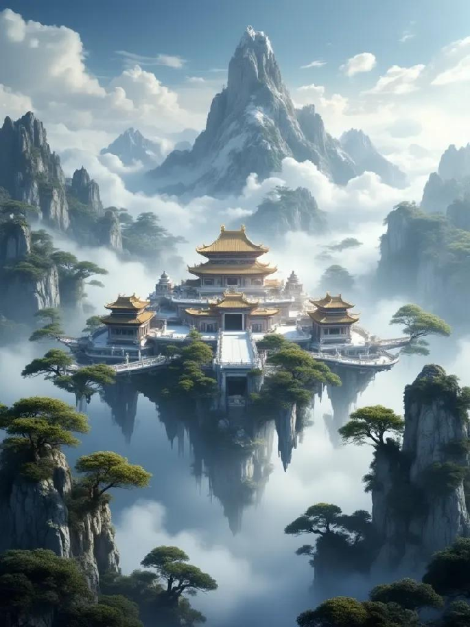

# 《萬界風月樓》諸天九界總覽

> 本目錄收錄《萬界風月樓》前期重點探索之「九個代表性主要世界」的詳細設定檔案。
> 相關世界觀原則與創作規範請參閱：[小說創作總綱（世界觀總綱）](../../README.md)。

---

## 一、九大代表性世界導航

根據創作總綱原則（**R19：一界多女主與世界群像原則**、**R20：男主主動護送與參與原世界原則**），這九個世界是故事前中期逐步探索的代表性文明板塊，並非僅有的九個世界，每一界均有獨立的文明、歷史、力量體系與世界群像。

| 編號 | 世界名稱 | 文明類型 | 核心能量／力量體系 | 故事核心主題 | 正文狀態 | 詳細設定檔案 |
| :---: | :--- | :--- | :--- | :--- | :---: | :---: |
| **01** | **青玄界** | 修仙文明 | 靈氣、道胎、丹嬰化神 | 宗門興衰、斷脈危機、古仙傳承 | ✅ 卷一、三、六主場（卷二、四聯動） | [01_qingxuan.md](./01_qingxuan.md) |
| **02** | **滄瀾界** | 高武異能玄幻文明 | 經脈氣血、內罡真意、神兵天人合一 | 江湖恩怨、皇權更迭、武林秩序 | ✅ 卷二、六主場（卷三、四聯動） | [02_canglan.md](./02_canglan.md) |
| **03** | **艾瑟蘭** | 魔法文明 | 以太魔網、平衡奧術、自然共鳴、聖光戰技 | 奧術真理、世界樹新生、泰坦平衡核心 | ✅ 卷七主場（四號雙向星門穩固） | [03_aetherland.md](./03_aetherland.md) |
| **04** | **諾瓦星域** | 星際科技文明 | 仿生工程、基因培育、星網分散運算、第二生命計畫 | 生命之問、人工生命自主權、利維坦未解之謎 | ✅ 卷八主場（五號雙向星門穩固） | [04_nova.md](./04_nova.md) |
| **05** | **九曜神域** | 神話文明 | 信仰神火、神格神職、至高神權 | 古神黃昏、信仰濁化、神座爭奪 | ✅ 卷四、六主場 | [05_jiuyao.md](./05_jiuyao.md) |
| **06** | **幽羅界** | 魔族文明 | 真魔血脈、九幽煞氣、深淵暗蝕 | 王庭內戰、血脈退化、深淵異變 | ⬜ 尚未開寫 | [06_youluo.md](./06_youluo.md) |
| **07** | **滄溟界** | 海洋文明 | 潮汐之源、鮫珠龍魄、海皇神權 | 萬丈濁潮、深海古神、海域霸權 | ⬜ 尚未開寫 | [07_cangming.md](./07_cangming.md) |
| **08** | **遺星界** | 末世遺跡文明 | 基因異能、輻射武裝、舊日超科技 | 廢土生存、淨化危機、文明復興 | ⬜ 尚未開寫 | [08_yixing.md](./08_yixing.md) |
| **09** | **太虛界** | 特殊法則文明 | 心識投影、時空裂隙、因果天秤 | 記憶迷宮、存在抹消、夢境成真 | ⬜ 尚未開寫 | [09_taixu.md](./09_taixu.md) |

---

## 二、世界架構與創作規則摘要

1. **獨立文明原則**：每個世界不是男主或女主的靜態舞台，而是具有自身歷史、勢力糾葛、經濟體系與運行法則的完整世界。
2. **世界群像與多女主（R19）**：單一世界內可存在多位不同陣營、性格與身分的女性角色，她們各自擁有獨立的人生追求與困境，不得將世界矮化為單一女主的專屬背景。
3. **主動護送與介入（R20）**：當女主回歸原世界時，男主會主動護送並深度參與該世界的事件、宗門紛爭與機緣發掘，逐步確立萬界樓在各界的影響力與威望。
4. **法則互補與轉化**：各世界力量體系表面不相通，但能透過萬界樓的陰陽合一本源進行解析、調和與賦能，創造出獨步諸天的跨界戰力與造化機緣。
5. **萬界非僅九界**：萬界樓連接無盡諸天，目前收錄之九界僅為古樓大劫後前期初步探索與定義之九大代表性界域，絕非萬界樓極限。未來隨著古樓修復、本源充盈與道標拓寬，將陸續解鎖更多未知宇宙與文明（例如第五卷規劃安插之九界外獨立世界「**無序荒界**」，屬於遠古天地法則崩解之真實世界，暫不列入前期九界編號，詳見 [第五卷方向草案](../arcs/05/README.md)）。
6. **跨界通行權限階梯**：跨界通行並非一蹴可幾，而是隨女主與樓主《太上玄奼真經》之生命共鳴與陰陽契合深度逐步授予（初入樓尚無通行權，深層共鳴後方可取得自主跨界與往返之能，詳見總綱第七章與第九章）。
